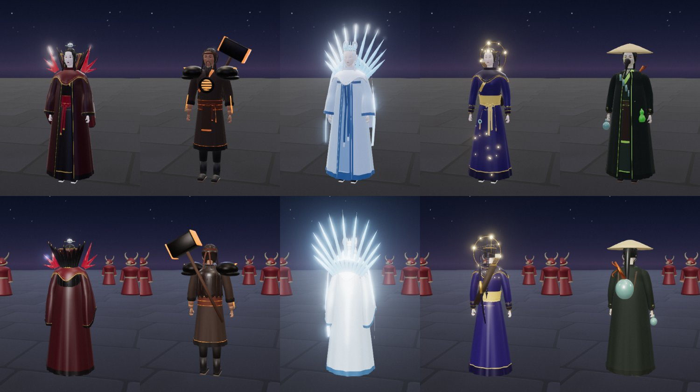

# VFX Tool documentation

The knowledge base for VFX Tool, a browser-based real-time VFX editor (Three.js 0.186, Vite, TypeScript). It holds
204 effects (plus 13 test spells for the combat mechanics): particle presets, set pieces, cinematic hero spells and twenty playable MOBA hero kits with rigged hero
models. Start with the guide if you want to use the tool, the architecture section if you want to change it, and
the art direction and pipeline sections if you want to make new effects the way the existing ones were made.

## Map of content

### Guide (use the tool)
| Page | What it answers |
|---|---|
| [Using the tool](guide/using-the-tool.md) | How to run it, the modes (particles, effects, targeted arena, play mode, hero mode), every control and key |

### Architecture (change the tool)
| Page | What it answers |
|---|---|
| [Overview](architecture/overview.md) | How `main.ts` builds, plays, updates and renders effects; post chain; distortion; screen feedback; the `vfx` debug handle |
| [Effects and parts](architecture/effects-and-parts.md) | The `Effect` / `EffectModule` contract and every shared part (core kit and the hero-kit parts files) |
| [Targeting and arena](architecture/targeting-and-arena.md) | `CastContext`, targeting modes, the arena (caster, enemies, HP, hits), danger zones |
| [Hero mode](architecture/hero-mode.md) | The MOBA test mode: input, aim, cooldowns, HUD, hero switching, overlapping spells, hero figures |
| [Hero identity layer](architecture/traits.md) | Passives, own resources, hold / recast / ammo inputs, stacks, per-hero attacks and walk speeds, buffs and debuffs; how a duel hit is resolved; online rules |
| [Basic attacks](architecture/attacks.md) | Right-click attack, A attack-move, S stop; melee swing and ranged homing bolt; blind, stun and shield rules; the attacker in hero mode and the duel AI |
| [Duel arenas](architecture/arenas.md) | The five arenas (layouts, looks, stages), how a duel picks one (random, or from the match id online), and the rules for a new arena |
| [Combat mechanics](architecture/mechanics.md) | Statuses, shield / heal / dash, skillshots, summons, melee kits, the duel AI rules, the test kits and the tournament tool |
| [Models](architecture/models.md) | The Blender pipelines for weapons and hero figures, and how the game loads and poses them |
| [Multiplayer duel game](architecture/multiplayer.md) | `/game.html`: the game server (accounts, lobbies, queue, referee), the protocol, network matches, the ring's pillars and walls, line of sight |
| [Research: MOBA design](research/moba-design.md) | What defines a MOBA, what short formats (HotS, LoL Arena, Battlerite) kept and cut, and seven recommendations for our 1v1 duel |
| [Research: game networking](research/game-networking.md) | Lockstep, authoritative server + prediction, rollback, lag compensation; real tick rates; a three-stage path for our netcode |

### Art direction (how it should look)
| Page | What it answers |
|---|---|
| [Art bible](ART_BIBLE.md) | Our look, palette rows (one per element and hero kit), shape language, the artist's workflow, the do/don't table |
| [VFX principles](VFX_PRINCIPLES.md) | The technique checklist: shape → timing → colour, layering, impact frames, readability |
| [Weapon VFX guide](WEAPON_VFX_GUIDE.md) | Looping weapon "enchant" auras, learned from a reference set |

### Pipeline (how effects are made)
| Page | What it answers |
|---|---|
| [Workflow](pipeline/workflow.md) | From idea to registered effect: design note, build, review rounds, registration, sweep, records |
| [Review tools](pipeline/review-tools.md) | Contact sheets, the self-test, the full sweep, decoding, browser-pane gotchas |
| [Spell brief](SPELL_BRIEF.md), [Targeted spell brief](TARGETED_SPELL_BRIEF.md), [Refine brief](REFINE_BRIEF.md), [Weapon aura brief](WEAPON_AURA_BRIEF.md) | The briefs given to worker agents that write or polish effects |
| [Hero kit rules](../pipeline/designs/kit-common.md) | The shared rules every hero kit follows (files, MOBA timing, look lessons) |

### Catalog (what exists)
| Page | What it answers |
|---|---|
| [Effects](catalog/effects.md) | Every registered effect by category, with links to source, design note and contact sheet |
| [Heroes](catalog/heroes/README.md) | The twenty heroes and their kits: Vesper (blood), Brannoc (forge), Isolde (frost), Lyra (astral), Vex (alchemy), Kaia (storm), Sefu (sand), Nyx (shadow), Fenna (grove), Auriel (dawn), Marin (tide), Zephyr (sky), Mortis (bone), Ada (clockwork), Opaline (prism), Sirix (hive), Cantor (bard), Oblivion (void), Shiori (ink), Tempo (chrono) |

### Knowledge (what we learned)
| Page | What it answers |
|---|---|
| [Lessons](knowledge/lessons.md) | Technical gotchas and fixes (shaders, post passes, instancing, materials, the browser pane) |
| [Glossary](knowledge/glossary.md) | The project's words: impact frame, telegraph, foil, dead beat, kit, lingering, ... |

### Project state
| Page | What it answers |
|---|---|
| [Status](STATUS.md) | The hand-over: what is done, in progress, blocked, waiting on the user, known issues, next steps |

## Where things live
| Path | Contents |
|---|---|
| `src/` | The app: `main.ts`, `arena.ts`, `heroMode.ts`, `heroes.ts`, `duel.ts`, `obstacles.ts`, `kits/`, `effects/` (framework, parts, weapons), `spells/` (effects by family), `game/` + `net/` (the duel game page) |
| `server/` | The duel game's Node server (`game-server.mjs`, `accounts.mjs`, `standalone.mjs`, `smoke-test.mjs`); accounts in `server/data/` (git-ignored) |
| `game.html` | The duel game's page (the editor is `index.html`) |
| `worker/`, `wrangler.jsonc` | The Cloudflare deployment (Worker + Durable Object running `server/hub.mjs`) |
| `public/models/` | Exported models: `weapons/`, `figures/`, `heroes/` |
| `blender/` | Blender scripts that build the models (`weapons/`, `heroes/`) |
| `pipeline/` | The effect pipeline: `designs/` (one note per effect or kit), `library/` (reference breakdowns), `forged.json` (record of forged effects), `tools/` (review tools) |
| `docs/` | This knowledge base; `spells/` (contact sheets), `heroes/` (concept and model sheets), `weapons/` (weapon sheet) |
| `.claude/skills/forge-vfx/` | The `/forge-vfx` skill (prompt-to-effect pipeline) |

## How to keep this current
- A new effect: its design note in `pipeline/designs/`, a row in [catalog/effects.md](catalog/effects.md), an entry
  in `pipeline/forged.json`.
- A new hero kit: a page in `catalog/heroes/`, a palette row in the art bible, an entry in `src/heroes.ts`.
- A new lesson: a row in the art bible's do/don't table (look) or in [knowledge/lessons.md](knowledge/lessons.md)
  (technique).
- Every session: [STATUS.md](STATUS.md).
