# Arena of Kits: pictures and clips

The game as it looks on 2026-11-11: all 39 heroes in the new realistic style and four new arenas. The same files are
on the game's News page (https://arena-of-kits.arenachamp.workers.dev/game, then News) and live in
[`public/news/`](../public/news/). Clips play when opened: GitHub shows them in its own player.

## Clips

| | |
|---|---|
| [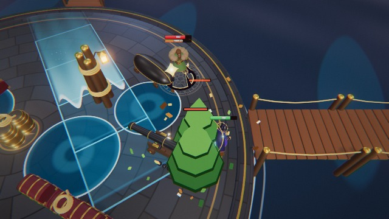](../public/news/duel4.mp4) | **[A real duel](../public/news/duel4.mp4)** (6 s). Lyra and Hank, both played by the computer, on the Drowned Harbour: a wave washes across the quay, tide pools stand on the floor. |
| [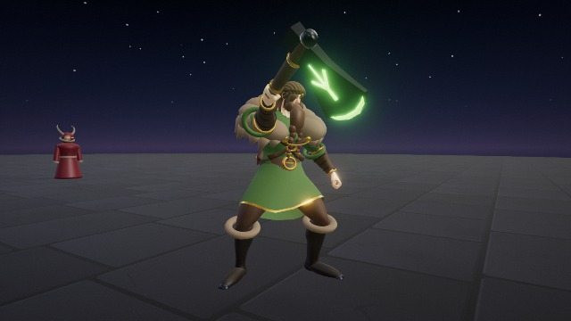](../public/news/attack4.mp4) | **[Attacks](../public/news/attack4.mp4)** (3 s). Hank's axe chop, twice. |
| [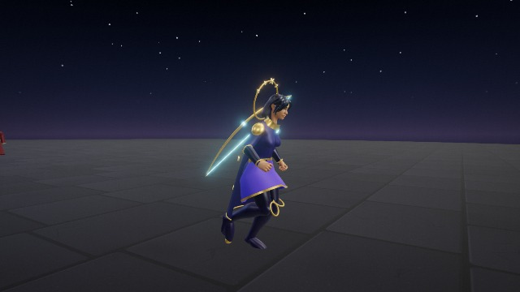](../public/news/run4.mp4) | **[Running](../public/news/run4.mp4)** (2 s). Lyra runs with her bow. |

## Photos

**The login picture:** eight heroes on the Drowned Harbour's quay (`public/login-bg.jpg`, made with `pipeline/tools/key-art.js`).

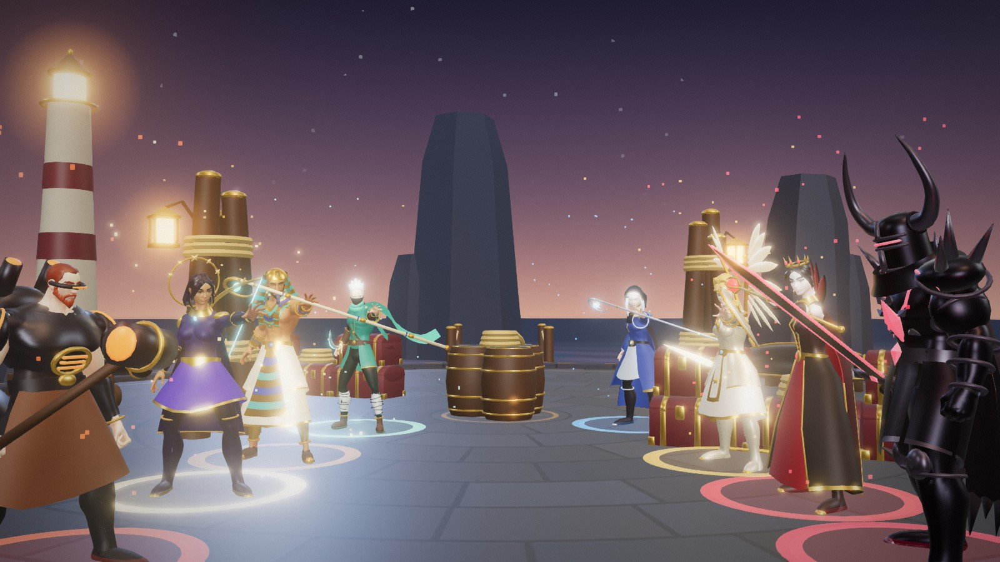

**All 39 heroes.**

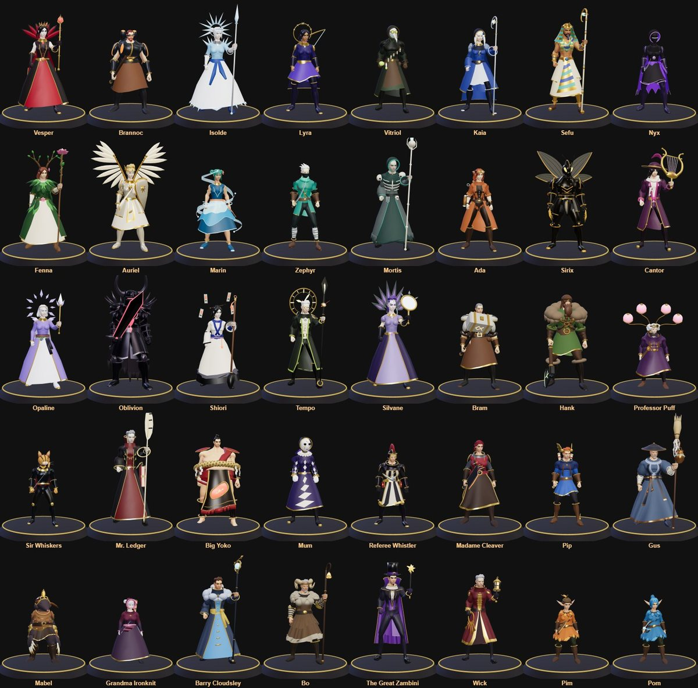

**The four new arenas.**

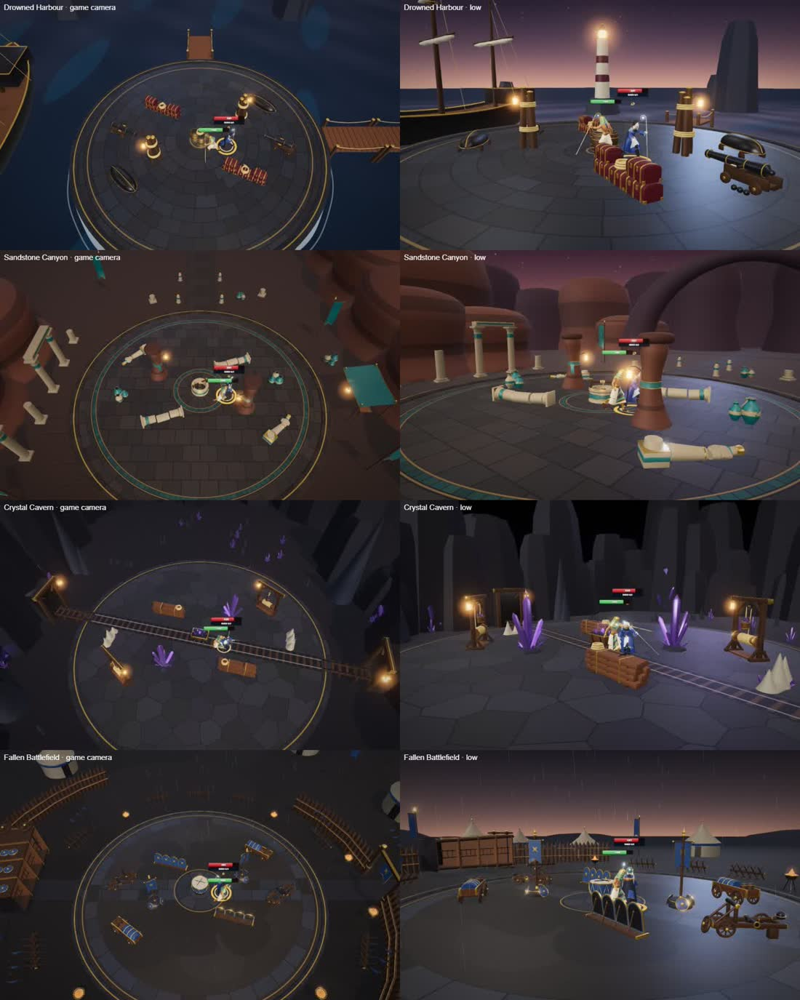

**Their events and their late stages.**

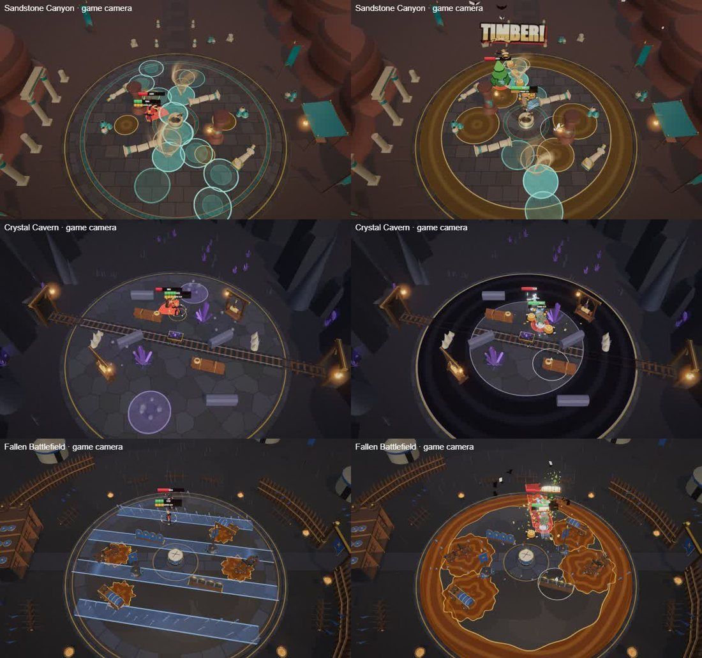

**The Play screen.**

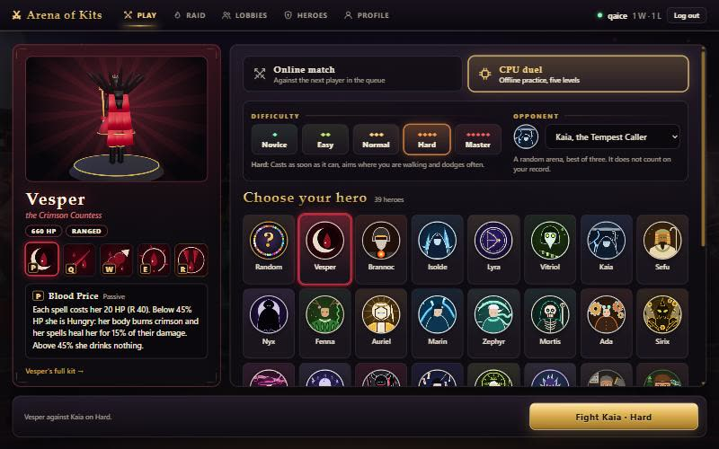

**The Raid: the hall of Noonfall,** where you step onto an altar to take an upgrade between bosses.

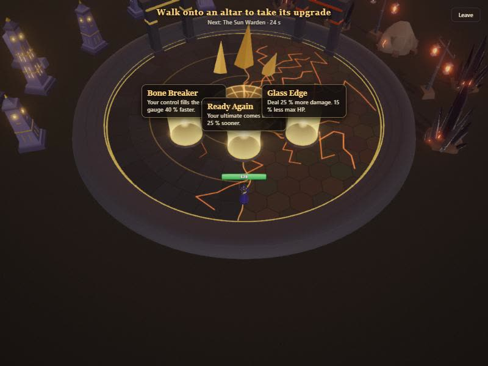

**The Raid: the Sun Warden** sweeps beams across his court.

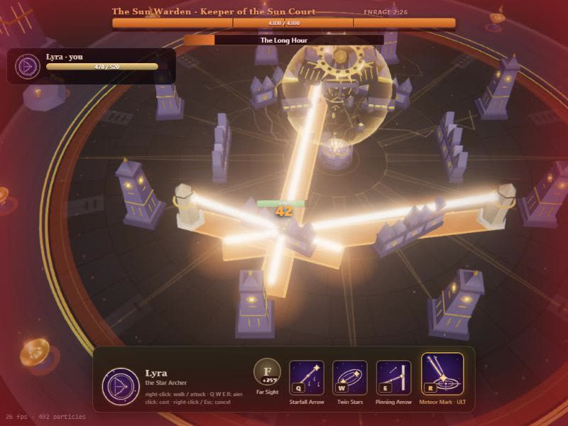

**An arena late in a round.** Night Temple with its walls down and sunfire on the outer floor.

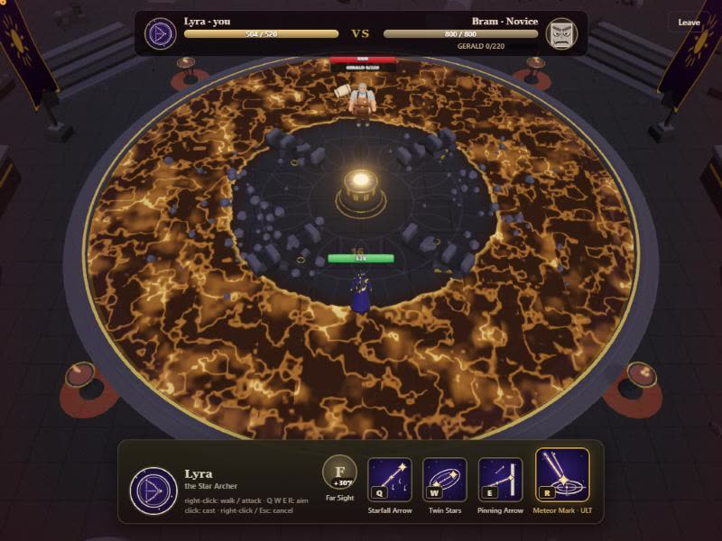

## Before the new look

The pictures and clips of 2026-11-10 and earlier (older hero models) stay on the News page under their releases:
`fight`, `attack`, `run`, `stances.jpg`, `heroes.jpg` in [`public/news/`](../public/news/).
