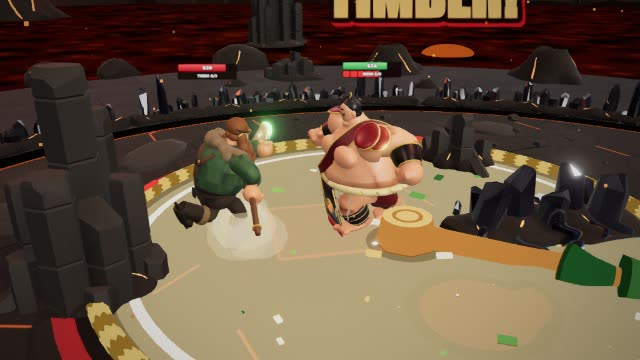
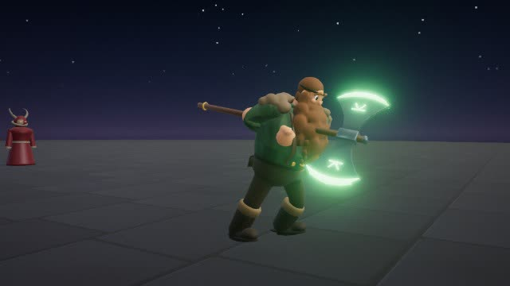
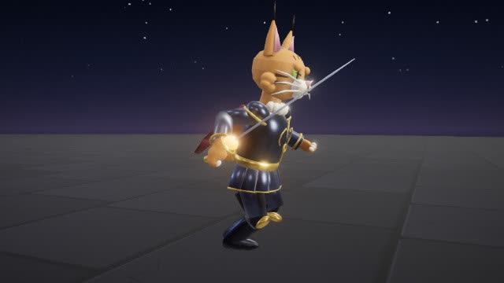
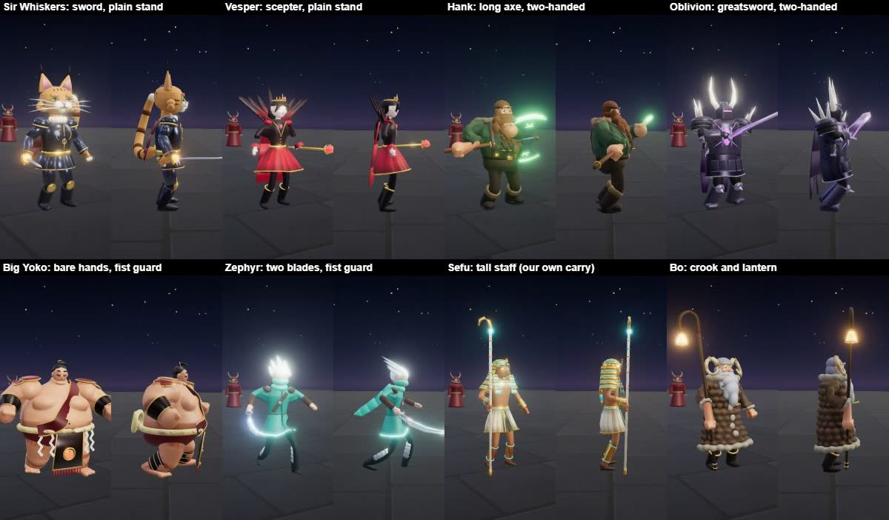
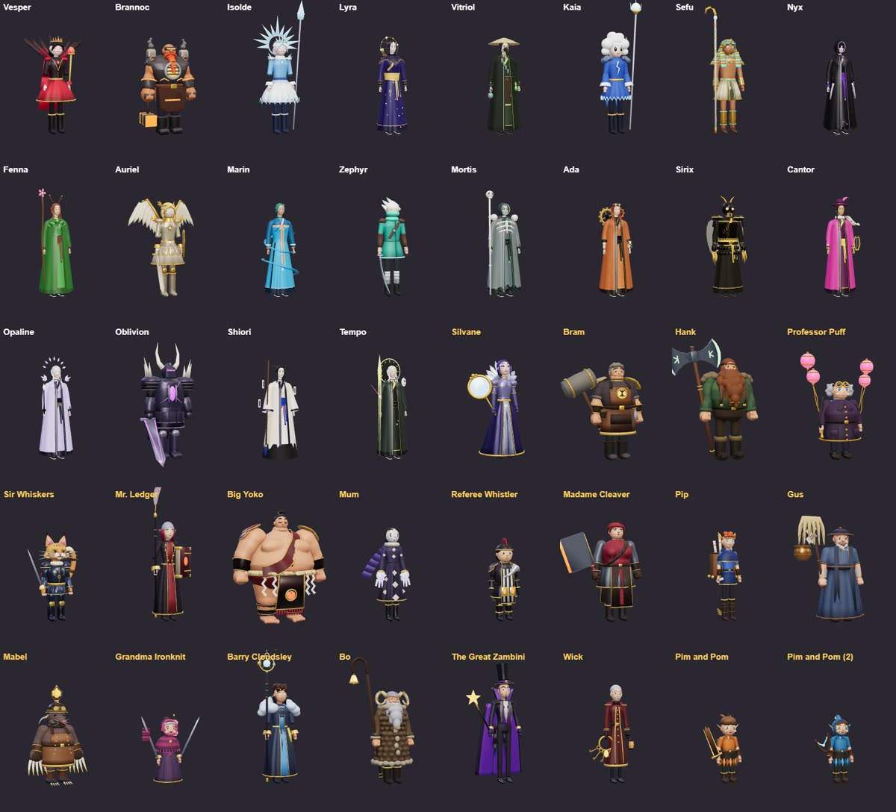

# Arena of Kits: pictures and clips

The game as it looks on 2026-11-10. The same files are on the game's News page
(https://arena-of-kits.arenachamp.workers.dev/game, then News) and live in [`public/news/`](../public/news/).
Clips play when opened: GitHub shows them in its own player.

## Clips

| | |
|---|---|
|  | **[A real duel](../public/news/fight.mp4)** (5 s). Big Yoko and Hank, both played by the computer, in Ember Caldera. |
|  | **[Attacks](../public/news/attack.mp4)** (6 s). Hank's two-handed axe chop, then Oblivion's greatsword slice. |
|  | **[Running](../public/news/run.mp4)** (2 s). Sir Whiskers runs with his rapier. |

## Photos

**The heroes' stances.** Each hero stands in the stance for what it holds: one blade, two hands on a big weapon, fists up, a tall staff.

**All 39 heroes.**

**The Play screen.**

**The Raid: the hall of Noonfall,** where you step onto an altar to take an upgrade between bosses.

**The Raid: the Sun Warden** sweeps beams across his court.

**An arena late in a round.** Night Temple with its walls down and sunfire on the outer floor.

