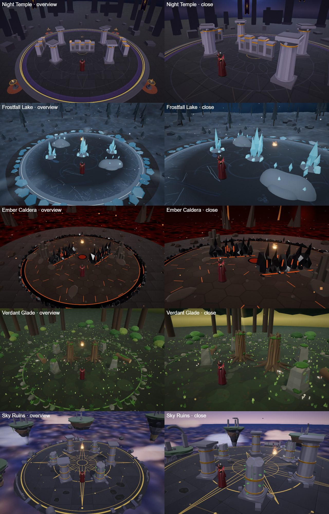
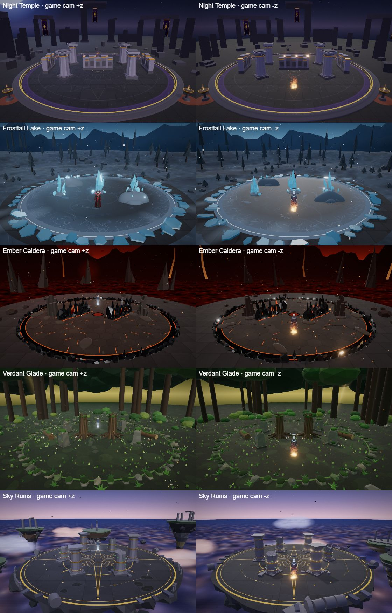

# Duel arenas

Every duel (the AI duel and the network duel) is fought in one of five arenas, picked at random each round. An
arena is a cover layout, a set of meshes and a stage (sky, fog, lights) around the same ring. The design sheet with
each arena's look and layout is [pipeline/designs/arenas.md](../../pipeline/designs/arenas.md).

From the two gameplay cameras (a network player on side 1 looks from the other end):

| Id | Name | Cover | Look |
|---|---|---|---|
| `temple` | Night Temple | a low sun altar in the middle, four angled screen walls round it, six side columns (`TEMPLE_OBSTACLES`) | moonlit temple court: engraved floor with a sun-wheel, stepped gold-lined curb, four braziers, sculpted fluted columns, carved screen walls and the altar (props from `blender/arenas/temple_props.py`); sculpted, painted backdrop from `blender/arenas/temple_backdrop.py` (`temple_backdrop.glb`): two grand ruined gates on stepped platforms (one pylon snapped, broken lintel with a gold sun disc, ruined side walls), colonnade arcs of whole and broken columns with architraves, hooded guardian statues on the sides, obelisks and banner poles flanking the gates, stair fragments, fallen drums and rubble heaps (placements merged per material, the rubble instanced; every vertex checked against the camera rule); one instanced banner cloth rippling in the wind, pale moon sprite, incense motes |
| `frost` | Frostfall Lake | a low frozen boulder in the middle, two long snow drifts guarding the starts, two short drifts in the far corners, four ice spires (two flanking the middle, two taller on the wings) (`FROST_OBSTACLES`) | two-layer frozen lake (cracks, bubbles, frozen fish), sculpted chiselled rock, wind-carved drifts with rocks and ice shards, faceted ice-crystal spires (props from `blender/arenas/frost_props.py`), a backdrop of broken shore ice plates and pressure ridges, snow-capped boulders and rocks, scrub pines, frozen dead trees, a snow-laden pine forest and far chiselled peaks (`blender/arenas/frost_backdrop.py`, tall props only beyond 26 m or at \|x\| > 12, checked per vertex), a dimmed sculpted snowfield, a mountain silhouette, faint aurora, snow and ground mist |
| `caldera` | Ember Caldera | an open middle (the lava vent), two low obsidian ridges flanking the middle lane, two tall basalt column clusters and two low clusters of snapped stumps off the z axis, two tall bladed obsidian ridges on the wings (`CALDERA_OBSTACLES`) | hex basalt with glowing cracks and cooled lava flows, glossy faceted obsidian ridges and chiselled hexagonal basalt columns with joints and worn tops, on cooled lava crust with small glowing cracks (props from `blender/arenas/caldera_props.py`); outside: a sculpted jagged obsidian lip round the ring, basalt prism clusters, cooled-lava boulders and small vents on the apron, lava-crusted spires in the lava lake (with bubbles), big vents under the smoke columns, a chiselled crater wall of basalt segments with thin lava falls (props from `blender/arenas/caldera_backdrop.py`), embers and ash |
| `glade` | Verdant Glade | a great fallen log across the middle (low), two broken giant stumps off its ends, two carved rune stones off the starts, two giant mushroom clusters beside the middle, two fallen trunks with upturned root plates on the wings (`GLADE_OBSTACLES`) | moss floor with grass, flowers and small mushrooms; sculpted, painted cover (grooved bark with roots and splintered breaks, chiselled stones with faint carved runes, moss draped on top surfaces) and backdrop (mossy rim stones, ferns, rocks, bushes, tall trees and dead snags) from `blender/arenas/glade_props.py` (`glade_props.glb`, `glade_backdrop.glb`, merged into one mesh per material); far forest wall and canopy, god rays, fireflies and falling leaves |
| `skyruins` | Sky Ruins | two low broken drum stacks flanking the middle on the cross axis, two low balustrade fragments off the starts, two tall intact columns and two tall broken columns off the z axis, two broken arch bases on the wings (`SKYRUINS_OBSTACLES`) | floating slate-marble platform with a gold compass-rose inlay and worn tiles; sculpted, painted cover (fluted marble drums with chipped rims, capitals with volutes, pale fresh-marble breaks with shards, gold neckings and imposts, ivy vines with leaves spiralling up the shafts) and backdrop (broken edge balustrade, slate edge blocks, two toppled columns, rocks hanging under the edge, floating rocky islands with a ring of columns, a temple and a great broken column, the big broken arch on its islet, loose floating rocks) from `blender/arenas/skyruins_props.py` (`skyruins_props.glb`, `skyruins_backdrop.glb`; unique placements merged into one mesh per material, the edge pieces instanced); sea of clouds, cloud puffs, birds |

## Code

- [src/arenas/types.ts](../../src/arenas/types.ts): `ArenaDef` (`id`, `name`, `obstacles`, `stage`, `hideGround?`,
  `build()`), `ArenaScene` (`group`, `update?`, `dispose?`) and `ArenaStage` (sky dome colours and stars, fog
  colour and range, hemisphere, sun and rim light colours and intensities).
- [src/arenas/index.ts](../../src/arenas/index.ts): `ARENAS` (fixed order), `arenaById`, `pickArena(seed?)`.
- One file per arena (`temple.ts`, `frost.ts`, `caldera.ts`, `glade.ts`, `skyruins.ts`); shared helpers in
  [common.ts](../../src/arenas/common.ts) (`RING`, `DEFAULT_STAGE`, `flatRing`, `floorDisc`, `canvasTexture`,
  `seeded`, `shadowed`, `disposeTree`). Collision capsules use `pillar` / `wall` from
  [obstacles.ts](../../src/obstacles.ts).

## How a duel uses it

- `Duel.start()` (AI duel) picks `arenaById(duel.arenaChoice)`, or a random arena when `arenaChoice` is `'random'`
  (the default), and shows the arena's name as a banner in play mode.
- `Duel.startNet()` takes `arena` (the match id from `match_start`, passed by [match.ts](../../src/game/match.ts))
  and picks with `pickArena(seed)`: a hash of the id, so both players get the same arena with no server change.
  The arena name shows in the "Waiting for opponent" banner.
- `Duel.setup()` calls `useArena(def)`: it builds the arena's meshes (freeing the previous arena's), sets
  `arena.obstacles = def.obstacles`, calls `host.setStage(def.stage)` and hides the slab floor for `hideGround`
  arenas (`arena.showGround`). `Duel.update` drives `ArenaScene.update` (snow, embers, fireflies, clouds).
  `Duel.stop()` puts back the default stage and the floor.
- runtime.ts `setStage` changes the sky dome uniforms, `scene.background`, the fog colour and range and the three
  lights in place (the cinematic camera toggles the same objects by reference).

The ring itself never changes: centre (0, 7), radius 12, starts at (0, 13) and (0, 1). `arena.bounds`, the AI,
the hero-mode camera focus and the network position stream all assume it.

## Rules for a new arena

- Point-symmetric cover about (0, 7); starts clear for 3 m; nothing within 1.5 m of the rim; gaps ≥ 2 m; no
  pockets; pillar r ≤ 1.0. Every obstacle mesh covers its capsule.
- Floors in the luminance band of the temple disc (`0x15131a`): ultimates darken the world to 0.55 and the kits'
  dark layers need a dark floor. Emissive details small and under bloom.
- Camera rule: anything taller than 2 m is more than 26 m from the centre or off the z axis (|x| > 12); the
  gameplay camera can sit at either end of the z axis.
- ≤ ~60 draw calls, ≤ 400 particles, no extra lights; `dispose()` frees everything.
- Tools: `vfx.duel.arenaChoice = '<id>'` pins the arena for AI duels and `_tourney` runs; see the sheet render in
  the arena section of `docs/STATUS.md` for the review camera positions.

## Limits

- The live Cloudflare build still has only the temple until the deploy freeze is lifted. The arena choice needs no
  server change, but both players must run a client that has the arenas, or they would see different cover.
