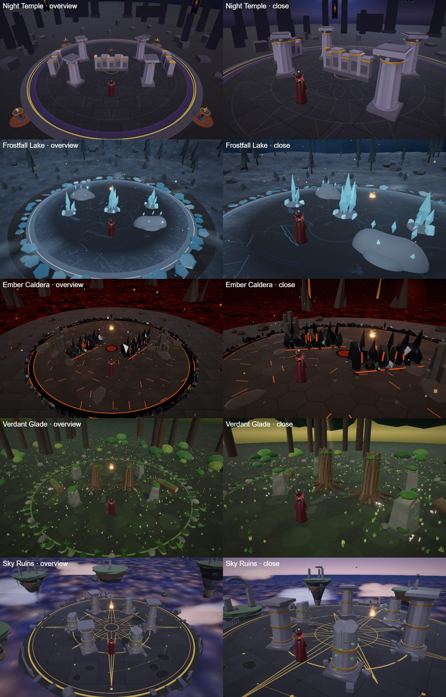
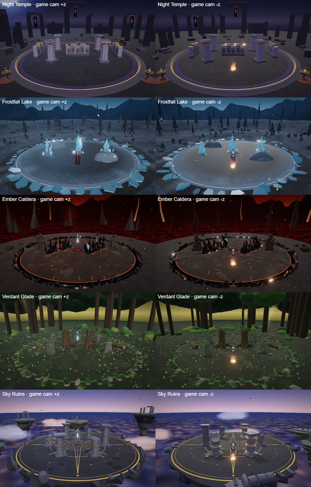

# Duel arenas

Every duel (the AI duel and the network duel) is fought in one of five arenas, picked at random each round. An
arena is a cover layout, a set of meshes and a stage (sky, fog, lights) around the same ring. The design sheet with
each arena's look and layout is [pipeline/designs/arenas.md](../../pipeline/designs/arenas.md).

From the two gameplay cameras (a network player on side 1 looks from the other end):

| Id | Name | Cover | Look |
|---|---|---|---|
| `temple` | Night Temple | centre wall, four diagonal pillars, two side walls (`DUEL_OBSTACLES`) | moonlit temple court: engraved floor with a sun-wheel, stepped gold-lined curb, four braziers, fluted columns and carved screen walls, ruined gates, colonnades and banners, incense motes |
| `frost` | Frostfall Lake | a central ice spire, two crystal clusters, two snow-drift ridges | two-layer frozen lake (cracks, bubbles, frozen fish), wind-carved drifts, broken ice plates at the shore, sculpted snowfield, pine forest, mountains, faint aurora, snow and ground mist |
| `caldera` | Ember Caldera | two long obsidian ridges forming a diagonal lane, two basalt column clusters | hex basalt with glowing cracks and cooled lava flows, jagged obsidian lip, basalt prisms, crater wall with lava falls, lava lake with bubbles, smoke columns, embers and ash |
| `glade` | Verdant Glade | two broken tree trunks, four carved standing stones, two fallen logs | moss floor with grass, flowers and mushrooms, mossy stone ring with ferns, rooted trunks with vines, weathered rune stones, forest wall and far canopy, god rays, fireflies and falling leaves |
| `skyruins` | Sky Ruins | six broken marble columns on a circle of radius 6 | floating slate-marble platform with a gold compass-rose inlay and worn tiles, columns with capitals and ivy, broken balustrade, sea of clouds, rocky floating islands with ruins, a broken arch, birds |

## Code

- [src/arenas/types.ts](../../src/arenas/types.ts): `ArenaDef` (`id`, `name`, `obstacles`, `stage`, `hideGround?`,
  `build()`), `ArenaScene` (`group`, `update?`, `dispose?`) and `ArenaStage` (sky dome colours and stars, fog
  colour and range, hemisphere, sun and rim light colours and intensities).
- [src/arenas/index.ts](../../src/arenas/index.ts): `ARENAS` (fixed order), `arenaById`, `pickArena(seed?)`.
- One file per arena (`temple.ts`, `frost.ts`, `caldera.ts`, `glade.ts`, `skyruins.ts`); shared helpers in
  [common.ts](../../src/arenas/common.ts) (`RING`, `DEFAULT_STAGE`, `flatRing`, `floorDisc`, `canvasTexture`,
  `seeded`, `shadowed`, `disposeTree`). Collision capsules use `pillar` / `wall` from
  [obstacles.ts](../../src/obstacles.ts).

## How a duel uses it

- `Duel.start()` (AI duel) picks `arenaById(duel.arenaChoice)`, or a random arena when `arenaChoice` is `'random'`
  (the default), and shows the arena's name as a banner in play mode.
- `Duel.startNet()` takes `arena` (the match id from `match_start`, passed by [match.ts](../../src/game/match.ts))
  and picks with `pickArena(seed)`: a hash of the id, so both players get the same arena with no server change.
  The arena name shows in the "Waiting for opponent" banner.
- `Duel.setup()` calls `useArena(def)`: it builds the arena's meshes (freeing the previous arena's), sets
  `arena.obstacles = def.obstacles`, calls `host.setStage(def.stage)` and hides the slab floor for `hideGround`
  arenas (`arena.showGround`). `Duel.update` drives `ArenaScene.update` (snow, embers, fireflies, clouds).
  `Duel.stop()` puts back the default stage and the floor.
- main.ts `setStage` changes the sky dome uniforms, `scene.background`, the fog colour and range and the three
  lights in place (the cinematic camera toggles the same objects by reference).

The ring itself never changes: centre (0, 7), radius 12, starts at (0, 13) and (0, 1). `arena.bounds`, the AI,
the hero-mode camera focus and the network position stream all assume it.

## Rules for a new arena

- Point-symmetric cover about (0, 7); starts clear for 3 m; nothing within 1.5 m of the rim; gaps ≥ 2 m; no
  pockets; pillar r ≤ 1.0. Every obstacle mesh covers its capsule.
- Floors in the luminance band of the temple disc (`0x15131a`): ultimates darken the world to 0.55 and the kits'
  dark layers need a dark floor. Emissive details small and under bloom.
- Camera rule: anything taller than 2 m is more than 26 m from the centre or off the z axis (|x| > 12); the
  gameplay camera can sit at either end of the z axis.
- ≤ ~60 draw calls, ≤ 400 particles, no extra lights; `dispose()` frees everything.
- Tools: `vfx.duel.arenaChoice = '<id>'` pins the arena for AI duels and `_tourney` runs; see the sheet render in
  the arena section of `docs/STATUS.md` for the review camera positions.

## Limits

- The live Cloudflare build still has only the temple until the deploy freeze is lifted. The arena choice needs no
  server change, but both players must run a client that has the arenas, or they would see different cover.
