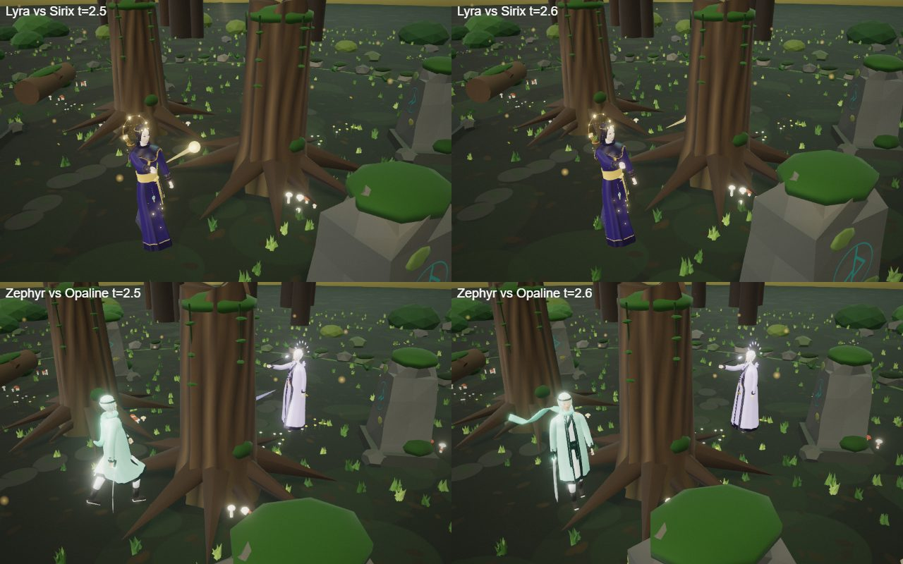

# Basic attacks

Every hero has a MOBA-style basic attack next to its four spells. It fills the time between cooldowns, so where a
hero stands matters all fight long. The code is in [src/attacks/](../../src/attacks/): `index.ts` (the numbers),
`attacker.ts` (one figure's attack: cooldown, wind-up, release) and `fx.ts` (the visuals).

## Controls (hero mode)

| Input | What happens |
|---|---|
| Right-click an enemy (hero or summoned unit) | walk into range and keep attacking it until another order |
| Right-click the ground | walk there (stops attacking) |
| `A`, then left-click | attack-move: on an enemy, attack it; on the ground, walk there and attack the first enemy that comes into range |
| `S` | stop: no walk, no attack, no pending cast |
| `Esc` / right-click while `A` is armed | disarm attack-move |

A spell cast cancels the wind-up of an attack but keeps the target, so the hero goes back to attacking after the
cast. Moving (a new order) cancels the wind-up; the attack's recovery is kept, so stepping between attacks costs
nothing ("attack, step, attack").

## Numbers

`attackFor(kit)` gives the default for the kit's type (`kit.melee`), coloured with the kit's accent, plus any
per-hero change in `OVERRIDES` (empty for now).

| Type | Range | Damage | Interval | Wind-up | Look |
|---|---|---|---|---|---|
| Melee | 2.6 m | 13 | 1.2 s | 0.3 s | a crescent swipe in front of the hero |
| Ranged | 6.5 m (needs line of sight) | 10 | 1.0 s | 0.25 s | a small homing bolt with a short trail, 18 m/s |

In AI duels basic attacks deal about an eighth to a quarter of the damage and make fights about a quarter shorter
(three test pairings: 27/21/29 s with attacks, 40/20/37 s without).

## Rules

- A blinded attacker misses: "MISS", no damage (this is what makes blind worth casting).
- Stun and knock-up stop attacking; silence and root do not (a silenced hero can still attack, a stunned one can't).
- A ranged bolt homes in, so it cannot be dodged by stepping aside; it vanishes if the target dies first.
- Shields absorb attack damage. Attacks can target summoned units (`arena.liveFoes()` includes them).
- Hits carry `HitOptions.attack`, which lets them past the duel's zone filter (`Duel.opponentHit`), like a bolt.

## Who attacks

- **Player hero** ([heroMode.ts](../../src/heroMode.ts)): an `Attacker` on the caster; hits go through `arena.hit`.
- **Duel opponent** ([duel.ts](../../src/duel.ts)): its own `Attacker`; a hit on the hero goes to
  `Duel.damagePlayer` (the duel owns the hero's HP and shield), a hit on a hero unit to `arena.hit`.
- **AI and autopilot**: when no spell can be cast and the other hero is in reach they attack (`hm.autoAttack` for the
  autopilot), standing still through the wind-up. A ranged AI now holds no farther than its attack range (it used
  to hold ~70% of Q's range, often out of attack range).

## Limits

- **Off in network duels.** The server relays only the four spell slots (and rate-checks them per slot), so
  `Duel.startNet` turns basic attacks off on both sides (`heroMode.attacksEnabled = false`) until the sync is
  designed with the multiplayer work.
- The visuals are generic (one bolt and one swipe, in the kit colour); per-hero looks and role traits (crits,
  every-third-shot, slowing hits, healing hits) are not built yet.
- The AI attacks the hero only, not units.
