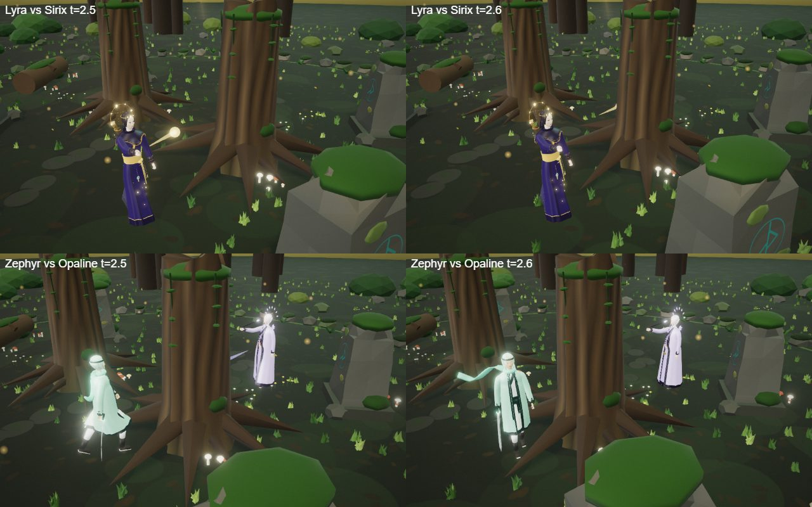

# Basic attacks

Every hero has a MOBA-style basic attack next to its four spells. It fills the time between cooldowns, so where a
hero stands matters all fight long. The code is in [src/attacks/](../../src/attacks/): `index.ts` (the numbers),
`attacker.ts` (one figure's attack: cooldown, wind-up, release) and `fx.ts` (the visuals).

## Controls (hero mode)

| Input | What happens |
|---|---|
| Right-click an enemy (hero or summoned unit) | walk into range and keep attacking it until another order |
| Right-click the ground | walk there (stops attacking) |
| `A`, then left-click | attack-move: on an enemy, attack it; on the ground, walk there and attack the first enemy that comes into range |
| `S` | stop: no walk, no attack, no pending cast |
| `Esc` / right-click while `A` is armed | disarm attack-move |

A spell cast cancels the wind-up of an attack but keeps the target, so the hero goes back to attacking after the
cast. Moving (a new order) cancels the wind-up; the attack's recovery is kept, so stepping between attacks costs
nothing ("attack, step, attack"). Cover coming between the attacker and the target cancels it the same way, and an
attack order then walks round.

## Numbers

`attackFor(kit)` gives the default for the kit's type (`kit.melee`), coloured with the kit's accent, plus any
per-hero change in `OVERRIDES` (empty for now).

| Type | Range | Damage | Interval | Wind-up | Look |
|---|---|---|---|---|---|
| Melee | 2.6 m (needs line of sight) | 13 | 1.2 s | 0.3 s | a crescent swipe in front of the hero |
| Ranged | 6.5 m (needs line of sight) | 10 | 1.0 s | 0.25 s | a small homing bolt with a short trail, 18 m/s |

In AI duels basic attacks deal about an eighth to a quarter of the damage and make fights about a quarter shorter
(three test pairings: 27/21/29 s with attacks, 40/20/37 s without).

## Rules

- A blinded attacker misses: "MISS", no damage (this is what makes blind worth casting).
- Stun and knock-up stop attacking; silence and root do not (a silenced hero can still attack, a stunned one can't).
- A ranged bolt homes in, so it cannot be dodged by stepping aside; it vanishes if the target dies first. Cover stops an attack only before its release: a bolt already flying goes on round a corner, which also keeps both screens of a network duel agreeing.
- Shields absorb attack damage. Attacks can target summoned units (`arena.liveFoes()` includes them).
- Hits carry `HitOptions.attack`, which lets them past the duel's zone filter (`Duel.opponentHit`), like a bolt.

## Reach, echo and reset (2026-11-03)

Three things a trait can do to the basic attack (see [traits.md](traits.md)):

- **`Trait.attackReach(t)`**: metres added to the range while it returns more than 0. `Attacker.range` is the spec's
  range plus `AttackOwner.reach()`; it is used by `inRange`, the wind-up leash, hero mode's attack-move pick
  (`HeroMode.attackRange`), and the AI's and the autopilot's approach and guard checks (`Duel` uses `oppAttack.range` /
  `hm.attackRange`).
- **`Trait.attackEcho(t)`**: a share 0..1. After an attack is released, `Attacker` waits `ECHO_DELAY` (0.12 s), then
  releases a second bolt or strike for that share of the damage (`opts.damage * share`, the first hit's mods on top).
  `attackMods` runs once, for the first hit (`AttackOwner.released(target, echo)`: `echo` is 0 for the first hit, the
  share for the second; owners must not count the second as an attack). The echo is dropped when the target is gone or
  the attacker is stunned in the gap. `Attacker.releaseNow` (the other player's attack online) never echoes.
- **`TraitView.resetAttack()`** → `Attacker.ready()`: the cooldown is 0 now.

Online: `attackReach` is applied locally only (the server does not check reach). The server drops attacks less than
0.5 s apart, so against the other hero the echo is **folded** into the single attack message (`power` x (1 + share),
clamped to 3 by the server) and no second bolt is drawn (`HeroMode.skipEcho`); against units it plays as two hits.

## Who attacks

- **Player hero** ([heroMode.ts](../../src/heroMode.ts)): an `Attacker` on the caster; hits go through `arena.hit`.
- **Duel opponent** ([duel.ts](../../src/duel.ts)): its own `Attacker`; a hit on the hero goes to
  `Duel.damagePlayer` (the duel owns the hero's HP and shield), a hit on a hero unit to `arena.hit`.
- **AI and autopilot**: when no spell can be cast and the other hero is in reach they attack (`hm.autoAttack` for the
  autopilot), standing still through the wind-up. A ranged AI now holds no farther than its attack range (it used
  to hold ~70% of Q's range, often out of attack range).

## Limits

- **Network duels (2026-10-30):** an attack on the other hero is sent at its release (`attack { id }`, through
  `HeroMode.onAttack` and `AttackOwner.released`); the other client plays it at once (`Attacker.releaseNow`, no
  wind-up) against its own hero and reports the hit with `took_hit` (the server allows one attack per 0.5 s and at
  most 40 damage from one). Attacks on summoned units stay on the attacker's screen.
- Per-hero looks, ranges, speeds and on-hit rules come from each hero's trait (`AttackSpec.look`, `attackMods`;
  see [traits.md](traits.md)): 16 missile and 6 swing looks in `src/attacks/fx.ts`.
- The AI attacks the hero only, not units.
