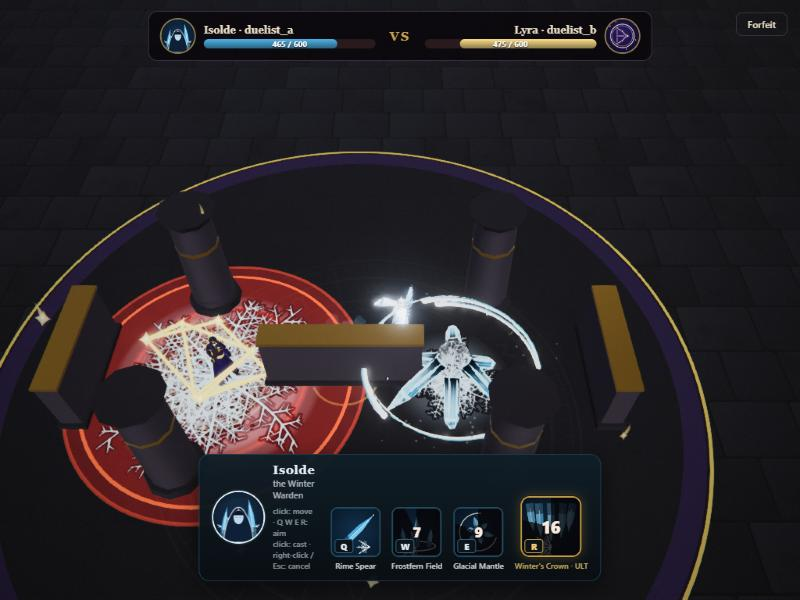

# Multiplayer duel game

**Arena of Kits** (`/game.html`) turns the 1 vs 1 duel into a small online game: log in, look at the heroes, open or
join a lobby or queue for a match, and fight another player in the duel ring, each controlling their own hero
(click to move, Q / W / E / R to aim and cast). The server keeps the accounts, pairs the players, referees HP and
the winner, and writes the stats the profile page shows. The editor stays at `/` (`index.html`) unchanged.



## Run it

| Command | What runs |
|---|---|
| `npm run dev` | Vite on 5173: the editor at `/`, the game at `/game.html`, the game server at `ws://…/ws` (attached by a Vite plugin; the plugin also hooks `vite preview`, untested) |
| `npm run build` then `npm run game:server` | the standalone server on 8787 (`PORT=…` to change): serves `dist/` and `/ws`; open `http://localhost:8787/` |
| `npm run test:server` | `server/smoke-test.mjs`: two socket clients through register, lobby, queue, fight, KO, forfeit, resume (no browser); `node server/smoke-test.mjs ws://host/ws` tests a running server |
| `npm run cf:dev` | the Cloudflare version locally (Workers runtime, no account needed): `http://localhost:8788/` |
| `npm run cf:deploy` | publish to Cloudflare (after `npx wrangler login`), see [Cloudflare](#cloudflare) |

Two players on one machine: open `/game.html` in two windows (or two tabs) and create two accounts. A tab in the
background keeps simulating (see *Background tabs*). Players on a LAN open the host's address instead.

## Architecture

```
 browser tab (game.html)                          Node (Vite dev server or server/standalone.mjs)
 ┌─────────────────────────────────┐   /ws JSON   ┌──────────────────────────────────────────────┐
 │ src/game/main.ts  screens        │◄────────────►│ server/game-server.mjs                        │
 │ src/net/client.ts NetClient      │              │  sessions (token → name, in memory)           │
 │ src/game/match.ts MatchController│              │  lobbies, queue, matches (in memory)          │
 │   └─ Duel.startNet (src/duel.ts) │              │ server/accounts.mjs → server/data/accounts.json│
 │ src/runtime.ts (shared scene)    │              └──────────────────────────────────────────────┘
 └─────────────────────────────────┘
```

| Decision | Choice and why |
|---|---|
| Transport | One WebSocket (`ws` 8.18.3, the only new dependency) on the page's own host at `/ws`. The Vite plugin in `vite.config.ts` attaches it to the dev / preview server, filtering upgrades by path so Vite's HMR socket is untouched. |
| Authority | **Server referee, client-owned heroes.** The server owns sessions, lobbies, pairing, match start (countdown), HP, the winner and the stats. Each client owns its own hero's movement and casts, and decides the hits *its own hero* takes: it replays the other side's cast locally and runs the duel's impact-time dodge check where its hero really stood. That keeps "walk out of the red" fair for the dodger and needs no headless effect simulation on the server. |
| Trust | Fine for friends on one machine or a LAN, not cheat-proof: a modified client could ignore its hits or skip cooldowns. The server clamps positions into the ring, drops casts before the countdown ends, drops a cast of the same slot within 0.35 s (R: 10 s, except one free second R within 4 s: a recast), accepts a reported hit only for a cast the other side made in the last 12 s, and caps one reported hit at 250. |
| Accounts | Names 3-16 `[A-Za-z0-9_-]`, passwords 4-64 characters hashed with PBKDF2-SHA256 (Web Crypto, 100 000 iterations, per-user salt; accounts from before the port used scrypt and are re-hashed at their next login, Node only). Stored in `server/data/accounts.json` (git-ignored) on Node, in the Durable Object's SQLite storage on Cloudflare. No e-mail, no external auth. |
| Sessions | A random token per sign-in, kept in memory on the server (a server restart means logging in again) and in **`sessionStorage`** on the client: per tab, so two tabs of one browser can be two players. One connection per account: a second sign-in signs the first out. |
| Same hero | Not allowed in one match (the client has one effect instance per spell label). The lobby greys out the other seat's hero and the server refuses `ready` with it; the queue only pairs different heroes. |
| Scene reuse | `game.html` imports `src/game/main.ts`. It builds the shared runtime (`createRuntime({ modules: targetedModules, background: true })`, `src/runtime.ts`) with only the spell effects, so the VFX tool's panel, particle editor and hotkeys are not in the game's bundle. The game drives `GameApi`: arena, hero mode, duel, kits, `setHeroMode`, `setKit`. No second render pipeline. |

## Files

| File | Role |
|---|---|
| `server/hub.mjs` | `createHub({ accounts, log, loserPicks })`: the runtime-free core (sessions, lobbies, queue, matches, the message handlers); `connect(send)` returns `{ message, closed }`; messages of one connection run one at a time |
| `server/accounts.mjs` | `Accounts(store)`: register, login, `record` a match, `profile` (stats, favourite hero, history of 20); `store` is `{ load(), put(key, account) }` |
| `server/game-server.mjs` | Node host: `attachGameServer(httpServer, { path, dataFile, log })` (`ws` + `fileStore`: every write re-reads the file and replaces one account, so servers sharing the file don't clobber each other) |
| `worker/index.mjs`, `wrangler.jsonc` | Cloudflare host: the Worker and the `GameHub` Durable Object (see [Cloudflare](#cloudflare)) |
| `server/standalone.mjs` | http server for `dist/` plus the game server (port 8787) |
| `server/smoke-test.mjs` | the socket-level end-to-end test |
| `game.html` | the second Vite entry (`build.rollupOptions.input` has `editor` and `game`) |
| `src/net/client.ts` | `NetClient` (connect, auto-reconnect with backoff, resume by token, typed `on(type, fn)`), the `ServerMsg` union and the `Profile` type |
| `src/game/main.ts` | screens: login / register, play (hero choice, find match), lobbies, lobby room, heroes, profile, play vs CPU; the queue bar; toasts. It sets `duel.onLeave` (the card's leave button ends the CPU fight or the network match) |
| `src/game/cpu.ts` | `CpuMatch`: an offline fight against the duel AI at a CPU level (no server, no account): set kit, hero mode on, `duel.cpuLevel`, `duel.start('play')`; a Leave button; a won level is reported to the screen |
| `src/game/match.ts` | `MatchController`: `match_start` → set kit, hero mode on, `duel.startNet`; streams moves at 20 Hz with the sender's clock; warns when its tab is hidden; forwards peer events; the result card; forfeit |
| `src/game/heroPreview.ts` | the heroes page turntable (its own small renderer, renders only while shown) |
| `src/game/game.css` | menu styles (duel HUD palette; hero accent through `--accent`) |
| `src/obstacles.ts` | the ring's pillars and walls: collision, sliding, line of sight, meshes (see below) |

Since PROTOCOL 11 (the hero shop): `createHub` also takes `shop` and `now` (the clock for the shop's days and weeks, for tests);
`Accounts` also keeps obols, owned heroes, the founders, the raid ranks and the week's boards, and its `store` may have
`getMeta(key)` / `putMeta(key, value)` for a few small records beside the accounts; `attachGameServer` takes `shop` and `now` and
passes them on. `pipeline/tools/shop-shots.py` plays bots through the hub and takes the Shop's pictures.

## Match flow

1. Two players are paired (both ready in a lobby, or two different heroes in the queue). The server sends
   `match_start` with each player's `side`: side 0 starts at (0, 0, 13) like the AI duel, side 1 at (0, 0, 1)
   with the camera turned round (`HeroMode.flipCamera`), so both see the opponent ahead. Positions are world
   coordinates on both clients; nothing is mirrored.
2. Each client sets its kit, turns hero mode on, calls `Duel.startNet({ opponent, side, names, net })` (hero locked,
   banner "Waiting for opponent") and sends `match_loaded`. When both are loaded (or after 15 s) the server sends
   `match_fight { countdown: 3 }`; the banner counts 3-2-1-FIGHT and unlocks the hero.
3. During the fight each client sends `move` 20 times a second (only when it changed) and `cast` after every cast
   (`HeroMode.onCast(label, slot, target)`). The other client draws the opponent's figure from its reports (see
   *Smooth movement*) and replays casts with `Duel.peerCast`: the effect starts where the foe is drawn (it snaps to
   the reported spot only when that is more than 3 m off), the effect plays through `castAs` with this side's hero as the target (single-target spells), the relayed aim point
   (ground spells) or the caster's spot (self spells), and the duel's own `hitPlayer` decides hit or dodge.
4. A hit on this side's hero: local number, red edge flash and knockback, then `took_hit { damage }`. The server
   subtracts it from that player's HP, answers `hp` to the victim and `peer_hit { damage, hp }` to the attacker,
   whose client shows the number and flash on the opponent and sets its HP (`Duel.peerHit`, through
   `arena.setHp`). A dodge sends `dodged` → `peer_dodged` (DODGED over the opponent). The attacker's own cast never
   damages the remote hero locally: `arena.hitFilter` drops those hits.
5. **Best of three rounds.** A round ends when a hero's HP reaches 0 (`ko`). The hub has no clock for it, but the arena's
   Last stand makes a long round end (user, 2026-11-06; [arenas.md](arenas.md#arenas-that-change-stages)).
   The server sends `round_end { round, result,
   reason, winner, score, hp, next }` (score as [this player, the foe]); the duel freezes the hero and shows "Round 1
   to <name> · 1-0" (`Duel.netRoundEnd`). A 3 s break follows. Then
   `round_start { round, score, you, foe, picked }`: each client runs
   `Duel.startNet` again (fresh HP, cooldowns and start spots, and its own arena: the seed is `<match id>-<round>`)
   and sends `match_loaded`, then the usual countdown. Every round's HP is the hero's own max (`match_loaded
   { maxHp }`; melee heroes carry more than 600).
6. The second round win, `match_leave` (`forfeit`, the Forfeit button) or a closed socket (`disconnect`, also during
   a break) ends the match: the server records both players with the round score, saves the file, and sends
   `match_end` with the result, `score` and the updated profile. The duel card shows VICTORY / DEFEAT, the time,
   "2-1 in rounds" and the new record; **Back to menu** stops the duel and hero mode.

## Loser picks

**Switched off for every match (user, 2026-11-06).** The code stays: `createHub({ loserPicks: true })` turns it on, and
only `server/smoke-test.mjs` does, to keep it working. With it off, `round_end.pick` is null, the panel never opens, the
break is 3 s and a `round_pick` is ignored. The rest of this section describes it switched on.

After a round that does not end the match, its loser gets 15 s to choose one of: swap hero, choose the next arena, or
keep things as they are (`round_end.pick { you, seconds }`, the panel from `showPick` in `src/game/main.ts`). The winner
reads "<name> is choosing". Best of three gives each player one pick at most by itself. Running out of time keeps things
as they are; an answer ends the wait, but the break still lasts its 3 s.

| Rule | How |
|---|---|
| A swap | Any hero but the other player's (one effect instance per spell label): the hub refuses that one, and the panel greys it. `round_start.you` and `.foe` say who fights next, and `beginRound` calls `api.setKit` when this side's changed |
| An arena | `round_pick.arena`. `Duel.startNet` plays `arenaId`, while the seed still drives the arena's events, so both screens stay on one schedule. The hub doesn't hold the arena list: an id a client doesn't know gets the seeded arena on both screens |
| Reading it | The loading page says "Ada swaps to Bram" for at least 2 s (`LoadingScreen.show({ note })`) |
| Stats | The match counts for the hero the player finished on. The history keeps the one they started on as `from` (`Lyra → Bram`) |

## Play vs CPU (offline)

The CPU duel is a mode of the Play screen (since 2026-11-10; it was a screen of its own): two tabs over the roster,
**Online match** and **CPU duel**. The CPU mode shows five difficulty buttons (Novice to Master,
[cpuLevels.ts](../../src/cpuLevels.ts); a tick on each level already beaten) and an opponent select (a random hero by
default, never your own) over the hero picker, and the bar's button becomes **Fight**. The login screen's **Duel the
CPU** opens the same screen without an account (`state.screen === 'cpu'`): only the CPU mode is open there, and the
online tab leads to the login. The mode is kept in `localStorage` (`play.mode`). Every hero picker starts with a **Random** tile: on the Play card and the CPU screen it stays chosen and is drawn when the match or fight starts, so a Rematch keeps the hero drawn; in a lobby it is drawn at once, so the other player sees the hero. The fight is the
offline AI duel (`CpuMatch` in `src/game/cpu.ts`, `duel.start('play')` at `duel.cpuLevel`) in a random arena: no
server messages, nothing on the profile. One round; the card's Rematch keeps hero, opponent choice and level, and
its Leave duel (or the Leave button during the fight) returns to the Play screen in its CPU mode. The choices and the beaten levels
live in this browser's `localStorage` (`cpu.level`, `cpu.foe`, `cpu.hero` without an account,
`cpu.won.<account or guest>`). Fight is disabled while the player is queued or in a lobby, since a `match_start`
would take the scene over.

## The Raid

A raid room is a lobby with `raid: <boss id>`: `lobby_create { raid }`, joined by its code, not on the public list. When both are
ready the hub sends `raid_start` instead of `match_start`, then leads the run with `raid_offer`, `raid_stage` and `raid_won`; `match_loaded` and `match_fight` work as in a match. The relays of
`move`, `cast` and `attack` are the same; the rest has its own messages and rules: [raid.md](raid.md). Alone is always offline.

**Twin Flames' messages** (a party against Ash and Ember, both at once, in the Twin Forge; the table with every field is in raid.md, "Twin Flames"). The rows marked 13 came with the forge (built as 12 on a branch that was never deployed; the Heart of Noon's merge stayed at 11, so the deploy that brings them is 13):

| Message | Since | What |
|---|---|---|
| `raid_stage.twin { half, hp, brain, staggerMax }` | 9 | Which half each seat is in (0 west with Ash, 1 east with Ember, -1 gone), each boss's HP and brain's screen, one boss's gauge. Since 13 each boss has `RAID_TWIN.share` (0.485) of the band's HP, not half (`raidTwinHp`) |
| `which` on `boss_cast`, `boss_move`, `boss_damage`, `boss_stagger`, `boss_debuff`, `boss_reward`, `boss_hp`, `boss_phase`, `boss_gauge`, `boss_kneel`, `peer_debuff`, `boss_brain`, `brain_moved` | 9 | Which of the two it is about (0 Ash, 1 Ember) |
| `boss_rage { which, on }`, `boss_fell { which }` | 9 | One grows furious or calms; one fell |
| `boss_cast.mate` | 13 | A second hero the step is for, beside `target` (Lantern Chain's pair); passed on only if it is a seat |
| `boss_cast` with `move: 'flood'` | 13 | No new field: from its relay on, the hub takes the wall of fire as out though both stand (revives and gold zones are the whole party's; hits stay each half's own boss's) |
| `boss_reward { key: 'change' }` (client → server, from a brain's screen) | 13 | A request, not a reward: the hub marks every second standing hero of each half for The Changing of the Flames, and says who with `boss_done { id, part: 100 + seat, side: seat }` |
| `boss_obj { id, part: 200 + own seat }` (client → server) | 13 | A marked hero stepped through a gate: the hub deals that seat into the other half. Taken only from that hero, once, within 12 s of the call |
| `boss_reward { key: 'vents' }` (from a brain's screen) | 13 | Every vent of one cast of Seal the Vents sealed: that twin staggers (40, scaled as its gauge is, halved as each twin's gauge is). Each vent itself is an objective (`boss_obj`, `boss_done`) as any spot |
| `twin_halves { half, brain, late }` (server → client) | 13 | The halves as dealt now, whose screen runs each brain, and the seats the gates shut on (those burn). `boss_brain` and `brain_moved` follow for a brain whose screen crossed |

## Messages

Client → server:

| `t` | Fields | Notes |
|---|---|---|
| `register`, `login` | `name`, `password`, `v` | → `session` or `auth_error`, or `update_required` (see *Rules version*) |
| `resume` | `token`, `v` | after a reload in the same tab |
| `logout`, `profile`, `lobbies` | | `lobbies` answers with `live` too (14): the duels being fought now |
| `watch`, `watch_leave` (14) | `id` (watch) | see *Watching a duel*; `error` for a duel that is over, a player in a match, a lobby or the queue |
| `lobby_create`, `lobby_join`, `lobby_leave` | `code` (join) | 4 letters, case-insensitive |
| `lobby_pick` | `hero` | resets that seat's ready; with the shop on, `error` for a hero that is neither owned nor free this week (see *The hero shop*) |
| `lobby_ready` | `ready` | refused without a hero or with the other seat's hero; both ready → match |
| `queue_join`, `queue_leave` | `hero` (join) | a locked hero is refused with `error`, as at `lobby_pick` |
| `shop_buy` (since PROTOCOL 11) | `hero` | → `shop_bought { hero, price, profile }`, or `error`: no such hero, already owned, not enough obols, the shop is closed |
| `boards` (11) | | → `boards`; answered without an account too |
| `tower_report` (11) | `floor`, `hero`, `week` | the floor this player's own page reached in the week's Tower, for the week's board. Not verified, pays nothing; only this week, 1-500, a hero the account may play, only upward → `boards` when it counted |
| `match_loaded` | `maxHp` | the hero's max HP for this match (200-2000; default 600); sent every round |
| `match_leave` | | |
| `round_pick` | `hero` or `arena`, or neither to keep things as they are | ignored while Loser picks is off; on, only from the round's loser during the break; see *Loser picks* |
| `move` | `x`, `z`, `yaw` | clamped to the ring, relayed |
| `cast` | `id`, `slot`, `x`, `z`, `fx`, `fz`, `enemy` | aim point, caster spot, aimed at the enemy; dropped before the countdown ends |
| `cast` (since 2026-10-30) | + `yaw` | which way the hero faced (spells fired straight ahead) |
| `took_hit` | `id`, `damage`, `color`, `soaked`, `blocked` | `damage` got past the hero's own shield, `soaked` is what the shield took; a hit from a basic attack is capped at 40. `blocked`: the victim's passive swallowed it whole (Isolde's ice block, Oblivion's void maw): no HP is taken, and the attacker's passives do not count it |
| `dodged` | `id` | |
| `hazard` | `damage`, `color` | an arena event hit this hero: capped at 60, at most one per 0.3 s, comes off the HP and can KO; the other client gets `peer_hit` with id 0 (no cast, no credit) |
| `attack` | `id` | a basic attack released at the other hero; at most one per 0.5 s |
| `heal` | `amount` | the hero healed itself; the server adds it (at most 150, at most 300 in 2 s, up to the max HP) |
| `status` | `kind`, `seconds`, `color` | a status the hero took (shown on the other screen; ≤ 3 s) |
| `shield` | `amount`, `seconds`, `color` | a shield the hero got (shown on the other screen; ≤ 400, ≤ 10 s) |
| `cast.mods`, `attack.mods` | `power`, `status`, `debuff`, `knock` | the hero identity layer's cast power and extras ([traits.md](traits.md)); power clamped 0.25-3, extras to the status / buff caps; a spell hit may now be up to 400 |
| `buff` | `kind`, `amount`, `seconds` | a buff or debuff on the hero (shown on the other screen; ≤ 50 %, ≤ 6 s) |
| `stacks` | `name`, `n` | stacks the other hero's mechanic keeps on this hero, decided here (≤ 20) |
| `spend` | `amount` | HP the hero paid for a spell (≤ 100, never below 1 HP) |
| `move.r` | | the hero's resource (0-1000), for the other screen's bar |

Server → client: `session { token, profile }`, `auth_error { error }` (empty error = token expired), `update_required { error }`, `logged_out
{ reason }`, `profile`, `error { error }` (shown as a toast), `lobbies { list }`, `lobby { lobby, you }`, `queue
{ on, since, size }`, `match_start { id, side, hp, you, foe }`, `match_fight { countdown, round }`, `round_end { …, pick }`, `round_start { round, score, you, foe, picked }`, `peer_move`,
`peer_cast` (+ `yaw`), `peer_hit { id, damage, soaked, hp, color, blocked }`, `peer_dodged`, `peer_attack { id }`, `peer_heal { amount, hp }`,
`peer_status { kind, seconds, color }`, `peer_shield { amount, seconds, color }`, `peer_buff`, `peer_stacks`, `peer_spend { amount, hp }`, `hp { hp }`, `match_end { result, winner, reason,
seconds, score, hp, stats, profile, earned }`. Since PROTOCOL 11: `shop { on, week, next, free }` (to every connection as it opens,
and again with a session and a profile), `shop_bought { hero, price, profile }`, `obols { earned, total, why }`, `boards { week,
raid, tower }`.

## Watching a duel (since PROTOCOL 14)

Anyone signed in may watch a duel being fought (the user, 2026-11-12: "make so that i can watch ongoing lobbys"; duels only for
now, raids later; the players see how many watch, not who). The Lobbies screen lists them under **Live now**
(`lobbies.live`); Watch sends `watch { id }`.

- **A watcher has no seat.** It gets no `match` on the hub (`Client.watching` instead), so nothing it sends can act in the
  duel, and its leaving ends nothing. At most 20 watch one duel. Joining the queue or a lobby, or logging out, stops watching.
- **What it gets:** `watch_start` (the duel as it stands: both names, heroes, HP and max, where each hero last stood, the round,
  the score, the state, the seconds of countdown left or how long the round has run), then every message of both players
  wrapped as `watch_msg { side, msg }` (`side`: the hero it is about; for `peer_hit`, the one hit), and its own `watch_fight`,
  `watch_round_end { winner, score, picking }`, `watch_round_start { heroes }`, `watch_end { winner, reason, seconds, score }`,
  with sides instead of "you". `watchers { n }` goes to the players and the watchers when the count changes.
- **The screen** (`src/game/watch.ts`, `Duel.startWatch`): side 0 is drawn as this screen's hero, side 1 as the opponent, the
  camera on the whole ring. Side 1 goes through the same `peer*` methods as a player's foe. Side 0 walks a track of its own
  reports and its casts and attacks are replayed (`HeroMode.replayCast`, `replayAttack`) with no check that could stop them.
  Nothing is decided on a watcher's screen: no hit, heal, payment or hazard counts there; all HP is the server's. A watcher
  who comes in mid-round sets the arena's event clock to the round's time, so its events match the players'.
- Checked: `npm run test:server` (list, join, counts, a watcher's messages change nothing, the sides, the end); two bot pages
  fighting and a third watching in Chrome: both heroes within 0.4 m of where their own screens had them, the same HP on all
  three, no errors.

## The hero shop, raid ranks and the week's boards

Design, decisions and what was checked: [`pipeline/designs/hero-shop.md`](../../pipeline/designs/hero-shop.md). Pictures:
[`docs/shop/shop.html`](../shop/shop.html). The table of heroes, prices and the numbers is in `server/protocol.mjs` (`HERO_SHOP`,
`SHOP`, `shopRotation`, `RAID_RANKS`), read by the hub and the page.

- **One switch:** `createHub({ shop })`, on unless told otherwise. The hosts pass it on: `SHOP` in `wrangler.jsonc` (Cloudflare),
  the `SHOP` environment variable for `server/standalone.mjs` and the dev server (`SHOP=off`). Off, every hero is free, nothing is
  sold, and obols are still earned.
- **Who may play what** is the hub's to say: a hero must be owned (a starter, bought, or a founder's) or one of the week's six.
  `lobby_pick`, `queue_join` and `round_pick` answer `error` otherwise. The page draws locks from the same table and keeps a
  locked hero out of the fights it starts itself (the Raid alone, the Tower); the CPU duel is open with every hero.
- **Founders:** the first time a store is opened with the shop on, the hub writes the moment and the heroes there were into a
  small record beside the accounts. An account created before it owns all of those.
- **Obols** are paid only by the hub: at a duel's end (40, a win 40 more, the first win of the server's UTC day 120 more; nothing
  for a duel under 30 s or for whoever left it) and as a raid boss falls to two or more after 20 s or more (60 each, 150 more for
  a tier whose three bosses all counted). The player hears at once (`obols`).
- **Raid ranks** come from `raids.others`, the most such bosses in one run: Ember 1, Ash 3, Noon 6, Eclipse 9. The profile carries
  `rank`; so does each seat of a raid room and each row of the open raids.
- **The week's boards** (the ISO week in UTC, as the Tower's): the best raid runs with others (bosses, then time, the party's names),
  written when a run ends, and the highest Tower floors as each player's own page reported them (`tower_report`, **not verified**).
  The top 20 of each, kept with the accounts, empty again each Monday.
- **The profile** carries `obols`, `owned` (every hero while the shop is off), `founder`, `rank`, `tower` and `raids.others`.

## Rules version

Both screens work out arenas, hazards and parcels from the same seed with no server field, so a tab left open from an
older build would see different cover and events from its opponent. `PROTOCOL` in `server/protocol.mjs` is one number
read by the hub and the client; **raise it by hand in any deploy that changes those rules or the messages.** A deploy
drops every socket, and `NetClient` reconnects and sends `resume` with its `v`, so that is when an older tab finds out.

| A tab sends | The hub answers | The tab |
|---|---|---|
| a lower `v` | `update_required` | Stops reconnecting and shows a bar with a Reload button over everything. A CPU fight goes on underneath |
| no `v` (from before the check) | `auth_error` with the same text | Shows it on its login screen. Its token stays, so a reload signs it back in |
| the same or a higher `v` | as usual | A higher one is a page newer than a hub still restarting during a deploy, for a few seconds at most |

## Stats

Per account: `wins`, `losses`, `matches`, per-hero `{ played, wins }` and the last 20 matches (hero, `from` after a swap,
opponent and their hero, result, seconds, reason, round score `rounds`). **Favourite hero** = the most played (ties: more wins). A forfeit or a
disconnect counts as a loss for the leaver and a win for the other player.

## The ring: pillars, walls and line of sight

Each arena (AI duel and network duel alike) has its own cover, `ArenaDef.obstacles` in [src/arenas](../../src/arenas),
see [arenas.md](arenas.md). A round copies it to `arena.obstacles`, where walls fall and spells raise new ones. A trait
reads the live list with `t.cover()`, and the list the arena started with, the same on both screens, with `t.arenaCover()`.

Every obstacle is a capsule on the ground (segment + radius; a pillar has zero length). The arena gets them through
`arena.obstacles` (set by the duel's setup, cleared by `stop`):

- **Collision:** `arena.keepInside` pushes positions out of them (`pushOut`, body clearance 0.5), so walking,
  knockback and network positions all respect them. `arena.walk` and `arena.moveFoe(…, slide = true)` (the AI) turn
  the walk along an obstacle's edge instead of into it (`steer`: the part of the walk along the edge, and a kept side when pressing straight at it, see
  [mechanics.md](mechanics.md#walking-round-cover-navts)).
- **Line of sight:** `arena.lineOfSight(a, b)` is false when the segment a-b passes within 0.9 × an obstacle's radius
  (`blocksSight`). **A spell needs sight of its target to be cast**: an enemy spell needs sight of the enemy, a ground
  spell of the aimed spot; self spells need none. A line skillshot needs none either: it fires along its aim and
  cover stops it (a phone's tap with no drag follows the enemy into sight first). In hero mode a confirmed cast without sight shows "No line of
  sight" and becomes a pending cast: the hero walks toward the target and casts the moment it is in range *and* in
  sight. While aiming, the hover ring and the ground circle turn the blocked colour when the target is out of
  sight. The duel AI (and the autopilot) only picks targeted spells with sight, and closes in to half its usual
  distance while blocked so its strafe comes round the cover.
- Sight is checked when the spell is cast; a spell already on its way still lands by the usual zone rule (walking
  behind a pillar after the cast is not a dodge by itself). In a network match the caster's client checks sight;
  the receiving client trusts the relayed cast.

## Cloudflare

Cloudflare Pages alone only serves static files, so the game is published as a **Worker with static assets and a
Durable Object** (the same Workers product family; the free plan covers SQLite-backed Durable Objects within its
daily limits, check Cloudflare's pricing page):

| Piece | What it does |
|---|---|
| Worker `arena-of-kits` (`worker/index.mjs`) | `/` redirects to `/game.html` (the game is the front page; the editor stays at `/index.html`); `/ws` goes to the hub; every other path is a file from `dist/` (`assets.run_worker_first: ["/ws", "/"]`) |
| Durable Object `GameHub` | one instance (`idFromName('main')`) so every player meets in one place; runs `createHub` from `server/hub.mjs`; WebSockets with `accept()` (no hibernation: the object stays in memory while players are connected) |
| Storage | table `accounts (key, json)` in the object's SQLite storage; loaded once when the object starts, one row written per change. Table `meta (key, json)` (made on first start if it is not there): the day the hero shop arrived and the week's boards. The Node server keeps the same two under `users` and `meta` in its JSON file |
| `SHOP` (`vars` in `wrangler.jsonc`) | "on": heroes are locked behind the shop. "off": every hero is free |
| Lost on eviction | sessions (players log in again), open lobbies and the queue; a running match keeps the object alive |

Deploy (once per machine: a free Cloudflare account and `npx wrangler login` in a browser):

```
npm run cf:deploy
```

It builds (`tsc` + Vite), uploads `dist/` and the Worker, and prints the address
(`https://arena-of-kits.<account>.workers.dev`). A custom domain is added in the Cloudflare dashboard.
`npm run cf:dev` runs the same setup locally on 8788 (state in `.wrangler/`, git-ignored).

Verified locally (2026-10-29, wrangler 4.150.0): the smoke test's 20 checks against `ws://localhost:8788/ws`; a two-tab
queue match (Isolde vs Brannoc, 24.6 s) with stats on both sides; accounts and stats still there after a restart.
Not yet deployed.

Verified locally again for the hero shop (2026-11-12, `wrangler dev` on its own port and store): a purchase, the obols and a
board row still there after the worker was stopped and started; an account made with `SHOP` "off" is a founder once the same
store is opened with it on. Against a running worker the smoke test plays everything but the shop's cases, and needs `SHOP`
"off" (`npx wrangler dev --var SHOP:off`), since its accounts are new and play any hero. The live worker has not had this build.

## Smooth movement

The round trip to the Cloudflare server is about 35 ms (measured from Vienna, 2026-10-30), so the lag a player
feels is in how the opponent is drawn, not in the connection. `move` carries `ts`, the sender's
`performance.now()`, and the server passes it on in `peer_move`. `Duel.peerMove` puts every report on this side's
clock (the offset is the smallest `now - ts` seen, the quickest delivery) in a short track; `Duel.netFollow` draws
the figure `PEER_DELAY` = 100 ms in the past, between the two reports around that moment, and turns it by the
shorter way. Past the newest report it holds still rather than guessing. A sender that stands still sends nothing,
so a gap over 120 ms is filled with a copy of the old spot just before the new report, and the figure does not
glide across the pause. Without `ts` (an older server) the arrival time is used instead.

Before this the figure eased toward the newest report at 15 Hz: it moved in small steps and jumped forward on
every cast. Measured with a scripted opponent walking at up to 4.5 m/s through 120 ms ± 40 ms of test lag each way,
the frame-to-frame change in its speed dropped from 1.42 to 0.54 m/s (RMS), and a cast moved it by 0.035 m instead of
snapping it to the cast spot.

Test lag: `game.html?lag=120&jitter=40` holds every message that long in each direction, in order (`NetClient`).
Off by default.

## Background tabs

`requestAnimationFrame` stops in a background tab (and in a hidden browser pane), which would freeze that player's
spells before impact, so they would never report a hit. The game's runtime (`background: true`) steps the simulation from a 100 ms
timer whenever no frame came for 250 ms, in 1/30 s substeps of the real time that passed (browsers slow
background timers to about once a second, so a hidden tab catches up in bigger batches).

The same slowdown hits the 20 Hz `move` timer: the other player sees a hidden tab's hero jump about once a second.
That cannot be fixed from the page, so the match shows a toast when its tab is hidden: play in two windows side by
side, not two tabs of one window.

## Verified (2026-10-29)

- `npm run test:server`: 20 checks pass.
- Built page on the standalone server, two tabs of the built-in browser, real input events through hero mode's
  own listeners: queue pairing (Lyra vs Vex, 22.6 s, the winner's and loser's cards and stats), lobby create / join
  from the list / taken hero greyed / ready (Isolde vs Lyra in the ring with cover, 24.5 s), a dodge shown on both
  screens, a hit's knockback replicated, a forfeit by disconnect when a tab reloads, session resume after reload,
  Back to menu and the profile.
- Line of sight in the editor's duel: Q at a foe behind the centre wall and behind a pillar is refused with the
  toast, the hero slides round and casts once in sight (wall 1 s, pillar 0.3 s); AI duels still finish (17-24 s).

## Mechanics online

Since 2026-10-30 the kits' mechanics work in network duels, on the same rule as the hits: **the client whose hero
takes an effect decides it**, and the server records and relays.

| Mechanic | How |
|---|---|
| Statuses (stun, root, slow, silence, blind, knock-up) | applied to this side's hero by the hit (`Duel.damagePlayer`), enforced here; `status` → `peer_status` draws the word and tint on the other screen. Blind on the other hero rolls its miss here, from that relayed status. |
| Knockback, pull | move this side's hero; the move reports carry the new spot. |
| Shields | the hero's own shield soaks here (`arena.absorb`); `took_hit` sends what got through and what was soaked; `shield` → `peer_shield` draws the bubble on the other screen, which takes `soaked` from it and drops it when damage got through. |
| Heals | `arena.casterHeal` → `heal`; the server adds it within its caps and answers `hp` / `peer_heal`. |
| Dashes, blinks | the caster's own client moves it; the other screen sees it through the move reports. |
| Skillshots | the other player's bolts fly on this screen (`ctx.projectile` stays on in the replay); touching this hero is the hit. |
| Spells fired where the hero faces (`self` mode) | `cast.yaw` turns the replayed caster before the spell plays. |
| Arena events and stages | both clients run the same schedule from `<match id>-<round>` on a clock that starts at FIGHT. Each client decides the hits on its own hero and units; the hero's damage goes out as `hazard`. Two tabs with bots agree on HP through Last stand; two real people have not tried it. |
| Summoned units | the other player's units spawn and fight on this screen; their hits on this hero go through `took_hit` with the summoning cast's id. Each screen simulates its own copy, so units can stand in different places or die at different times on the two screens. |
| Basic attacks | see [attacks.md](attacks.md). Echo (Lyra) is folded into one hit; reach (Zephyr) is local. |
| Units from a trait (`TraitView.summon`) | only this player's own passive raises units, on its own screen; the other screen does not see them (a spell's units are replayed through the cast there) and `hitFilter` drops their hits on the other hero, so online they hit the pack only: they do no damage to the other hero. The other side's `summon` is a no-op here. `deathSpots` only know units this screen simulates. |
| Hold-to-charge | the charge becomes `mods.power` in the cast message, like any trait mod. |
| Recast that only acts (`replay: false`) | sends no cast: it moves the hero (a blink, a rewind), which streams as moves. A jump over 4 m between two move reports snaps on the other screen (`PEER_JUMP`) instead of gliding. |
| Skillshot that pulls (`pull` on a bolt hit) | the bolt flies on the victim's screen, the hit carries `from` = the bolt's start, and `damagePlayer` drags the hero toward it (4 m at most). The caster's screen only draws the result through the victim's moves. |
| Carry (`ctx.carry`) | applied by the victim's client when the replayed cast calls it; on the caster's screen `arena.remoteFigure` (the other hero) is left alone and follows its streamed position. The effect must judge the catch with the live position of the target. |
| Arc aim | `cast.bend` (clamped to +-1.5 rad by the server, optional) rides with the cast; both screens fly the same arc. An older server drops the field and the replay flies straight. |
| Temporary walls | both screens build the wall from the cast (`ctx.sentFrom`, `ctx.point`) and time it out on their own clocks; the replay's `from` is not used for the geometry. A new round clears them. |

Tested with two local players (2026-10-30): a Lyra bolt into Auriel's shield (28 through, 25 soaked), Lyra's root
trap and basic attack, Marin's hook pulling Fenna 3 m, Fenna's heal on hit and her turret hitting Marin 4 times.

## Limits and next steps

- Not cheat-proof (see *Trust*); no reconnect into a running match (a reload forfeits).
- Several servers on one data file (two dev ports, the standalone server) write one account at a time; the last
  write wins per account, and sessions and lobbies are per server (both players must use the same one).
- One match per player at a time; no spectators, no rematch button (back to the menu, queue again).
- Mirror matches need a second effect instance per spell label (`castAs` in runtime.ts).
- Projectiles fly through pillars visually; sight is only checked at the cast.
- Pillars can hide a hero from the high camera when it stands right behind one (no see-through fade yet).
- The other session's duel balance numbers predate the cover; re-run its tournament with the obstacles in.

## See also

- [Hero mode and the duel](hero-mode.md)
- [Targeting and arena](targeting-and-arena.md)
- [Using the tool](../guide/using-the-tool.md)
- [Docs home](../README.md)
