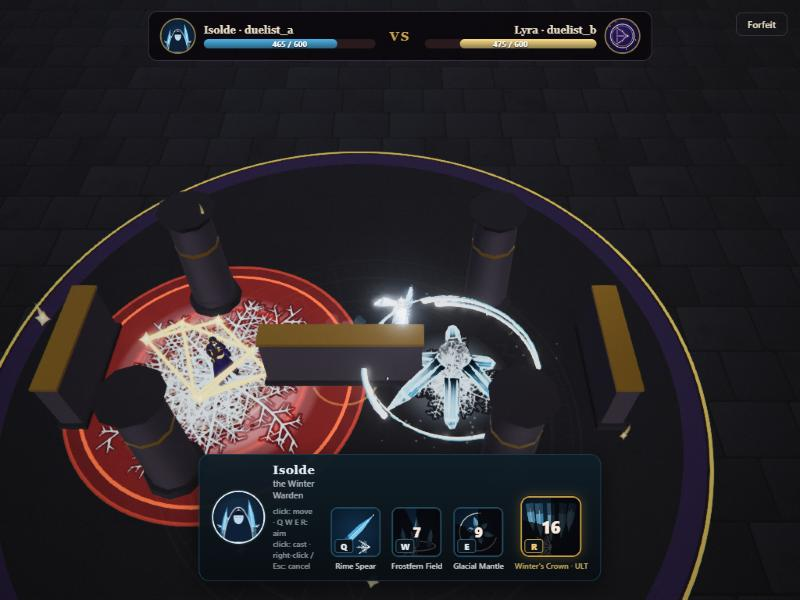

# Multiplayer duel game

**Arena of Kits** (`/game.html`) turns the 1 vs 1 duel into a small online game: log in, look at the heroes, open or
join a lobby or queue for a match, and fight another player in the duel ring, each controlling their own hero
(click to move, Q / W / E / R to aim and cast). The server keeps the accounts, pairs the players, referees HP and
the winner, and writes the stats the profile page shows. The editor stays at `/` (`index.html`) unchanged.



## Run it

| Command | What runs |
|---|---|
| `npm run dev` | Vite on 5173: the editor at `/`, the game at `/game.html`, the game server at `ws://…/ws` (attached by a Vite plugin; the plugin also hooks `vite preview`, untested) |
| `npm run build` then `npm run game:server` | the standalone server on 8787 (`PORT=…` to change): serves `dist/` and `/ws`; open `http://localhost:8787/` |
| `npm run test:server` | `server/smoke-test.mjs`: two socket clients through register, lobby, queue, fight, KO, forfeit, resume (no browser) |

Two players on one machine: open `/game.html` in two windows (or two tabs) and create two accounts. A tab in the
background keeps simulating (see *Background tabs*). Players on a LAN open the host's address instead.

## Architecture

```
 browser tab (game.html)                          Node (Vite dev server or server/standalone.mjs)
 ┌─────────────────────────────────┐   /ws JSON   ┌──────────────────────────────────────────────┐
 │ src/game/main.ts  screens        │◄────────────►│ server/game-server.mjs                        │
 │ src/net/client.ts NetClient      │              │  sessions (token → name, in memory)           │
 │ src/game/match.ts MatchController│              │  lobbies, queue, matches (in memory)          │
 │   └─ Duel.startNet (src/duel.ts) │              │ server/accounts.mjs → server/data/accounts.json│
 │ src/main.ts (scene, game mode)   │              └──────────────────────────────────────────────┘
 └─────────────────────────────────┘
```

| Decision | Choice and why |
|---|---|
| Transport | One WebSocket (`ws` 8.18.3, the only new dependency) on the page's own host at `/ws`. The Vite plugin in `vite.config.ts` attaches it to the dev / preview server, filtering upgrades by path so Vite's HMR socket is untouched. |
| Authority | **Server referee, client-owned heroes.** The server owns sessions, lobbies, pairing, match start (countdown), HP, the winner and the stats. Each client owns its own hero's movement and casts, and decides the hits *its own hero* takes: it replays the other side's cast locally and runs the duel's impact-time dodge check where its hero really stood. That keeps "walk out of the red" fair for the dodger and needs no headless effect simulation on the server. |
| Trust | Fine for friends on one machine or a LAN, not cheat-proof: a modified client could ignore its hits or skip cooldowns. The server clamps positions into the ring, drops casts before the countdown ends, and caps one reported hit at 250. |
| Accounts | `server/data/accounts.json` (git-ignored), names 3-16 `[A-Za-z0-9_-]`, passwords 4-64 characters hashed with `crypto.scrypt` and a per-user salt. No e-mail, no external auth, nothing leaves the machine. |
| Sessions | A random token per sign-in, kept in memory on the server (a server restart means logging in again) and in **`sessionStorage`** on the client: per tab, so two tabs of one browser can be two players. One connection per account: a second sign-in signs the first out. |
| Same hero | Not allowed in one match (the client has one effect instance per spell label). The lobby greys out the other seat's hero and the server refuses `ready` with it; the queue only pairs different heroes. |
| Scene reuse | `game.html` has `<body data-mode="game">` and imports `src/main.ts`, which then hides the lil-gui panel and stats line and skips the editor hotkeys. `main.ts` exports `gameApi` (arena, hero mode, duel, kits, `setHeroMode`, `setKit`). No second render pipeline. |

## Files

| File | Role |
|---|---|
| `server/game-server.mjs` | `attachGameServer(httpServer, { path, dataFile, log })`: sessions, lobbies, queue, matches, the message handlers |
| `server/accounts.mjs` | `Accounts`: register, login, `record` a match, `profile` (stats, favourite hero, history of 20) |
| `server/standalone.mjs` | http server for `dist/` plus the game server (port 8787) |
| `server/smoke-test.mjs` | the socket-level end-to-end test |
| `game.html` | the second Vite entry (`build.rollupOptions.input` has `editor` and `game`) |
| `src/net/client.ts` | `NetClient` (connect, auto-reconnect with backoff, resume by token, typed `on(type, fn)`), the `ServerMsg` union and the `Profile` type |
| `src/game/main.ts` | screens: login / register, play (hero choice, find match), lobbies, lobby room, heroes, profile; the queue bar; toasts |
| `src/game/match.ts` | `MatchController`: `match_start` → set kit, hero mode on, `duel.startNet`; streams moves at 15 Hz; forwards peer events; the result card; forfeit |
| `src/game/heroPreview.ts` | the heroes page turntable (its own small renderer, renders only while shown) |
| `src/game/game.css` | menu styles (duel HUD palette; hero accent through `--accent`) |
| `src/obstacles.ts` | the ring's pillars and walls: collision, sliding, line of sight, meshes (see below) |

## Match flow

1. Two players are paired (both ready in a lobby, or two different heroes in the queue). The server sends
   `match_start` with each player's `side`: side 0 starts at (0, 0, 13) like the AI duel, side 1 at (0, 0, 1)
   with the camera turned round (`HeroMode.flipCamera`), so both see the opponent ahead. Positions are world
   coordinates on both clients; nothing is mirrored.
2. Each client sets its kit, turns hero mode on, calls `Duel.startNet({ opponent, side, names, net })` (hero locked,
   banner "Waiting for opponent") and sends `match_loaded`. When both are loaded (or after 15 s) the server sends
   `match_fight { countdown: 3 }`; the banner counts 3-2-1-FIGHT and unlocks the hero.
3. During the fight each client sends `move` 15 times a second (only when it changed) and `cast` after every cast
   (`HeroMode.onCast(label, slot, target)`). The other client eases the opponent's figure toward the reported
   position (`Duel.netFollow`) and replays casts with `Duel.peerCast`: the foe is snapped to where it cast from, the
   effect plays through `castAs` with this side's hero as the target (single-target spells), the relayed aim point
   (ground spells) or the caster's spot (self spells), and the duel's own `hitPlayer` decides hit or dodge.
4. A hit on this side's hero: local number, red edge flash and knockback, then `took_hit { damage }`. The server
   subtracts it from that player's HP, answers `hp` to the victim and `peer_hit { damage, hp }` to the attacker,
   whose client shows the number and flash on the opponent and sets its HP (`Duel.peerHit`, through
   `arena.setHp`). A dodge sends `dodged` → `peer_dodged` (DODGED over the opponent). The attacker's own cast never
   damages the remote hero locally: `arena.hitFilter` drops those hits.
5. HP 0 (`ko`), `match_leave` (`forfeit`, the Forfeit button) or a closed socket (`disconnect`) ends the match: the
   server records both players, saves the file, and sends `match_end` with the result and the updated profile.
   The duel card shows VICTORY / DEFEAT, the time and the new record; **Back to menu** stops the duel and hero mode.

## Messages

Client → server:

| `t` | Fields | Notes |
|---|---|---|
| `register`, `login` | `name`, `password` | → `session` or `auth_error` |
| `resume` | `token` | after a reload in the same tab |
| `logout`, `profile`, `lobbies` | | |
| `lobby_create`, `lobby_join`, `lobby_leave` | `code` (join) | 4 letters, case-insensitive |
| `lobby_pick` | `hero` | resets that seat's ready |
| `lobby_ready` | `ready` | refused without a hero or with the other seat's hero; both ready → match |
| `queue_join`, `queue_leave` | `hero` (join) | |
| `match_loaded`, `match_leave` | | |
| `move` | `x`, `z`, `yaw` | clamped to the ring, relayed |
| `cast` | `id`, `slot`, `x`, `z`, `fx`, `fz`, `enemy` | aim point, caster spot, aimed at the enemy; dropped before the countdown ends |
| `took_hit` | `id`, `damage`, `color` | |
| `dodged` | `id` | |

Server → client: `session { token, profile }`, `auth_error { error }` (empty error = token expired), `logged_out
{ reason }`, `profile`, `error { error }` (shown as a toast), `lobbies { list }`, `lobby { lobby, you }`, `queue
{ on, since, size }`, `match_start { id, side, hp, you, foe }`, `match_fight { countdown }`, `peer_move`,
`peer_cast`, `peer_hit { id, damage, hp, color }`, `peer_dodged`, `hp { hp }`, `match_end { result, winner, reason,
seconds, hp, stats, profile }`.

## Stats

Per account: `wins`, `losses`, `matches`, per-hero `{ played, wins }` and the last 20 matches (hero, opponent and
their hero, result, seconds, reason). **Favourite hero** = the most played (ties: more wins). A forfeit or a
disconnect counts as a loss for the leaver and a win for the other player.

## The ring: pillars, walls and line of sight

The duel ring (AI duel and network duel alike) has cover, defined once in `DUEL_OBSTACLES` in
[obstacles.ts](../../src/obstacles.ts) and point-symmetric about the ring's centre (0, 7):

| Obstacle | Where |
|---|---|
| centre wall | (-2.2, 7) to (2.2, 7): hides the two starts from each other |
| 4 pillars (r 0.85) | (±5, 3.6), (±5, 10.4) |
| 2 side walls | x = ±8.6, z 5.4 to 8.6 |

Every obstacle is a capsule on the ground (segment + radius; a pillar has zero length). The arena gets them through
`arena.obstacles` (set by the duel's setup, cleared by `stop`):

- **Collision:** `arena.keepInside` pushes positions out of them (`pushOut`, body clearance 0.5), so walking,
  knockback and network positions all respect them. `arena.walk` and `arena.moveFoe(…, slide = true)` (the AI) turn
  the walk along an obstacle's edge instead of into it (`steer`; the side is chosen from where the hero stands
  relative to the obstacle's middle, which stays stable; choosing by the walk direction alone flipped every frame
  when walking straight at a wall).
- **Line of sight:** `arena.lineOfSight(a, b)` is false when the segment a-b passes within 0.9 × an obstacle's radius
  (`blocksSight`). **A spell needs sight of its target to be cast**: an enemy spell needs sight of the enemy, a ground
  spell of the aimed spot; self spells need none. In hero mode a confirmed cast without sight shows "No line of
  sight" and becomes a pending cast: the hero walks toward the target and casts the moment it is in range *and* in
  sight. While aiming, the hover ring and the ground circle turn the pale foil colour when the target is out of
  sight. The duel AI (and the autopilot) only picks targeted spells with sight, and closes in to half its usual
  distance while blocked so its strafe comes round the cover.
- Sight is checked when the spell is cast; a spell already on its way still lands by the usual zone rule (walking
  behind a pillar after the cast is not a dodge by itself). In a network match the caster's client checks sight;
  the receiving client trusts the relayed cast.

## Background tabs

`requestAnimationFrame` stops in a background tab (and in a hidden browser pane), which would freeze that player's
spells before impact, so they would never report a hit. In game mode `main.ts` steps the simulation from a 100 ms
timer whenever no frame came for 250 ms, in 1/30 s substeps of the real time that passed (browsers slow
background timers to about once a second, so a hidden tab catches up in bigger batches).

## Verified (2026-10-29)

- `npm run test:server`: 20 checks pass.
- Built page on the standalone server, two tabs of the built-in browser, real input events through hero mode's
  own listeners: queue pairing (Lyra vs Vex, 22.6 s, the winner's and loser's cards and stats), lobby create / join
  from the list / taken hero greyed / ready (Isolde vs Lyra in the ring with cover, 24.5 s), a dodge shown on both
  screens, a hit's knockback replicated, a forfeit by disconnect when a tab reloads, session resume after reload,
  Back to menu and the profile.
- Line of sight in the editor's duel: Q at a foe behind the centre wall and behind a pillar is refused with the
  toast, the hero slides round and casts once in sight (wall 1 s, pillar 0.3 s); AI duels still finish (17-24 s).

## Limits and next steps

- Not cheat-proof (see *Trust*); no reconnect into a running match (a reload forfeits).
- Several servers on one data file (two dev ports, the standalone server) merge accounts on save; the last write
  wins per account, and sessions and lobbies are per server (both players must use the same one).
- One match per player at a time; no spectators, no rematch button (back to the menu, queue again).
- Mirror matches need a second effect instance per spell label (`castAs` in main.ts).
- Projectiles fly through pillars visually; sight is only checked at the cast.
- Pillars can hide a hero from the high camera when it stands right behind one (no see-through fade yet).
- The other session's duel balance numbers predate the cover; re-run its tournament with the obstacles in.

## See also

- [Hero mode and the duel](hero-mode.md)
- [Targeting and arena](targeting-and-arena.md)
- [Using the tool](../guide/using-the-tool.md)
- [Docs home](../README.md)
