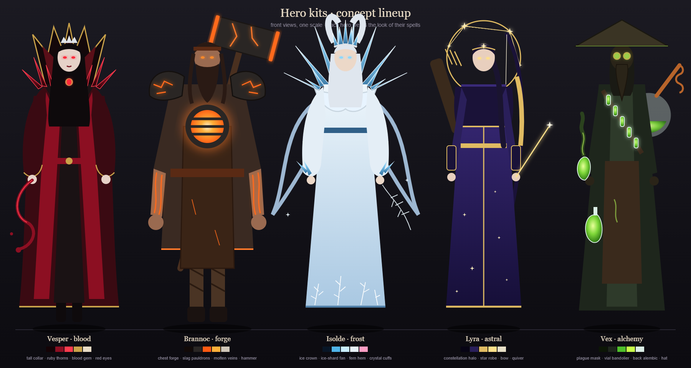
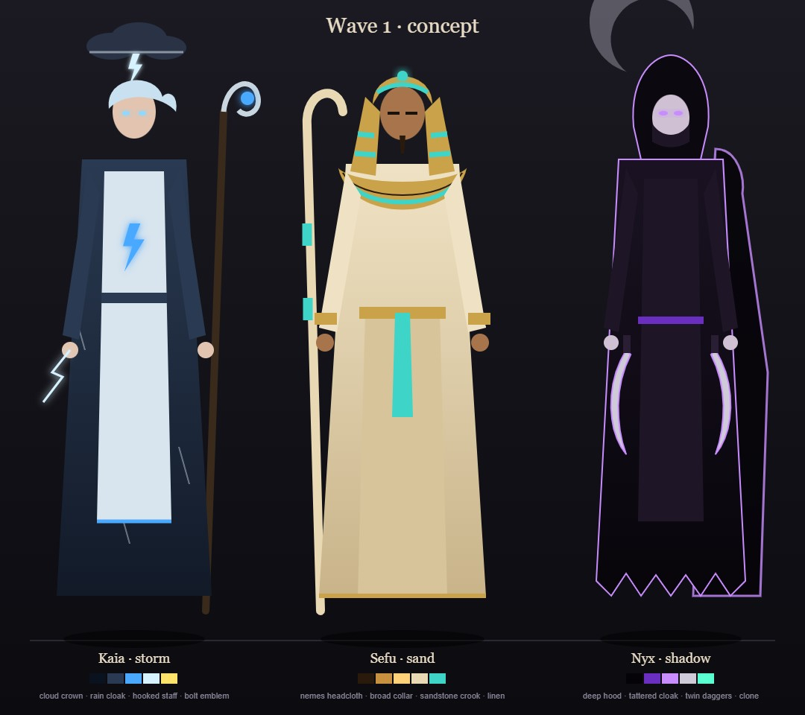
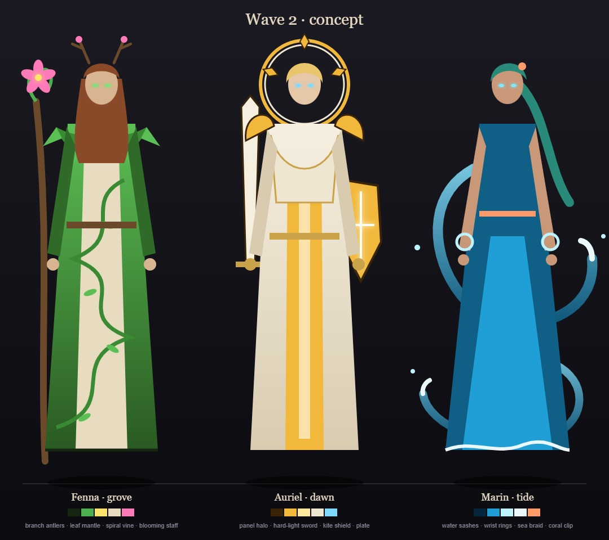
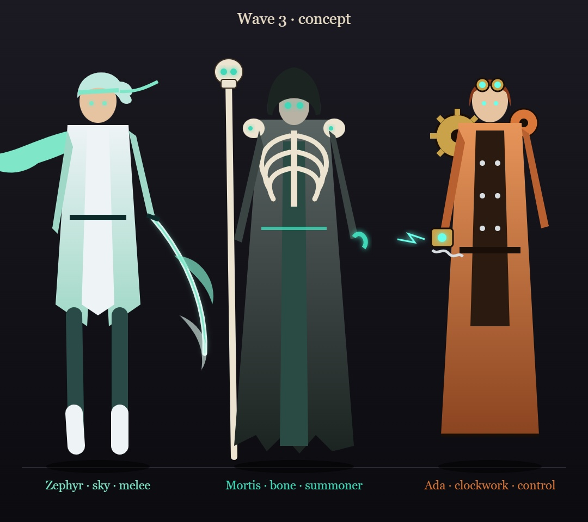
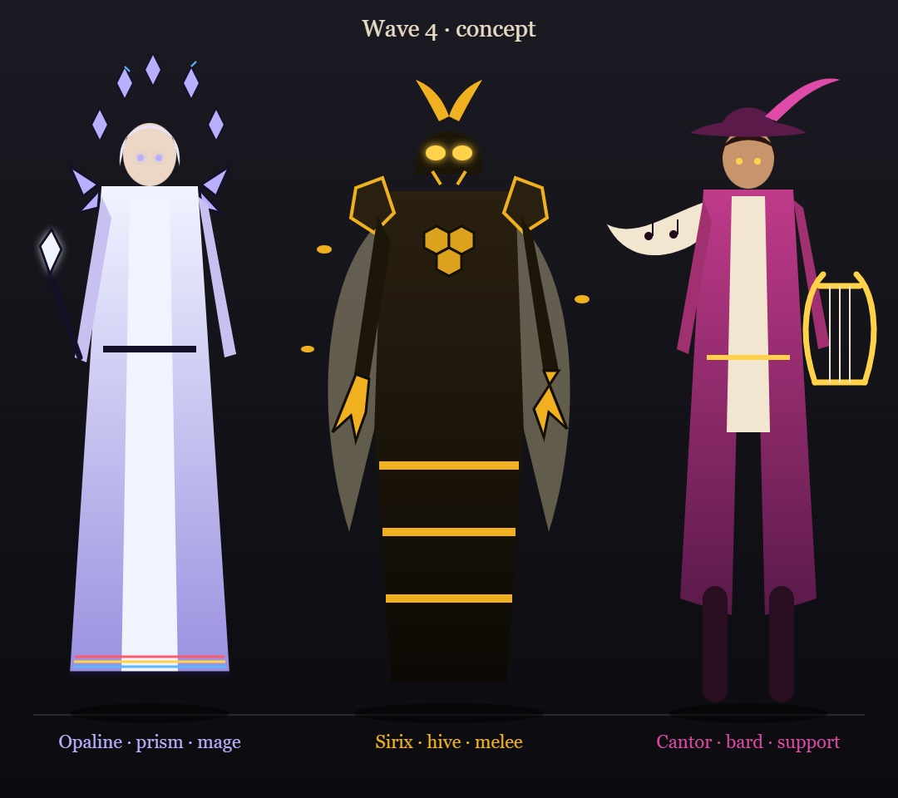
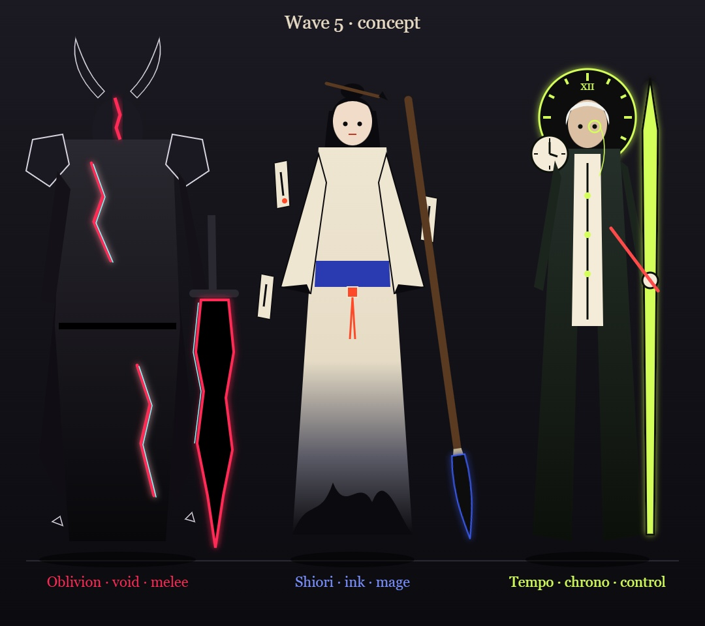
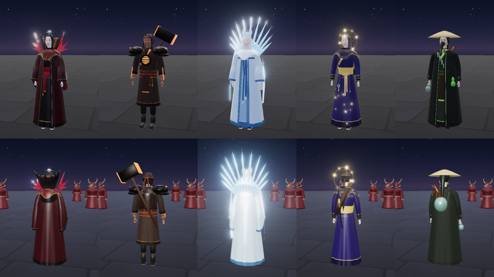
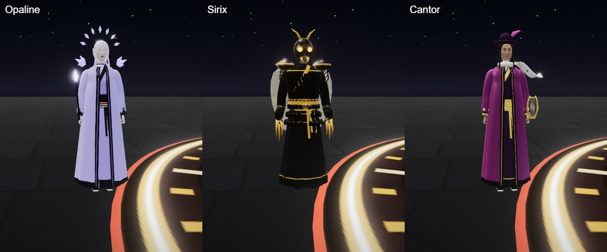
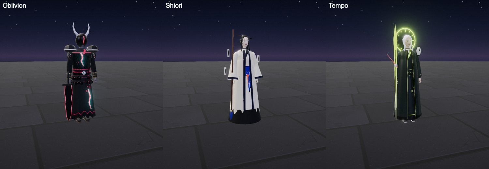

# Hero roster

39 hero kits (20 original, remade as "v5" on 2026-11-04, and 19 added since), each one character with four spells (Q, W, E and the R ultimate), one shared parts file, one palette row in the art bible and one rigged model. A kit is data (`HeroKit` in [`src/heroes.ts`](../../../src/heroes.ts)); its spells are ordinary registered effects looked up by label, so each also appears in the [effect catalog](../effects.md). Hero mode (key H, `src/heroMode.ts`) plays a kit MOBA-style on top of play mode, and the hero switcher (View menu, or click the portrait) changes the hero.

## Roster

| Hero | Title | Theme | Signature shape | Portrait (HUD, canvas-drawn) | Page |
|---|---|---|---|---|---|
| Vesper | the Crimson Countess | blood (`hero: blood`) | The blood tendril: a tapered, viscous rope with a round bead at the tip, that hardens into faceted ruby crystal thorns. | A bone crescent behind a blood drop: the moon and the blood. | [blood](blood.md) |
| Brannoc | the Ashen Smith | forge (`hero: forge`) | Molten slag that cools: liquid metal glows white-orange, a black crust grows over it from the edges inward, leaving orange cracks that dim to dull red and go out. | A broad iron helm, an ash beard, and the forge glowing in his chest. | [forge](forge.md) |
| Isolde | the Winter Warden | frost (`hero: frost`) | Frost ferns: rime creeps across the floor (and up the enemies) as feathery, branching fern patterns that grow from a point outward, white-blue on dark stone, then shatter into angular ice shards. | A frost fern fan behind, a tall crystal, and a hooded face with one pink glint. | [frost](frost.md) |
| Lyra | the Star Archer | astral (`hero: astral`) | Constellations: bright four-point star points joined by thin, crisp gold lines that draw themselves from star to star into a figure (a net, a bow, a stag), then snap: the lines break and the stars fall as small shooting stars. | A parchment ring with a gold bow-shaped constellation inside it. | [astral](astral.md) |
| Vitriol | the Plague Alchemist | alchemy (`hero: alchemy`) | Glass and reaction: thin-walled glass flasks (pale green-white glass, dark liquid inside) that shatter into sharp glass shards, releasing a bubbling caustic liquid (acid green, big round bubbles that swell and pop into rings) and rising fume curls. | A dark hood, a pale glass mask with a long beak-like snout and two round green lenses, and a coat with a bandolier of vials. | [alchemy](alchemy.md) |
| Kaia | the Tempest Caller | storm (`hero: storm`) | The lightning tree: thick, hard-edged blue-white lightning that branches like a tree with a dark outline, under flat-bottomed dark cloud, with slanting rain streaks at one shared angle. | A dark cloud over slanting rain and a branching bolt, a hooded face in a rain cloak, and the hooked staff with a spark in its hook. | [storm](storm.md) |
| Sefu | the Dune Sovereign | sand (`hero: sand`) | Sand that flows like a ribbon and sets like stone: thick grainy ochre ribbons that harden into pale carved sandstone with dark incised glyphs, then crumble to dust. | Layered linen shoulders, a gold collar, a bearded face under a striped gold headdress, and the sandstone crook behind. | [sand](sand.md) |
| Nyx | the Umbral Stalker | shadow (`hero: shadow`) | Flat cut-paper shadow: matte-black blades, hands, a crescent and hooded figures with a thin hard violet edge line, standing as cut-outs that move in stepped jumps. | A pale moon behind her, two crossed daggers and the hooded black figure with a mint slit for the eyes. | [shadow](shadow.md) |
| Fenna | the Grove Warden | grove (`hero: grove`) | The spiral vine that blooms: thick green vines coil in spirals with leaf pairs, and at the end of every spiral a giant flower bursts open (a cup of cream petals with a pink rim and a pollen core), then sheds petals and pollen. | A living staff topped by a bloom, a cloak of layered leaves with a pale bark collar, and antler-like branches around her head. | [grove](grove.md) |
| Auriel | the Dawn Paladin | dawn (`hero: dawn`) | Hard-light geometry: flat gold panels with crisp edges (hexagons, kite shields, blade shards) that click together into shapes and shatter into panels, lit by a white core line with a dark amber rim. | A sun disc with crisp rays, a halo ring above a helmed paladin in white and gold plate, and a raised blade. | [dawn](dawn.md) |
| Marin | the Tide Dancer | tide (`hero: tide`) | The water ribbon: thick, smooth bands of clear blue water with a white foam crest that she swirls like a dancer's sash, throwing spinning droplets off the curls. | Sashes of water sweeping round her, a wave-blue wrap on the shoulders and a coral flower in her hair. | [tide](tide.md) |
| Zephyr | the Wind Blade | sky (`hero: sky`) | The wind crescent: sharp pale sickle crescents with a hot leading edge and a thin dark inner edge, joined by thin spiral gust ribbons and blown leaves. | A big pale crescent behind her, gust ribbons streaming to the side, a mint scarf and a head with swept white hair and a pink blossom. | [sky](sky.md) |
| Mortis | the Ossuary Lord | bone (`hero: bone`) | Bone architecture: chunky carved ivory ribs, vertebrae, skull-capped spires and cages with teal soulfire flickering in the joints. | A skull face under a dark hood with teal wisps, rib arcs over the chest and a skull-topped staff. | [bone](bone.md) |
| Ada | the Artificer | clockwork (`hero: clockwork`) | The toothed gear: machined copper and brass gears, springs, chains and rivets, with cyan sparks jumping where the metal meets and steam from the joints. | A backpack of brass gears behind her shoulders, a cyan zigzag of electricity and a bobbed head with goggles pushed up on a leather cap. | [clockwork](clockwork.md) |
| Opaline | the Lightbreaker | prism (`hero: prism`) | The refracting crystal: faceted clear lavender glass with a dark edge line, and light that enters white and leaves as thin parallel bands of red, gold, green and blue. | A floating ring of small prisms behind her head, a pale lavender robe with crystal epaulettes and a crystal brooch, and a calm face under long pale hair. | [prism](prism.md) |
| Sirix | the Swarm Warden | hive (`hero: hive`) | The hexagon and the swarm: wax-amber honeycomb cells, black chitin plates with an amber rim, and hundreds of small striped wasps that form into shapes. | Honeycomb cells and pale wings behind black chitin shoulders with hexagonal pauldrons, and an insect head with green eyes. | [hive](hive.md) |
| Cantor | the Last Verse | bard (`hero: bard`) | The stave and the note: flowing five-line parchment staves with dark ink notes riding them, thin fast sound rings and one golden lyre. | Staves drifting behind him with notes riding them, a rose and plum coat with a lyre strap and a parchment scarf printed with notes. | [bard](bard.md) |
| Oblivion | the Unmaker | void (`hero: void`) | Torn space: jagged slits of pure black with a hot pink edge on one side and a cyan fringe on the other, glass-like cracks on the ground and flat shards of the world drifting into the tears. | Black plate cracked with glowing pink rifts, spiked pauldrons, a ragged cloak whose hem breaks into floating shards and a horned helm with a single rift slit. | [void](void.md) |
| Shiori | the Last Brush | ink (`hero: ink`) | The wet brushstroke: tapered strokes with bristle streaks and a dry tail, splatter, rice-paper decals where ink bleeds in and a square vermilion seal. | Floating paper talismans, a huge brush, a rice-paper white robe with the hem washed in ink and an indigo sash, and long black hair with a brush-shaped hairpin. | [ink](ink.md) |
| Tempo | the Unwound Hour | chrono (`hero: chrono`) | The luminous clock dial: rings of Roman numerals and ticks in radium chartreuse, tapered clock hands, a red second hand and pale afterimages. | A glowing clock dial behind his head like a halo, a staff shaped like a giant minute hand, an ivory dial plate on the shoulder and a monocle. | [chrono](chrono.md) |
| Silvane | the Vain | mirror (`hero: mirror`) | Real mirrors: spinning hand mirrors and tall standing mirrors in polished silver with pale blue glass and a little violet, bouncing off walls and breaking into glass slivers. | A tall oval looking-glass behind her head: a silver frame, a pale sheen. | [mirror](mirror.md) |
| Bram | the Pillar Mason | mason (`hero: mason`) | Gerald and his stone: a chunky chipped limestone pillar with a carved face, rubble, dust and a long toppling shadow, in flat toon stone with a pale chalk edge. | Gerald, big: a chipped block with a moss tuft, the grumpy face filling the frame, a bored sweat-free stare. | [mason](mason.md) |
| Hank | the Lumberjack | timber (`hero: timber`) | Real trees: chunky stylised pines in three stages (sapling, young, full) that are cover while they stand and fall along a shadowed strip, with sawdust, leaves and birds. | Pines behind him and a double axe over his shoulder. | [timber](timber.md) |
| Professor Puff | balloon scientist | balloon (`hero: balloon`) | Real balloons: shiny pink rubber with a pale gold foil, soap bubbles, torn rubber scraps and a brass pin, popping into words. | A bunch of balloons tied behind his shoulder. | [balloon](balloon.md) |
| Sir Whiskers | the Cat Knight | cat (`hero: cat`) | Flat comic strokes of ginger, steel and cream: crossed claw marks, an amber leap ribbon, a clay pot, floating words and paw prints. | A cream halo of nine lives behind a ginger cat in a plumed helmet and a steel pauldron, with a small sword raised. | [cat](cat.md) |
| Mr. Ledger | the Debt Collector | ledger (`hero: ledger`) | Stationery: fluttering paper, bouncing gold coins, red rubber-stamp ink and a dark green ledger. | Ruled rows of figures and a red DUE stamp behind a thin man in a grey suit with a ledger under his arm. | [ledger](ledger.md) |
| Big Yoko | the Mountain | sumo (`hero: sumo`) | The straw-rope ring seen from the side with a pale line inside it, stamped on the floor as a dohyo. | A dark brown ground with a straw-rope ring behind huge shoulders under crimson lacquered plates, a crimson stole across the chest, a calm round face with a topknot tied in gold and a few salt crystals in the air. | [sumo](sumo.md) |
| Mum | the mime | mime (`hero: mime`) | The white glove, and dashed chalk lines on the floor for what cannot be seen. | A dark ink ground, a white glove pressed against an invisible pane with a dashed chalk line, a striped shirt, a red scarf and a white painted face under a black beret. | [mime](mime.md) |
| Referee Whistler | by the book | referee (`hero: referee`) | The whistle, and the round "no" sign: a pictogram crossed out in a red ring with a bar. | A black ground, striped shoulders with a whistle on a cord, a square stern face with a dark cap of hair and a raised hand with a yellow card. | [referee](referee.md) |
| Madame Cleaver | Arena Chef | chef (`hero: chef`) | The big steel cleaver with a hole near its spine, and dishes left on the floor. | A warm charcoal ground with a great cleaver raised behind a proud rosy face under a tall toque, a white double-breasted coat with a red neckerchief and a ladle in her other hand. | [chef](chef.md) |
| Pip | the Wingfoot | courier (`hero: courier`) | The brown-paper parcel tied with string, with a red FRAGILE sticker on its front. | A deep blue ground, a leather courier's pack with sealed scrolls and a glowing seal, a deep blue capelet, an eager freckled face under a gold winged circlet and a sealed scroll in a raised hand. | [courier](courier.md) |
| Gus | the Caretaker | janitor (`hero: janitor`) | The mop with its strings, the yellow A-frame sign, the wheeled bucket and a wet floor with a shine across it. | A deep blue ground, a mop behind the shoulder, grey overalls with a yellow strap and keys, a broad tired face with a red nose and a drooping moustache under a flat cap. | [janitor](janitor.md) |
| Mabel | the Mole | mole (`hero: mole`) | The dark round pit with a raised rim of dirt, and three gold claw strokes. | A soil bank with a tunnel mouth behind a round fur head with a pink snout, thick round glasses and a miner's helmet with a glowing lamp, huge claws at the edges. | [mole](mole.md) |
| Grandma Ironknit | the Knitter | yarn (`hero: yarn`) | A ball of wool with a strand pulled out and a long needle through it. | A dark wine ground with loose wool, a grey cat by her shoulder, a rose shawl, a grey bun with two needles through it and a kind round face with big glasses. | [yarn](yarn.md) |
| Barry Cloudsley | the Sky Augur | weather (`hero: weather`) | A smiling cloud and a weather card. | A storm sky with slanting rain, a storm-slate coat with a cloud mantle and a high gold-rimmed collar, a calm face under windswept hair and a weathervane staff with a glowing orb. | [weather](weather.md) |
| Bo | the angry shepherd | sheep (`hero: sheep`) | The lumpy cloud of a sheep with its black face and four stick legs, and the shepherd's crook. | A dusk-green pasture, a sheep under his arm, the crook shaken beside his head and a huge grey-white beard under a furious red face and a wide hat. | [sheep](sheep.md) |
| The Great Zambini | stage magician | magic (`hero: magic`) | The top hat and the gold star. | A violet spotlight on a dark stage with gold stars, a purple cape with a high collar, a smug pale face with a thin moustache under a tipped top hat and a star-tipped wand. | [magic](magic.md) |
| Wick | the Doorman | door (`hero: door`) | An upright door in its frame, ajar, with warm light at the crack and a brass number plate. | A dark wine-brown ground with a door ajar behind him, a long red coat with brass buttons, a long pale face with a white moustache, a little round hat and a gloved hand holding up keys. | [door](door.md) |
| Pim and Pom | the twins | twins (`hero: twins`) | Toys: cartoon words, confetti, spiky stars and a wooden sword, slingshot, net and toy shield, all with a dark outline. | Pim in his orange helmet with the wooden sword and Pom's blue hood over his shoulder (Pom has a portrait of her own). | [twins](twins.md) |

## Roles (v5, 2026-11-04)

Every hero has a role and a kit shape of its own (design: [`hero-roles.md`](../../../pipeline/designs/hero-roles.md); the v5 kits: [`kits-v5.md`](../../../pipeline/designs/kits-v5.md) and [`new-heroes-kits.md`](../../../pipeline/designs/new-heroes-kits.md)). Each hero also has a trait (passive, twist, own resource or meter, walk speed and basic attack) in `src/traits/<theme>.ts`; see the hero pages.
No two heroes share the same four spell shapes; the old "Q single target, W ground zone, E self aura, R radius-7
ultimate" template is gone. New spell types: QUICK (no aim: the hero turns to the nearest enemy in reach and fires), NOVA (a ring that grows from
the caster), ORBIT (blades circle the caster), BOOMERANG (out and back), CHANNEL (a held, sweeping beam), GLOBAL (no
range limit, long warning), TRAIL (a dash that leaves a slowing strip), plus TRAP, LINGER, FUSE, HOOK, TETHER, CAGE,
BACKSTEP, BLINK and EXECUTE.

| Hero | Role | Signature | Q | W | E | R |
|---|---|---|---|---|---|---|
| Nyx | assassin (melee) | Umbral Veil | TGT backstab | SELF smoke blind | DASH + SUMMON double | SELF night |
| Zephyr | assassin (melee) | Following Wind | CONE + recast dash-slash | DASH leap, knock-up | DASH step, 2 charges | targeted cuts from every side |
| Brannoc | tank (melee) | Hot Iron | HOOK pull | SELF armour + slam | TGT burn | SELF stance + Quench |
| Oblivion | juggernaut (melee) | Deep Gravity | SELF slam, short pull | ZONE null zone, silence | DASH step, arms a rip | LINE black hole, pull + stun |
| Vesper | juggernaut (drain) | Blood price | TGT needle + recast | DASH mist | TGT curse | TGT channel |
| Sirix | bruiser (melee) | The Swarm | BOLT barb + recast leap | BUFF armour, wasps sting | ZONE cloud of all wasps | LINE column of all wasps |
| Kaia | mage (burst) | Lightning Rods | TGT strike + rod | ZONE rod + recast | TGT magnet pull | SELF storm |
| Vitriol | mage (reactions) | Reaction | LINE dart + toxin | TGT fire | CONE acid | SUMMON walking bomb |
| Tempo | mage (chrono) | Echo | BOLT clock hand, echo | ZONE slow, echo | DASH untouchable, echo | TGT clock face, echo |
| Lyra | marksman | Far Sight | LINE held pierce | SELF echo + haste | LINE pin / slow | TGT mark + meteor |
| Opaline | marksman | Prismatic | BOLT banks off surfaces | ZONE crystal wall | NOVA blind + push | TGT ring of six shards |
| Auriel | support | Oath of Dawn | QUICK cone + shield | SELF shield, recast pop | TGT beam, brand | SELF big shield, recast pop + ring |
| Fenna | support | Living Garden | LINE seed + flower | TGT root | DASH + flower | GROUND tree + recast |
| Cantor | support | On the Beat | QUICK cone, silence on the beat | TGT note, charm | SELF buff, speed + shield | SELF ring that confines both |
| Isolde | controller | Deep Winter | LINE pierce + recast | TGT chill | SELF armour | TGT spends Chill |
| Sefu | controller | Pharaoh's Decree | LINE blind | TGT hook pull | DASH bite | TGT seal |
| Marin | controller | Turning Tide | BOLT push or pull | ZONE coral pillar, push or pull | DASH untouchable, flips tide | SELF channel drag + crash |
| Mortis | summoner | Ossuary | BOLT fan, shard per pile | SUMMON skeletons, one per pile | SELF bone shield, recast shatter | TGT hand drag + root + skeletons |
| Ada | engineer | Overclock | TGT homing drone, tags | TURRET, 2 charges | HOOK, enemy or reel to wall | SELF root + heavy rounds |
| Shiori | summoner | Wet Ink | BOLT leaves a stroke | TRAP seal, roots | DASH paints a stroke | ZONE character, roots, strokes erupt |
| Silvane | marksman | Fairest of All | SHOT bank + catch | TERRAIN standing mirror | DASH through the glass | SELF ring of 8 bolts |
| Bram | bruiser (melee) | Best Friends | GROUND burst + knock-up | LINE shove Gerald | DASH + shield | LINE topple Gerald |
| Hank | bruiser (melee) | Fresh Cut | QUICK cone + felling | TERRAIN tree, 2 charges | SHOT thrown tree | TERRAIN row + dominoes |
| Professor Puff | mage (ranged) | Inflate | SHOT air jet | ZONE delayed pop | ESCAPE float + push | TGT pin |
| Sir Whiskers | assassin (melee) | Nine Lives | QUICK claw cone | GROUND pot from cover, stun | DASH leap that costs a life | SELF save a life |
| Mr. Ledger | controller | On Your Tab | BOLT paper, damage on the tab | ZONE notice, tab + slow | SELF call the tab due | GROUND stamp, whole tab +60% |
| Big Yoko | tank (melee) | The ring (Dohyo) | LINE push | AURA stamps ring | DASH carries | CONE blind |
| Mum | controller (ranged) | Silence Is Golden | LINE unseen ball | WALL (3 charges) | TARGET pull | BOX of 4 walls |
| Referee Whistler | controller (ranged) | By the Book | LINE ring of sound | AURA rule, no dashes | AURA rule, no spells | ZONE card |
| Madame Cleaver | support (ranged) | Today's Special | LINE cleaver + dish | ZONE soup + dish | LOB burnt dish | WALL banquet table |
| Pip | skirmisher (ranged) | Sign Here | LINE letter | ZONE parcel burst | DASH sprint | TARGET hunting parcel |
| Gus | controller (melee) | Wet Floor | CONE mop + wet strip | WALL sign (2 charges) | LINE bucket + wet splash | AURA flood |
| Mabel | assassin (melee) | Dig Site | CONE claw | ZONE hole | DASH underground | TARGET sinkhole |
| Grandma Ironknit | support (ranged) | Keep Warm | LINE needle | LINE yarn (2 charges) | TARGET sweater | SUMMON cat |
| Barry Cloudsley | mage (ranged) | And Now the Weather | LINE gust | ZONE lightning | SELF forecast change | ZONE walking tornado |
| Bo | summoner (ranged) | Wool Over Your Eyes | CONE crook | SUMMON 3 sheep | LINE wool ball | LINE stampede |
| The Great Zambini | trickster (ranged) | Ta-da! | FAN 3 cards | LINE saw | SELF 3 hats | TARGET hats + swords |
| Wick | controller (ranged) | This Way, Please | LINE key through doors | DOOR (2 charges) | AURA slam | ZONE 4 doors |
| Pim and Pom | fighter (two halves) | Tag Team | Pim CONE · Pom BOLT | Pim DASH · Pom ZONE root | Pim BUFF shield · Pom DASH + trap | SWAP (Tag Out) |

Spell labels per hero:

| Hero | Q | W | E | R (ultimate) |
|---|---|---|---|---|
| Vesper | lancet | mist waltz | hemocurse | sanguine feast |
| Brannoc | chain hammer | forge roar | red-hot rivet | molten core |
| Isolde | icicle | hoarfrost | rime armour | winter's shatter |
| Lyra | starfall arrow | twin stars | pinning arrow | meteor mark |
| Vitriol | toxin dart | fire vial | acid splash | homunculus |
| Kaia | sky strike | thunder rod | polarity | supercell storm |
| Sefu | cobra spit | shepherd's crook | scarab stride | sarcophagus |
| Nyx | umbral cut | smoke veil | shadow double | nightfall |
| Fenna | seed shot | strangle vine | pollen glide | world tree |
| Auriel | first light | dawnward | oathbrand | sunrise |
| Marin | wave disc | coral spire | mist form | moon's pull |
| Zephyr | crosswind | skyward | feather step | sky rend |
| Mortis | bone fan | raise dead | bone armour | grave grasp |
| Ada | homing drone | deploy turret | grapple hook | siege mode |
| Opaline | ricochet light | crystal pillar | blinding flare | shatterlight |
| Sirix | barbed stinger | hive shell | swarm cloud | swarm surge |
| Cantor | resounding chord | siren song | rising chorus | duet |
| Oblivion | gravity slam | null zone | phase step | void black hole |
| Shiori | ink lash | seal of binding | flowing script | the last character |
| Tempo | tick bolt | slow time | time skip | stolen hour |
| Silvane | hand mirror | vanity stand | through the glass | hall of mirrors |
| Bram | raise gerald | the shove | a good lean | gerald no |
| Hank | axe swing | fast growth | caber toss | timber call |
| Professor Puff | air hose | helium bomb | hot air | pop! |
| Sir Whiskers | scratch | knock it over | pounce | land on my feet |
| Mr. Ledger | invoice | late fee | call it in | foreclosure |
| Big Yoko | palm strike | stomp | sumo charge | salt throw |
| Mum | invisible ball | mime wall | rope trick | the box |
| Referee Whistler | whistle blast | no running | no casting | show the card |
| Madame Cleaver | thrown cleaver | hot soup | burnt offering | dinner is served |
| Pip | express letter | fragile | shortcut | final delivery |
| Gus | big mop | wet floor sign | mop bucket | flood |
| Mabel | mole claw | mole dig | mole tunnel | sinkhole |
| Grandma Ironknit | knitting needle | cast on | sweater | mr biscuit |
| Barry Cloudsley | cold front | lightning risk | forecast update | severe warning |
| Bo | crook whack | spare sheep | shear | stampede |
| The Great Zambini | card spray | sawn in half | hat trick | grand finale |
| Wick | key toss | wick door | door slam | grand lobby |
| Pim and Pom | bonk / pebble | pim charge / snare | shield up / backflip | tag out |

## How the kits share structure

- **One parts file per kit**: `src/effects/parts/<theme>.ts` exports a palette constant (numbers, plus a `_CSS` string twin such as `BLOOD` / `BLOOD_CSS`) and the kit's pooled parts. The spells import it directly.
- **One palette row per kit** in [ART_BIBLE.md](../../ART_BIBLE.md) section 2: core, hot, body, accent, dark, plus a pale foil colour that keeps dark energy readable on a darkened floor. The art bible rows are Blood (bone foil), Forge (ash), Frost (rime), Astral (chart parchment), Alchemy (glass, with gold for the transmutation), Storm (rain grey), Sand (sandstone), Shadow (moon grey), Grove (bark cream), Dawn (ivory) and Tide (foam), Sky (cloud), Bone (bone ivory), Clockwork (steel), Prism (clear glass), Hive (wax), Bard (parchment), Void (ash), Ink (rice paper) and Chrono (ivory dial). The 19 newer heroes have no art bible row; their palette is the constant in their parts file and is listed on their page.
- **Spells**: `src/spells/targeted/<camelName>.ts`, each exporting `<camelName>Module` with `category: 'hero: <theme>'`, registered in `src/spells/targeted/index.ts`. Every hit passes the kit colour (`color: <PALETTE>_CSS.body`) so the arena hit flash matches.
- **Kit data**: `HeroKit` has name, title, accent and foil colours, a canvas-drawn portrait, an optional model path, and a tuple of four `HeroSpell` (`key`, `label`, `name`, `range`, `cooldown`, `blurb`, canvas icon). Every kit is `src/kits/<theme>.ts`; `src/heroes.ts` lists them in `HERO_KITS` and maps each hero to its model. Kit fields added in v5: `hpChunks`, `alt`, `base` and `attack` on the kit, `escape` and `anytime` on a spell (see [Hero traits](../../architecture/mechanics.md#hero-traits-what-v5-added)).
- **Q, W, E are normal MOBA abilities** under the gameplay camera: the hit lands 0.4-0.8 s after the cast and the frame is clean by about 2 s (an E aura may run about 3 s). Since 2026-10-30 each slot's shape depends on the hero (see Roles above); traps, lingering zones and fuses may land up to 4.2 s after the cast.
- **R is the ultimate**: the biggest of the four, still under the gameplay camera (no cinematic, no letterbox), hit around 2.0-2.5 s, clean by 4.5 s, with one dead beat and one short impact frame. Ranges: the range and cooldown of each spell are in its hero page (the kit data is the source).
- **Each kit has a signature shape** and a pale foil near its dark layer; shapes must read at gameplay distance (camera about 12-16 behind and 6-8 above). The shared look lessons are in [`pipeline/designs/kit-common.md`](../../../pipeline/designs/kit-common.md); the blood kit sheet [`blood-kit.md`](../../../pipeline/designs/blood-kit.md) is the template.
- **Mechanics fields**: the wave 3, wave 4 and wave 5 kits use the optional kit fields of the [combat mechanics](../../architecture/mechanics.md): `maxHp` and `melee` on the kit (Zephyr, Sirix, Oblivion), `dash`, `cc`, `summon` and `aim: 'line'` on a spell, and `ctx.projectile` / `ctx.summon` / `ctx.shieldSelf` / `ctx.moveCaster` and `HitOptions.status` in the spell files; the wave 5 kits also use `HitOptions.pull` (Oblivion's Null Tether and Unmaking, see [Pull](../../architecture/mechanics.md#pull)) and `ctx.healSelf` (Tempo's Rewind).
- **Models**: rigged figures on the Dao rig in `public/models/heroes/<theme>.glb`, built by [`blender/heroes/hero_figures.py`](../../../blender/heroes/hero_figures.py) (one `LOOKS` entry per hero plus its props) and mapped by hero name in `src/heroes.ts`.

## Concept lineup

The hand-drawn concept lineup (front views, one scale, each hero wearing the look of their spells; vector source [`lineup_concept.svg`](../../heroes/lineup_concept.svg)):

The concept for the wave 1 heroes (Kaia, Sefu and Nyx; vector source [`wave1_concept.svg`](../../heroes/wave1_concept.svg)):

The concept for the wave 2 heroes (Fenna, Auriel and Marin; vector source [`wave2_concept.svg`](../../heroes/wave2_concept.svg)):

The concept for the wave 3 heroes (Zephyr, Mortis and Ada; vector source [`wave3_concept.svg`](../../heroes/wave3_concept.svg)):

The concept for the wave 4 heroes (Opaline, Sirix and Cantor; vector source [`wave4_concept.svg`](../../heroes/wave4_concept.svg)):

The concept for the newest three heroes (Oblivion, Shiori and Tempo; vector source [`wave5_concept.svg`](../../heroes/wave5_concept.svg)):

## In-game sheet

The rigged models in hero mode: front row facing the camera, back row from behind (left to right: Vesper, Brannoc, Isolde, Lyra, Vitriol; the old first-style models).

The turnaround sheet of the same models is [`models_sheet.jpg`](../../heroes/models_sheet.jpg).

The wave 4 models in hero mode (Opaline, Sirix and Cantor):

The wave 5 models in hero mode (Oblivion, Shiori and Tempo):

## Hero pages

- [Vesper, the Crimson Countess](blood.md)
- [Brannoc, the Ashen Smith](forge.md)
- [Isolde, the Winter Warden](frost.md)
- [Lyra, the Star Archer](astral.md)
- [Vitriol, the Plague Alchemist](alchemy.md)
- [Kaia, the Tempest Caller](storm.md)
- [Sefu, the Dune Sovereign](sand.md)
- [Nyx, the Umbral Stalker](shadow.md)
- [Fenna, the Grove Warden](grove.md)
- [Auriel, the Dawn Paladin](dawn.md)
- [Marin, the Tide Dancer](tide.md)
- [Zephyr, the Wind Blade](sky.md)
- [Mortis, the Ossuary Lord](bone.md)
- [Ada, the Artificer](clockwork.md)
- [Opaline, the Lightbreaker](prism.md)
- [Sirix, the Swarm Warden](hive.md)
- [Cantor, the Last Verse](bard.md)
- [Oblivion, the Unmaker](void.md)
- [Shiori, the Last Brush](ink.md)
- [Tempo, the Unwound Hour](chrono.md)
- [Silvane, the Vain](mirror.md)
- [Bram, the Pillar Mason](mason.md)
- [Hank, the Lumberjack](timber.md)
- [Professor Puff, balloon scientist](balloon.md)
- [Sir Whiskers, the Cat Knight](cat.md)
- [Mr. Ledger, the Debt Collector](ledger.md)
- [Big Yoko, the Mountain](sumo.md)
- [Mum, the mime](mime.md)
- [Referee Whistler, by the book](referee.md)
- [Madame Cleaver, Arena Chef](chef.md)
- [Pip, the Wingfoot](courier.md)
- [Gus, the Caretaker](janitor.md)
- [Mabel, the Mole](mole.md)
- [Grandma Ironknit, the Knitter](yarn.md)
- [Barry Cloudsley, the Sky Augur](weather.md)
- [Bo, the angry shepherd](sheep.md)
- [The Great Zambini, stage magician](magic.md)
- [Wick, the Doorman](door.md)
- [Pim and Pom, the twins](twins.md)

## Balance (duel tournament)

HP is the kit's `maxHp` (default 600; Pim and Pom 620 in all, Sir Whiskers in lives via `hpChunks`). Main numbers are damage per hit unless noted; they come from the trait constants and the spell defaults in `src/traits/` and `src/spells/targeted/`. Each hero's walk speed and basic attack are in its page.

| Hero | Role | HP | Q / W / E / R main numbers |
|---|---|---|---|
| Vesper | juggernaut (drain) | 660 | Q 36, rip 26 (heals 20); W dash 5 m, next 2 attacks +18; E 25, curse 30 per enemy spell; R 35 + 35 + 40 (+20% missing HP) |
| Brannoc | tank (melee) | 780 | Q 40, pull 4 m, slow 1 s (Tempered: stun 0.75 s); W +30% armour, slam +35 and knock-up 0.5 s; E 25 + 2 x 6; R stance +25 per attack, Quench 30 + 10 per second left |
| Isolde | controller | 570 | Q 42 + 2 Chill, shatter 26; W 36 + 2 Chill; E +40% armour, 2 Chill to attackers; R 50 + 30 per Chill (200 at 5) |
| Lyra | marksman | 520 | Q 29 to 58 by the draw (+30% at 10 m); W second arrow at half damage, +20% speed; E 35, root 1.5 s at a wall or slow 40%; R 120 + 25% of damage dealt meanwhile |
| Vitriol | mage (reactions) | 510 | Q 20 + 5 x 5; W 18 + 5 x 5; E 40, shove; R 55 and all three reactions (Combust 34, Corrode +35% for 3 s, Concussion push 2.5 m + silence 0.5 s) |
| Kaia | mage (burst) | 580 | Q 60 (+18 per rod arc); W 24 per pulse + slow 1 s, discharge 50; E 20, pull 3 m, stun 0.6 s at a rod; R 32 per bolt, 6 s |
| Sefu | controller | 620 | Q 62, blind 1.2 s; W 35, pull 3 m, slow 0.5 s; E 30 + 30 poison; R seal 1.2 s, then 110 |
| Nyx | assassin (melee) | 640 | Q 54 (86 from behind); W blind 0.5 s per tick; E 40 HP copy, 15 per 0.9 s; R +25% speed, +20% damage for 5 s |
| Fenna | support | 600 | Q 64; W 40, root 1.0 s (1.4 s near a flower); E dash 6 m; R tree roots 1 s, Uproot 60 |
| Auriel | support | 550 | Q 40, shield 14 (burst 8); W shield 45 (burst 27); E 44, brand 2.5 s (burst stun 0.8 s); R shield 130, ring 80 |
| Marin | controller | 610 | Q 52, push or pull 2.5 m; W 44, push 3 m or pull 2 m; E 40, flips the tide; R 24 a second drag, crash 110 |
| Zephyr | assassin (melee) | 620 | Q 34 (dash-slash 23); W 34, knock-up 0.5 s; E dash, 2 charges; R 22 per cut, 3 to 9 cuts |
| Mortis | summoner | 450 | Q 3 x 31 (+1 shard per pile); W 15 + skeleton (+1 per pile); E shield 30 + 30 per skeleton, darts 38; R 55 + 28, pull 4 m, root 1 s |
| Ada | engineer | 550 | Q 45, tag +30% turret damage; W turret 80 HP, 9 per 1.4 s; E 30, slow 1 s; R 23 per 0.8 s, 6 s |
| Opaline | marksman | 600 | Q 64 (+25% per bounce); W crystal 80 HP, 6 s; E blind 1.5 s, push 2 m; R 6 x 36 |
| Sirix | bruiser (melee) | 720 | Q 42, leap 25 (+ poison 30 for 2 wasps); W armour 40% for 3 s, sting 15; E 7 per wasp per second, blind 1 s; R 18 per wasp, shove 4 m, blind 1 s |
| Cantor | support | 680 | Q 52 (silence 0.5 s in tune); W charm 0.8 s; E shield 30, speed +25%; R 18 per beat, ring 3.4 s |
| Oblivion | juggernaut (melee) | 780 | Q 60, pull 1.5 m; W silence 0.3 s per 0.25 s, 3 s; E +40 rip, weaken 20% for 2 s; R core 105 + stun 1 s, collapse 85 |
| Shiori | summoner | 600 | Q 66, crossing burst 40; W root 1.0 s; E dash 6 m, stroke; R 40, root 1.0 s, strokes 3 x 50 |
| Tempo | mage (chrono) | 580 | Q 50, echo 20; W 30, slow 2 s, echo 12; E 35, echo 14; R 70, slow 2 s, echo 28 |
| Silvane | marksman | 620 | Q 64 (+25% per bounce, up to 3); W wall, 60 HP, Bad Luck -15% for 7 s; E up to 9 m through the Stand; R 8 x 60 (+25% per bounce) |
| Bram | bruiser (melee) | 800 | Q 76, knock-up 0.5 s; W 70, carried, stun 0.9 s at a wall; E shield 60 for 2 s; R 150 along 10 m |
| Hank | bruiser (melee) | 780 | Q 60 (+ felled tree 30 / 60 / 110); W 50, knock-up 0.5 s; E 30 / 60 / 90 by tree, axe 30; R 90 per fallen tree, 3 hits at most |
| Professor Puff | mage (ranged) | 580 | Q 60 + 3 Air; W 50 + 3 Air; E push 3 m, float 6 m; R 60 + 20 per Air, shove 3 m |
| Sir Whiskers | assassin (melee) | 540 | Q 64; W 60, stun 0.5 s; E 60, costs a life; R 4 s save, attacks +30% |
| Mr. Ledger | controller | 600 | Q 72 on the tab; W 62 on the tab, slow 1.5 s; E tab due now; R tab x 1.6, exposed +20% for 3 s |
| Big Yoko | tank (melee) | 840 | Q 54, shove 3 m; W 50, slow 1 s, stamps the ring; E 40, carries; R blind 1.5 s, ring -2 m, haste 30% for 4 s; ring-out +80 and stun 0.5 s |
| Mum | controller (ranged) | 620 | Q 72, knock 1.5; W wall 4 m for 5 s, 3 charges; E 55, pull 3 m; R 4 walls for 3 s |
| Referee Whistler | controller (ranged) | 620 | Q 72, knock 1.5; W rule 3 s; E rule 2 s; R yellow card + HANDS OFF 3 s; red (2 yellows) 90 + silence 1.5 s |
| Madame Cleaver | support (ranged) | 680 | Q 66; W 56, slow 1.5 s; E burnt dish 60 + stun 0.8 s; R table 150 HP, 5 s, +25% damage for 5 s or 50 HP; dishes: haste 15% / heal 30 |
| Pip | skirmisher (ranged) | 620 | Q 58 + 15 per Charge; W 72, slow 1 s; E sprint 6 m, Charge refunds it; R 80 + 40 per Charge spent |
| Gus | controller (melee) | 700 | Q 60 + wet strip 6 s; W sign 40 HP, slide hit 40 + stun 0.6 s; E 55 + wet splash; R wet disc 7 m for 5 s, haste 35% |
| Mabel | assassin (melee) | 680 | Q 68; W hole 8 s, root 0.8 s + slow; E 60 + knock-up 0.5 s; R 115 + root 1 s |
| Grandma Ironknit | support (ranged) | 620 | Q 62; W line, stuck 0.4 s + slow 1 s; E slow 2 s then 50; R cat 200 HP, 25 per second + slow 1 s, 6 s |
| Barry Cloudsley | mage (ranged) | 610 | Q 64 (Rain: slow 1.5 s; Wind: knock 6); W 64; E changes the forecast, Cold Front on 6 s cooldown; R 25 per second for 4 s; +20% in a right forecast |
| Bo | summoner (ranged) | 640 | Q 58 + a sheep; W 3 sheep, 30 HP, 6 s; E 50 + 3 Wool; R 30 per sheep, 3 hits at most; 5 Wool = a sheep for 1 s |
| The Great Zambini | trickster (ranged) | 570 | Q 3 x 26; W 60 + slow 1.5 s; E hides 1.5 s, right hat = stun 1 s; R 3 x 30; Ta-da! +40% and a rabbit |
| Wick | controller (ranged) | 650 | Q 78 (through doors); W pair of doors, 40 HP, 10 s; E 70 + stun 0.5 s; R 4 doors for 4 s |
| Pim and Pom | fighter (two halves) | 620 | Pim: Q 72; W 56 dash; E shield 50. Pom: Q 66; W 30 + root 1.0 s; E 40. R swap, 310 HP each |

Basic attacks are on in the AI duels. The default melee attack is 13 per 1.2 s at 2.6 m and the ranged one 10 per 1.0 s at 6.5 m; most heroes change them in their trait (`Trait.attack`). The win rates of the old 20-hero tournament are not kept here: the v5 rebuild made them false.

## See also

- [Effect catalog](../effects.md)
- [Combat mechanics](../../architecture/mechanics.md)
- [Hero mode screenshots](../../spells/hero-mode_aim.jpg) and [ultimate](../../spells/hero-mode_ult.jpg)
- [Docs home](../../README.md)
- [Art bible](../../ART_BIBLE.md)
- [Kit shared rules](../../../pipeline/designs/kit-common.md)
