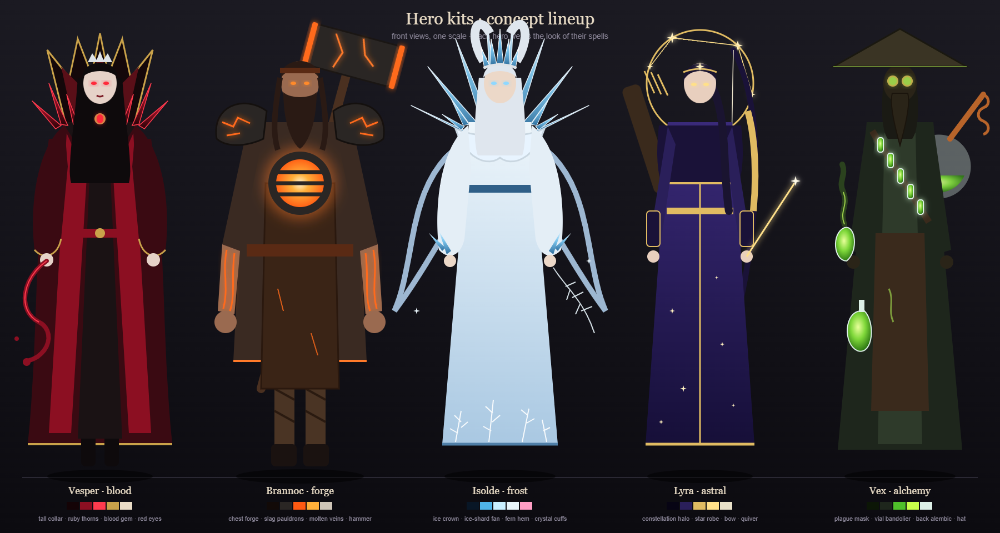
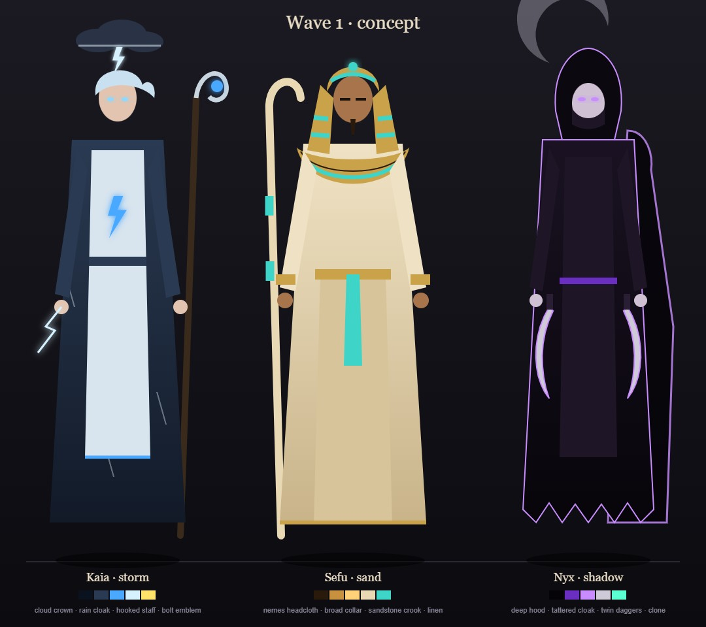
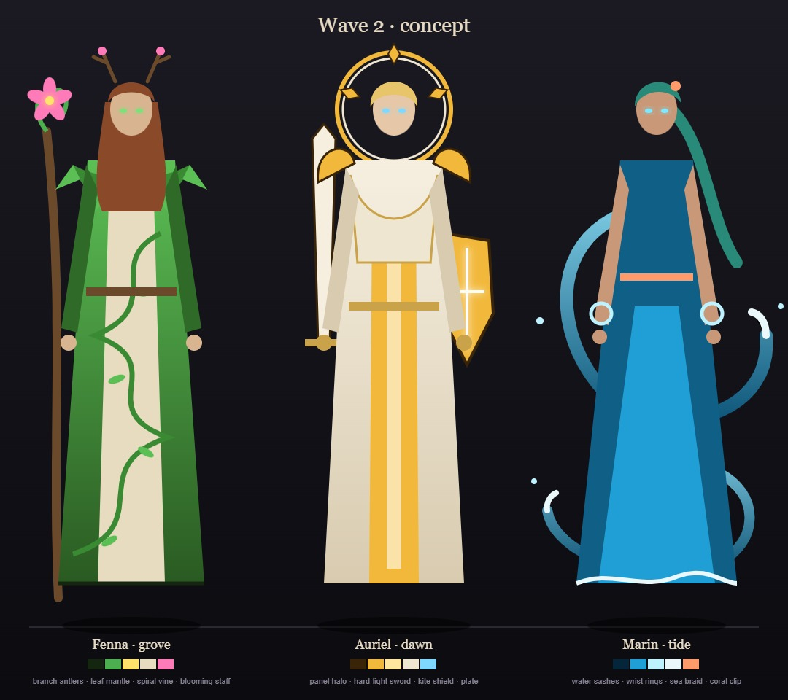

# Hero roster

Seventeen hero kits, each one character with four spells (Q, W, E and the R ultimate), one shared parts file, one palette row in the art bible and one rigged model. A kit is data (`HeroKit` in [`src/heroes.ts`](../../../src/heroes.ts)); its spells are ordinary registered effects looked up by label, so each also appears in the [effect catalog](../effects.md). Hero mode (key H, `src/heroMode.ts`) plays a kit MOBA-style on top of play mode, and the hero switcher (View menu, or click the portrait) changes the hero.

## Roster

| Hero | Title | Theme | Signature shape | Portrait (HUD, canvas-drawn) | Page |
|---|---|---|---|---|---|
| Vesper | the Crimson Countess | blood (`hero: blood`) | The blood tendril: a tapered, viscous rope with a round bead at the tip, that hardens into faceted ruby crystal thorns. | A bone crescent behind a blood drop: the moon and the blood. | [blood](blood.md) |
| Brannoc | the Ashen Smith | forge (`hero: forge`) | Molten slag that cools: liquid metal glows white-orange, a black crust grows over it from the edges inward, leaving orange cracks that dim to dull red and go out. | A broad iron helm, an ash beard, and the forge glowing in his chest. | [forge](forge.md) |
| Isolde | the Winter Warden | frost (`hero: frost`) | Frost ferns: rime creeps across the floor (and up the enemies) as feathery, branching fern patterns that grow from a point outward, white-blue on dark stone, then shatter into angular ice shards. | A frost fern fan behind, a tall crystal, and a hooded face with one pink glint. | [frost](frost.md) |
| Lyra | the Star Archer | astral (`hero: astral`) | Constellations: bright four-point star points joined by thin, crisp gold lines that draw themselves from star to star into a figure (a net, a bow, a stag), then snap: the lines break and the stars fall as small shooting stars. | A parchment ring with a gold bow-shaped constellation inside it. | [astral](astral.md) |
| Vex | the Plague Alchemist | alchemy (`hero: alchemy`) | Glass and reaction: thin-walled glass flasks (pale green-white glass, dark liquid inside) that shatter into sharp glass shards, releasing a bubbling caustic liquid (acid green, big round bubbles that swell and pop into rings) and rising fume curls. | A dark hood, a pale glass mask with a long beak-like snout and two round green lenses, and a coat with a bandolier of vials. | [alchemy](alchemy.md) |
| Kaia | the Tempest Caller | storm (`hero: storm`) | The lightning tree: thick, hard-edged blue-white lightning that branches like a tree with a dark outline, under flat-bottomed dark cloud, with slanting rain streaks at one shared angle. | A dark cloud over slanting rain and a branching bolt, a hooded face in a rain cloak, and the hooked staff with a spark in its hook. | [storm](storm.md) |
| Sefu | the Dune Sovereign | sand (`hero: sand`) | Sand that flows like a ribbon and sets like stone: thick grainy ochre ribbons that harden into pale carved sandstone with dark incised glyphs, then crumble to dust. | Layered linen shoulders, a gold collar, a bearded face under a striped gold headdress, and the sandstone crook behind. | [sand](sand.md) |
| Nyx | the Umbral Stalker | shadow (`hero: shadow`) | Flat cut-paper shadow: matte-black blades, hands, a crescent and hooded figures with a thin hard violet edge line, standing as cut-outs that move in stepped jumps. | A pale moon behind her, two crossed daggers and the hooded black figure with a mint slit for the eyes. | [shadow](shadow.md) |
| Fenna | the Grove Warden | grove (`hero: grove`) | The spiral vine that blooms: thick green vines coil in spirals with leaf pairs, and at the end of every spiral a giant flower bursts open (a cup of cream petals with a pink rim and a pollen core), then sheds petals and pollen. | A living staff topped by a bloom, a cloak of layered leaves with a pale bark collar, and antler-like branches around her head. | [grove](grove.md) |
| Auriel | the Dawn Paladin | dawn (`hero: dawn`) | Hard-light geometry: flat gold panels with crisp edges (hexagons, kite shields, blade shards) that click together into shapes and shatter into panels, lit by a white core line with a dark amber rim. | A sun disc with crisp rays, a halo ring above a helmed paladin in white and gold plate, and a raised blade. | [dawn](dawn.md) |
| Marin | the Tide Dancer | tide (`hero: tide`) | The water ribbon: thick, smooth bands of clear blue water with a white foam crest that she swirls like a dancer's sash, throwing spinning droplets off the curls. | Sashes of water sweeping round her, a wave-blue wrap on the shoulders and a coral flower in her hair. | [tide](tide.md) |
| Zephyr | the Wind Blade | sky (`hero: sky`) | The wind crescent: sharp pale sickle crescents with a hot leading edge and a thin dark inner edge, joined by thin spiral gust ribbons and blown leaves. | A big pale crescent behind her, gust ribbons streaming to the side, a mint scarf and a head with swept white hair and a pink blossom. | [sky](sky.md) |
| Mortis | the Ossuary Lord | bone (`hero: bone`) | Bone architecture: chunky carved ivory ribs, vertebrae, skull-capped spires and cages with teal soulfire flickering in the joints. | A skull face under a dark hood with teal wisps, rib arcs over the chest and a skull-topped staff. | [bone](bone.md) |
| Ada | the Artificer | clockwork (`hero: clockwork`) | The toothed gear: machined copper and brass gears, springs, chains and rivets, with cyan sparks jumping where the metal meets and steam from the joints. | A backpack of brass gears behind her shoulders, a cyan zigzag of electricity and a bobbed head with goggles pushed up on a leather cap. | [clockwork](clockwork.md) |
| Opaline | the Lightbreaker | prism (`hero: prism`) | The refracting crystal: faceted clear lavender glass with a dark edge line, and light that enters white and leaves as thin parallel bands of red, gold, green and blue. | A floating ring of small prisms behind her head, a pale lavender robe with crystal epaulettes and a crystal brooch, and a calm face under long pale hair. | [prism](prism.md) |
| Sirix | the Swarm Warden | hive (`hero: hive`) | The hexagon and the swarm: wax-amber honeycomb cells, black chitin plates with an amber rim, and hundreds of small striped wasps that form into shapes. | Honeycomb cells and pale wings behind black chitin shoulders with hexagonal pauldrons, and an insect head with green eyes. | [hive](hive.md) |
| Cantor | the Last Verse | bard (`hero: bard`) | The stave and the note: flowing five-line parchment staves with dark ink notes riding them, thin fast sound rings and one golden lyre. | Staves drifting behind him with notes riding them, a rose and plum coat with a lyre strap and a parchment scarf printed with notes. | [bard](bard.md) |

Spell labels per hero:

| Hero | Q | W | E | R (ultimate) |
|---|---|---|---|---|
| Vesper | hemolance | thorn garden | crimson pact | sanguine eclipse |
| Brannoc | rivet shot | anvil drop | bellows ward | forgefall |
| Isolde | rime spear | frostfern field | glacial mantle | winter's crown |
| Lyra | starshot | constellation snare | orbit veil | celestial hunt |
| Vex | volatile flask | caustic pool | mutagen | grand transmutation |
| Kaia | arc lance | downpour | static field | eye of the storm |
| Sefu | sand lash | quicksand | dune ward | tomb of kings |
| Nyx | umbral blink | grasp of the deep | night shroud | eclipse execution |
| Fenna | bloom lash | overgrowth | verdant ward | world blossom |
| Auriel | radiant spear | aegis wall | halo of blades | judgement of dawn |
| Marin | tide whip | whirlpool | undertow dance | leviathan's waltz |
| Zephyr | gale edge | tailwind rush | cyclone guard | thousand winds |
| Mortis | bone spear | grave call | ossuary ward | legion of the ossuary |
| Ada | clockwork rivet shot | cog turret | gear field | gearfall |
| Opaline | prism bolt | refraction field | mirror shell | spectrum lance |
| Sirix | mandible rend | swarm leap | chitin carapace | queen's descent |
| Cantor | discordant note | silencing refrain | ballad of valor | crescendo |

## How the kits share structure

- **One parts file per kit**: `src/effects/parts/<theme>.ts` exports a palette constant (numbers, plus a `_CSS` string twin such as `BLOOD` / `BLOOD_CSS`) and the kit's pooled parts. The spells import it directly.
- **One palette row per kit** in [ART_BIBLE.md](../../ART_BIBLE.md) section 2: core, hot, body, accent, dark, plus a pale foil colour that keeps dark energy readable on a darkened floor. The art bible rows are Blood (bone foil), Forge (ash), Frost (rime), Astral (chart parchment), Alchemy (glass, with gold for the transmutation), Storm (rain grey), Sand (sandstone), Shadow (moon grey), Grove (bark cream), Dawn (ivory) and Tide (foam), Sky (cloud), Bone (bone ivory), Clockwork (steel), Prism (clear glass), Hive (wax) and Bard (parchment).
- **Spells**: `src/spells/targeted/<camelName>.ts`, each exporting `<camelName>Module` with `category: 'hero: <theme>'`, registered in `src/spells/targeted/index.ts`. Every hit passes the kit colour (`color: <PALETTE>_CSS.body`) so the arena hit flash matches.
- **Kit data**: `HeroKit` has name, title, accent and foil colours, a canvas-drawn portrait, an optional model path, and a tuple of four `HeroSpell` (`key`, `label`, `name`, `range`, `cooldown`, `blurb`, canvas icon). The blood kit is inline in `src/heroes.ts`; the others are `src/kits/<theme>.ts`.
- **Q, W, E are normal MOBA abilities** under the gameplay camera: the hit lands 0.4-0.8 s after the cast and the frame is clean by about 2 s (an E aura may run about 3 s). Q is a single-target or short-chain strike, W a ground zone, E a self aura (range 0, cast at once).
- **R is the ultimate**: the biggest of the four, still under the gameplay camera (no cinematic, no letterbox), hit around 2.0-2.5 s, clean by 4.5 s, with one dead beat and one short impact frame. Ranges: Q 10-12, W 10-11, R 13-14; cooldowns: Q 2.5-3 s, W 6-8 s, E 9-10 s, R 20 s.
- **Each kit has a signature shape** and a pale foil near its dark layer; shapes must read at gameplay distance (camera about 12-16 behind and 6-8 above). The shared look lessons are in [`pipeline/designs/kit-common.md`](../../../pipeline/designs/kit-common.md); the blood kit sheet [`blood-kit.md`](../../../pipeline/designs/blood-kit.md) is the template.
- **Mechanics fields**: the wave 3 and wave 4 kits use the optional kit fields of the [combat mechanics](../../architecture/mechanics.md): `maxHp` and `melee` on the kit (Zephyr, Sirix), `dash`, `cc`, `summon` and `aim: 'line'` on a spell, and `ctx.projectile` / `ctx.summon` / `ctx.shieldSelf` / `ctx.moveCaster` and `HitOptions.status` in the spell files.
- **Models**: rigged figures on the Dao rig in `public/models/heroes/<theme>.glb`, built by [`blender/heroes/hero_figures.py`](../../../blender/heroes/hero_figures.py) (one `LOOKS` entry per hero plus its props) and mapped by hero name in `src/heroes.ts`.

## Concept lineup

The hand-drawn concept lineup (front views, one scale, each hero wearing the look of their spells; vector source [`lineup_concept.svg`](../../heroes/lineup_concept.svg)):

The concept for the wave 1 heroes (Kaia, Sefu and Nyx; vector source [`wave1_concept.svg`](../../heroes/wave1_concept.svg)):

The concept for the wave 2 heroes (Fenna, Auriel and Marin; vector source [`wave2_concept.svg`](../../heroes/wave2_concept.svg)):

The concept for the wave 3 heroes (Zephyr, Mortis and Ada; vector source [`wave3_concept.svg`](../../heroes/wave3_concept.svg)):

The concept for the newest three heroes (Opaline, Sirix and Cantor; vector source [`wave4_concept.svg`](../../heroes/wave4_concept.svg)):

## In-game sheet

The rigged models in hero mode: front row facing the camera, back row from behind (left to right: Vesper, Brannoc, Isolde, Lyra, Vex).

The turnaround sheet of the same models is [`models_sheet.jpg`](../../heroes/models_sheet.jpg).

The wave 4 models in hero mode (Opaline, Sirix and Cantor):

## Hero pages

- [Vesper, the Crimson Countess](blood.md)
- [Brannoc, the Ashen Smith](forge.md)
- [Isolde, the Winter Warden](frost.md)
- [Lyra, the Star Archer](astral.md)
- [Vex, the Plague Alchemist](alchemy.md)
- [Kaia, the Tempest Caller](storm.md)
- [Sefu, the Dune Sovereign](sand.md)
- [Nyx, the Umbral Stalker](shadow.md)
- [Fenna, the Grove Warden](grove.md)
- [Auriel, the Dawn Paladin](dawn.md)
- [Marin, the Tide Dancer](tide.md)
- [Zephyr, the Wind Blade](sky.md)
- [Mortis, the Ossuary Lord](bone.md)
- [Ada, the Artificer](clockwork.md)
- [Opaline, the Lightbreaker](prism.md)
- [Sirix, the Swarm Warden](hive.md)
- [Cantor, the Last Verse](bard.md)

## Balance (duel tournament)

Damage per spell after the balance pass (2026-10-29). E auras hit on each pulse; R hits once (Sanguine Eclipse and
Grand Transmutation twice). Ranges and cooldowns are in each hero's page.

| Hero | Q | W | E | R |
|---|---|---|---|---|
| Vesper | Hemolance 53, cd 3 s | Thorn Garden 50 + 10, cd 7 s | Crimson Pact 2 × 9 | Sanguine Eclipse 15 + 120 |
| Brannoc | Rivet Shot 46 | Anvil Drop 55 | Bellows Ward 2 × 15 | Forgefall 115 |
| Isolde | Rime Spear 50 | Frostfern Field 56 | Glacial Mantle 2 × 12 | Winter's Crown 125 |
| Lyra | Starshot 52 per target (hits from 0.52 s) | Constellation Snare 60, cd 7 s | Orbit Veil 2 × 12 | Celestial Hunt 135 |
| Vex | Volatile Flask 45 + 12 | Caustic Pool 30 + 12 + 12, cd 7 s | Mutagen 2 × 12 | Grand Transmutation 80 + 50 |
| Kaia | Arc Lance 50 | Downpour 40 + 15, cd 7 s | Static Field 2 × 14 | Eye of the Storm 125 |
| Sefu | Sand Lash 50 | Quicksand 45 + 10, cd 7 s | Dune Ward 2 × 13 | Tomb of Kings 125 |
| Nyx | Umbral Blink 50 | Grasp of the Deep 45 + 10, cd 7 s | Night Shroud 2 × 13 | Eclipse Execution 125 |
| Fenna | Bloom Lash 50 | Overgrowth 45 + 10, cd 7 s | Verdant Ward 2 × 15 | World Blossom 125 |
| Auriel | Radiant Spear 50 | Aegis Wall 45 + 10, cd 7 s | Halo of Blades 2 × 13 | Judgement of Dawn 125 |
| Marin | Tide Whip 50 | Whirlpool 45 + 10, cd 7 s | Undertow Dance 2 × 13 | Leviathan's Waltz 125 |
| Zephyr | Gale Edge 40, cd 2.5 s | Tailwind Rush 45, knock-up 0.4 s, cd 7 s | Cyclone Guard 2 × 13 + 50 shield | Thousand Winds 125, knock-up 0.5 s |
| Mortis | Bone Spear 50 (pierces) | Grave Call 15 + 2 skeletons, cd 9 s | Ossuary Ward 2 × 12 + 30 shield | Legion of the Ossuary 90 + 2 archers |
| Ada | Rivet Shot 55 + slow (ricochets) | Cog Turret 20 + turret 12 per shot, cd 12 s | Gear Field 2 × 13 + slow | Gearfall 125 + root 1.2 s |
| Opaline | Prism Bolt 45 + 3 × 15 (splits), cd 3 s | Refraction Field 40 + blind 1.5 s, cd 7 s | Mirror Shell 2 × 12 + 40 shield | Spectrum Lance 125 |
| Sirix | Mandible Rend 40 + slow, cd 2.5 s | Swarm Leap 30 + 2 wasps, cd 9 s | Chitin Carapace 2 × 12 + 40 shield + slow | Queen's Descent 90 + stun 0.6 s |
| Cantor | Discordant Note 50 (bounces), cd 3 s | Silencing Refrain 40 + silence 1.5 s, cd 7 s | Ballad of Valor 2 × 10 + 30 shield + heal 40 | Crescendo 100 + stun 0.6 s |

Kaia, Sefu and Nyx were built inside the balance budget in `pipeline/designs/kit-common.md` and needed no tuning: in an
8-hero tournament (3 fights per ordered pairing, 168 fights) every hero won 38–60% (Lyra 60%, Nyx 60%, Brannoc 55%,
Kaia 55%, Vesper 52%, Vex 43%, Isolde 38%, Sefu 38%), within the noise of that sample.

Zephyr, Mortis and Ada are the first kits built on the [combat mechanics](../../architecture/mechanics.md) (a melee hero with a dash and knock-ups, a summoner, a ranged control hero with slows, a turret and a root). Crowd control, shields and summons cost damage, so their numbers follow the "Mechanics budget" in `pipeline/designs/kit-common.md` (melee 700 HP and Q about 40; summoner spells with less damage; a ranged control Q of about 55). After those numbers the wave 3 tournament gave Zephyr 60%, Mortis 60% and Ada 56%.

Opaline, Sirix and Cantor (wave 4) are built on the same mechanics and budget: a splitting skillshot with a blind (mage), a melee brawler with a leap that summons wasps, and a support with a bouncing skillshot, a silence, a shield with a heal and a stunning ultimate. In the wave 4 tournament (each hero against 16 opponents, 3 fights per ordered pairing, both sides) Opaline first won 63%; Refraction Field was lowered from 45 to 40 damage and she then won 53%. Sirix won 45% and Cantor 46%.

Measured with AI vs AI duels (run duel, every hero against every other, both sides on the same AI, both dodging)
using [duel-tourney.js](../../../pipeline/tools/duel-tourney.js). Win rates, two runs of 100 fights:

| Hero | Before | After |
|---|---|---|
| Vesper | 88% | 57% |
| Brannoc | 67% | 53% |
| Lyra | 8% | 48% |
| Isolde | 50% | 46% |
| Vex | 38% | 46% |

What changed: Hemolance 60 → 53 and cooldown 2.5 → 3 s, Thorn Garden cooldown 6 → 7 s; Rivet Shot 55 → 46, Anvil
Drop 65 → 55, Forgefall 130 → 115; Rime Spear 55 → 50, Frostfern Field 50 → 56; Starshot 45 → 52 and its first hit
0.75 → 0.52 s (its late hit was dodged about half the time), Constellation Snare 50 → 60 and cooldown 8 → 7 s,
Celestial Hunt 125 → 135; Volatile Flask 40 → 45, Caustic Pool cooldown 8 → 7 s. Single matchups still swing a lot
between runs (the AI's strafing is random); judge balance on the totals of 100+ fights.

## See also

- [Effect catalog](../effects.md)
- [Combat mechanics](../../architecture/mechanics.md)
- [Hero mode screenshots](../../spells/hero-mode_aim.jpg) and [ultimate](../../spells/hero-mode_ult.jpg)
- [Docs home](../../README.md)
- [Art bible](../../ART_BIBLE.md)
- [Kit shared rules](../../../pipeline/designs/kit-common.md)
