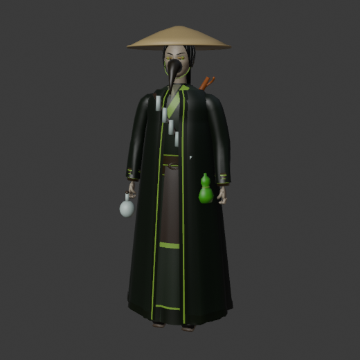
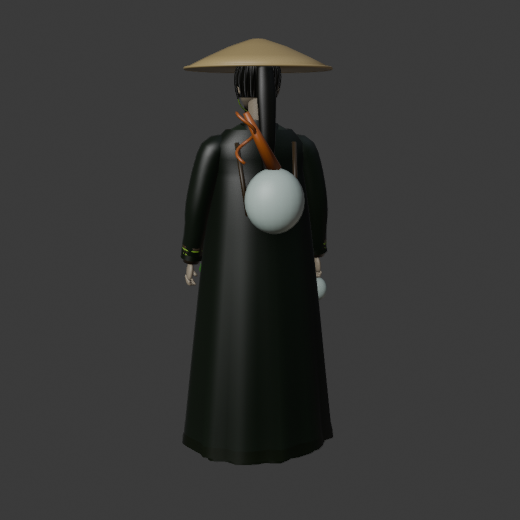

# Vitriol, the Plague Alchemist

The alchemy hero kit (v5): Vitriol's four spells (Q, W, E and the R ultimate), his passive, the shared parts file, the palette row and the rigged hero model. In the earlier versions of this page he was called Vex. A plague doctor in a dark hood and a pale glass beak mask with round green lenses, and a coat with a bandolier of vials. Each of his first three spells leaves a reagent on the enemy; two different reagents react. He has 510 HP and plays at range.

## Role

| | |
|---|---|
| Role | Mage (reactions), ranged |
| Signature | Reaction |
| HP | 510 |
| Kit shapes | Q LINE dart + toxin · W TGT fire (sure hit) · E CONE acid (self-cast) · R SUMMON walking bomb |

He wins by mixing two reagents on the enemy for a reaction, and by sending the homunculus, which sets off all three at once. His weakness is HP and reach: his basic attack reaches only 6.5 m, and the homunculus can be shot down.

## At a glance

| | |
|---|---|
| Hero | Vitriol, the Plague Alchemist |
| Spell category | `hero: alchemy` |
| Parts file | [`src/effects/parts/alchemy.ts`](../../../src/effects/parts/alchemy.ts) |
| Kit data | [`src/kits/alchemy.ts`](../../../src/kits/alchemy.ts) |
| Trait (rules) | [`src/traits/alchemy.ts`](../../../src/traits/alchemy.ts) |
| Kit sheet | [`kit-alchemy.md`](../../../pipeline/designs/kit-alchemy.md) (read [kit-common.md](../../../pipeline/designs/kit-common.md) first) |
| Model | [`public/models/heroes/alchemy.glb`](../../../public/models/heroes/alchemy.glb) |

## Palette

The art bible row "Alchemy" ([ART_BIBLE.md](../../ART_BIBLE.md) section 2, energy value ladders). Every effect of the kit picks from this row and adds black.

| Core | Hot | Body | Accent | Dark | Foil |
|---|---|---|---|---|---|
| `#f4ffe0` | `#c8ff4a` | `#4fbf2a` | `#ff5ad8` | `#0c1606` | glass `#dcefe6`, gold `#e8b84a` |

Core is tiny; accent is a magenta reaction spark, 2-3 frames; the glass foil is glass walls, shard edges and the alchemical circle ink; gold `#e8b84a` is used only for the transmutation.

## Signature shape and material rules

Glass and reaction: thin-walled glass flasks (pale green-white glass, dark liquid inside) that shatter into sharp glass shards, releasing a bubbling caustic liquid (acid green, big round bubbles that swell and pop into rings) and rising fume curls. The ultimate's twist: transmutation to gold (enemies flash to gold statues for a beat, then crack).

- Acid: the kit's liquid shader (smooth, dark-green rim, one thin hot-green rim line, pinpoint specular); bubbles are separate small spheres of the same look that swell and pop into thin rings.
- Glass: low-opacity pale glass with a bright fresnel rim; shards are flat glass triangles with an edge line.
- Fumes: dark green toon smoke curls (normal-blended, dark with a hot-green rim), small and few.

## Passive and twist

| | |
|---|---|
| Passive | Reaction: each of Q, W and E leaves its reagent on the enemy for 4 s (Q green toxin, W orange fire, E violet acid). A second, different reagent sets off a reaction, clears both reagents and takes 2 s off the cooldown of the spell that took no part. |
| Twist | The three reactions. Toxin + fire: Combust, 34 extra damage at once. Toxin + acid: Corrode, the enemy takes 35% more damage for 3 s. Fire + acid: Concussion, the enemy is pushed 2.5 m and silenced 0.5 s. The Homunculus (R) carries all three reagents and sets off all three reactions with its one hit. |
| Resource or meter | none (the reagents are stacks on the enemy; the passive slot shows the letters T, F, A) |
| Speed | 4.0 m/s |
| Basic attack | ranged, 6.5 m, 9 damage every 1.0 s, wind-up 0.25 s, bolt speed 18, dart look |
| Other rules | Once per cast: a burn tick of the same cast does not count as a second reagent. |

## Mechanics

Vitriol uses these pieces of [the combat mechanics](../../architecture/mechanics.md):

| Mechanic | Where |
|---|---|
| Stacks on the enemy | The three reagents, from the trait's `dealt` |
| Damage over time | Q: 5 ticks of 5 over 3 s; W: 5 ticks of 5 over 2 s (`projectile: true`, so they follow a target that walks) |
| Skillshot | Q: a dart at 20 m/s, 9 m, radius 0.4 (`aim: 'line'`) |
| Sure hit | W: needs sight at the cast, cannot miss |
| Cone, self-cast | E: a 4 m cone in front of her (self targeting, radius 4.5; the AI casts when the enemy is within 3.9 m) with a shove back |
| Summon | R: `summon: true`, a walking bomb of 120 HP at 4 m/s that lives at most 3.7 s |
| Debuff, silence, push | The reactions |
| Cooldown cut | A reaction takes 2 s off the unused spell (`noteOwner`, `peerNote`) |
| Melee, dash, pull, shield, heal | none |

## Spells

All four play under the normal gameplay camera. Range and cooldown come from the kit data (`src/kits/alchemy.ts`), hit time and length from the spell files in `src/spells/targeted/`; the numbers are the spell files' defaults. Reaction bonuses come on top.

| Key | Label | Targeting | Range | Cooldown | Hit time | Length | What happens |
|---|---|---|---|---|---|---|---|
| Q | [toxin dart](../../../src/spells/targeted/toxinDart.ts) | line skillshot (ground aim) | 9 | 3 s | on contact (speed 20, 6 m in about 0.5 s with the wind-up) | 4.3 s | She flicks a glass dart of green toxin down the aim. On a hit: 20 damage, a green splat, and the toxin clings as a bubbling blob for 4 s, with 5 ticks of 5 over 3 s. Leaves the toxin reagent. A miss only splashes the floor. |
| W | [fire vial](../../../src/spells/targeted/fireVial.ts) | enemy (needs sight) | 7 | 6 s | 0.72 s | about 3.6 s | A vial of orange fire arcs after the enemy's live position and bursts on them: 18 damage, then 5 ticks of 5 over 2 s while flames stand on them. It cannot miss. Leaves the fire reagent. With no enemy it bursts on the aimed spot. |
| E | [acid splash](../../../src/spells/targeted/acidSplash.ts) | self (cone r 4) | 4 | 8 s | 0.42 s | 2.1 s | She smashes a flask of violet acid in front of her: everyone in the 4 m cone takes 40 and a shove back, and a violet puddle lies there a moment. Leaves the acid reagent. Her answer to being rushed. |
| R | [homunculus](../../../src/spells/targeted/homunculus.ts) | enemies (up to 10) | 10 | 25 s | on contact (the bomb appears at 0.4 s, lives up to 3.7 s) | about 5.5 s | Ultimate. She flings three vials into a circle at her feet and a glass-bellied homunculus (120 HP, 4 m/s) hops out and walks at the enemy. Within 1.5 m of an enemy it bursts on everyone within 2 m for 55 and sets off all three reactions (Combust, Corrode, Concussion), a beat apart. It can be shot down, and then it only fizzles. |

Spell sources: [`toxinDart.ts`](../../../src/spells/targeted/toxinDart.ts), [`fireVial.ts`](../../../src/spells/targeted/fireVial.ts), [`acidSplash.ts`](../../../src/spells/targeted/acidSplash.ts), [`homunculus.ts`](../../../src/spells/targeted/homunculus.ts). Their catalog rows are in the [effect catalog](../effects.md#hero-alchemy).

## Parts file

[`src/effects/parts/alchemy.ts`](../../../src/effects/parts/alchemy.ts) holds everything the kit's spells share. Spells import it directly (`../../effects/parts/alchemy`).

| Export | Role |
|---|---|
| `ALCHEMY`, `ALCHEMY_CSS` | palette constants |
| `Flask` | a flask mesh (glass shell, sloshing dark acid, cork): `slosh`, `lob` along an arc |
| `GlassShards` | instanced flat glass triangles (or, recoloured, gold flakes) with gravity and spin |
| `Bubbles` | acid bubbles that rise, swell and pop into a thin ring |
| `AcidPool` | bubbling ground decal: `spread`, `bubble`, `drain` to a stain |
| `Fumes` | dark toon fume curls that rise and twist (default cap 8) |
| `Droplets` | small acid droplets flying an arc from point to point (the E spit) |
| `TransmuteCircle` | a glass-ink alchemical circle with glyphs that can be lit one by one |
| `AcidColumn` | the ultimate's column of acid that coils into a sphere |
| `FigureShell` | a gold statue or green-rim shell drawn over an arena figure without touching the arena materials |
| `Flames` | the fire reagent burning on a body |
| `ReactionBurst` | one burst per reaction at the struck body (Combust a fireball, Corrode three closing violet rings, Concussion a flat shockwave); `trigger(kinds, at)` plays one or several |
| `homunculusLook` | the `MinionLook` of the homunculus: a squat glass-bellied creature with a cork head, a hissing fuse and three reagent orbs in its belly |
| `REAGENT`, `REACTION_CSS`, `REACTION_WORD` | the three reagent colours (slot 0..2) and the reaction colours and words |

## Model

[`public/models/heroes/alchemy.glb`](../../../public/models/heroes/alchemy.glb): a rigged figure on the Dao rig (same bone names as `public/models/figures/hero.glb`, so `src/effects/weapons/hero.ts` can pose it). Built by `build("alchemy")` / `export("alchemy")` in [`blender/heroes/hero_figures.py`](../../../blender/heroes/hero_figures.py) (the first style). Hero mode shows it with procedural walk, breath and cast poses. It is wired through the `MODELS` map in [`src/heroes.ts`](../../../src/heroes.ts) (name `Vitriol`), and its hit size is in `HERO_BODIES` in the same file (radius 0.43 m, height 2.37 m).
- HUD portrait (canvas-drawn in the kit data): A dark hood, a pale glass mask with two round green lenses, and a coat with a bandolier of vials.

  

## Files

| What | Where |
|---|---|
| Kit sheet (design) | [`pipeline/designs/kit-alchemy.md`](../../../pipeline/designs/kit-alchemy.md) |
| Shared kit rules | [`pipeline/designs/kit-common.md`](../../../pipeline/designs/kit-common.md) |
| Parts | [`src/effects/parts/alchemy.ts`](../../../src/effects/parts/alchemy.ts) |
| Spells | [`toxinDart.ts`](../../../src/spells/targeted/toxinDart.ts), [`fireVial.ts`](../../../src/spells/targeted/fireVial.ts), [`acidSplash.ts`](../../../src/spells/targeted/acidSplash.ts), [`homunculus.ts`](../../../src/spells/targeted/homunculus.ts) |
| Kit data | [`src/kits/alchemy.ts`](../../../src/kits/alchemy.ts) |
| Trait (passive, twist, rules) | [`src/traits/alchemy.ts`](../../../src/traits/alchemy.ts) |
| Model | [`public/models/heroes/alchemy.glb`](../../../public/models/heroes/alchemy.glb) |
| Model script | [`blender/heroes/hero_figures.py`](../../../blender/heroes/hero_figures.py) |

## See also

- [Hero roster and shared structure](README.md)
- [Combat mechanics](../../architecture/mechanics.md)
- [Vesper (blood)](blood.md), [Brannoc (forge)](forge.md), [Isolde (frost)](frost.md), [Lyra (astral)](astral.md)
- [Effect catalog](../effects.md)
- [Docs home](../../README.md)
- [Art bible](../../ART_BIBLE.md)
- [Kit shared rules](../../../pipeline/designs/kit-common.md)
