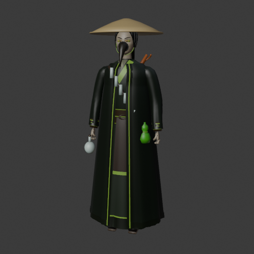
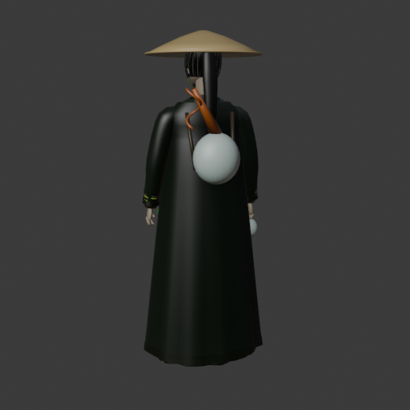
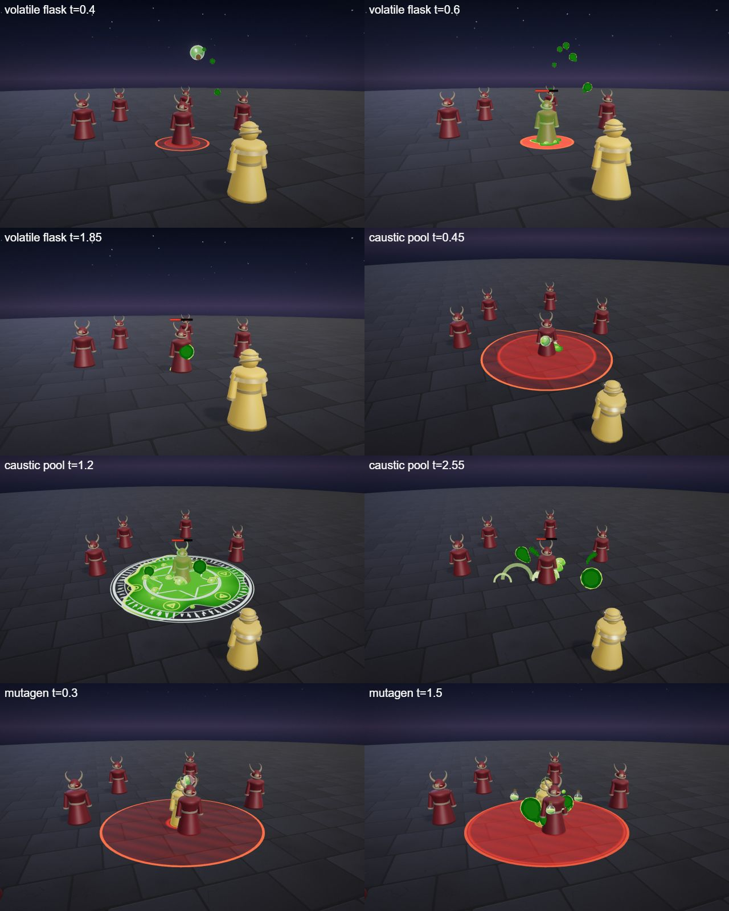
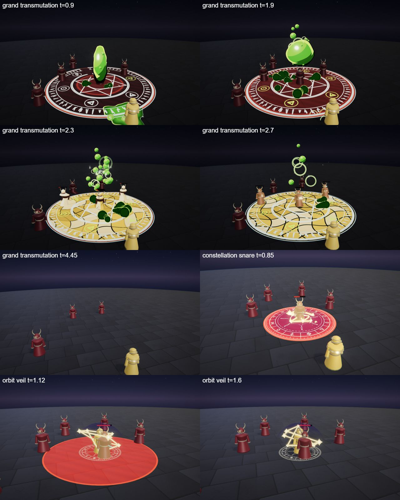

# Vex, the Plague Alchemist

The alchemy hero kit: Vex's four spells (Q, W, E and the R ultimate), the shared parts file, the palette row and the rigged hero model. A masked alchemist in a coat of vials; damage over time, zones, a gamble of an ultimate.

## Role

| | |
|---|---|
| Role | Mage (poison) |
| Signature | Lingering poison |
| HP | 560 |
| Reach | Ranged |

She wins by damage over time: pools and fields that slow and keep ticking, plus a heal. Her flask is a small circle that can miss, and she has little burst.

## At a glance

| | |
|---|---|
| Hero | Vex, the Plague Alchemist |
| Spell category | `hero: alchemy` |
| Parts file | [`src/effects/parts/alchemy.ts`](../../../src/effects/parts/alchemy.ts) |
| Kit data | [`src/kits/alchemy.ts`](../../../src/kits/alchemy.ts) |
| Kit sheet | [`kit-alchemy.md`](../../../pipeline/designs/kit-alchemy.md) (read [kit-common.md](../../../pipeline/designs/kit-common.md) first) |
| Model | [`public/models/heroes/alchemy.glb`](../../../public/models/heroes/alchemy.glb) |

## Palette

The art bible row "Alchemy" ([ART_BIBLE.md](../../ART_BIBLE.md) section 2, energy value ladders). Every effect of the kit picks from this row and adds black.

| Core | Hot | Body | Accent | Dark | Foil |
|---|---|---|---|---|---|
| `#f4ffe0` | `#c8ff4a` | `#4fbf2a` | `#ff5ad8` | `#0c1606` | glass `#dcefe6`, gold `#e8b84a` |

Core is tiny; accent is a magenta reaction spark, 2-3 frames; the glass foil is glass walls, shard edges and the alchemical circle ink; gold `#e8b84a` is used only for the transmutation.

## Signature shape and material rules

Glass and reaction: thin-walled glass flasks (pale green-white glass, dark liquid inside) that shatter into sharp glass shards, releasing a bubbling caustic liquid (acid green, big round bubbles that swell and pop into rings) and rising fume curls. The ultimate's twist: transmutation to gold (enemies flash to gold statues for a beat, then crack).

- Acid: the kit's liquid shader (smooth, dark-green rim, one thin hot-green rim line, pinpoint specular); bubbles are separate small spheres of the same look that swell and pop into thin rings.
- Glass: low-opacity pale glass with a bright fresnel rim; shards are flat glass triangles with an edge line.
- Fumes: dark green toon smoke curls (normal-blended, dark with a hot-green rim), small and few.

## Spells

All four play under the normal gameplay camera (no cinematic, no letterbox). The four slots are four different spell types (see the Targeting column). Q is a lob, W a lingering pool, E a heal and R a lingering gold field. Q hits at 0.55 s and W ticks until 3.6 s; E is clean by about 2.3 s; R is the ultimate (hit around 2.0-2.5 s, clean by 5.0 s, one dead beat and one short impact frame). Range and cooldown come from the kit data (`src/kits/alchemy.ts`), hit time and length from the spell files in `src/spells/targeted/`; "hit" is the telegraph impact time and the first damage.

| Key | Label | Targeting | Range | Cooldown | Hit time | Length | What happens |
|---|---|---|---|---|---|---|---|
| Q | [volatile flask](../../../src/spells/targeted/volatileFlask.ts) | ground (r 1.6, LOB) | 10 | 3 s | 0.55 s | 1.8 s | She lobs a flask in a high spinning arc; it shatters on the spot in glass and caustic splash. Whoever stands in the 1.6 m circle takes damage 53, and one burn tick of 12 at 1.2 s. |
| W | [caustic pool](../../../src/spells/targeted/causticPool.ts) | ground (r 4, LINGER) | 10 | 7 s | 0.6 s, then ticks at 1.2, 2.0, 2.8 and 3.6 s | 4.6 s | Two flasks shatter on the point and an alchemical circle fills with boiling acid that stays 4 s and burns everything in it, then drains to a stain. Damage 34 on the first hit, then four ticks of 7; every hit slows 1.0 s. |
| E | [mutagen](../../../src/spells/targeted/mutagen.ts) | self (BUFF) | 0 (self) | 9 s | 0.4 s (the drink) | 2.3 s | She drinks a flask and heals 45 HP. No damage and no flasks. Loopable. |
| R | [grand transmutation](../../../src/spells/targeted/grandTransmutation.ts) | ground (r 7, LINGER) | 13 | 20 s | 2.0 s (gold), ticks at 2.8 and 3.4 s, shatter at 3.8 s | 5.0 s | The ultimate. A giant circle and a column of acid that coils into a sphere (dead beat 1.85-2.0 s); at 2.0 s everything in the zone turns to gold (75, slow 2.0 s). The gold field stands 1.8 s and ticks 5 with slow 2.0 s at 2.8 and 3.4 s, then shatters at 3.8 s (50). |

Spell sources: [`volatileFlask.ts`](../../../src/spells/targeted/volatileFlask.ts), [`causticPool.ts`](../../../src/spells/targeted/causticPool.ts), [`mutagen.ts`](../../../src/spells/targeted/mutagen.ts), [`grandTransmutation.ts`](../../../src/spells/targeted/grandTransmutation.ts). Their catalog rows are in the [effect catalog](../effects.md#hero-alchemy).

## Parts file

[`src/effects/parts/alchemy.ts`](../../../src/effects/parts/alchemy.ts) holds everything the four spells share. Spells import it directly (`../../effects/parts/alchemy`).

| Export | Role |
|---|---|
| `ALCHEMY`, `ALCHEMY_CSS` | palette constants |
| `Flask` | a flask mesh (glass shell, sloshing dark acid, cork): `slosh`, `lob` along an arc |
| `GlassShards` | instanced flat glass triangles (or, recoloured, gold flakes) with gravity and spin |
| `Bubbles` | acid bubbles that rise, swell and pop into a thin ring |
| `AcidPool` | bubbling ground decal: `spread`, `bubble`, `drain` to a stain |
| `Fumes` | dark toon fume curls that rise and twist (default cap 8) |
| `Droplets` | small acid droplets flying an arc from point to point (the E spit) |
| `TransmuteCircle` | a glass-ink alchemical circle with glyphs that can be lit one by one |
| `AcidColumn` | the ultimate's column of acid that coils into a sphere |
| `FigureShell` | a gold statue or green-rim shell drawn over an arena figure without touching the arena materials |

## Model

[`public/models/heroes/alchemy.glb`](../../../public/models/heroes/alchemy.glb): a rigged figure on the Dao rig (same bone names as `public/models/figures/hero.glb`, so `src/effects/weapons/hero.ts` can pose it). Built by `build("alchemy")` / `export("alchemy")` in [`blender/heroes/hero_figures.py`](../../../blender/heroes/hero_figures.py); hero mode shows it with procedural walk, breath and cast poses. It is wired through the `MODELS` map in [`src/heroes.ts`](../../../src/heroes.ts).

- Look: A long dark coat over a stained robe, a leather apron, a wide conical hat.
- Props: `plague_mask` (beaked, glass eyes), `vial_bandolier` (glowing vials), `back_alembic`, `held_flask`.
- HUD portrait (canvas-drawn in the kit data): A dark hood, a pale glass mask with a long beak-like snout and two round green lenses, and a coat with a bandolier of vials.

 

## Files

| What | Where |
|---|---|
| Kit sheet (design) | [`pipeline/designs/kit-alchemy.md`](../../../pipeline/designs/kit-alchemy.md) |
| Shared kit rules | [`pipeline/designs/kit-common.md`](../../../pipeline/designs/kit-common.md) |
| Parts | [`src/effects/parts/alchemy.ts`](../../../src/effects/parts/alchemy.ts) |
| Spells | [`volatileFlask.ts`](../../../src/spells/targeted/volatileFlask.ts), [`causticPool.ts`](../../../src/spells/targeted/causticPool.ts), [`mutagen.ts`](../../../src/spells/targeted/mutagen.ts), [`grandTransmutation.ts`](../../../src/spells/targeted/grandTransmutation.ts) |
| Kit data | [`src/kits/alchemy.ts`](../../../src/kits/alchemy.ts) |
| Model | [`public/models/heroes/alchemy.glb`](../../../public/models/heroes/alchemy.glb) |
| Model script | [`blender/heroes/hero_figures.py`](../../../blender/heroes/hero_figures.py) |

## Review sheets

Contact sheets in `docs/spells/` (frames over time, from `pipeline/tools/contact-sheet.js`).

### Alchemy review A

### Alchemy review B

### Final check (forgefall and the alchemy kit)

## See also

- [Hero roster and shared structure](README.md)
- [Vesper (blood)](blood.md), [Brannoc (forge)](forge.md), [Isolde (frost)](frost.md), [Lyra (astral)](astral.md)
- [Effect catalog](../effects.md)
- [Docs home](../../README.md)
- [Art bible](../../ART_BIBLE.md)
- [Kit shared rules](../../../pipeline/designs/kit-common.md)
