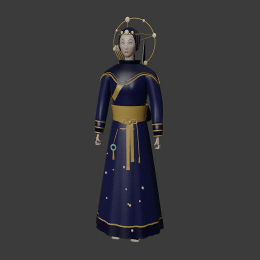
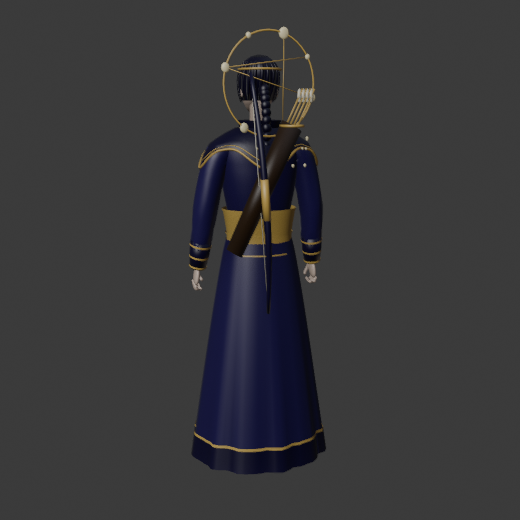

# Lyra, the Star Archer

The astral hero kit (v5): Lyra's four spells (Q, W, E and the R ultimate), her passive, the shared parts file, the palette row and the rigged hero model. A night archer with a gold crescent bow, a starry violet cloak and constellations that draw themselves between her arrows. She is a ranged marksman: she hits harder the farther the enemy is, she draws her bow for her first spell and she ends fights with a meteor.

## Role

| | |
|---|---|
| Role | Marksman (ranged) |
| Signature | Far Sight |
| HP | 520 |
| Kit shapes | Q LINE held skillshot · W SELF attack echo + haste · E LINE pin or slow · R TGT mark, then meteor |

She wins by keeping the enemy at 10 m or more, where her damage is 30% higher, and by pinning them against a wall. Her weakness is her low HP (520) and being caught: her basic attack reaches only 8.5 m.

## At a glance

| | |
|---|---|
| Hero | Lyra, the Star Archer |
| Spell category | `hero: astral` |
| Parts file | [`src/effects/parts/astral.ts`](../../../src/effects/parts/astral.ts) |
| Kit data | [`src/kits/astral.ts`](../../../src/kits/astral.ts) |
| Trait (rules) | [`src/traits/astral.ts`](../../../src/traits/astral.ts) |
| Kit sheet | [`kit-astral.md`](../../../pipeline/designs/kit-astral.md) (read [kit-common.md](../../../pipeline/designs/kit-common.md) first) |
| Model | [`public/models/heroes/astral.glb`](../../../public/models/heroes/astral.glb) |

## Palette

The art bible row "Astral" ([ART_BIBLE.md](../../ART_BIBLE.md) section 2, energy value ladders). Every effect of the kit picks from this row and adds black.

| Core | Hot | Body | Accent | Dark | Foil |
|---|---|---|---|---|---|
| `#fffbe8` | `#ffe08a` | `#5a3fc0` | `#7ff3ff` | `#070414` | chart `#e8e0c8` |

Core only in star cores; hot is the constellation lines; body is the night-violet field behind the stars; accent (cyan) only 2-3 frames at hits; the parchment chart foil is the drawn chart rings and zodiac glyphs on the ground.

## Signature shape and material rules

Constellations: bright four-point star points joined by thin, crisp gold lines that draw themselves from star to star into a figure (a net, a bow, a stag), then snap: the lines break and the stars fall as small shooting stars. Second shape: arrows of light with a long, thin gold tail.

- Lines are crisp ribbons (width ~0.06-0.1) with a soft halo under them (~0.3 at low opacity), not fat glows.
- Stars are four-point hard shapes with a tiny white core and varied sizes.
- The violet body is a dark translucent "night" disc or ribbon behind the gold so the gold reads (the dark layer).
- The chart foil is a canvas ring with tick marks and zodiac glyphs, not glowing.

## Passive and twist

| | |
|---|---|
| Passive | Far Sight: her damage rises with distance, +0% within 4 m, up to +30% at 10 m or more (every hit she deals, spells and attacks). The passive slot shows the current bonus. |
| Twist | A held Q. Aiming Q longer charges it for up to 1 s: the range grows from 9 to 14 m and the damage from 29 to 58 (power 0.5 + 0.5 x the draw). At full draw the arrow pierces, and a full-draw hit takes 3 s off Pinning Arrow's cooldown. |
| Resource or meter | none |
| Speed | 4.0 m/s |
| Basic attack | ranged, 8.5 m, 12 damage every 1.4 s, wind-up 0.32 s, arrow speed 24 |
| Other rules | Twin Stars makes every basic attack for 5 s loose a second arrow at half damage (`attackEcho` 0.5) and gives +20% speed (kit `buff`, haste). Meteor Mark adds up to 25% of what she deals the marked enemy meanwhile, tallied while the mark is live. |

## Mechanics

Lyra uses these pieces of [the combat mechanics](../../architecture/mechanics.md):

| Mechanic | Where |
|---|---|
| Hold (charge) | Q: `hold: { slot: 0, seconds: 1 }` |
| Skillshots | Q (14 m at full draw, speed 26) and E (9 m, speed 24, radius 0.4) are projectiles; both are `aim: 'line'` |
| Root or slow by position | E: the status is decided at the hit: within 1.5 m of a wall or pillar the enemy is rooted 1.5 s, anywhere else they are slowed 40% for 1.5 s. E is flagged `cc` |
| Cooldown cut | A full-draw Q hit takes 3 s off E (`setCooldown`) |
| Attack echo and haste | W |
| Mark and strike | R: a star locks onto the enemy, follows them, then falls on a fixed spot |
| Melee, summon, dash, pull, shield, heal | none |

## Spells

All four play under the normal gameplay camera. Range and cooldown come from the kit data (`src/kits/astral.ts`), hit time and length from the spell files in `src/spells/targeted/`. The numbers are the spell files' defaults, before Far Sight.

| Key | Label | Targeting | Range | Cooldown | Hit time | Length | What happens |
|---|---|---|---|---|---|---|---|
| Q | [starfall arrow](../../../src/spells/targeted/starfallArrow.ts) | line skillshot (ground aim), held | 14 (9 to 14 by the draw) | 4 s | arrow leaves at 0.3 s | 3.2 s | A gold crescent bow and string draw on and the arrow leaves at 0.3 s. Damage 29 to 58 by the draw. Small stars drop onto the line every 2 m; the constellation lines join them, hold a beat, snap, and the stars fall. A full draw pierces and adds an impact frame and a ground ring. |
| W | [twin stars](../../../src/spells/targeted/twinStars.ts) | self | 0 (self) | 14 s | none (a look only) | 5.2 s | A parchment chart draws on under her and two four-point stars orbit her chest on a gold line. For 5 s each basic attack looses a second arrow at half damage, and she moves 20% faster. The orbit fades over the last 0.45 s. |
| E | [pinning arrow](../../../src/spells/targeted/pinningArrow.ts) | line skillshot (ground aim) | 9 | 9 s | arrow leaves at 0.3 s | 3.2 s | A thin arrow (speed 24) for 35 damage. Within 1.5 m of a wall or pillar the enemy is pinned: rooted 1.5 s with a gold line to the wall. Anywhere else they are slowed 40% for 1.5 s. |
| R | [meteor mark](../../../src/spells/targeted/meteorMark.ts) | enemy | 14 | 24 s | 2.4 s (spot fixed at 1.5 s) | 4.1 s | Ultimate. A star arrow climbs into the sky and a large star hangs 12 m up, tethered to the enemy. It follows them for 1.5 s and swells with what she deals them, then fixes on their position. At 2.4 s the meteor lands on that spot (radius 1.8 m, checked on live positions): 120 plus 25% of the damage she dealt the marked enemy meanwhile. One impact frame and a crater. |

Spell sources: [`starfallArrow.ts`](../../../src/spells/targeted/starfallArrow.ts), [`twinStars.ts`](../../../src/spells/targeted/twinStars.ts), [`pinningArrow.ts`](../../../src/spells/targeted/pinningArrow.ts), [`meteorMark.ts`](../../../src/spells/targeted/meteorMark.ts). Their catalog rows are in the [effect catalog](../effects.md#hero-astral).

## Parts file

[`src/effects/parts/astral.ts`](../../../src/effects/parts/astral.ts) holds everything the kit's spells share. Spells import it directly (`../../effects/parts/astral`).

| Export | Role |
|---|---|
| `ASTRAL`, `ASTRAL_CSS` | palette constants |
| `StarPoints` | instanced four-point stars: pop in, `twinkle`, `fall` as a shooting star |
| `ConstellationLines` | crisp gold segments with a halo: `connect` draws a line, `snap` breaks them into falling pieces |
| `StarArrow` | a light arrow with a long tapered gold tail: `fly`, `onArrive` |
| `StarChart` | a parchment ground ring with ticks and zodiac glyphs, with a `hole` to hide the busy centre |
| `NightVeil` | a dark violet translucent disc, dome or upright patch with sparse tiny stars, the dark layer behind constellations |

## Model

[`public/models/heroes/astral.glb`](../../../public/models/heroes/astral.glb): a rigged figure on the Dao rig (same bone names as `public/models/figures/hero.glb`, so `src/effects/weapons/hero.ts` can pose it). Built by `build("astral")` / `export("astral")` in [`blender/heroes/hero_figures.py`](../../../blender/heroes/hero_figures.py) (the first style). Hero mode shows it with procedural walk, breath and cast poses. It is wired through the `MODELS` map in [`src/heroes.ts`](../../../src/heroes.ts) (name `Lyra`), and its hit size is in `HERO_BODIES` in the same file (radius 0.38 m, height 2.38 m).
- HUD portrait (canvas-drawn in the kit data): A parchment ring with a gold bow-shaped constellation inside it.

  

## Files

| What | Where |
|---|---|
| Kit sheet (design) | [`pipeline/designs/kit-astral.md`](../../../pipeline/designs/kit-astral.md) |
| Shared kit rules | [`pipeline/designs/kit-common.md`](../../../pipeline/designs/kit-common.md) |
| Parts | [`src/effects/parts/astral.ts`](../../../src/effects/parts/astral.ts) |
| Spells | [`starfallArrow.ts`](../../../src/spells/targeted/starfallArrow.ts), [`twinStars.ts`](../../../src/spells/targeted/twinStars.ts), [`pinningArrow.ts`](../../../src/spells/targeted/pinningArrow.ts), [`meteorMark.ts`](../../../src/spells/targeted/meteorMark.ts) |
| Kit data | [`src/kits/astral.ts`](../../../src/kits/astral.ts) |
| Trait (passive, twist, rules) | [`src/traits/astral.ts`](../../../src/traits/astral.ts) |
| Model | [`public/models/heroes/astral.glb`](../../../public/models/heroes/astral.glb) |
| Model script | [`blender/heroes/hero_figures.py`](../../../blender/heroes/hero_figures.py) |

## See also

- [Hero roster and shared structure](README.md)
- [Combat mechanics](../../architecture/mechanics.md)
- [Vesper (blood)](blood.md), [Brannoc (forge)](forge.md), [Isolde (frost)](frost.md), [Vitriol (alchemy)](alchemy.md)
- [Effect catalog](../effects.md)
- [Docs home](../../README.md)
- [Art bible](../../ART_BIBLE.md)
- [Kit shared rules](../../../pipeline/designs/kit-common.md)
