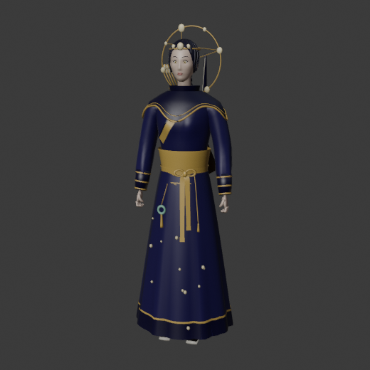
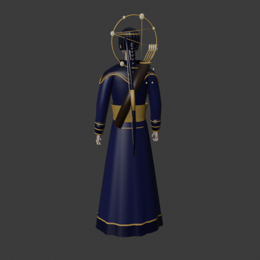
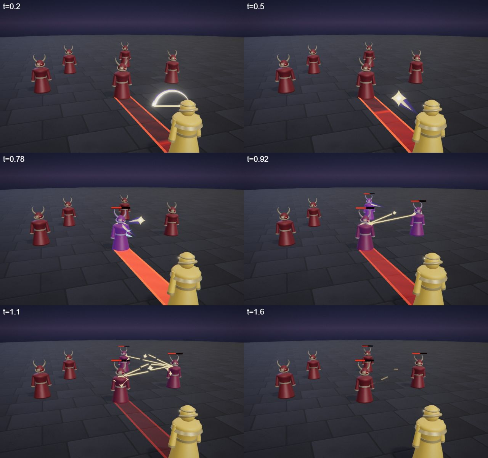
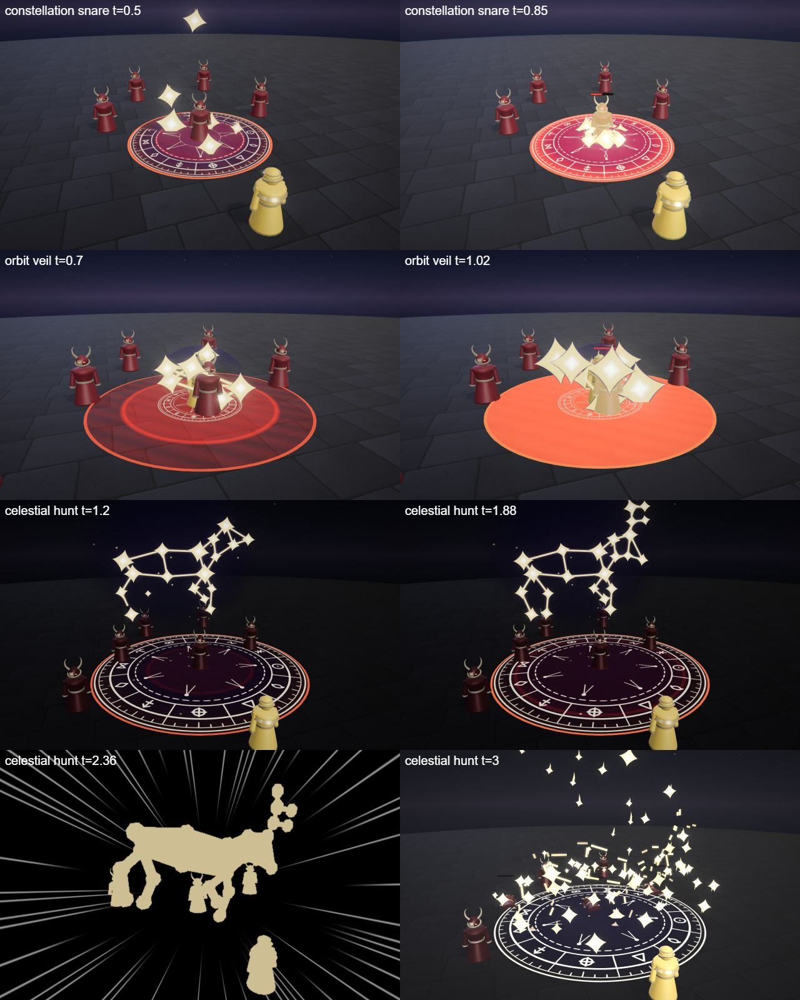

# Lyra, the Star Archer

The astral hero kit: Lyra's four spells (Q, W, E and the R ultimate), the shared parts file, the palette row and the rigged hero model. A ranged archer who reads the sky; precise, elegant, multi-target.

## Role

| | |
|---|---|
| Role | Marksman |
| Signature | Out-range |
| HP | 520 |
| Reach | Ranged (longest reach: Q 14 m, R global) |

She out-ranges everyone: steady poke from 14 m, a trap, and a backstep to reset the gap. She has the least HP and dies to a dive that closes the distance.

## At a glance

| | |
|---|---|
| Hero | Lyra, the Star Archer |
| Spell category | `hero: astral` |
| Parts file | [`src/effects/parts/astral.ts`](../../../src/effects/parts/astral.ts) |
| Kit data | [`src/kits/astral.ts`](../../../src/kits/astral.ts) |
| Kit sheet | [`kit-astral.md`](../../../pipeline/designs/kit-astral.md) (read [kit-common.md](../../../pipeline/designs/kit-common.md) first) |
| Model | [`public/models/heroes/astral.glb`](../../../public/models/heroes/astral.glb) |

## Palette

The art bible row "Astral" ([ART_BIBLE.md](../../ART_BIBLE.md) section 2, energy value ladders). Every effect of the kit picks from this row and adds black.

| Core | Hot | Body | Accent | Dark | Foil |
|---|---|---|---|---|---|
| `#fffbe8` | `#ffe08a` | `#5a3fc0` | `#7ff3ff` | `#070414` | chart `#e8e0c8` |

Core only in star cores; hot is the constellation lines; body is the night-violet field behind the stars; accent (cyan) only 2-3 frames at hits; the parchment chart foil is the drawn chart rings and zodiac glyphs on the ground.

## Signature shape and material rules

Constellations: bright four-point star points joined by thin, crisp gold lines that draw themselves from star to star into a figure (a net, a bow, a stag), then snap: the lines break and the stars fall as small shooting stars. Second shape: arrows of light with a long, thin gold tail.

- Lines are crisp ribbons (width ~0.06-0.1) with a soft halo under them (~0.3 at low opacity), not fat glows.
- Stars are four-point hard shapes with a tiny white core and varied sizes.
- The violet body is a dark translucent "night" disc or ribbon behind the gold so the gold reads (the dark layer).
- The chart foil is a canvas ring with tick marks and zodiac glyphs, not glowing.

## Spells

All four play under the normal gameplay camera (no cinematic, no letterbox). The four slots are four different spell types (see the Targeting column). Q is a bouncing skillshot, W a trap, E a backstep and R a global strike. Q, W and E are clean by about 2.4-4 s; R is the ultimate (hit around 2.0-2.5 s, clean by 4.5 s, one dead beat and one short impact frame). Range and cooldown come from the kit data (`src/kits/astral.ts`), hit time and length from the spell files in `src/spells/targeted/`; "hit" is the telegraph impact time and the first damage.

| Key | Label | Targeting | Range | Cooldown | Hit time | Length | What happens |
|---|---|---|---|---|---|---|---|
| Q | [starshot](../../../src/spells/targeted/starshot.ts) | ground, aim line (BOLT, bounces once) | 14 | 2 s | 0.27 s (release; flies 22 m/s) | 3.0 s | She draws a bow of light; a star arrow flies down the aim line, hits the first enemy and bounces once to the nearest other enemy within 6 m, leaving a small constellation that snaps. Damage 52 per hit. |
| W | [constellation snare](../../../src/spells/targeted/constellationSnare.ts) | ground (r 4 net, TRAP) | 11 | 7 s | armed at 0.8 s, snaps when an enemy is inside; fizzles at 3.0 s | 4.0 s | An arrow goes up, stars fall around the spot and are joined into a net that lies armed until 3.0 s. The moment an enemy stands inside it snaps tight: damage 60, root 1.2 s, and it drags the enemy toward the centre; it breaks apart 0.6 s later. If nobody walks in, it fizzles with no hit. |
| E | [orbit veil](../../../src/spells/targeted/orbitVeil.ts) | self (r 5, BACKSTEP) | 0 (self) | 9 s | 0.6 s (volley); the step starts at 0.65 s | 2.4 s | A turning constellation of 7 stars circles her under a night veil and fires gold lines at every enemy within 5 m: damage 12 and slow 1.0 s. Then it carries her 5 m away from the enemy in 0.35 s, and the chart and veil travel with her. |
| R | [celestial hunt](../../../src/spells/targeted/celestialHunt.ts) | ground (r 3, GLOBAL) | 60 (the whole ring) | 20 s | 2.5 s | 4.5 s | The ultimate. The world goes to night and a giant constellation stag is drawn over the spot you pick, anywhere in the ring; dead beat at 1.8-1.95 s, then it charges down (impact frame, star rain). Hits check where the enemy stands now, so a walker escapes. Damage 155. |

Spell sources: [`starshot.ts`](../../../src/spells/targeted/starshot.ts), [`constellationSnare.ts`](../../../src/spells/targeted/constellationSnare.ts), [`orbitVeil.ts`](../../../src/spells/targeted/orbitVeil.ts), [`celestialHunt.ts`](../../../src/spells/targeted/celestialHunt.ts). Their catalog rows are in the [effect catalog](../effects.md#hero-astral).

## Parts file

[`src/effects/parts/astral.ts`](../../../src/effects/parts/astral.ts) holds everything the four spells share. Spells import it directly (`../../effects/parts/astral`).

| Export | Role |
|---|---|
| `ASTRAL`, `ASTRAL_CSS` | palette constants |
| `StarPoints` | instanced four-point stars: pop in, `twinkle`, `fall` as a shooting star |
| `ConstellationLines` | crisp gold segments with a halo: `connect` draws a line, `snap` breaks them into falling pieces |
| `StarArrow` | a light arrow with a long tapered gold tail: `fly`, `onArrive` |
| `StarChart` | a parchment ground ring with ticks and zodiac glyphs, with a `hole` to hide the busy centre |
| `NightVeil` | a dark violet translucent disc, dome or upright patch with sparse tiny stars, the dark layer behind constellations |

## Model

[`public/models/heroes/astral.glb`](../../../public/models/heroes/astral.glb): a rigged figure on the Dao rig (same bone names as `public/models/figures/hero.glb`, so `src/effects/weapons/hero.ts` can pose it). Built by `build("astral")` / `export("astral")` in [`blender/heroes/hero_figures.py`](../../../blender/heroes/hero_figures.py); hero mode shows it with procedural walk, breath and cast poses. It is wired through the `MODELS` map in [`src/heroes.ts`](../../../src/heroes.ts).

- Look: A night-violet robe with gold trim, archer's bracers, a braid.
- Props: `star_circlet`, `star_halo`, `mantle_stars`, `robe_stars`, `back_bow`, `quiver`.
- HUD portrait (canvas-drawn in the kit data): A parchment ring with a gold bow-shaped constellation inside it.

 

## Files

| What | Where |
|---|---|
| Kit sheet (design) | [`pipeline/designs/kit-astral.md`](../../../pipeline/designs/kit-astral.md) |
| Shared kit rules | [`pipeline/designs/kit-common.md`](../../../pipeline/designs/kit-common.md) |
| Parts | [`src/effects/parts/astral.ts`](../../../src/effects/parts/astral.ts) |
| Spells | [`starshot.ts`](../../../src/spells/targeted/starshot.ts), [`constellationSnare.ts`](../../../src/spells/targeted/constellationSnare.ts), [`orbitVeil.ts`](../../../src/spells/targeted/orbitVeil.ts), [`celestialHunt.ts`](../../../src/spells/targeted/celestialHunt.ts) |
| Kit data | [`src/kits/astral.ts`](../../../src/kits/astral.ts) |
| Model | [`public/models/heroes/astral.glb`](../../../public/models/heroes/astral.glb) |
| Model script | [`blender/heroes/hero_figures.py`](../../../blender/heroes/hero_figures.py) |

## Review sheets

Contact sheets in `docs/spells/` (frames over time, from `pipeline/tools/contact-sheet.js`).

### Starshot

### Astral review (the other three spells)

## See also

- [Hero roster and shared structure](README.md)
- [Vesper (blood)](blood.md), [Brannoc (forge)](forge.md), [Isolde (frost)](frost.md), [Vex (alchemy)](alchemy.md)
- [Effect catalog](../effects.md)
- [Docs home](../../README.md)
- [Art bible](../../ART_BIBLE.md)
- [Kit shared rules](../../../pipeline/designs/kit-common.md)
