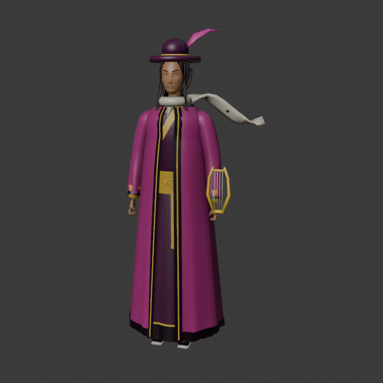
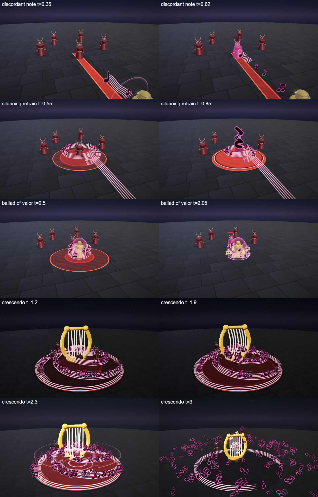

# Cantor, the Last Verse

The bard hero kit: Cantor's four spells (Q, W, E and the R ultimate), the shared parts file, the palette row and the rigged hero model. A support in a rose and plum long coat and a wide plum hat with a rose feather, carrying a golden lyre; his magic is sound made visible, as flowing five-line staves with notes riding them. He is built on the [combat mechanics](../../architecture/mechanics.md): a bouncing skillshot, a silence, a shield with a heal and a self-centred stunning ultimate.

## Role

| | |
|---|---|
| Role | Support (ranged) |
| Signature | Silence |
| HP | 640 |
| Kit shapes | Q BOLT bounce · W ZONE silence · E BUFF heal + shield · R SELF-R stun |

He wins a 1v1 by attrition: the silence shuts the enemy's spells off, the ballad shields and heals him, and the crescendo stuns anyone who has come close. His weakness is low burst: he needs time to win the trade.

## At a glance

| | |
|---|---|
| Hero | Cantor, the Last Verse |
| Spell category | `hero: bard` |
| Parts file | [`src/effects/parts/bard.ts`](../../../src/effects/parts/bard.ts) |
| Kit data | [`src/kits/bard.ts`](../../../src/kits/bard.ts) |
| Kit sheet | [`kit-bard.md`](../../../pipeline/designs/kit-bard.md) (read [kit-common.md](../../../pipeline/designs/kit-common.md) first) |
| Model | [`public/models/heroes/bard.glb`](../../../public/models/heroes/bard.glb) |

## Palette

The art bible row "Bard" ([ART_BIBLE.md](../../ART_BIBLE.md) section 2, energy value ladders). Every effect of the kit picks from this row.

| Core | Hot | Body | Accent | Dark | Foil |
|---|---|---|---|---|---|
| `#ffffff` | `#ffb8e6` | `#e04aa8` | `#ffd24a` | `#1e0a1a` | parchment `#f2e6d0` |

Core is only tiny highlights and the white leading edge of a sound ring; hot is the pale rim glow of a note; body is the rose magenta of the glow and the sound rings; accent (gold) is the lyre, the golden notes of the heal and the two-frame stars at the hits; dark is the ink of the notes and the plum-black sky of the ultimate; the parchment foil is the five stave lines. Plum `#4a1a40` appears in the kit icons as the coat.

## Signature shape and material rules

The stave and the note. Flowing five-line staves wave through the air with dark ink notes riding along them, thin crisp sound rings race outward, and one golden lyre is the only solid object. Every spell is a piece of music: a note thrown and bouncing, a stave that coils round a zone and goes silent, two staves circling him, a giant lyre and one deafening chord. Not the storm kit's lightning (Kaia) and not the astral kit's drawn lines (Lyra): soft waving ribbons, ink glyphs with a glowing rim, and rings that are fast and thin.

- Staves: five thin parallel parchment ribbons with a rose glow edge, camera-facing and unlit, gently waving.
- Notes: flat camera-facing glyphs (quarter, eighth, beamed pair, treble clef, rest) in dark ink with a rose rim; the notes of a heal are gold.
- Sound rings: a thin band with a white leading edge and a rose body, expanding fast and fading.

## Mechanics

Cantor uses these pieces of [the combat mechanics](../../architecture/mechanics.md):

| Mechanic | Where |
|---|---|
| Skillshot, bounce | Q is `aim: 'line'`: `ctx.projectile` fires a note (speed 20, range 12, radius 0.45) with `bounce: 1`, so after the first hit it turns to the nearest other enemy within 6 m. Hero mode draws a strip toward the cursor; the AI's bolt dodge can sidestep it |
| Silence | W silences every enemy it hits for 1.5 s (`status: { kind: 'silence', seconds: 1.5 }`, cap 1.5 s): they can still move but cannot cast |
| Shield, heal | E gives `ctx.shieldSelf(30, 3)`, a 30 point shield for 3 s, and at the second pulse `ctx.healSelf(40)` (up to max HP, with a green number) |
| Aura | E pulses twice and hits every enemy inside radius 4 for 10 with knock 2 |
| Stun | R has `cc: true` and stuns every enemy within 5 m of him for 0.8 s (cap 1.2 s). A stun is followed by 0.5 s of stun immunity, so it cannot be chained |
| Melee, dash, summons | none. `maxHp` is 640 |

The numbers follow the "Mechanics budget" of [kit-common.md](../../../pipeline/designs/kit-common.md): a support kit pays for its silence, shield, heal and stun with less damage on the other spells (E 10 per pulse, R 95).

## Spells

All four play under the normal gameplay camera (no cinematic, no letterbox). The four spells have different shapes: Q is a bouncing skillshot (first damage 0.2-0.8 s after the cast, clean by 1.5 s), W a delayed ground zone (hit at 0.75 s, clean by 2.2 s), E a shield and heal with two weak pulses (3.2 s), R a self-centred ultimate round him (hit at 2.2 s, clean by 4.5 s, one dead beat and impact frames). Range and cooldown come from the kit data (`src/kits/bard.ts`), hit time and length from the spell files in `src/spells/targeted/`; "hit" is the telegraph impact time and the first damage.

| Key | Label | Targeting | Range | Cooldown | Hit time | Length | What happens |
|---|---|---|---|---|---|---|---|
| Q | [discordant note](../../../src/spells/targeted/discordantNote.ts) | ground, BOLT skillshot line (width 0.9) | 12 | 3 s | flies from 0.2 s, about 0.6 s of flight | 1.5 s | He strums his golden lyre; a big dark note glyph forms in front of him with two sound rings, and at 0.2 s it flies along the aim line trailing a short five-line stave ribbon. Each hit bursts into small notes and a sound ring with a two-frame gold star, and the note bounces on to the nearest other enemy. Damage 52, knock 2. |
| W | [silencing refrain](../../../src/spells/targeted/silencingRefrain.ts) | ground ZONE (r 4) | 10 | 7 s | 0.75 s | 2.2 s | A stave ribbon spirals in from his lyre and coils round the zone edge; notes ride the coil inward while it tightens. At 0.75 s the hush: every note freezes, one huge rest glyph appears over the centre, a dark sound ring snaps inward and every enemy inside is hit and silenced. Then the notes fall and fade and the stave unwinds. Damage 40, silence 1.5 s. |
| E | [ballad of valor](../../../src/spells/targeted/balladOfValor.ts) | self BUFF (r 4) | 0 (self) | 9 s | 1.0 s and 2.0 s (two pulses) | 3.2 s | Two stave ribbons circle him (radius 1.3) with notes riding them, and he is shielded at once for 3 s. At 1.0 s and 2.0 s he strums and a sound ring races out to radius 4: every enemy inside takes a small hit and is knocked back. At 2.0 s golden notes rise round him and he heals. At 2.6 s the staves unwind into falling notes. The telegraph ends at the first pulse. Damage 10 per pulse, knock 2, shield 30, heal 40. |
| R | [crescendo](../../../src/spells/targeted/crescendo.ts) | self SELF-R (r 5) | 0 (self) | 20 s | 2.2 s | 4.5 s | The ultimate. The world darkens to plum-black and a circle of staves marks radius 5 round him. A giant golden lyre (about 6 tall) rises in front of him; three staves spiral up from the zone edge into it carrying hundreds of notes, its strings shimmer faster and the enemies are pulled a little toward the centre. At 1.6 s every note stops mid-air and the strings draw back; dead beat 1.85-2.0 s; at 2.0 s the strings snap forward and a wall of sound rings races down onto him. At 2.2 s the chord lands: two impact frames, concentric sound rings across the zone, every note scatters, a gold star, ground refraction, the hit and a short stun on everything within 5 m. The notes drift down and the lyre dissolves into notes. Damage 95, knock 4, stun 0.8 s. |

Spell sources: [`discordantNote.ts`](../../../src/spells/targeted/discordantNote.ts), [`silencingRefrain.ts`](../../../src/spells/targeted/silencingRefrain.ts), [`balladOfValor.ts`](../../../src/spells/targeted/balladOfValor.ts), [`crescendo.ts`](../../../src/spells/targeted/crescendo.ts). Their catalog rows are in the [effect catalog](../effects.md#hero-bard).

## Parts file

[`src/effects/parts/bard.ts`](../../../src/effects/parts/bard.ts) holds everything the four spells share. Spells import it directly (`../../effects/parts/bard`). Everything is pooled, takes world-space positions and has a `reset()`; the materials are unlit toon shaders kept below the bloom threshold.

| Export | Role |
|---|---|
| `BARD`, `BARD_CSS` | palette constants (`foil` is the parchment) |
| `Stave` | a five-line music stave along a path: `setPath(points, width, head, tail)` sets the path and the visible stretch of it, `setRange(head, tail)`, `wave(amplitude)` makes it undulate, `at(u, out)` gives the point at fraction `u` so notes can ride it; `alpha` fades it |
| `GLYPH` | the glyph atlas indices: `quarter`, `eighth`, `beamed`, `clef`, `rest` |
| `Notes` | pooled note glyphs (`NoteOptions`, `RideOptions`), one instanced mesh: `emit(pos, vel, count, life, opts)` throws free notes, `ride(stave, u, glyph, opts)` slides one along a stave, `hold(pos, glyph, size, gold)` keeps one in place (`move`, `resize`, `kill`), `fall(gravity, life)` and `scatter(origin, speed, life, gravity)` turn every note into a free one; `frozen` holds time for a dead beat |
| `SoundRings` | quick crisp sound rings (`RingOptions`): `pulse(center, radius, seconds, normal, opts)`; pooled |
| `Lyre` | the golden lyre (about 1 m tall at scale 1): `show(pos, scale, yaw)` pops it in, `place` moves or resizes it, `strum(strength)` makes the strings ring, `pull(k)` draws them back, `shimmer(rate)` keeps them humming, `hide()` |

## Model

[`public/models/heroes/bard.glb`](../../../public/models/heroes/bard.glb): a rigged figure on the Dao rig (same bone names as `public/models/figures/hero.glb`, so `src/effects/weapons/hero.ts` can pose it). Built by `build("bard")` / `export("bard")` in [`blender/heroes/hero_figures.py`](../../../blender/heroes/hero_figures.py); hero mode shows it with procedural walk, breath and cast poses. It is wired through the `MODELS` map in [`src/heroes.ts`](../../../src/heroes.ts) (name `Cantor`).

- Look: A slim man in a rose and plum long coat over a cream shirt, with leg wraps, loose dark hair, a wide plum hat with a rose feather, a parchment scarf printed with notes and a golden lyre in his left hand.
- Props: `feathered_hat`, `note_scarf`, `golden_lyre`.
- HUD portrait (canvas-drawn in the kit data): Staves drifting behind him with a few notes riding them, shoulders in a rose and plum coat with a lyre strap, and the parchment scarf printed with notes.

The wave 4 concept (Opaline, Sirix and Cantor; vector source [`wave4_concept.svg`](../../heroes/wave4_concept.svg)):

The wave 4 models in hero mode (Opaline, Sirix and Cantor):

## Files

| What | Where |
|---|---|
| Kit sheet (design) | [`pipeline/designs/kit-bard.md`](../../../pipeline/designs/kit-bard.md) |
| Shared kit rules | [`pipeline/designs/kit-common.md`](../../../pipeline/designs/kit-common.md) |
| Parts | [`src/effects/parts/bard.ts`](../../../src/effects/parts/bard.ts) |
| Spells | [`discordantNote.ts`](../../../src/spells/targeted/discordantNote.ts), [`silencingRefrain.ts`](../../../src/spells/targeted/silencingRefrain.ts), [`balladOfValor.ts`](../../../src/spells/targeted/balladOfValor.ts), [`crescendo.ts`](../../../src/spells/targeted/crescendo.ts) |
| Kit data | [`src/kits/bard.ts`](../../../src/kits/bard.ts) |
| Model | [`public/models/heroes/bard.glb`](../../../public/models/heroes/bard.glb) |
| Model script | [`blender/heroes/hero_figures.py`](../../../blender/heroes/hero_figures.py) |

## Review sheets

Contact sheet in `docs/spells/` (frames over time, from `pipeline/tools/contact-sheet.js`). The bard kit passed its first review, so there is no second round.

### Bard review

## See also

- [Hero roster and shared structure](README.md)
- [Combat mechanics](../../architecture/mechanics.md)
- [Opaline (prism)](prism.md), [Sirix (hive)](hive.md), [Lyra (astral)](astral.md), [Kaia (storm)](storm.md)
- [Effect catalog](../effects.md)
- [Docs home](../../README.md)
- [Art bible](../../ART_BIBLE.md)
- [Kit shared rules](../../../pipeline/designs/kit-common.md)
