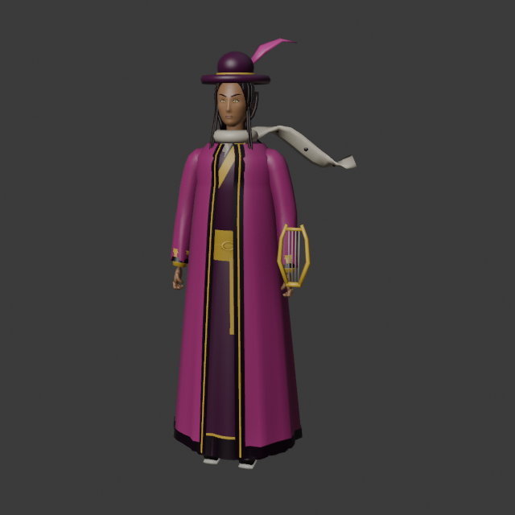

# Cantor, the Last Verse

The bard hero kit (kits v5): Cantor's four spells (Q, W, E and the R ultimate), his passive, the shared parts file, the palette row and the rigged hero model. A slim man in a rose and plum coat with a feathered hat, a note-printed scarf and a golden lyre. A beat pulses under him, and a spell cast on the beat is stronger.

## Role

| | |
|---|---|
| Role | Support (ranged attack) |
| Signature | On the Beat |
| HP | 680 |
| Kit shapes | Q QUICK cone, silences on the beat · W TGT note, charm · E SELF buff, speed + shield on tuned casts · R SELF ring that confines both heroes |

He wins a 1v1 by casting on his own pulse. Every in-tune spell is 30% stronger and 1 s cheaper. His weakness is that any hit of 50 or more breaks his beat, which takes the bonus away, and he has no dash. Walk speed 4.0 m/s.

## At a glance

| | |
|---|---|
| Hero | Cantor, the Last Verse |
| Spell category | `hero: bard` |
| Parts file | [`src/effects/parts/bard.ts`](../../../src/effects/parts/bard.ts) |
| Kit data | [`src/kits/bard.ts`](../../../src/kits/bard.ts) |
| Trait data | [`src/traits/bard.ts`](../../../src/traits/bard.ts) |
| Kit sheet | [`kit-bard.md`](../../../pipeline/designs/kit-bard.md) (read [kit-common.md](../../../pipeline/designs/kit-common.md) first) |
| Model | [`public/models/heroes/bard.glb`](../../../public/models/heroes/bard.glb) |

## Palette

The art bible row "Bard" ([ART_BIBLE.md](../../ART_BIBLE.md) section 2, energy value ladders). Every effect of the kit picks from this row.

| Core | Hot | Body | Accent | Dark | Foil |
|---|---|---|---|---|---|
| `#ffffff` | `#ffb8e6` | `#e04aa8` | `#ffd24a` | `#1e0a1a` | parchment `#f2e6d0` |

Core is only tiny highlights and the white leading edge of a sound ring; hot is the pale rim glow of a note; body is the rose magenta of the glow and the sound rings; accent (gold) is the lyre, the golden notes of the heal and the two-frame stars at the hits; dark is the ink of the notes and the plum-black sky of the ultimate; the parchment foil is the five stave lines. Plum `#4a1a40` appears in the kit icons as the coat.

## Signature shape and material rules

The stave and the note. Flowing five-line staves wave through the air with dark ink notes riding along them, thin crisp sound rings race outward, and one golden lyre is the only solid object. Every spell is a piece of music: a note thrown and bouncing, a stave that coils round a zone and goes silent, two staves circling him, a giant lyre and one deafening chord. Not the storm kit's lightning (Kaia) and not the astral kit's drawn lines (Lyra): soft waving ribbons, ink glyphs with a glowing rim, and rings that are fast and thin.

- Staves: five thin parallel parchment ribbons with a rose glow edge, camera-facing and unlit, gently waving.
- Notes: flat camera-facing glyphs (quarter, eighth, beamed pair, treble clef, rest) in dark ink with a rose rim; the notes of a heal are gold.
- Sound rings: a thin band with a white leading edge and a rose body, expanding fast and fading.

## Passive and twist

| | |
|---|---|
| Passive | **On the Beat**: a beat pulses under him every 1.2 s. A spell cast within 0.2 s of a pulse is in tune: +30% effect and 1 s off its cooldown. A stun, a silence or a hit of 50 or more breaks the beat for 2 s. |
| Twist | none (the trait has no `twist` entry) |
| Resource or meter | none. A ring under him shows the beat: it swells from 1.0 to 1.6 m over the 0.2 s before a pulse (gold), rests rose between pulses, and is flat grey while the beat is broken. The passive slot shows TUNE or OFF. A gold `chorus` gem pip shows while Rising Chorus runs |
| Walk speed | 4.0 m/s |
| Basic attack | ranged, 6 m, 10 per 1.0 s, wind-up 0.25 s, bolt speed 18, note look |

Other trait rules (`src/traits/bard.ts`):

- While the beat is broken nothing is in tune.
- Rising Chorus opens a 3 s window: each in-tune cast in it gives +25% speed for 1.5 s and a 30 shield (the engine keeps the larger shield, so nothing stacks).
- Duet cannot be cast while the enemy is charmed. If its ring closes on nobody, half its cooldown is given back.
- Inside the Duet ring, an in-tune spell hit also silences for 0.5 s.

## Mechanics

Cantor uses these pieces of [the combat mechanics](../../architecture/mechanics.md):

| Mechanic | Where |
|---|---|
| Beat | the passive: tune window 0.2 s every 1.2 s; +30% power, 1 s cooldown refund |
| Silence | Q in tune (0.5 s), and in-tune spells inside Duet (0.5 s) |
| Charm | W: the enemy walks toward him and cannot act, 0.8 s (1.1 s in tune) |
| Shield and speed | E: on each in-tune cast, 30 shield and +25% speed for 1.5 s |
| Confinement | R: a ring neither hero can leave, 3.4 s |
| Crowd control flag | W has `cc: true` in the kit data |
| Skillshot, summon, dash, pull | none. The siren note is a homing note blocked by cover |

## Spells

All four play under the normal gameplay camera. Range and cooldown come from the kit data (`src/kits/bard.ts`), hit time and length from the spell files in `src/spells/targeted/`; "hit" is the telegraph impact time and the first damage.

| Key | Label | Targeting | Range | Cooldown | Hit time | Length | What happens |
|---|---|---|---|---|---|---|---|
| Q | [resounding chord](../../../src/spells/targeted/resoundingChord.ts) | self, QUICK cone (5 m, 90 degrees) | 5 | 3 s | 0.4 s | 1.3 s | A chord from the lyre fans out in three sound waves. Damage 52. In tune with his beat: also silenced 0.5 s. |
| W | [siren song](../../../src/spells/targeted/sirenSong.ts) | enemy (click) | 8 | 12 s | 0.8 s (the note lands) | 3.8 s | A note flies at the enemy at 10 m/s (it gives up after 2 s) and charms it: it walks toward him and cannot act, 0.8 s (1.1 s in tune). Cover breaks the note. No damage. |
| E | [rising chorus](../../../src/spells/targeted/risingChorus.ts) | self (radius 7) | 0 (self) | 11 s | rises at 0.35 s | 3.5 s | Notes orbit him for 3 s. Every in-tune spell in that time gives him +25% speed for 1.5 s and a 30 shield. No damage. |
| R | [duet](../../../src/spells/targeted/duet.ts) | self (radius 9) | 0 (self) | 24 s | the ring closes at 0.8 s | 4.2 s | A ring of music staves (6 m radius) closes round him in 0.8 s and holds 3.4 s: neither of you can leave it. Each beat (every 1.2 s) it pulses for 18 on each enemy inside, and in-tune spells inside it also silence 0.5 s. At 0.8 s the ring only holds if the enemy is inside 6 m; otherwise it collapses and half the cooldown comes back. Cannot be cast while the enemy is charmed. |

Spell sources: [`resoundingChord.ts`](../../../src/spells/targeted/resoundingChord.ts), [`sirenSong.ts`](../../../src/spells/targeted/sirenSong.ts), [`risingChorus.ts`](../../../src/spells/targeted/risingChorus.ts), [`duet.ts`](../../../src/spells/targeted/duet.ts). Their catalog rows are in the [effect catalog](../effects.md#hero-bard).

## Parts file

[`src/effects/parts/bard.ts`](../../../src/effects/parts/bard.ts) holds everything the four spells share. Spells import it directly (`../../effects/parts/bard`). Everything is pooled, takes world-space positions and has a `reset()`; the materials are unlit toon shaders kept below the bloom threshold.

| Export | Role |
|---|---|
| `BARD`, `BARD_CSS` | palette constants (`foil` is the parchment) |
| `Stave` | a five-line music stave along a path: `setPath(points, width, head, tail)` sets the path and the visible stretch of it, `setRange(head, tail)`, `wave(amplitude)` makes it undulate, `at(u, out)` gives the point at fraction `u` so notes can ride it; `alpha` fades it |
| `GLYPH` | the glyph atlas indices: `quarter`, `eighth`, `beamed`, `clef`, `rest` |
| `Notes` | pooled note glyphs (`NoteOptions`, `RideOptions`), one instanced mesh: `emit(pos, vel, count, life, opts)` throws free notes, `ride(stave, u, glyph, opts)` slides one along a stave, `hold(pos, glyph, size, gold)` keeps one in place (`move`, `resize`, `kill`), `fall(gravity, life)` and `scatter(origin, speed, life, gravity)` turn every note into a free one; `frozen` holds time for a dead beat |
| `SoundRings` | quick crisp sound rings (`RingOptions`): `pulse(center, radius, seconds, normal, opts)`; pooled |
| `Lyre` | the golden lyre (about 1 m tall at scale 1): `show(pos, scale, yaw)` pops it in, `place` moves or resizes it, `strum(strength)` makes the strings ring, `pull(k)` draws them back, `shimmer(rate)` keeps them humming, `hide()` |
| `DuetWall` | the Duet ring wall made of music: an open cylinder 2.4 m tall with five parchment stave lines, bar lines, a rose glow at the foot and dark notes sliding along the lines: `set(center, radius, alpha, time)` |

## Model

[`public/models/heroes/bard.glb`](../../../public/models/heroes/bard.glb): a rigged figure on the Dao rig (same bone names as `public/models/figures/hero.glb`, so `src/effects/weapons/hero.ts` can pose it). Built by `build("bard")` / `export("bard")` in [`blender/heroes/hero_figures.py`](../../../blender/heroes/hero_figures.py). Hero mode shows it with procedural walk, breath and cast poses. It is wired through the `MODELS` map in [`src/heroes.ts`](../../../src/heroes.ts). Hit size (`HERO_BODIES`): radius 0.39 m, height 2.38 m.

- Look: a slim man in a rose and plum long coat over a cream shirt, with leg wraps, loose dark hair, a wide plum hat with a rose feather, a parchment scarf printed with notes and a golden lyre in his left hand.
- Props: `feathered_hat`, `note_scarf`, `golden_lyre`.
- HUD portrait (canvas-drawn in the kit data): staves drifting behind him with a few notes riding them, shoulders in a rose and plum coat with a lyre strap, and the parchment scarf printed with notes.

## Files

| What | Where |
|---|---|
| Kit sheet (design) | [`pipeline/designs/kit-bard.md`](../../../pipeline/designs/kit-bard.md) |
| Shared kit rules | [`pipeline/designs/kit-common.md`](../../../pipeline/designs/kit-common.md) |
| Kits v5 design | [`pipeline/designs/kits-v5.md`](../../../pipeline/designs/kits-v5.md) |
| Parts | [`src/effects/parts/bard.ts`](../../../src/effects/parts/bard.ts) |
| Spells | [`resoundingChord.ts`](../../../src/spells/targeted/resoundingChord.ts), [`sirenSong.ts`](../../../src/spells/targeted/sirenSong.ts), [`risingChorus.ts`](../../../src/spells/targeted/risingChorus.ts), [`duet.ts`](../../../src/spells/targeted/duet.ts) |
| Kit data | [`src/kits/bard.ts`](../../../src/kits/bard.ts) |
| Trait | [`src/traits/bard.ts`](../../../src/traits/bard.ts) |
| Model | [`public/models/heroes/bard.glb`](../../../public/models/heroes/bard.glb) |
| Model script | [`blender/heroes/hero_figures.py`](../../../blender/heroes/hero_figures.py) |

## See also

- [Hero roster and shared structure](README.md)
- [Combat mechanics](../../architecture/mechanics.md)
- [Auriel (dawn)](dawn.md), [Tempo (chrono)](chrono.md)
- [Effect catalog](../effects.md)
- [Docs home](../../README.md)
- [Art bible](../../ART_BIBLE.md)
- [Kit shared rules](../../../pipeline/designs/kit-common.md)
