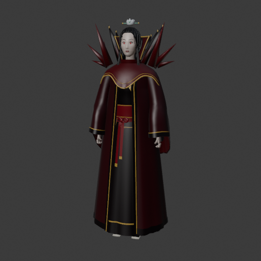
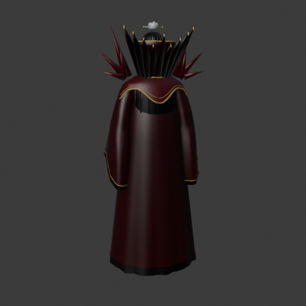

# Vesper, the Crimson Countess

The blood hero kit (v5): Vesper's four spells (Q, W, E and the R ultimate), her passive, the shared parts file, the palette row and the rigged hero model. A pale countess in a black robe with a crimson lining and a tall collar. She pays HP for every spell and gets it back by drinking from the enemy, but only when she is low. She plays at range with a basic attack of 5.5 m, and she needs sight of the enemy for her curse, her rip and her feast.

## Role

| | |
|---|---|
| Role | Juggernaut (drain), ranged |
| Signature | Blood price |
| HP | 660 |
| Kit shapes | Q TGT needle + RECAST rip · W DASH mist · E TGT curse · R TGT CHANNEL |

She wins by staying near 45% HP, where every spell hit heals her. Above that line she only pays. Her weakness is cover: the rip, the curse and the feast all need sight, and they end when the enemy gets past 8 m (the feast: 9 m).

## At a glance

| | |
|---|---|
| Hero | Vesper, the Crimson Countess |
| Spell category | `hero: blood` |
| Parts file | [`src/effects/parts/blood.ts`](../../../src/effects/parts/blood.ts) |
| Kit data | [`src/kits/blood.ts`](../../../src/kits/blood.ts) |
| Trait (rules) | [`src/traits/blood.ts`](../../../src/traits/blood.ts) |
| Kit sheet | [`kit-blood.md`](../../../pipeline/designs/kit-blood.md) (read [kit-common.md](../../../pipeline/designs/kit-common.md) first) |
| Model | [`public/models/heroes/blood_v2.glb`](../../../public/models/heroes/blood_v2.glb) |

## Palette

The art bible row "Blood" ([ART_BIBLE.md](../../ART_BIBLE.md) section 2, energy value ladders). Every effect of the kit picks from this row and adds black.

| Core | Hot | Body | Accent | Dark | Foil |
|---|---|---|---|---|---|
| `#fff1e6` | `#ff3b4e` | `#8c0f22` | `#bff4ff` | `#140306` | bone `#e9dcc6` |

Core only in tiny specular dots and tip glints; hot is the thin rim light and crystal edge line; body is the liquid and crystal fill; accent (pale cyan) only 2-3 frames at the hit; bone foil is the sigils, the palm cut, impact cards and the moon, so the red reads against it.

## Signature shape and material rules

The blood tendril: a tapered, viscous rope with a round bead at the tip, that hardens into faceted ruby crystal thorns. Liquid is smooth, crystal is faceted; that contrast is the kit idea. Through-line: every small spell ends with blood drops flying back from the enemies into the caster's chest (life drain).

- Liquid: smooth normals, custom toon shader (crimson body, fresnel to dark at the rim, one thin hot rim line on the light side, one tiny core specular dot), normal-blended. No `MeshStandard` gloss, no additive spheres.
- Crystal: flat facets, dark body, a hot edge line; below the bloom threshold except a 1-2 frame tip glint.
- Smoke after the hit is small dark `#140306` toon smoke (`SmokeBall`).
- Every hit passes `color: BLOOD_CSS.body` so the arena hit flash is crimson, not white.
- Not Crimson Requiem: no petals, no grey-world colour drain, no red laser slashes.

## Passive and twist

| | |
|---|---|
| Passive | Blood Price: each spell costs her 20 HP (R costs 40, the Rip recast costs nothing). It never takes her below 1 HP. |
| Twist | Hungry: below 45% of her max HP her body burns crimson (a ring at her feet) and her spell hits of slots Q, W and E heal her for 15% of their damage. Basic attacks and R do not heal that way. Above 45% she drinks nothing. |
| Resource or meter | none |
| Speed | 4 m/s |
| Basic attack | ranged, 5.5 m, 8 damage every 0.7 s, wind-up 0.18 s, bolt speed 20, drop look |
| Other rules | Mist Waltz arms her next two basic attacks for 3 s: +18 damage and +1.5 m reach each (shown as two drop pips). The Rip is a recast of Q, open from 1 s to 3 s after the cast. Hemocurse: while it holds, each spell the enemy casts costs them 30 HP, and heals her 15 if she is Hungry. The duel AI casts R only within 4 m. |

## Mechanics

Vesper uses these pieces of [the combat mechanics](../../architecture/mechanics.md):

| Mechanic | Where |
|---|---|
| HP cost | Every spell, through the trait's `castMods` (20 HP, R 40) |
| Recast | Q: the Rip (`recast`, window 3 s, opens at 1 s, full damage) |
| Dash | W flows 5 m (`dash: true`, kit range 11 is only the AI's reach) |
| Curse on spells | E: `enemyCast` costs the enemy 30 HP per spell while the curse is live |
| Channel | R holds her 1.6 s (`hold`). A stun, a silence or a knock-up, 9 m of distance or lost sight ends it |
| Heal | Hungry heal on spell hits, the Rip refund (20 HP), the curse heal (15), the feast heal (45 when Hungry) |
| Basic attack buff | W: two empowered attacks with more reach |
| Melee, summon, pull, shield | none |

## Spells

All four play under the normal gameplay camera. Q, E and R are targeted at an enemy and all of them are judged on the live position (`projectile: true`), so they cannot be walked out of; a red circle on the enemy is the warning. Range and cooldown come from the kit data (`src/kits/blood.ts`), hit time and length from the spell files in `src/spells/targeted/`. The numbers are the spell files' defaults.

| Key | Label | Targeting | Range | Cooldown | Hit time | Length | What happens |
|---|---|---|---|---|---|---|---|
| Q | [lancet](../../../src/spells/targeted/lancet.ts) | enemy (TGT, recast) | 7 | 4 s | 0.4 s (the rip 0.3 s after its cast) | 1.4 s (the rip 1.0 s) | A crystal needle flies to the enemy and stays in for 3 s as a blood pip. Damage 36. Cast again from 1 s to 3 s: a thread runs to the needle and rips it out for 26 more, and she gets 20 HP back when it lands. The rip works only if the first cast struck, she still sees the enemy and they are within 8 m; otherwise it fizzles. |
| W | [mist waltz](../../../src/spells/targeted/mistWaltz.ts) | ground (r 1, DASH) | 11 (the AI's reach; the flow is 5 m) | 11 s | none (no damage) | 1.3 s | She comes apart into blood-red mist and slides 5 m to the aim in 0.2 s, then the mist folds back into her. Not untouchable, no telegraph. Arms two basic attacks for 3 s: +18 damage and +1.5 m reach. |
| E | [hemocurse](../../../src/spells/targeted/hemocurse.ts) | enemy (TGT) | 7 | 12 s | 0.6 s | 4.0 s | A thread of blood runs to the enemy and a crown of thorns closes round them. Damage 25, and the curse lasts 3 s: each spell they cast costs them 30 HP, and heals her 15 if she is Hungry. It breaks past 8 m or without sight. |
| R | [sanguine feast](../../../src/spells/targeted/sanguineFeast.ts) | enemy (TGT, channel) | 8 | 24 s | 0.4 s, 1.0 s and 1.6 s (three pulses) | 2.4 s | Ultimate. She is rooted for 1.6 s and drinks through a thread of blood. Pulses of 35, 35, then 40 plus 20% of the enemy's missing HP. The third pulse heals her 45 if she is Hungry. A stun, silence or knock-up on her, 9 m of distance or lost sight ends it, and the pulses not yet due do not happen. |

Spell sources: [`lancet.ts`](../../../src/spells/targeted/lancet.ts), [`mistWaltz.ts`](../../../src/spells/targeted/mistWaltz.ts), [`hemocurse.ts`](../../../src/spells/targeted/hemocurse.ts), [`sanguineFeast.ts`](../../../src/spells/targeted/sanguineFeast.ts). Their catalog rows are in the [effect catalog](../effects.md#hero-blood).

The feast reads the missing HP as what she has dealt the enemy this round (the engine gives a spell no target HP), capped at 600, so it over-counts if the enemy heals.

## Parts file

[`src/effects/parts/blood.ts`](../../../src/effects/parts/blood.ts) holds everything the kit's spells share. Spells import it directly (`../../effects/parts/blood`).

| Export | Role |
|---|---|
| `BLOOD`, `BLOOD_CSS` | palette constants (numbers and CSS strings) |
| `BloodTendril` | tapered tube on a per-frame curve, with `reveal` (draw on / pull back), a tip bead and wobble |
| `BloodSplats` | pool of small wet ground splats that spread, dry and fade |
| `BloodPool` | ground decal: `spread`, a slow ripple, then `dry` to near-black and fade |
| `BloodDrops` | instanced teardrops with gravity, splats on landing, and `drain` (drops arcing home to the caster) |
| `BloodThorns` | instanced crystal spikes: `erupt`, `shatter` into flakes; also usable as one big spike (the lance) |
| `BloodSigil` | the bone crest as a ground decal, with a draw-on `reveal` and `fade` |
| `BloodMist` | Vesper's mist (Mist Waltz): pooled soft wisps of blood-red haze with a lumpy toon edge; `puff` adds one, `stream` lays them along a line, `update(dt)` every frame |

## Model

[`public/models/heroes/blood_v2.glb`](../../../public/models/heroes/blood_v2.glb): a rigged figure on the Dao rig (same bone names as `public/models/figures/hero.glb`, so `src/effects/weapons/hero.ts` can pose it). Built in [`blender/heroes/moba_figures.py`](../../../blender/heroes/moba_figures.py) (the current style, the `_v2` models). Hero mode shows it with procedural walk, breath and cast poses. It is wired through the `MODELS` map in [`src/heroes.ts`](../../../src/heroes.ts) (name `Vesper`), and its hit size is in `HERO_BODIES` in the same file (radius 0.41 m, height 2.35 m).
- HUD portrait (canvas-drawn in the kit data): A bone crescent behind a blood drop: the moon and the blood.

  

## Files

| What | Where |
|---|---|
| Kit sheet (design) | [`pipeline/designs/kit-blood.md`](../../../pipeline/designs/kit-blood.md) |
| Shared kit rules | [`pipeline/designs/kit-common.md`](../../../pipeline/designs/kit-common.md) |
| Parts | [`src/effects/parts/blood.ts`](../../../src/effects/parts/blood.ts) |
| Spells | [`lancet.ts`](../../../src/spells/targeted/lancet.ts), [`mistWaltz.ts`](../../../src/spells/targeted/mistWaltz.ts), [`hemocurse.ts`](../../../src/spells/targeted/hemocurse.ts), [`sanguineFeast.ts`](../../../src/spells/targeted/sanguineFeast.ts) |
| Kit data | [`src/kits/blood.ts`](../../../src/kits/blood.ts) |
| Trait (passive, twist, rules) | [`src/traits/blood.ts`](../../../src/traits/blood.ts) |
| Model | [`public/models/heroes/blood_v2.glb`](../../../public/models/heroes/blood_v2.glb) |
| Model script | [`blender/heroes/moba_figures.py`](../../../blender/heroes/moba_figures.py) |

## See also

- [Hero roster and shared structure](README.md)
- [Combat mechanics](../../architecture/mechanics.md)
- [Brannoc (forge)](forge.md), [Isolde (frost)](frost.md), [Lyra (astral)](astral.md), [Vitriol (alchemy)](alchemy.md)
- [Effect catalog](../effects.md)
- [Docs home](../../README.md)
- [Art bible](../../ART_BIBLE.md)
- [Kit shared rules](../../../pipeline/designs/kit-common.md)
