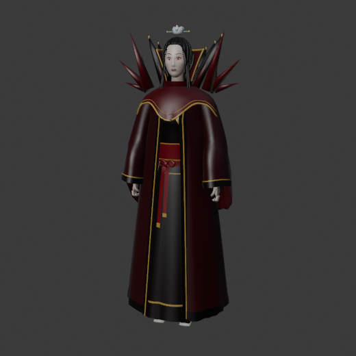
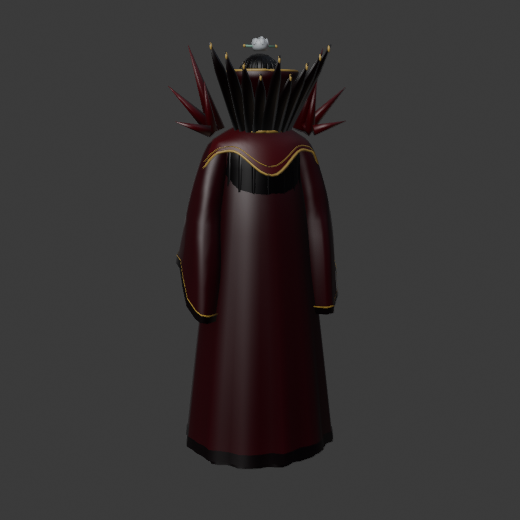
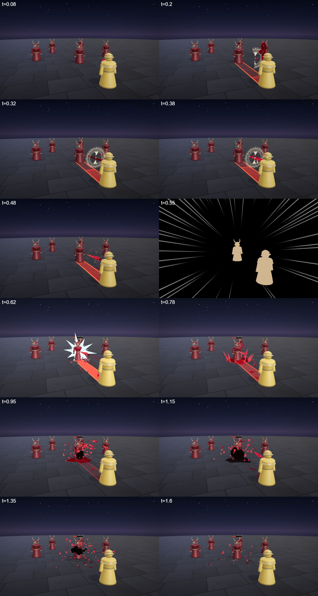
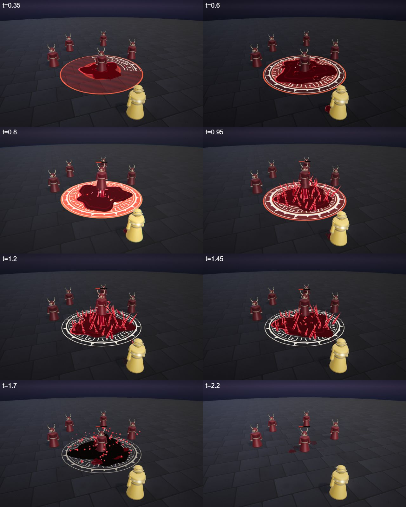
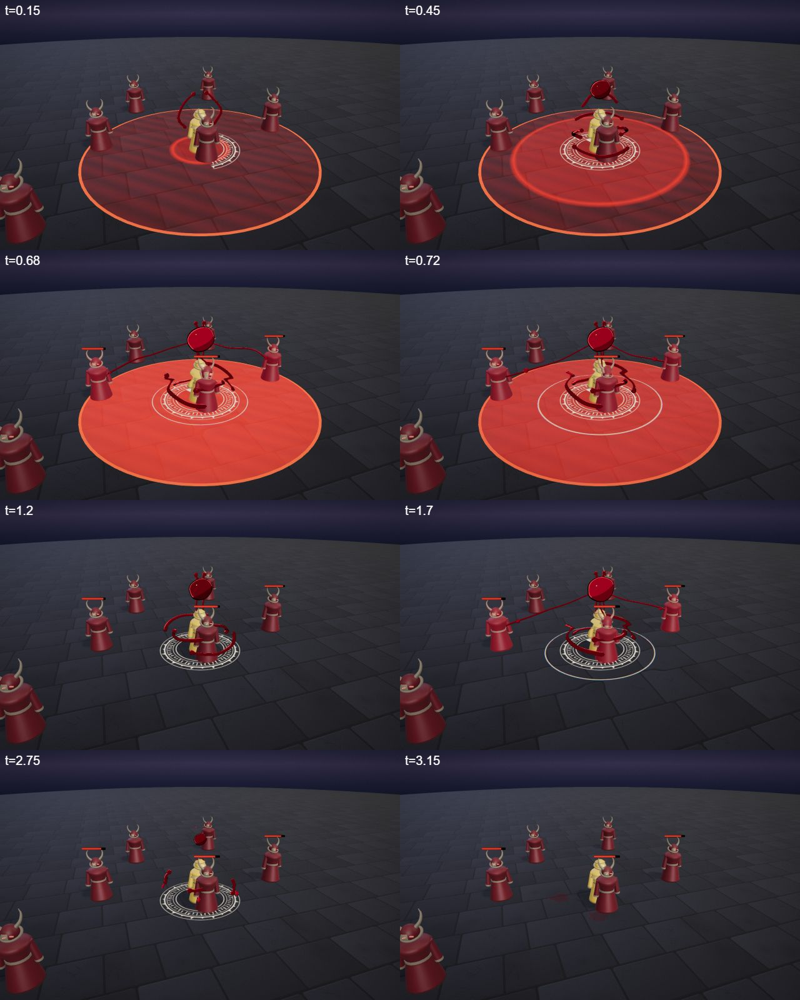
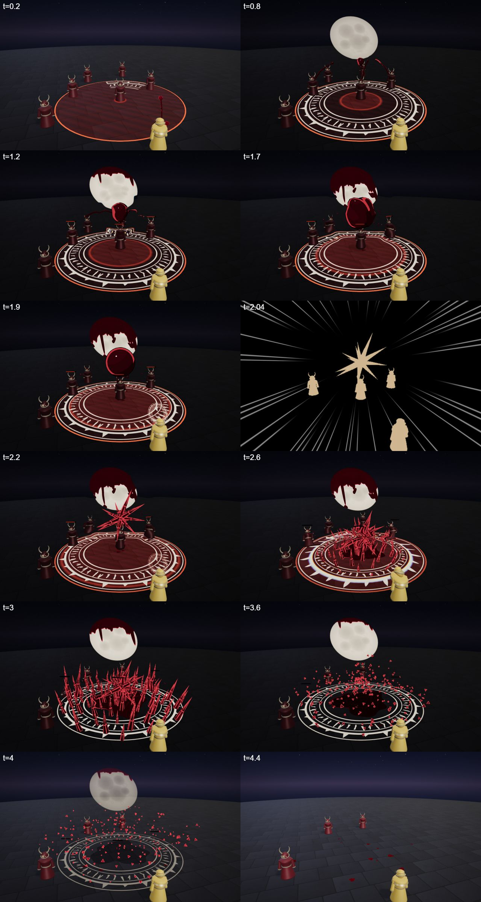

# Vesper, the Crimson Countess

The blood hero kit: Vesper's four spells (Q, W, E and the R ultimate), the shared parts file, the palette row and the rigged hero model. A gothic hemomancer noble. She bleeds on purpose: a pale cut on her palm, and her blood becomes whips, lances and thorns. What she spills she takes back from her enemies.

## At a glance

| | |
|---|---|
| Hero | Vesper, the Crimson Countess |
| Spell category | `hero: blood` |
| Parts file | [`src/effects/parts/blood.ts`](../../../src/effects/parts/blood.ts) |
| Kit data | [`src/heroes.ts`](../../../src/heroes.ts) |
| Kit sheet | [`blood-kit.md`](../../../pipeline/designs/blood-kit.md) (read [kit-common.md](../../../pipeline/designs/kit-common.md) first) |
| Model | [`public/models/heroes/blood.glb`](../../../public/models/heroes/blood.glb) |

## Palette

The art bible row "Blood" ([ART_BIBLE.md](../../ART_BIBLE.md) section 2, energy value ladders). Every effect of the kit picks from this row and adds black.

| Core | Hot | Body | Accent | Dark | Foil |
|---|---|---|---|---|---|
| `#fff1e6` | `#ff3b4e` | `#8c0f22` | `#bff4ff` | `#140306` | bone `#e9dcc6` |

Core only in tiny specular dots and tip glints; hot is the thin rim light and crystal edge line; body is the liquid and crystal fill; accent (pale cyan) only 2-3 frames at the hit; bone foil is the sigils, the palm cut, impact cards and the moon, so the red reads against it.

## Signature shape and material rules

The blood tendril: a tapered, viscous rope with a round bead at the tip, that hardens into faceted ruby crystal thorns. Liquid is smooth, crystal is faceted; that contrast is the kit idea. Through-line: every small spell ends with blood drops flying back from the enemies into the caster's chest (life drain).

- Liquid: smooth normals, custom toon shader (crimson body, fresnel to dark at the rim, one thin hot rim line on the light side, one tiny core specular dot), normal-blended. No `MeshStandard` gloss, no additive spheres.
- Crystal: flat facets, dark body, a hot edge line; below the bloom threshold except a 1-2 frame tip glint.
- Smoke after the hit is small dark `#140306` toon smoke (`SmokeBall`).
- Every hit passes `color: BLOOD_CSS.body` so the arena hit flash is crimson, not white.
- Not Crimson Requiem: no petals, no grey-world colour drain, no red laser slashes.

## Spells

All four play under the normal gameplay camera (no cinematic, no letterbox). Q, W and E are normal MOBA abilities (hit 0.4-0.8 s after the cast, clean by about 2 s; an E aura may run about 3 s); R is the ultimate (hit around 2.0-2.5 s, clean by 4.5 s, one dead beat and one short impact frame). Range and cooldown come from the kit data (`src/heroes.ts`), hit time and length from the spell files in `src/spells/targeted/`; "hit" is the telegraph impact time and the first damage.

| Key | Label | Targeting | Range | Cooldown | Hit time | Length | What happens |
|---|---|---|---|---|---|---|---|
| Q | [hemolance](../../../src/spells/targeted/hemolance.ts) | enemy | 11 | 3 s | 0.55 s | 1.6 s | A pale cut on her raised palm sprays blood; a tendril pours up, coils above the shoulder, hardens into a crystal lance and impales one enemy. The blood drains back home. Damage 60. |
| W | [thorn garden](../../../src/spells/targeted/thornGarden.ts) | ground (r 4.5) | 10 | 7 s | 0.75 s | 2.3 s | A tendril runs to the point, a bone sigil draws on and a pool of blood spreads inside it, then freezes upward into a thicket of 34 thorns. Damage 50, one tick of 10 at 1.2 s. |
| E | [crimson pact](../../../src/spells/targeted/crimsonPact.ts) | self (r 6) | 0 (self) | 9 s | 0.6 s (loop 0.6-2.6 s) | 3.2 s | Arms spread, a bone sigil draws on and a heart of blood beats above her head and drains every enemy nearby on each beat. Loopable. Damage 9 per beat. |
| R | [sanguine eclipse](../../../src/spells/targeted/sanguineEclipse.ts) | ground (r 7) | 13 | 20 s | 2.4 s | 4.5 s | The ultimate. Three blood beads are thrown up and a bone moon appears and bleeds; the zone's blood is harvested (1.0 s tick, 15), freezes into a thorn-star at 2.0 s and falls on the zone at 2.4 s (120). Dead beat, then one impact frame. |

Spell sources: [`hemolance.ts`](../../../src/spells/targeted/hemolance.ts), [`thornGarden.ts`](../../../src/spells/targeted/thornGarden.ts), [`crimsonPact.ts`](../../../src/spells/targeted/crimsonPact.ts), [`sanguineEclipse.ts`](../../../src/spells/targeted/sanguineEclipse.ts). Their catalog rows are in the [effect catalog](../effects.md#hero-blood).

Per-spell design notes: [`hemolance.md`](../../../pipeline/designs/hemolance.md), [`thorn-garden.md`](../../../pipeline/designs/thorn-garden.md), [`crimson-pact.md`](../../../pipeline/designs/crimson-pact.md), [`sanguine-eclipse.md`](../../../pipeline/designs/sanguine-eclipse.md).

## Parts file

[`src/effects/parts/blood.ts`](../../../src/effects/parts/blood.ts) holds everything the four spells share. Spells import it directly (`../../effects/parts/blood`).

| Export | Role |
|---|---|
| `BLOOD`, `BLOOD_CSS` | palette constants (numbers and CSS strings) |
| `BloodTendril` | tapered tube on a per-frame curve, with `reveal` (draw on / pull back), a tip bead and wobble |
| `BloodSplats` | pool of small wet ground splats that spread, dry and fade |
| `BloodPool` | ground decal: `spread`, a slow ripple, then `dry` to near-black and fade |
| `BloodDrops` | instanced teardrops with gravity, splats on landing, and `drain` (drops arcing home to the caster) |
| `BloodThorns` | instanced crystal spikes: `erupt`, `shatter` into flakes; also usable as one big spike (the lance) |
| `BloodSigil` | the bone crest as a ground decal, with a draw-on `reveal` and `fade` |

## Model

[`public/models/heroes/blood.glb`](../../../public/models/heroes/blood.glb): a rigged figure on the Dao rig (same bone names as `public/models/figures/hero.glb`, so `src/effects/weapons/hero.ts` can pose it). Built by `build("blood")` / `export("blood")` in [`blender/heroes/hero_figures.py`](../../../blender/heroes/hero_figures.py); hero mode shows it with procedural walk, breath and cast poses. It is wired through the `MODELS` map in [`src/heroes.ts`](../../../src/heroes.ts).

- Look: A black left-lapped robe, a crimson-lined open over-robe, a tall vampire collar, a silk cloud mantle, loose black hair, red eyes.
- Props: `blood_gem` (gem at the throat), `blood_thorns`, `vampire_collar`.
- HUD portrait (canvas-drawn in the kit data): A bone crescent behind a blood drop: the moon and the blood.

 

## Files

| What | Where |
|---|---|
| Kit sheet (design) | [`pipeline/designs/blood-kit.md`](../../../pipeline/designs/blood-kit.md) |
| Shared kit rules | [`pipeline/designs/kit-common.md`](../../../pipeline/designs/kit-common.md) |
| Parts | [`src/effects/parts/blood.ts`](../../../src/effects/parts/blood.ts) |
| Spells | [`hemolance.ts`](../../../src/spells/targeted/hemolance.ts), [`thornGarden.ts`](../../../src/spells/targeted/thornGarden.ts), [`crimsonPact.ts`](../../../src/spells/targeted/crimsonPact.ts), [`sanguineEclipse.ts`](../../../src/spells/targeted/sanguineEclipse.ts) |
| Kit data | [`src/heroes.ts`](../../../src/heroes.ts) |
| Model | [`public/models/heroes/blood.glb`](../../../public/models/heroes/blood.glb) |
| Model script | [`blender/heroes/hero_figures.py`](../../../blender/heroes/hero_figures.py) |

The blood kit is the only kit defined inline in `src/heroes.ts` (`bloodKit`); the other four live in `src/kits/`.

## Review sheets

Contact sheets in `docs/spells/` (frames over time, from `pipeline/tools/contact-sheet.js`).

### Hemolance

### Thorn Garden

### Crimson Pact

### Sanguine Eclipse

## See also

- [Hero roster and shared structure](README.md)
- [Brannoc (forge)](forge.md), [Isolde (frost)](frost.md), [Lyra (astral)](astral.md), [Vex (alchemy)](alchemy.md)
- [Effect catalog](../effects.md)
- [Docs home](../../README.md)
- [Art bible](../../ART_BIBLE.md)
- [Kit shared rules](../../../pipeline/designs/kit-common.md)
