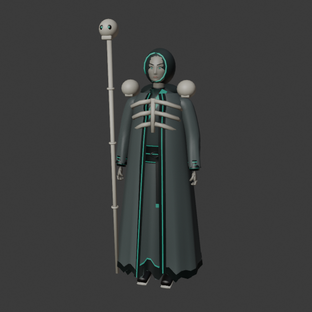
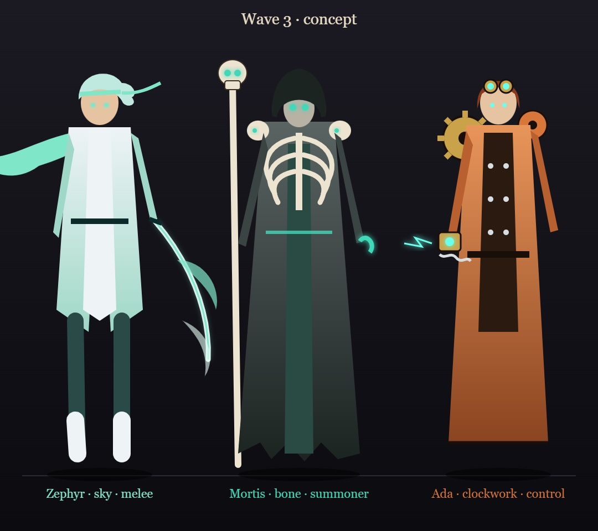
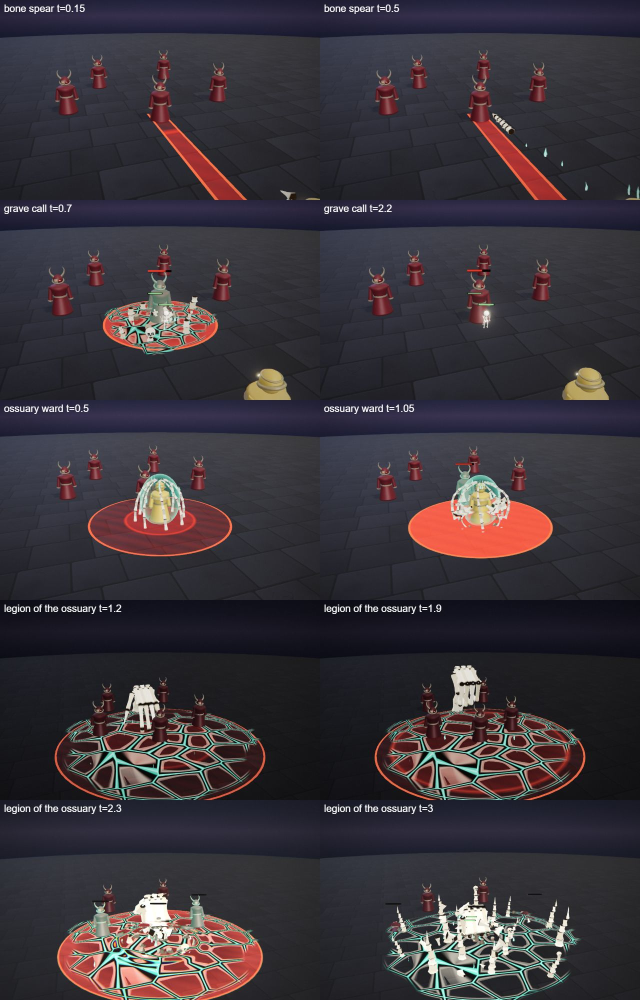
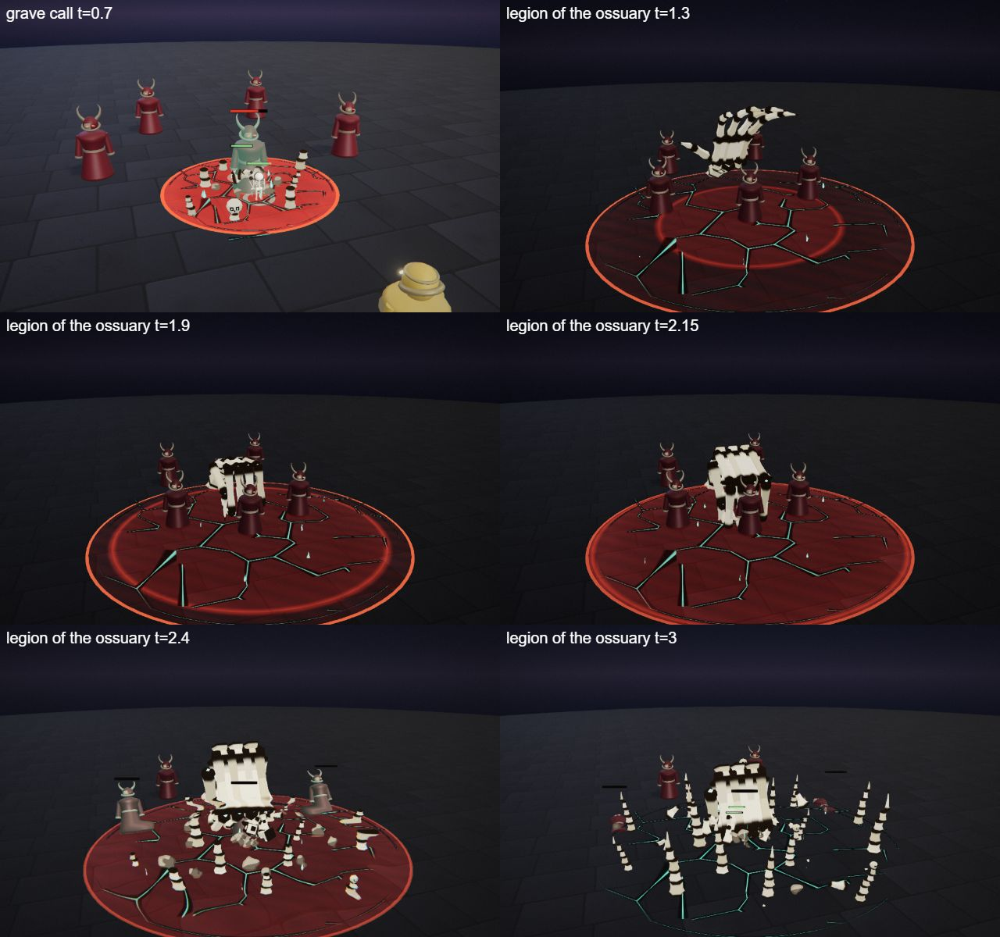
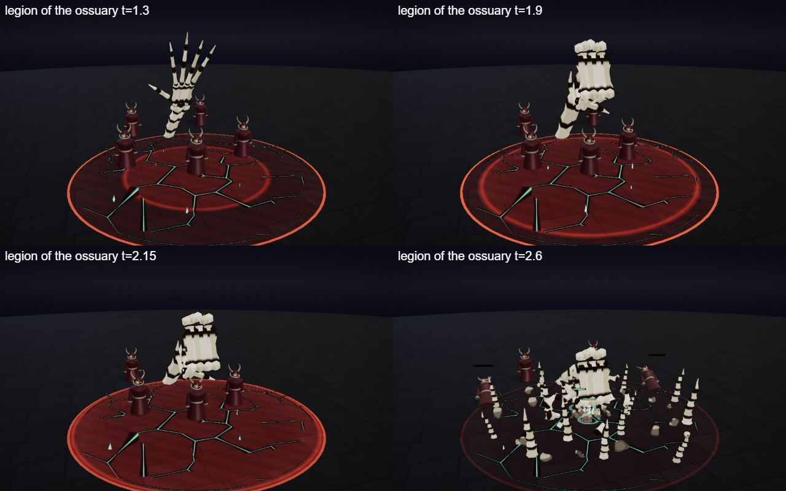

# Mortis, the Ossuary Lord

The bone hero kit: Mortis's four spells (Q, W, E and the R ultimate), the shared parts file, the palette row and the rigged hero model. A summoner in a tattered grave robe with a ribcage mantle and a skull-topped staff; he throws bone and raises skeletons to fight for him. He is one of the first heroes built on the [combat mechanics](../../architecture/mechanics.md): a skillshot, summoned units and a cage root.

## Role

Summoner, 580 HP, ranged. Signature: *Raise the dead*. Skeletons fight for him. He wins a 1v1 by keeping two to four units on the enemy while the bone spear pokes and the cage roots it in place. His weakness is that his own spells are light, the units die to area damage and the cap is 6 units.

## At a glance

| | |
|---|---|
| Hero | Mortis, the Ossuary Lord |
| Spell category | `hero: bone` |
| Parts file | [`src/effects/parts/bone.ts`](../../../src/effects/parts/bone.ts) |
| Kit data | [`src/kits/bone.ts`](../../../src/kits/bone.ts) |
| Kit sheet | [`kit-bone.md`](../../../pipeline/designs/kit-bone.md) (read [kit-common.md](../../../pipeline/designs/kit-common.md) first) |
| Model | [`public/models/heroes/bone.glb`](../../../public/models/heroes/bone.glb) |

## Palette

The art bible row "Bone" ([ART_BIBLE.md](../../ART_BIBLE.md) section 2, energy value ladders). Every effect of the kit picks from this row.

| Core | Hot | Body | Accent | Dark | Foil |
|---|---|---|---|---|---|
| `#f4fffb` | `#b8fff0` | `#3fd8b8` | `#ff5a3a` | `#0a1412` | bone `#ece4d0` |

Core is only tiny highlights; hot is the heart of the soulfire; body is the teal soulfire (wisps, the light in the cracks, the skeletons' eyes); accent (ember) only 2-3 frames at hits; dark is the teal-black ground and the dark crevices between bones; the bone foil is the ivory of every bone (the kit's pale layer, with crevices `#3a291b`).

## Signature shape and material rules

Bone architecture. Bone is chunky, carved and stacked: ribs, vertebrae, skull-capped spires and cages, with soulfire flickering in the joints. Every spell builds something out of bone: a spear of vertebrae, spires clawing out of cracked ground, a cage of ribs, a colossal skeletal hand. Not the blood kit's bone crescent and crystal thorns (Vesper), and not the shadow kit's flat cut-outs: solid, faceted ivory with dark crevices.

- Bones: faceted chunks with round knobs, ivory with dark crevices; a lit side, no gloss.
- Soulfire: small teal teardrop wisps with a hot core, never a large flame.
- Dust and chips: pale grey puffs and flying bone chips at every hit.

## Mechanics

Mortis uses these pieces of [the combat mechanics](../../architecture/mechanics.md):

| Mechanic | Where |
|---|---|
| Skillshot | Q is `aim: 'line'`: `ctx.projectile` fires a piercing bolt (speed 22, range 11, radius 0.45) that hits every enemy on its line once. Hero mode draws a strip toward the cursor; the AI's bolt dodge can sidestep it |
| Summons | W has `summon: true` and calls `ctx.summon` for 2 melee skeletons (40 HP, 6 s, 6 damage per 1 s); R has `summon: true` and summons 2 ranged skeleton archers (35 HP, 6 s, 8 damage per 1.5 s). The cap is 6 live units per side. The AI casts a summon spell when it is ready and the hero is within 10 m |
| Shield | E gives `ctx.shieldSelf(30, 3)`, a 30 point shield for 3 s |
| Unit looks | both summons use `skeletonLook` (see [Parts file](#parts-file)) |
| Melee, dash, knock-up | none. `maxHp` is not set, so the default 600 HP applies |

The numbers follow the "Mechanics budget" of [kit-common.md](../../../pipeline/designs/kit-common.md): a summoner's own spells carry less damage because the units make up the rest. After the hero-roles balance pass (2026-10-30) he wins 53% (see the roster README).

## Spells

All four play under the normal gameplay camera (no cinematic, no letterbox). Q, W and E each have a shape of their own (see the table: dash, skillshot, trap, orbit, summon and so on), not a fixed strike, zone or aura; R is the ultimate (hit at 2.2 s, clean by 4.5 s, one dead beat). Range and cooldown come from the kit data (`src/kits/bone.ts`), hit time and length from the spell files in `src/spells/targeted/`; "hit" is the telegraph impact time and the first damage.

| Key | Label | Targeting | Range | Cooldown | Hit time | Length | What happens |
|---|---|---|---|---|---|---|---|
| Q | [bone spear](../../../src/spells/targeted/boneSpear.ts) | skillshot line (BOLT, pierce, width 0.9) | 11 | 3 s | flies from 0.2 s, 0.5 s of flight | 1.5 s | A 2.2 m spear of chunky vertebrae assembles from flying bones beside him with soulfire in its joints. At 0.2 s it leaves as a piercing bolt and the spear follows it down the line. Every hit throws bone chips, dust and a small ember accent; at max range the spear clatters apart into bones that fade. Damage 50, knock 2. |
| W | [grave call](../../../src/spells/targeted/graveCall.ts) | ground (SUMMON, r 3) | 10 | 9 s | 0.6 s | 2.0 s | The ground cracks in a circle with teal light in the cracks and wisps flickering out of them. At the hit two skeletons claw out of the ground in a burst of dust, chips and eight bone spires (two capped with skulls), hurting the enemies inside. The spires sink away; the skeletons live on as units (40 HP, 6 s, 6 damage every 1 s). Damage 15, knock 1, plus 2 melee skeletons. |
| E | [ossuary ward](../../../src/spells/targeted/ossuaryWard.ts) | enemy (CAGE, r 2) | 9 | 9 s | 0.8 s and 1.9 s (two pulses) | 2.8 s | A cage of curved ribs (radius 1.0, 2.4 high) grows up out of the floor round the chosen enemy with soulfire in its joints. At 0.8 s the ribs close and flex and fire a ring of bone shards to radius 2: damage 12 and root 1.2 s to whoever is still inside (an enemy that walked off is missed). They flex again at 1.9 s for another 12, with no second root. At 2.2 s the cage crumbles into dust. |
| R | [legion of the ossuary](../../../src/spells/targeted/legionOfTheOssuary.ts) | ground (SUMMON, r 7) | 13 | 20 s | 2.2 s | 4.5 s | The ultimate. The world darkens to a teal-black and cracks with teal light spread over the zone. A colossal skeletal hand (fingers about 5 long, soulfire in every joint) rises out of the ground at the zone's far edge, rears up and opens over the point while the enemies are drawn in, closes into a fist, hangs for a dead beat (1.85-2.0 s), then slams down: a ring of bone spires bursts across the zone, dust, an ember accent, a ground shockwave and the hit. At 2.4 s two skeleton archers (35 HP, 6 s, 8 damage every 1.5 s) climb out of the cracks; the hand crumbles into the ground and the spires sink. Damage 90, knock 5, plus 2 ranged skeletons. |

Spell sources: [`boneSpear.ts`](../../../src/spells/targeted/boneSpear.ts), [`graveCall.ts`](../../../src/spells/targeted/graveCall.ts), [`ossuaryWard.ts`](../../../src/spells/targeted/ossuaryWard.ts), [`legionOfTheOssuary.ts`](../../../src/spells/targeted/legionOfTheOssuary.ts). Their catalog rows are in the [effect catalog](../effects.md#hero-bone).

## Parts file

[`src/effects/parts/bone.ts`](../../../src/effects/parts/bone.ts) holds everything the four spells share. Spells import it directly (`../../effects/parts/bone`). Everything is pooled, takes world-space positions and has a `reset()`; the materials are toon shaders kept below the bloom threshold.

| Export | Role |
|---|---|
| `BONE`, `BONE_CSS` | palette constants (`bone` is the pale foil) |
| `boneChunkGeometry`, `boneMaterial` | the shared faceted bone chunk and its ivory toon material (`variant` picks a tone) |
| `BoneSpire` | a stack of tapering bone segments, optionally skull-capped: `grow(pos, height, seconds, lean, leanAngle, delay)`, `crumble(seconds, delay)` |
| `SoulWisps` | teal soulfire teardrops: `attach(pos, count, spread, size)`, `puff(pos, count, spread, size)`, `release()` |
| `BoneDust` | pale dust puffs: `burst(pos, count, speed, size)`, `ring(center, radius, count, size)` |
| `BoneShards` | flying bone chips: `shoot(pos, vel, life, size, g)`, `burst(pos, count, speed, up, size)`, `ring(center, count, radius, seconds, y, size)` |
| `GroundCracks` | cracked-floor decal with teal light in the cracks: `spread(center, radius, seconds)`, `fade(seconds)` |
| `BoneLance` | the vertebra spear: `assemble(center, dir, k)`, `place(center, dir)`, `hide()` |
| `RibCage` | the rib cage of the ward: `set(center, radius, height, grow, flex, crumble, spin)`, `pointAt(rib, s, flex, out)`, `hide()` |
| `BoneHand` | the colossal skeletal hand: `place(base, wrist, face, pitch, curl, spread, time, scale)`, `hide()` |
| `skeletonLook` | a `MinionLook` for `SummonOptions.look`, see below |

### skeletonLook

`skeletonLook` is the unit look for summons ([`MinionLook`](../../architecture/mechanics.md#the-look-pluggable-partsminionts) in `parts/minion.ts`): a small skeleton about 0.9 high facing +Z, with a skull with teal eyes and a loose jaw, a spine with four rib arcs and a soulfire glow inside the cage, a pelvis and jointed legs and arms. A `melee` unit carries a blade that swings on `pose.swing`; a `ranged` unit holds a bow in its left hand and draws with the right, kicking on `pose.shot`. The body material is repainted ivory and the outline dark brown, so the arena's hit flash still works. A `turret` falls back to the default look.

## Model

[`public/models/heroes/bone.glb`](../../../public/models/heroes/bone.glb): a rigged figure on the Dao rig (same bone names as `public/models/figures/hero.glb`, so `src/effects/weapons/hero.ts` can pose it). Built by `build("bone")` / `export("bone")` in [`blender/heroes/hero_figures.py`](../../../blender/heroes/hero_figures.py); hero mode shows it with procedural walk, breath and cast poses. It is wired through the `MODELS` map in [`src/heroes.ts`](../../../src/heroes.ts) (name `Mortis`).

- Look: A tall figure in a tattered grave robe in grey and teal with a shaved head under a deep hood with a teal edge, a ribcage mantle over the chest, skulls on the shoulders and a bone staff topped with a skull whose eyes burn with teal soulfire.
- Props: `bone_hood`, `rib_mantle`, `shoulder_skulls`, `skull_staff`.
- HUD portrait (canvas-drawn in the kit data): A staff on the right with a small skull and a soulfire wisp, rib arcs sweeping over the chest and a skull face under a dark hood with teal wisps around it.

The wave 3 concept (Zephyr, Mortis and Ada; vector source [`wave3_concept.svg`](../../heroes/wave3_concept.svg)):

## Files

| What | Where |
|---|---|
| Kit sheet (design) | [`pipeline/designs/kit-bone.md`](../../../pipeline/designs/kit-bone.md) |
| Shared kit rules | [`pipeline/designs/kit-common.md`](../../../pipeline/designs/kit-common.md) |
| Parts | [`src/effects/parts/bone.ts`](../../../src/effects/parts/bone.ts) |
| Spells | [`boneSpear.ts`](../../../src/spells/targeted/boneSpear.ts), [`graveCall.ts`](../../../src/spells/targeted/graveCall.ts), [`ossuaryWard.ts`](../../../src/spells/targeted/ossuaryWard.ts), [`legionOfTheOssuary.ts`](../../../src/spells/targeted/legionOfTheOssuary.ts) |
| Kit data | [`src/kits/bone.ts`](../../../src/kits/bone.ts) |
| Model | [`public/models/heroes/bone.glb`](../../../public/models/heroes/bone.glb) |
| Model script | [`blender/heroes/hero_figures.py`](../../../blender/heroes/hero_figures.py) |

## Review sheets

Contact sheets in `docs/spells/` (frames over time, from `pipeline/tools/contact-sheet.js`).

### Bone review

### Bone re-check (round 2)

### Bone re-check (round 3)

## See also

- [Hero roster and shared structure](README.md)
- [Combat mechanics](../../architecture/mechanics.md)
- [Zephyr (sky)](sky.md), [Ada (clockwork)](clockwork.md), [Vesper (blood)](blood.md)
- [Effect catalog](../effects.md)
- [Docs home](../../README.md)
- [Art bible](../../ART_BIBLE.md)
- [Kit shared rules](../../../pipeline/designs/kit-common.md)
