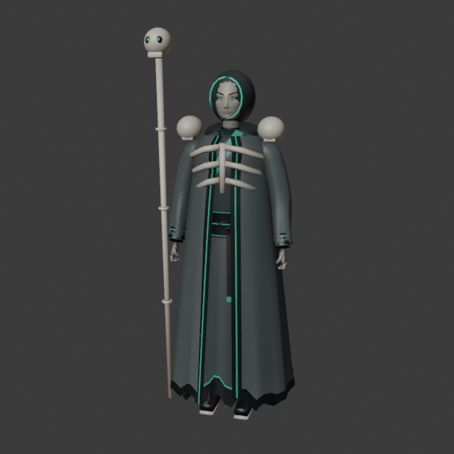

# Mortis, the Ossuary Lord

The bone hero kit (kits v5): Mortis's four spells (Q, W, E and the R ultimate), his passive, the shared parts file, the palette row and the rigged hero model. A tall necromancer in a tattered grave robe with a skull-topped staff. Every unit that dies leaves a bone pile, and his spells use the piles.

## Role

| | |
|---|---|
| Role | Summoner (ranged attack) |
| Signature | Ossuary |
| HP | 450 |
| Kit shapes | Q BOLT fan of shards, one more per pile · W SUMMON skeletons at a spot, one more per pile · E SELF bone shield that bursts into shards, recast to shatter · R TGT hand drag + root + skeletons |

He wins a 1v1 by spending skeletons for armour or letting them die for piles, and by catching the enemy with the hand. His weakness is that he is the slowest ranged hero (3.8 m/s) with low damage while his skeletons are down. Killing skeletons away from his piles starves him.

## At a glance

| | |
|---|---|
| Hero | Mortis, the Ossuary Lord |
| Spell category | `hero: bone` |
| Parts file | [`src/effects/parts/bone.ts`](../../../src/effects/parts/bone.ts) |
| Kit data | [`src/kits/bone.ts`](../../../src/kits/bone.ts) |
| Trait data | [`src/traits/bone.ts`](../../../src/traits/bone.ts) |
| Kit sheet | [`kit-bone.md`](../../../pipeline/designs/kit-bone.md) (read [kit-common.md](../../../pipeline/designs/kit-common.md) first) |
| Model | [`public/models/heroes/bone.glb`](../../../public/models/heroes/bone.glb) |

## Palette

The art bible row "Bone" ([ART_BIBLE.md](../../ART_BIBLE.md) section 2, energy value ladders). Every effect of the kit picks from this row.

| Core | Hot | Body | Accent | Dark | Foil |
|---|---|---|---|---|---|
| `#f4fffb` | `#b8fff0` | `#3fd8b8` | `#ff5a3a` | `#0a1412` | bone `#ece4d0` |

Core is only tiny highlights; hot is the heart of the soulfire; body is the teal soulfire (wisps, the light in the cracks, the skeletons' eyes); accent (ember) only 2-3 frames at hits; dark is the teal-black ground and the dark crevices between bones; the bone foil is the ivory of every bone (the kit's pale layer, with crevices `#3a291b`).

## Signature shape and material rules

Bone architecture. Bone is chunky, carved and stacked: ribs, vertebrae, skull-capped spires and cages, with soulfire flickering in the joints. Every spell builds something out of bone: a spear of vertebrae, spires clawing out of cracked ground, a cage of ribs, a colossal skeletal hand. Not the blood kit's bone crescent and crystal thorns (Vesper), and not the shadow kit's flat cut-outs: solid, faceted ivory with dark crevices.

- Bones: faceted chunks with round knobs, ivory with dark crevices; a lit side, no gloss.
- Soulfire: small teal teardrop wisps with a hot core, never a large flame.
- Dust and chips: pale grey puffs and flying bone chips at every hit.

## Passive and twist

| | |
|---|---|
| Passive | **Ossuary**: every summoned unit that dies by damage, his or the enemy's, leaves a bone pile for 8 s, drawn on the ground for its whole life on both screens. Bone Fan throws a shard per pile near him, Raise Dead a skeleton per pile near the spot. Every fifth basic attack that lands raises a small skeleton. |
| Twist | none (the trait has no `twist` entry) |
| Resource or meter | meter `BONES` (max 5): the bone piles now on the ground. The passive slot shows the attack count out of 5 and the piles (`3/5 +2`) |
| Walk speed | 3.8 m/s |
| Basic attack | ranged, 6 m, 10 per 1.0 s, wind-up 0.25 s, bolt speed 18, bone look |

Other trait rules (`src/traits/bone.ts`):

- The small skeleton from every fifth attack is a melee unit at his feet with 36 HP that lasts 6 s and hits for 7 every second.
- Bone Armour is made here: a shield of 30 plus 30 per living skeleton, 120 at most, for 4 s. The trait counts the damage the shield absorbs; once it has used the shield up it is "broken" and the shards fly. Online, `armourbroke` is sent so the other screen's effect knows.
- Bone Armour has a recast, "Shatter" (arms after 0.3 s, window 4 s). It ends the shield now and the shards fly at once. The duel AI never shatters (`aiWait`).

## Mechanics

Mortis uses these pieces of [the combat mechanics](../../architecture/mechanics.md):

| Mechanic | Where |
|---|---|
| Summon | W raises skeletons (40 HP, 8 s, hit 10); R raises two (50 HP, 7 s, hit 8); the passive raises a small one (36 HP, 6 s, hit 7). Kit flag: W `summon` |
| Bone piles | `deathSpots(8)` of both sides, read by Q and W |
| Shield | E, 30 + 30 per skeleton, 120 at most, 4 s |
| Recast | E, "Shatter" |
| Pull and root | R drags 4 m and roots 1 s. Kit flag: R `cc` |
| Skillshot | Bone Fan (three or more shards, radius 0.2, speed 20) |
| Dash, heal | none |

## Spells

All four play under the normal gameplay camera. Range and cooldown come from the kit data (`src/kits/bone.ts`), hit time and length from the spell files in `src/spells/targeted/`; "hit" is the telegraph impact time and the first damage.

| Key | Label | Targeting | Range | Cooldown | Hit time | Length | What happens |
|---|---|---|---|---|---|---|---|
| Q | [bone fan](../../../src/spells/targeted/boneFan.ts) | ground (BOLT skillshot, line) | 8 | 5 s | 0.3 s, then flight at 20 m/s | 1.3 s | He flicks three thin bone shards in a fan, 18 degrees apart. Each does 31 and knocks back a little (knock 1). Every bone pile within 3 m of him throws one more (six at most) and the fan widens. A shard flies 8 m. |
| W | [raise dead](../../../src/spells/targeted/raiseDead.ts) | ground (r 2.4 hole) | 9 | 9 s | 0.7 s | 2.0 s | The ground cracks and bone spires rise; at 0.7 s a skeleton claws out of the ground, and one more for every bone pile within 4 m of the spot (three more at most). Enemies in the hole take 15. Each skeleton has 40 HP, lasts 8 s and hits for 10. |
| E | [bone armour](../../../src/spells/targeted/boneArmour.ts) | self (radius 8) | 0 (self) | 14 s | cage up at 0.45 s; shards at 3.5 s or when it breaks | 4.6 s | A cage of ribs closes round him: a shield of 30 plus 30 per living skeleton (120 at most) for 4 s. When it breaks, or at 3.5 s, five bone darts fly at the enemy for 38. Recast (from 0.3 s, within 4 s): Shatter it now and the darts fly at once (at 0.6 s at the earliest). |
| R | [grave grasp](../../../src/spells/targeted/graveGrasp.ts) | enemy (click), sight needed | 9 | 22 s | 0.7 s (ring checked) | 3.3 s | A hand rises where the enemy stood, a 1.6 m ring shown for 0.7 s. If the enemy is still inside, the hand closes at 0.95 s and drags it 4 m toward him over 0.6 s (never closer than 1.1 m): 55 damage, rooted 1 s, and two skeletons claw out beside it for 28 damage more (50 HP, 7 s, hit 8). If it stepped out, the hand closes on nothing. |

Spell sources: [`boneFan.ts`](../../../src/spells/targeted/boneFan.ts), [`raiseDead.ts`](../../../src/spells/targeted/raiseDead.ts), [`boneArmour.ts`](../../../src/spells/targeted/boneArmour.ts), [`graveGrasp.ts`](../../../src/spells/targeted/graveGrasp.ts). Their catalog rows are in the [effect catalog](../effects.md#hero-bone).

## Parts file

[`src/effects/parts/bone.ts`](../../../src/effects/parts/bone.ts) holds everything the four spells share. Spells import it directly (`../../effects/parts/bone`). Everything is pooled, takes world-space positions and has a `reset()`; the materials are toon shaders kept below the bloom threshold.

| Export | Role |
|---|---|
| `BONE`, `BONE_CSS` | palette constants (`bone` is the pale foil) |
| `boneChunkGeometry`, `boneMaterial` | the shared faceted bone chunk and its ivory toon material (`variant` picks a tone) |
| `BoneSpire` | a stack of tapering bone segments, optionally skull-capped: `grow(pos, height, seconds, lean, leanAngle, delay)`, `crumble(seconds, delay)` |
| `SoulWisps` | teal soulfire teardrops: `attach(pos, count, spread, size)`, `puff(pos, count, spread, size)`, `release()` |
| `BoneDust` | pale dust puffs: `burst(pos, count, speed, size)`, `ring(center, radius, count, size)` |
| `BoneShards` | flying bone chips: `shoot(pos, vel, life, size, g)`, `burst(pos, count, speed, up, size)`, `ring(center, count, radius, seconds, y, size)` |
| `GroundCracks` | cracked-floor decal with teal light in the cracks: `spread(center, radius, seconds)`, `fade(seconds)` |
| `BoneLance` | the vertebra spear: `assemble(center, dir, k)`, `place(center, dir)`, `hide()` |
| `RibCage` | the rib cage of the ward: `set(center, radius, height, grow, flex, crumble, spin)`, `pointAt(rib, s, flex, out)`, `hide()` |
| `BoneHand` | the colossal skeletal hand: `place(base, wrist, face, pitch, curl, spread, time, scale)`, `hide()` |
| `skeletonLook` | a `MinionLook` for `SummonOptions.look`, see below |
| `BoneDarts` | a handful of pointed bone darts placed by hand every frame (Bone Armour's shards): `set(i, pos, dir, size)`, `hide(i)`, `reset()` |
| `BonePiles` | bone piles on the ground (the passive): `set(spots, k)` draws a small heap of five bones with a skull on the first few at every spot, grown to `k` |
| `colossusLook` | a leftover: the old Bone Colossus unit look (a skeleton scaled 2.5x with horns and a club). No spell of the current kit uses it |

### skeletonLook

`skeletonLook` is the unit look for summons ([`MinionLook`](../../architecture/mechanics.md#the-look-pluggable-partsminionts) in `parts/minion.ts`): a small skeleton about 0.9 high facing +Z, with a skull with teal eyes and a loose jaw, a spine with four rib arcs and a soulfire glow inside the cage, a pelvis and jointed legs and arms. A `melee` unit carries a blade that swings on `pose.swing`; a `ranged` unit holds a bow in its left hand and draws with the right, kicking on `pose.shot`. The body material is repainted ivory and the outline dark brown, so the arena's hit flash still works. A `turret` falls back to the default look.

## Model

[`public/models/heroes/bone.glb`](../../../public/models/heroes/bone.glb): a rigged figure on the Dao rig (same bone names as `public/models/figures/hero.glb`, so `src/effects/weapons/hero.ts` can pose it). Built by `build("bone")` / `export("bone")` in [`blender/heroes/hero_figures.py`](../../../blender/heroes/hero_figures.py). Hero mode shows it with procedural walk, breath and cast poses. It is wired through the `MODELS` map in [`src/heroes.ts`](../../../src/heroes.ts). Hit size (`HERO_BODIES`): radius 0.44 m, height 2.51 m.

- Look: a tall figure in a tattered grave robe in grey and teal with a shaved head under a deep hood with a teal edge, a ribcage mantle over the chest, skulls on the shoulders and a bone staff topped with a skull whose eyes burn with teal soulfire.
- Props: `bone_hood`, `rib_mantle`, `shoulder_skulls`, `skull_staff`.
- HUD portrait (canvas-drawn in the kit data): a staff on the right with a small skull and a soulfire wisp, a robe with a ribcage mantle and rib arcs sweeping over the chest.

## Files

| What | Where |
|---|---|
| Kit sheet (design) | [`pipeline/designs/kit-bone.md`](../../../pipeline/designs/kit-bone.md) |
| Shared kit rules | [`pipeline/designs/kit-common.md`](../../../pipeline/designs/kit-common.md) |
| Kits v5 design | [`pipeline/designs/kits-v5.md`](../../../pipeline/designs/kits-v5.md) |
| Parts | [`src/effects/parts/bone.ts`](../../../src/effects/parts/bone.ts) |
| Spells | [`boneFan.ts`](../../../src/spells/targeted/boneFan.ts), [`raiseDead.ts`](../../../src/spells/targeted/raiseDead.ts), [`boneArmour.ts`](../../../src/spells/targeted/boneArmour.ts), [`graveGrasp.ts`](../../../src/spells/targeted/graveGrasp.ts) |
| Kit data | [`src/kits/bone.ts`](../../../src/kits/bone.ts) |
| Trait | [`src/traits/bone.ts`](../../../src/traits/bone.ts) |
| Model | [`public/models/heroes/bone.glb`](../../../public/models/heroes/bone.glb) |
| Model script | [`blender/heroes/hero_figures.py`](../../../blender/heroes/hero_figures.py) |

## See also

- [Hero roster and shared structure](README.md)
- [Combat mechanics](../../architecture/mechanics.md)
- [Ada (clockwork)](clockwork.md), [Shiori (ink)](ink.md), [Sirix (hive)](hive.md)
- [Effect catalog](../effects.md)
- [Docs home](../../README.md)
- [Art bible](../../ART_BIBLE.md)
- [Kit shared rules](../../../pipeline/designs/kit-common.md)
