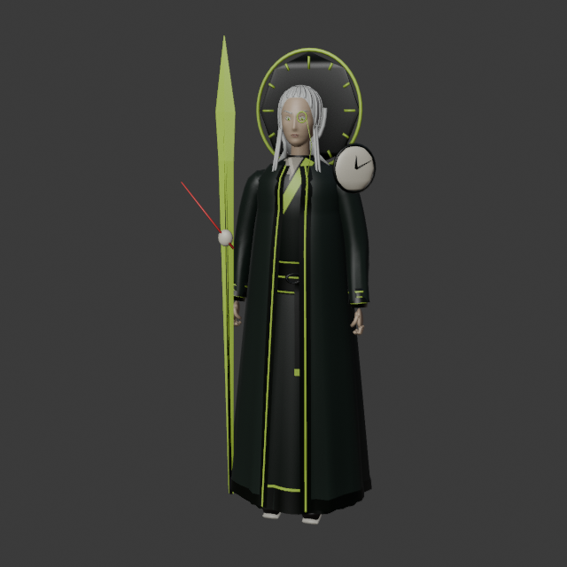
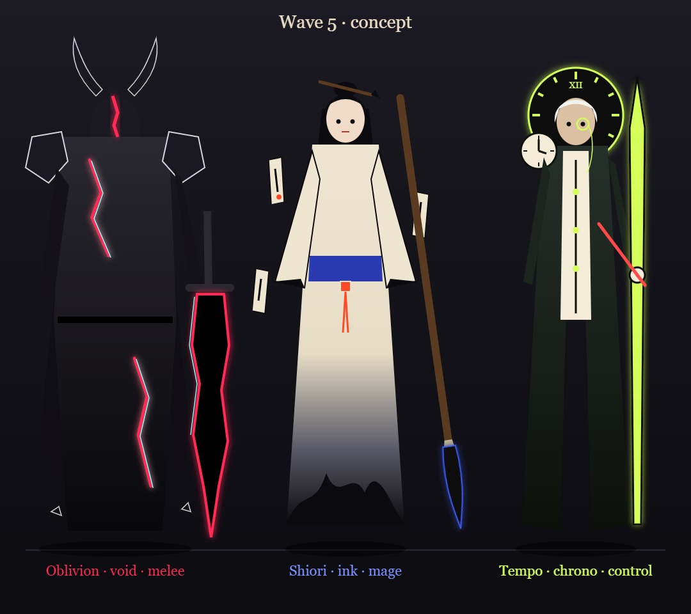
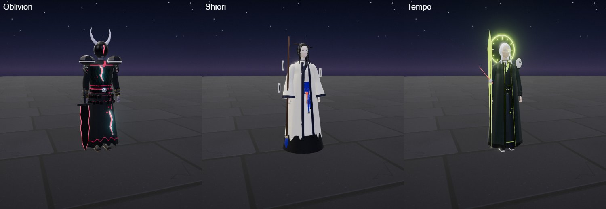
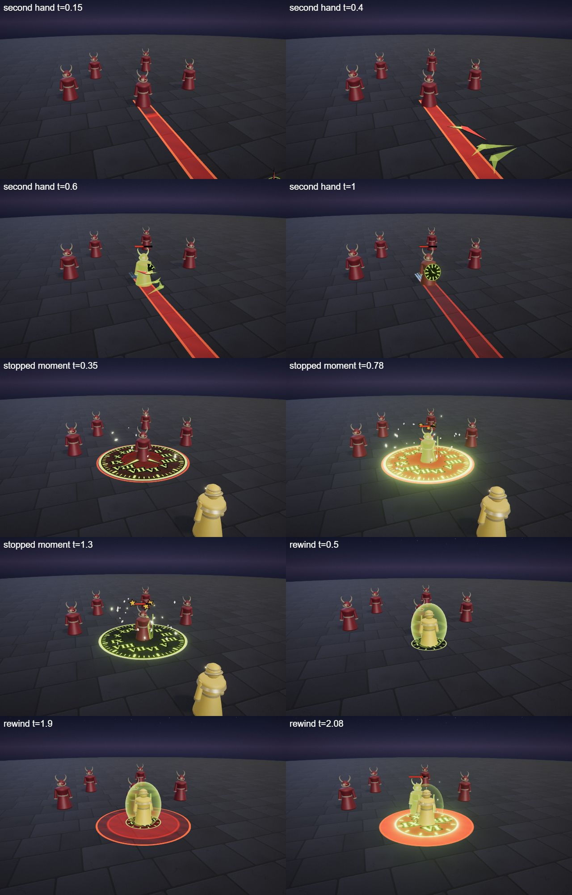
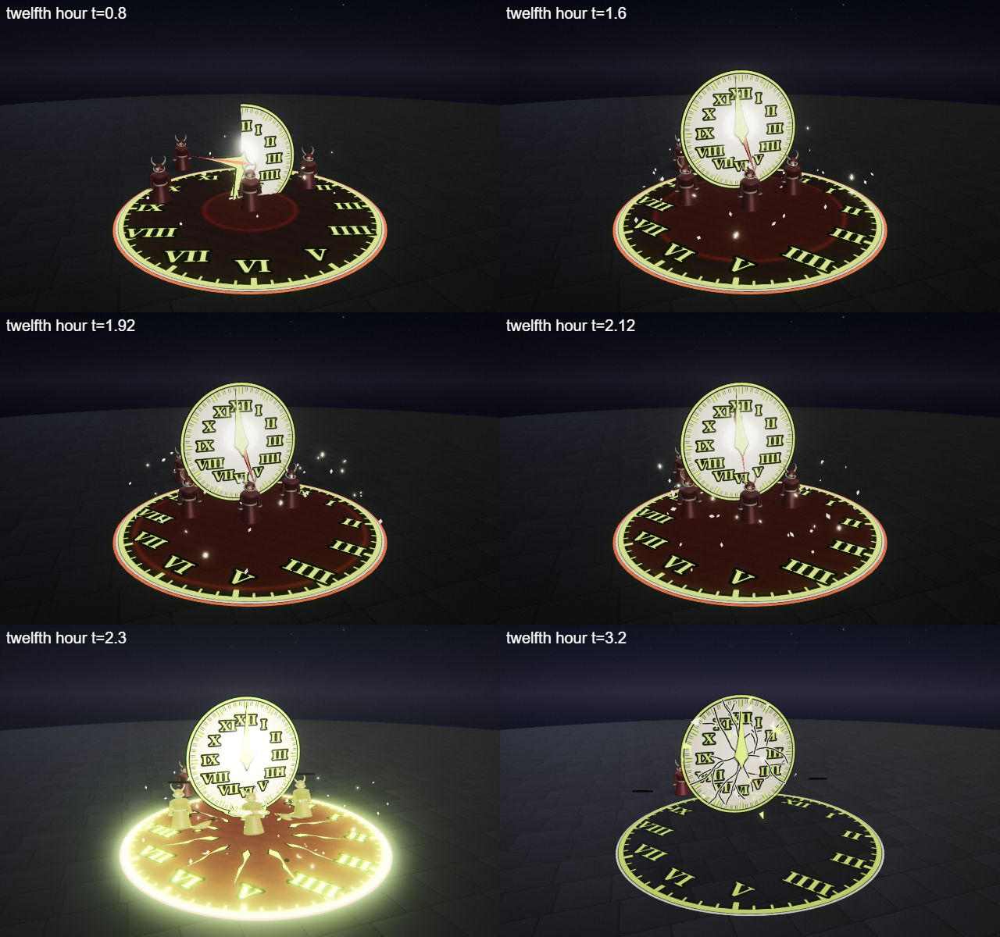

# Tempo, the Unwound Hour

The chrono hero kit: Tempo's four spells (Q, W, E and the R ultimate), the shared parts file, the palette row and the rigged hero model. A slim timekeeper in a long dark coat over an ivory waistcoat, with white hair, a monocle, a glowing clock dial floating behind his head like a halo, an ivory dial on one shoulder and a staff shaped like a giant minute hand with a red second hand pinned at its pivot. He is built on the [combat mechanics](../../architecture/mechanics.md): a piercing skillshot with a slow, a stun, a rewind that shields and heals, and a stunning ultimate.

Tournament (19 opponents, 3 fights per ordered pairing, both sides): 51%, unchanged.

## At a glance

| | |
|---|---|
| Hero | Tempo, the Unwound Hour |
| Spell category | `hero: chrono` |
| Parts file | [`src/effects/parts/chrono.ts`](../../../src/effects/parts/chrono.ts) |
| Kit data | [`src/kits/chrono.ts`](../../../src/kits/chrono.ts) |
| Kit sheet | [`kit-chrono.md`](../../../pipeline/designs/kit-chrono.md) (read [kit-common.md](../../../pipeline/designs/kit-common.md) first) |
| Model | [`public/models/heroes/chrono.glb`](../../../public/models/heroes/chrono.glb) |

## Palette

The art bible row "Chrono" ([ART_BIBLE.md](../../ART_BIBLE.md) section 2, energy value ladders). Every effect of the kit picks from this row.

| Core | Hot | Body | Accent | Dark | Foil |
|---|---|---|---|---|---|
| `#ffffff` | `#f4ffd0` | `#d4ff5a` | `#ff4a4a` | `#0c100a` | ivory dial `#f4ecd8` |

Core is only tiny highlights; hot is the pale highlight of the numerals and hands; body (radium chartreuse) is the numerals, ticks and hands; accent (red) is the second hand and the star at an impact; dark is the face of a dark dial and the outline of every hand; the ivory foil is the face of the big dials. The afterimages are a paler chartreuse (`#e4ffa0` in the kit icons). The kit data also uses a coat colour `#1b2416` for the portrait and icons.

## Signature shape and material rules

The luminous clock dial. Time is drawn as clock dials: rings of Roman numerals and tick marks in glowing radium paint (like an old watch face in the dark), long tapered clock hands that sweep, and afterimages, pale translucent echoes of a figure or an object two or three steps behind it in time. Moments that stop show as frozen motes and a dial that freezes mid-tick; moments that rewind show as afterimages playing backward. Not the clockwork kit (copper gears, springs and rivets: no gears and no brass), not the `hourglass of ages` recipe (no sand, no hourglass) and not the dawn kit (gold light panels).

- Dials: flat discs on the ground or standing in the air, an ivory, dark or open ring face with chartreuse numerals and ticks on a canvas texture, crisp and unlit.
- Hands: tapered flat blades with a dark outline.
- Afterimages: the shape copied pale and translucent, two or three at most.
- Motes: a few small pale diamonds that stop dead in the air and later float up and fade.

## Mechanics

Tempo uses these pieces of [the combat mechanics](../../architecture/mechanics.md):

| Mechanic | Where |
|---|---|
| Skillshot, pierce | Q is `aim: 'line'`: `ctx.projectile` fires a spinning clock hand (speed 22, range 11, radius 0.45) with `pierce: true`, so it hits every enemy in its line once. Hero mode draws a strip toward the cursor; the AI's bolt dodge can sidestep it |
| Slow | Q slows every enemy it hits for 1.0 s (walking speed x 0.6, cap 2.5 s) |
| Stun | W stuns every enemy it hits for 0.8 s and R for 0.6 s (cap 1.2 s). A stun is followed by 0.5 s of stun immunity, so it cannot be chained |
| Shield, heal | E gives `ctx.shieldSelf(25, 2)`, a 25 point shield for 2 s, and `ctx.healSelf(45)` on arrival back at the mark |
| Dash back | E calls `ctx.moveCaster(anchor, 0.25)` at 1.8 s into the spell, not at the cast: he slides back to the spot where he stood when he cast it. The spell is not flagged `dash: true`, so the duel AI does not use it as a gap closer |
| Crowd control flag | W and R have `cc: true`, so the duel AI casts them first when the enemy is in range |
| Melee, summon, pull | none. `maxHp` is not set, so the default 600 HP applies |

The numbers follow the "Mechanics budget" of [kit-common.md](../../../pipeline/designs/kit-common.md): a ranged control Q of about 55 (the code has 50).

## Spells

All four play under the normal gameplay camera (no cinematic, no letterbox). Q, W and E are normal MOBA abilities (the first damage 0.5-0.75 s after the cast, E's after 2.05 s; clean by about 2.2 s, E by 2.8 s); R is the ultimate (hit at 2.2 s, clean by 4.5 s, one dead beat). Range and cooldown come from the kit data (`src/kits/chrono.ts`), hit time and length from the spell files in `src/spells/targeted/`; "hit" is the telegraph impact time and the first damage.

| Key | Label | Targeting | Range | Cooldown | Hit time | Length | What happens |
|---|---|---|---|---|---|---|---|
| Q | [second hand](../../../src/spells/targeted/secondHand.ts) | skillshot line (width 0.9) | 11 | 3 s | flies from 0.2 s, about 0.5 s of flight | 1.5 s | A small dial flicks open at his staff tip and the red second hand snaps off it (0 to 0.2 s). At 0.2 s it leaves as a piercing bolt: a spinning red clock hand with a chartreuse counter-hand and two pale afterimages trailing. Every hit slows the target and flashes a tiny dial (radius 0.6) on it that ticks backward once, with a small red star. At full range the hands fade. Damage 50, knock 1, slow 1.0 s. |
| W | [stopped moment](../../../src/spells/targeted/stoppedMoment.ts) | ground (r 3.5) | 10 | 8 s | 0.75 s | 2.2 s | A clock dial (radius 3.5) draws itself on the ground, the numerals appearing one by one (0 to 0.3 s); both hands sweep toward twelve with the ticking speeding up (0.3 to 0.7 s). At 0.75 s they meet and the dial freezes: the ticks stop, motes stop dead in the air, a small red star flashes and every enemy still inside is hit and stunned; a pale afterimage of up to three victims stays where it was hit. The frozen frame holds to 1.55 s, then the motes release and the dial fades. Damage 35, stun 0.8 s. |
| E | [rewind](../../../src/spells/targeted/rewind.ts) | self (r 3) | 0 (self) | 11 s | 2.05 s | 2.8 s | He marks the moment: a dial (radius 1.2) opens at his feet, a pale afterimage of him stays standing on it and he takes a 25 point shield for 2 s. He may walk freely; the dial's hands run backward. At 1.8 s he rewinds: he slides back to the mark in 0.25 s while two or three afterimages replay his path backward. On arrival (2.05 s) he heals and the dial flashes outward to radius 3: every enemy inside is hit and shoved away from the mark. The dial fades from 2.2 s. The telegraph is a circle of 3 at the mark from 1.4 s to the arrival. Damage 15, knock 2, shield 25, heal 45. |
| R | [twelfth hour](../../../src/spells/targeted/twelfthHour.ts) | ground (r 7) | 13 | 20 s | 2.2 s | 4.5 s | The ultimate. The world darkens to green-black and a numeral ring traces the zone edge on the ground, ticking. Behind the point a vast ivory clock dial (7 across, about 4 up, chartreuse numerals) rises facing the camera; its two hands sweep fast toward twelve and slow as they near it, afterimages of the hands trailing, a red second hand ticking, motes drifting and the enemies drawn a little toward the centre. At 1.6 s the minute hand stops one tick short and every mote freezes; dead beat 1.85-2.0 s; the last tick (2.0 to 2.2 s) brings the hands to twelve and the red second hand flies off the dial and drives into the centre. At 2.2 s: two impact frames, the ring flashes, twelve chartreuse shock lines race out along the numerals, a red star, a ground refraction ring, shake, the hit and a short stun. The dial cracks into flakes and fades and the dark lifts. Damage 100, knock 3, stun 0.6 s. |

Spell sources: [`secondHand.ts`](../../../src/spells/targeted/secondHand.ts), [`stoppedMoment.ts`](../../../src/spells/targeted/stoppedMoment.ts), [`rewind.ts`](../../../src/spells/targeted/rewind.ts), [`twelfthHour.ts`](../../../src/spells/targeted/twelfthHour.ts). Their catalog rows are in the [effect catalog](../effects.md#hero-chrono).

## Parts file

[`src/effects/parts/chrono.ts`](../../../src/effects/parts/chrono.ts) holds everything the four spells share. Spells import it directly (`../../effects/parts/chrono`). Everything is pooled, takes world-space positions and has a `reset()`; the materials are unlit and `toneMapped: false`.

| Export | Role |
|---|---|
| `CHRONO`, `CHRONO_CSS` | palette constants (`foil` is the ivory dial) |
| `Hand` | a tapered flat clock-hand blade with a dark outline in a plane: `set(pivot, angle, length, width)` (angle clockwise from twelve, radians), `sweep(from, to, seconds, steps, ease)` (`steps` above 0 makes it tick in that many jumps), `point(pivot, dir, hint, length, width)` aims it along any direction, `orient(u, n)` changes the plane, `setAngle`, `stop`, `hide` |
| `Dial` | a luminous clock dial (`DialOptions`: `face` `'ring'`, `'ivory'` or `'dark'`, `marks` `'full'`, `'quarter'`, `'ticks'` or `'band'`, `hands`, `spinFace`, `order`): `show(center, radius, normal, seconds)` draws it in clockwise from twelve with the numerals appearing one by one, `place(center, radius)`, `tick(rate)` steps the hands (negative is backward), `tickBack()`, `freeze()` stops the ticking with a flash, `flash(v)`, `crack(k)`, `hide(seconds)`; `hands[0]` is the long minute hand and `hands[1]` the short hour hand |
| `Afterimage` | two or three pale translucent echoes (`max`), never more: `trail(object, count, spacing)` copies of a mesh follow it, `replay(points, seconds, stagger)` figure echoes run a path backward, `stand(i, pos, yaw, alpha)` a still figure echo, `fade(seconds)` |
| `FrozenMotes` | a few small pale motes (at most 48): `drift(center, radius, count)` floats them slowly, `freeze(center, radius, count)` adds more and stops every mote dead in the air, `release(seconds)` lets them float up and fade |
| `Flakes` | small flat triangular flakes of a cracked dial: `emit(pos, vel, size, life)` throws one, they tumble, fall and shrink |

The kit has no unit look: Tempo summons nothing.

## Model

[`public/models/heroes/chrono.glb`](../../../public/models/heroes/chrono.glb): a rigged figure on the Dao rig (same bone names as `public/models/figures/hero.glb`, so `src/effects/weapons/hero.ts` can pose it). Built by `build("chrono")` / `export("chrono")` in [`blender/heroes/hero_figures.py`](../../../blender/heroes/hero_figures.py); hero mode shows it with procedural walk, breath and cast poses. It is wired through the `MODELS` map in [`src/heroes.ts`](../../../src/heroes.ts) (name `Tempo`).

- Look: A slim man in a long dark green-black coat with a chartreuse edge over an ivory waistcoat, loose white hair, a glowing chartreuse monocle on a chain, a clock-dial halo (a glowing ring with a dark face and twelve ticks) behind his head, an ivory dial plate on the left shoulder and a staff shaped like a giant minute hand with a red second hand pinned at its pivot.
- Props: `dial_halo`, `monocle`, `dial_pauldron`, `hand_staff`.
- HUD portrait (canvas-drawn in the kit data): A glowing clock dial floating behind his head like a halo, the minute-hand staff with the red second hand at its pivot, shoulders in a long dark coat with a chartreuse edge, the ivory dial plate on the shoulder, and a long lean face with white hair swept back and tied in a tail, and a monocle on a chain.

The wave 5 concept (Oblivion, Shiori and Tempo; vector source [`wave5_concept.svg`](../../heroes/wave5_concept.svg)):

The wave 5 models in hero mode (Oblivion, Shiori and Tempo):

## Files

| What | Where |
|---|---|
| Kit sheet (design) | [`pipeline/designs/kit-chrono.md`](../../../pipeline/designs/kit-chrono.md) |
| Shared kit rules | [`pipeline/designs/kit-common.md`](../../../pipeline/designs/kit-common.md) |
| Parts | [`src/effects/parts/chrono.ts`](../../../src/effects/parts/chrono.ts) |
| Spells | [`secondHand.ts`](../../../src/spells/targeted/secondHand.ts), [`stoppedMoment.ts`](../../../src/spells/targeted/stoppedMoment.ts), [`rewind.ts`](../../../src/spells/targeted/rewind.ts), [`twelfthHour.ts`](../../../src/spells/targeted/twelfthHour.ts) |
| Kit data | [`src/kits/chrono.ts`](../../../src/kits/chrono.ts) |
| Model | [`public/models/heroes/chrono.glb`](../../../public/models/heroes/chrono.glb) |
| Model script | [`blender/heroes/hero_figures.py`](../../../blender/heroes/hero_figures.py) |

## Review sheets

Contact sheets in `docs/spells/` (frames over time, from `pipeline/tools/contact-sheet.js`).

### Chrono review (Q, W, E)

### Chrono review (R)

## See also

- [Hero roster and shared structure](README.md)
- [Combat mechanics](../../architecture/mechanics.md)
- [Oblivion (void)](void.md), [Shiori (ink)](ink.md), [Ada (clockwork)](clockwork.md), [Cantor (bard)](bard.md)
- [Effect catalog](../effects.md)
- [Docs home](../../README.md)
- [Art bible](../../ART_BIBLE.md)
- [Kit shared rules](../../../pipeline/designs/kit-common.md)
