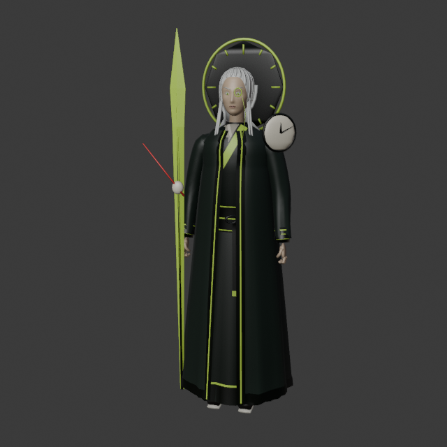

# Tempo, the Unwound Hour

The chrono hero kit (kits v5): Tempo's four spells (Q, W, E and the R ultimate), his passive, the shared parts file, the palette row and the rigged hero model. A slim man in a long dark coat with a clock-dial halo and a staff shaped like a giant minute hand. Every spell he casts plays twice.

## Role

| | |
|---|---|
| Role | Mage (ranged attack) |
| Signature | Echo |
| HP | 580 |
| Kit shapes | Q BOLT clock hand, echo · W ZONE slow, echo · E DASH time skip, untouchable, echo · R TGT clock face, echo |

He wins a 1v1 by making the enemy pay for where they stand twice: the echo repeats each spell 1.5 s later from the same place. His weakness is that his damage comes late and can be dodged twice. Rushed by a melee hero, he has one short blink and little else. Walk speed 4.0 m/s.

## At a glance

| | |
|---|---|
| Hero | Tempo, the Unwound Hour |
| Spell category | `hero: chrono` |
| Parts file | [`src/effects/parts/chrono.ts`](../../../src/effects/parts/chrono.ts) |
| Kit data | [`src/kits/chrono.ts`](../../../src/kits/chrono.ts) |
| Trait data | [`src/traits/chrono.ts`](../../../src/traits/chrono.ts) |
| Kit sheet | [`kit-chrono.md`](../../../pipeline/designs/kit-chrono.md) (read [kit-common.md](../../../pipeline/designs/kit-common.md) first) |
| Model | [`public/models/heroes/chrono.glb`](../../../public/models/heroes/chrono.glb) |

## Palette

The art bible row "Chrono" ([ART_BIBLE.md](../../ART_BIBLE.md) section 2, energy value ladders). Every effect of the kit picks from this row.

| Core | Hot | Body | Accent | Dark | Foil |
|---|---|---|---|---|---|
| `#ffffff` | `#f4ffd0` | `#d4ff5a` | `#ff4a4a` | `#0c100a` | ivory dial `#f4ecd8` |

Core is only tiny highlights; hot is the pale highlight of the numerals and hands; body (radium chartreuse) is the numerals, ticks and hands; accent (red) is the second hand and the star at an impact; dark is the face of a dark dial and the outline of every hand; the ivory foil is the face of the big dials. The afterimages are a paler chartreuse (`#e4ffa0` in the kit icons). The kit data also uses a coat colour `#1b2416` for the portrait and icons.

## Signature shape and material rules

The luminous clock dial. Time is drawn as clock dials: rings of Roman numerals and tick marks in glowing radium paint (like an old watch face in the dark), long tapered clock hands that sweep, and afterimages, pale translucent echoes of a figure or an object two or three steps behind it in time. Moments that stop show as frozen motes and a dial that freezes mid-tick; moments that rewind show as afterimages playing backward. Not the clockwork kit (copper gears, springs and rivets: no gears and no brass), not the `hourglass of ages` recipe (no sand, no hourglass) and not the dawn kit (gold light panels).

- Dials: flat discs on the ground or standing in the air, an ivory, dark or open ring face with chartreuse numerals and ticks on a canvas texture, crisp and unlit.
- Hands: tapered flat blades with a dark outline.
- Afterimages: the shape copied pale and translucent, two or three at most.
- Motes: a few small pale diamonds that stop dead in the air and later float up and fade.

## Passive and twist

| | |
|---|---|
| Passive | **Echo**: every spell he casts plays twice. Tick, Slow Time, Time Skip and Stolen Hour each repeat 1.5 s later from the same place at 40% damage (80% in Stolen Hour). Ghost clock hands show where. |
| Twist | none (the trait has no `twist` entry) |
| Resource or meter | none. A ring at his feet and a gold `stolen` mark pip show while Stolen Hour's strong echoes run |
| Walk speed | 4.0 m/s |
| Basic attack | ranged, 6 m, 10 per 1.0 s, wind-up 0.25 s, bolt speed 18, gear look |

Other trait rules (`src/traits/chrono.ts`):

- The echo lives in each spell's effect; the trait keeps the strength (40%, or 80% while Stolen Hour runs) and shows it. Ghost clock hands mark where each echo will come from, on both screens.
- A direct hit with Tick takes 1 s off Tick (once per cast). The echo's hit never counts.
- Slow Time: he moves 30% faster inside the circle.
- Time Skip: untouchable for 0.6 s (every hit on him is swallowed, and he is held).
- Stolen Hour starts its effect only if it lands. The victim's screen tells his own client, which raises the echoes to 80% for 4 s (gold pip and ring on both screens) and gives him 30% more speed. It does not touch the enemy's cooldowns.

## Mechanics

Tempo uses these pieces of [the combat mechanics](../../architecture/mechanics.md):

| Mechanic | Where |
|---|---|
| Echo | the passive: a second hit 1.5 s later at 40% (80% in Stolen Hour) for Q, W, E and R |
| Slow | W (2 s), R (2 s) |
| Untouchable | Time Skip, 0.6 s |
| Dash | Time Skip (up to 6 m). Kit flag: E `dash` |
| Speed buff | W (30% faster inside the circle, 3 s), R (30% faster for 4 s) |
| Cooldown refund | Tick: 1 s on a direct hit |
| Skillshot | Tick (radius 0.35, speed 20) |
| Summon, shield, pull | none |

## Spells

All four play under the normal gameplay camera. Range and cooldown come from the kit data (`src/kits/chrono.ts`), hit time and length from the spell files in `src/spells/targeted/`; "hit" is the telegraph impact time and the first damage. Each length includes the echo.

| Key | Label | Targeting | Range | Cooldown | Hit time | Length | What happens |
|---|---|---|---|---|---|---|---|
| Q | [tick bolt](../../../src/spells/targeted/tickBolt.ts) | ground (BOLT skillshot, line, radius 0.35) | 9 | 3 s | released at 0.25 s, flight at 20 m/s | 2.45 s | A spinning clock hand flies 9 m: 50. A direct hit takes 1 s off Tick. Echo: the same line again 1.5 s after the release, from where he stood, for 20. |
| W | [slow time](../../../src/spells/targeted/slowTime.ts) | ground (r 3.5) | 9 | 9 s | 1.2 s | 3.35 s | Time thickens in a 3.5 m circle for 3 s with dials turning in it. After 1.2 s enemies inside take 30 and are slowed 2 s. He moves 30% faster inside for 3 s. Echo 1.5 s later: 12 and the slow again. |
| E | [time skip](../../../src/spells/targeted/timeSkip.ts) | ground (dash, pulse r 1.4) | 6 | 11 s | 0.6 s (he returns) | 2.5 s | He vanishes for 0.6 s (untouchable) and returns on the marker up to 6 m away with a pulse of 35. Echo 1.5 s later at the same spot: 14. |
| R | [stolen hour](../../../src/spells/targeted/stolenHour.ts) | enemy (click), sight checked | 8 | 24 s | 0.8 s | 2.7 s | A clock face (1.2 m) forms over the enemy. After 0.8 s, if he still sees them: 70 and slowed 2 s, and for 4 s his echoes hit at 80% and he moves 30% faster. Echo: 28. If the wind-up fails it fizzles at 1.5 s. |

Spell sources: [`tickBolt.ts`](../../../src/spells/targeted/tickBolt.ts), [`slowTime.ts`](../../../src/spells/targeted/slowTime.ts), [`timeSkip.ts`](../../../src/spells/targeted/timeSkip.ts), [`stolenHour.ts`](../../../src/spells/targeted/stolenHour.ts). Their catalog rows are in the [effect catalog](../effects.md#hero-chrono).

## Parts file

[`src/effects/parts/chrono.ts`](../../../src/effects/parts/chrono.ts) holds everything the four spells share. Spells import it directly (`../../effects/parts/chrono`). Everything is pooled, takes world-space positions and has a `reset()`; the materials are unlit and `toneMapped: false`.

| Export | Role |
|---|---|
| `CHRONO`, `CHRONO_CSS` | palette constants (`foil` is the ivory dial) |
| `Hand` | a tapered flat clock-hand blade with a dark outline in a plane: `set(pivot, angle, length, width)` (angle clockwise from twelve, radians), `sweep(from, to, seconds, steps, ease)` (`steps` above 0 makes it tick in that many jumps), `point(pivot, dir, hint, length, width)` aims it along any direction, `orient(u, n)` changes the plane, `setAngle`, `stop`, `hide` |
| `Dial` | a luminous clock dial (`DialOptions`: `face` `'ring'`, `'ivory'` or `'dark'`, `marks` `'full'`, `'quarter'`, `'ticks'` or `'band'`, `hands`, `spinFace`, `order`): `show(center, radius, normal, seconds)` draws it in clockwise from twelve with the numerals appearing one by one, `place(center, radius)`, `tick(rate)` steps the hands (negative is backward), `tickBack()`, `freeze()` stops the ticking with a flash, `flash(v)`, `crack(k)`, `hide(seconds)`; `hands[0]` is the long minute hand and `hands[1]` the short hour hand |
| `Afterimage` | two or three pale translucent echoes (`max`), never more: `trail(object, count, spacing)` copies of a mesh follow it, `replay(points, seconds, stagger)` figure echoes run a path backward, `stand(i, pos, yaw, alpha)` a still figure echo, `fade(seconds)` |
| `FrozenMotes` | a few small pale motes (at most 48): `drift(center, radius, count)` floats them slowly, `freeze(center, radius, count)` adds more and stops every mote dead in the air, `release(seconds)` lets them float up and fade |
| `Flakes` | small flat triangular flakes of a cracked dial: `emit(pos, vel, size, life)` throws one, they tumble, fall and shrink |
| `ECHO_GOLD`, `ECHO_GOLD_CSS` | the golden colour of the strong echoes (Stolen Hour) |
| `DialFace`, `DialMarks` | types for the dial textures: face `'ring'`, `'ivory'`, `'dark'`; marks `'full'`, `'quarter'`, `'ticks'`, `'band'` |
| `EchoClock` | the ghost clock hands of the passive: a pale translucent dial that appears at the place the echo will come from, its hands running round to twelve as the echo fires: `show(center, radius, normal, seconds)`, `place`, `gold(true)`, `fire()` |

The kit has no unit look: Tempo summons nothing.

## Model

[`public/models/heroes/chrono.glb`](../../../public/models/heroes/chrono.glb): a rigged figure on the Dao rig (same bone names as `public/models/figures/hero.glb`, so `src/effects/weapons/hero.ts` can pose it). Built by `build("chrono")` / `export("chrono")` in [`blender/heroes/hero_figures.py`](../../../blender/heroes/hero_figures.py). Hero mode shows it with procedural walk, breath and cast poses. It is wired through the `MODELS` map in [`src/heroes.ts`](../../../src/heroes.ts). Hit size (`HERO_BODIES`): radius 0.41 m, height 2.46 m.

- Look: a slim man in a long dark green-black coat with a chartreuse edge over an ivory waistcoat, loose white hair, a glowing chartreuse monocle on a chain, a clock-dial halo behind his head, an ivory dial plate on the left shoulder and a staff shaped like a giant minute hand.
- Props: `dial_halo`, `monocle`, `dial_pauldron`, `hand_staff`.
- HUD portrait (canvas-drawn in the kit data): a glowing clock dial floating behind his head like a halo, the minute-hand staff with the red second hand at its pivot, and shoulders in a long dark coat with a chartreuse edge.

## Files

| What | Where |
|---|---|
| Kit sheet (design) | [`pipeline/designs/kit-chrono.md`](../../../pipeline/designs/kit-chrono.md) |
| Shared kit rules | [`pipeline/designs/kit-common.md`](../../../pipeline/designs/kit-common.md) |
| Kits v5 design | [`pipeline/designs/kits-v5.md`](../../../pipeline/designs/kits-v5.md) |
| Parts | [`src/effects/parts/chrono.ts`](../../../src/effects/parts/chrono.ts) |
| Spells | [`tickBolt.ts`](../../../src/spells/targeted/tickBolt.ts), [`slowTime.ts`](../../../src/spells/targeted/slowTime.ts), [`timeSkip.ts`](../../../src/spells/targeted/timeSkip.ts), [`stolenHour.ts`](../../../src/spells/targeted/stolenHour.ts) |
| Kit data | [`src/kits/chrono.ts`](../../../src/kits/chrono.ts) |
| Trait | [`src/traits/chrono.ts`](../../../src/traits/chrono.ts) |
| Model | [`public/models/heroes/chrono.glb`](../../../public/models/heroes/chrono.glb) |
| Model script | [`blender/heroes/hero_figures.py`](../../../blender/heroes/hero_figures.py) |

## See also

- [Hero roster and shared structure](README.md)
- [Combat mechanics](../../architecture/mechanics.md)
- [Oblivion (void)](void.md), [Shiori (ink)](ink.md)
- [Effect catalog](../effects.md)
- [Docs home](../../README.md)
- [Art bible](../../ART_BIBLE.md)
- [Kit shared rules](../../../pipeline/designs/kit-common.md)
