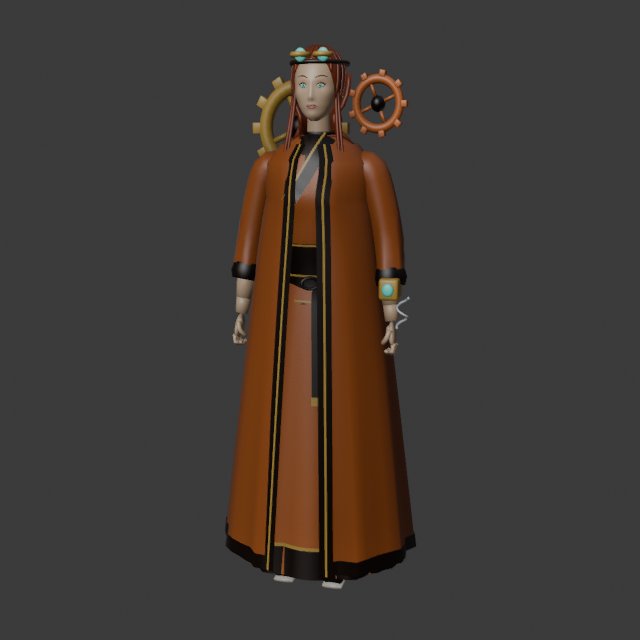

# Ada, the Artificer

The clockwork hero kit (kits v5): Ada's four spells (Q, W, E and the R ultimate), her passive, the shared parts file, the palette row and the rigged hero model. A slim inventor in a copper coat with a backpack of brass gears and a wrist launcher. She builds turrets and stands near them.

## Role

| | |
|---|---|
| Role | Engineer (ranged attack) |
| Signature | Overclock |
| HP | 550 |
| Kit shapes | Q TGT homing drone, tags · W TURRET, 2 charges · E HOOK, hits or reels her to a wall or turret · R SELF root, heavy rounds, recast to pack up |

She wins a 1v1 by fighting from her turrets: they shoot faster near her and harder against a tagged enemy. Her weakness is being rushed before her turrets are up, or after they die. Siege Mode roots her, so it makes her a target. Walk speed 3.9 m/s.

## At a glance

| | |
|---|---|
| Hero | Ada, the Artificer |
| Spell category | `hero: clockwork` |
| Parts file | [`src/effects/parts/clockwork.ts`](../../../src/effects/parts/clockwork.ts) |
| Kit data | [`src/kits/clockwork.ts`](../../../src/kits/clockwork.ts) |
| Trait data | [`src/traits/clockwork.ts`](../../../src/traits/clockwork.ts) |
| Kit sheet | [`kit-clockwork.md`](../../../pipeline/designs/kit-clockwork.md) (read [kit-common.md](../../../pipeline/designs/kit-common.md) first) |
| Model | [`public/models/heroes/clockwork.glb`](../../../public/models/heroes/clockwork.glb) |

## Palette

The art bible row "Clockwork" ([ART_BIBLE.md](../../ART_BIBLE.md) section 2, energy value ladders). Every effect of the kit picks from this row.

| Core | Hot | Body | Accent | Dark | Foil |
|---|---|---|---|---|---|
| `#ffffff` | `#ffd08a` | `#d9773a` | `#6affea` | `#1a0f08` | steel `#d8dde2` |

Core is only tiny highlights; hot is polished brass and the glow of sparks; body is machined copper; accent (cyan electric) is the sparks, the arcs between gears and the launcher lens; dark is oiled iron and the underside of every gear; the steel foil is the chains, the rims and the steam. Brass `#d9a655` appears in the kit icons as a second metal.

## Signature shape and material rules

The toothed gear. Everything is machined copper and brass: gears that spin and mesh, coiled springs, chains, rivets and puffs of steam, with cyan sparks jumping where metal meets metal. Every spell is a mechanism: a wound spring letting go, a turret clicking together, nested gears lurching a notch, a giant gear lowered on chains. Not the forge kit's molten slag (Brannoc): clean, oiled, precisely cut metal, not hot or cracked.

- Gears: flat, chunky teeth (the tooth count follows the radius, `teethFor`), spokes or a ring hole, a dark hub; they turn against each other.
- Sparks: short cyan arcs and bursts, a few per click.
- Steam: pale puffs from joints and hubs.

## Passive and twist

| | |
|---|---|
| Passive | **Overclock**: her turrets within 5 m of her shoot 30% faster. A ring at her feet shows the 5 m, and a turret inside it glows. In Siege Mode the ring grows to 8 m and those turrets shoot twice as fast. |
| Twist | none (the trait has no `twist` entry). The passive is the whole rule |
| Resource or meter | none. The ring at her feet (orange) shows the range |
| Walk speed | 3.9 m/s |
| Basic attack | ranged, 6 m, 10 per 1.0 s, wind-up 0.25 s, bolt speed 18, rivet look |

Other trait rules (`src/traits/clockwork.ts`):

- Homing Drone tags the enemy for 3 s (one pip over them). A hit from one of her turrets on a tagged enemy deals 30% more.
- Deploy Turret has 2 charges, one back every 10 s.
- Siege Mode holds her still for 6 s with +20% armour. Its recast, "Pack up" (arms after 0.3 s), frees her at once. A stun or silence ends it too. While braced she cannot cast Grapple.
- The duel AI holds Siege Mode until it has a turret up and the enemy is inside the 9 m her rounds reach (`aiHold`).

## Mechanics

Ada uses these pieces of [the combat mechanics](../../architecture/mechanics.md):

| Mechanic | Where |
|---|---|
| Summon | W: a turret with 80 HP for 8 s, 9 damage every 1.4 s, range 8. Kit flag: W `summon` |
| Charges | W, 2 charges, one back every 10 s |
| Tag | Q tags for 3 s; turret hits on a tagged enemy deal +30% |
| Unit rate | the passive and Siege Mode speed up her turrets (`unitRate`) |
| Slow | E on an enemy, 1 s |
| Hold and armour | R roots her 6 s with +20% armour |
| Recast | R, "Pack up" |
| Pull, dash, shield, heal | none. The hook reels Ada herself to a wall, pillar or turret; it cannot pull the enemy |

## Spells

All four play under the normal gameplay camera. Range and cooldown come from the kit data (`src/kits/clockwork.ts`), hit time and length from the spell files in `src/spells/targeted/`; "hit" is the telegraph impact time and the first damage.

| Key | Label | Targeting | Range | Cooldown | Hit time | Length | What happens |
|---|---|---|---|---|---|---|---|
| Q | [homing drone](../../../src/spells/targeted/homingDrone.ts) | enemy (click), sight needed | 8 | 4 s | 0.45 s | 3.75 s | A brass drone with a cyan lens leaves her backpack at 0.08 s, flies in an arc and lands on the enemy at 0.45 s. It always hits: 45. It tags the enemy for 3 s (a ring on the ground lasts as long as the tag) and her turrets deal 30% more to a tagged enemy. |
| W | [deploy turret](../../../src/spells/targeted/deployTurret.ts) | ground (r 1.5) | 8 | 10 s | 0.5 s (the turret is built) | 1.6 s | Two charges, one back every 10 s. A turret is built at the spot: 80 HP, 9 damage every 1.4 s, range 8, for 8 s. Within 5 m of her it shoots 30% faster and glows. |
| E | [grapple hook](../../../src/spells/targeted/grappleHook.ts) | ground (line, bolt radius 0.35) | 9 | 10 s | 0.25 s (hook released), flight at 20 m/s | up to 2.2 s | A hook with a cable (0.25 s wind-up). On an enemy: 30 damage and slowed 1 s, and she stays put. On a wall, a pillar or her own turret she reels herself to it, stopping 0.9 m short. It cannot pull the enemy. |
| R | [siege mode](../../../src/spells/targeted/siegeMode.ts) | self (radius 25) | 9 | 24 s | plates down at 0.4 s, a heavy round every 0.8 s | 6.7 s | Four steel plates slam onto the ground round her and she braces for 6 s, rooted, +20% armour. Turrets within 8 m of her fire twice as fast, and she fires heavy rounds (23 every 0.8 s, at most 2 in flight) at an enemy within 9 m she can see. A stun, silence or knock-up ends it. Recast: pack up. |

Spell sources: [`homingDrone.ts`](../../../src/spells/targeted/homingDrone.ts), [`deployTurret.ts`](../../../src/spells/targeted/deployTurret.ts), [`grappleHook.ts`](../../../src/spells/targeted/grappleHook.ts), [`siegeMode.ts`](../../../src/spells/targeted/siegeMode.ts). Their catalog rows are in the [effect catalog](../effects.md#hero-clockwork).

## Parts file

[`src/effects/parts/clockwork.ts`](../../../src/effects/parts/clockwork.ts) holds everything the four spells share. Spells import it directly (`../../effects/parts/clockwork`). Everything is pooled, takes world-space positions and has a `reset()`; the materials are toon shaders kept below the bloom threshold.

| Export | Role |
|---|---|
| `CLOCKWORK`, `CLOCKWORK_CSS` | palette constants (`foil` is the steel) |
| `gearGeometry`, `teethFor` | a toothed gear geometry (`teeth`, `spokes`, `hole`) and the tooth count that suits a radius |
| `Gear` | pooled flat gears (`GearOptions`): `place(pos, normal, radius, spin, opts)`, `assemble(seconds)`, `move`, `setRate`, `setRadius`, `kick(i, angle)` (a lurch), `hide(i)`, `fold(seconds)`, `scatter(speed, life, origin)` (breaks into cogs) |
| `Spring` | coiled spring: `set(from, to, coils, radius)`, `stretch(k)`, `hide()` |
| `Sparks` | cyan sparks: `arc(a, b, life)`, `burst(pos, count)`, `ring(center, radius, count, y)` |
| `SteamPuffs` | pale steam: `puff(pos, dir, count)` |
| `Chain` | a hanging chain between two points: `set(a, b)`, `hide()` |
| `Rivet` | the spinning copper rivet: `place(pos, dir, spin)`, `hide()` |
| `turretLook` | a `MinionLook` for `SummonOptions.look`, see below |
| `setTurretPower` | sets how hard a turret glows (Overclock): 0 none, 1 inside her 5 m ring, 2 in Siege Mode. Keyed by the unit's position vector |
| `HomingDrone` | the drone: a small brass body with a cyan lens and two spinning rotor gears: `place(pos, dir, t)`, `hide()` |
| `GrappleHook` | the hook head: a steel grapnel with three copper prongs and a ring eye: `place(pos, dir, spin)`, `hide()` |
| `SiegePlates` | Siege Mode's footing: four steel plates with copper braces and stakes: `set(centre, k, t)` (`k` is how far deployed) |
| `RailBeam`, `MagCoil` | a glowing beam and a set of coil rings from the old Mag Rail spell. The current kit does not use `RailBeam`; Siege Mode uses `MagCoil` |

### turretLook

`turretLook` is the unit look for the summoned turret ([`MinionLook`](../../architecture/mechanics.md#the-look-pluggable-partsminionts) in `parts/minion.ts`): a brass tripod, a spinning gear body, a short barrel and a cyan lens that flares on `pose.shot`. Any other unit kind falls back to the default look.

## Model

[`public/models/heroes/clockwork.glb`](../../../public/models/heroes/clockwork.glb): a rigged figure on the Dao rig (same bone names as `public/models/figures/hero.glb`, so `src/effects/weapons/hero.ts` can pose it). Built by `build("clockwork")` / `export("clockwork")` in [`blender/heroes/hero_figures.py`](../../../blender/heroes/hero_figures.py). Hero mode shows it with procedural walk, breath and cast poses. It is wired through the `MODELS` map in [`src/heroes.ts`](../../../src/heroes.ts). Hit size (`HERO_BODIES`): radius 0.39 m, height 2.29 m.

- Look: a slim inventor in a copper long coat over a dark vest with steel buttons, rolled sleeves, loose auburn hair, brass goggles pushed up on the forehead, a backpack of meshing brass and copper gears and a spring-loaded wrist launcher with a cyan lens.
- Props: `goggles`, `gear_backpack`, `wrist_launcher`.
- HUD portrait (canvas-drawn in the kit data): the brass backpack of gears behind her shoulders and a wrist launcher on the right, shoulders in a dark coat with a copper trim and brass buttons.

## Files

| What | Where |
|---|---|
| Kit sheet (design) | [`pipeline/designs/kit-clockwork.md`](../../../pipeline/designs/kit-clockwork.md) |
| Shared kit rules | [`pipeline/designs/kit-common.md`](../../../pipeline/designs/kit-common.md) |
| Kits v5 design | [`pipeline/designs/kits-v5.md`](../../../pipeline/designs/kits-v5.md) |
| Parts | [`src/effects/parts/clockwork.ts`](../../../src/effects/parts/clockwork.ts) |
| Spells | [`homingDrone.ts`](../../../src/spells/targeted/homingDrone.ts), [`deployTurret.ts`](../../../src/spells/targeted/deployTurret.ts), [`grappleHook.ts`](../../../src/spells/targeted/grappleHook.ts), [`siegeMode.ts`](../../../src/spells/targeted/siegeMode.ts) |
| Kit data | [`src/kits/clockwork.ts`](../../../src/kits/clockwork.ts) |
| Trait | [`src/traits/clockwork.ts`](../../../src/traits/clockwork.ts) |
| Model | [`public/models/heroes/clockwork.glb`](../../../public/models/heroes/clockwork.glb) |
| Model script | [`blender/heroes/hero_figures.py`](../../../blender/heroes/hero_figures.py) |

## See also

- [Hero roster and shared structure](README.md)
- [Combat mechanics](../../architecture/mechanics.md)
- [Mortis (bone)](bone.md), [Shiori (ink)](ink.md)
- [Effect catalog](../effects.md)
- [Docs home](../../README.md)
- [Art bible](../../ART_BIBLE.md)
- [Kit shared rules](../../../pipeline/designs/kit-common.md)
