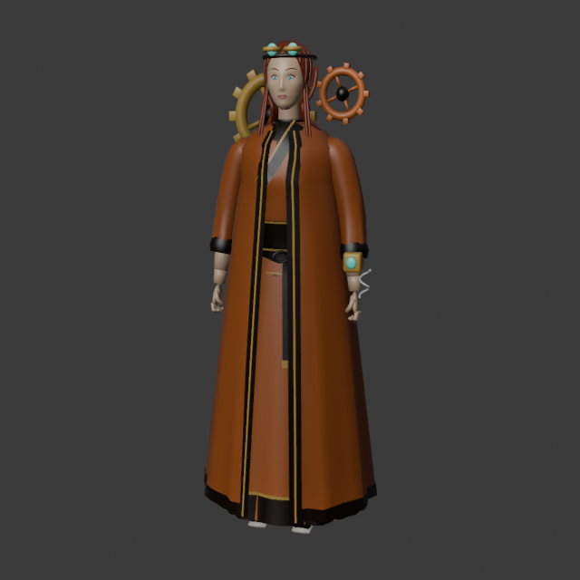
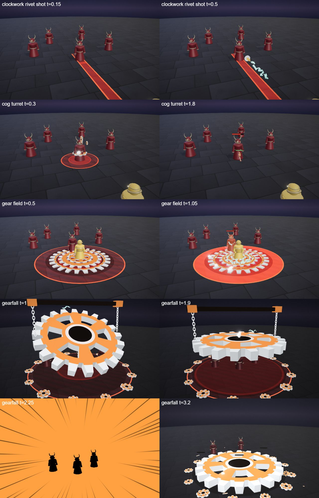
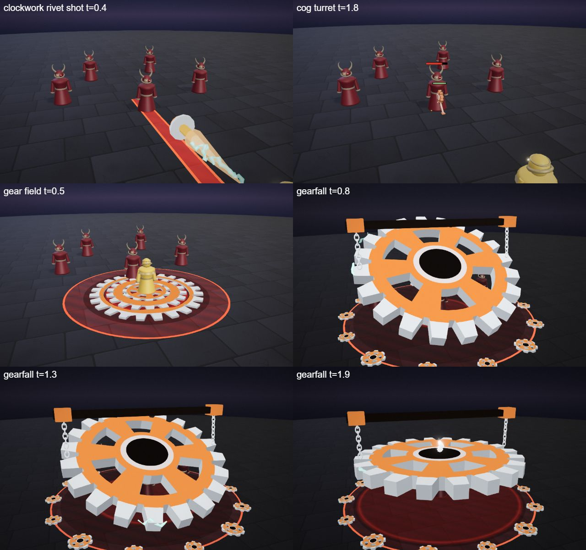
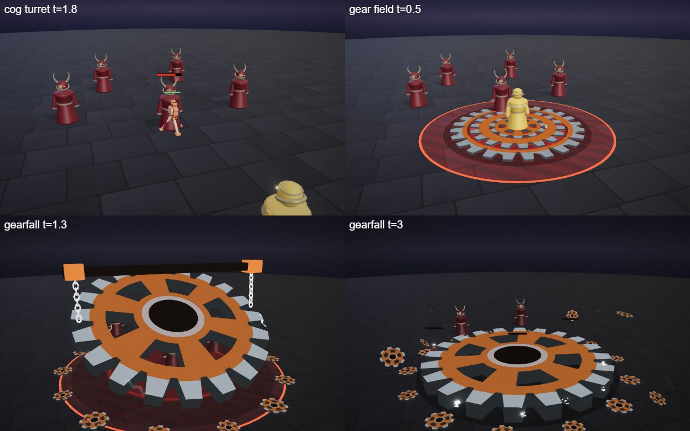

# Ada, the Artificer

The clockwork hero kit: Ada's four spells (Q, W, E and the R ultimate), the shared parts file, the palette row and the rigged hero model. An inventor in a copper long coat with a backpack of brass gears and a spring-loaded wrist launcher; she controls the fight from range with slows, a turret and a root. She is one of the first heroes built on the [combat mechanics](../../architecture/mechanics.md): a ricocheting skillshot, slows, a summoned turret and a root.

## At a glance

| | |
|---|---|
| Hero | Ada, the Artificer |
| Spell category | `hero: clockwork` |
| Parts file | [`src/effects/parts/clockwork.ts`](../../../src/effects/parts/clockwork.ts) |
| Kit data | [`src/kits/clockwork.ts`](../../../src/kits/clockwork.ts) |
| Kit sheet | [`kit-clockwork.md`](../../../pipeline/designs/kit-clockwork.md) (read [kit-common.md](../../../pipeline/designs/kit-common.md) first) |
| Model | [`public/models/heroes/clockwork.glb`](../../../public/models/heroes/clockwork.glb) |

## Palette

The art bible row "Clockwork" ([ART_BIBLE.md](../../ART_BIBLE.md) section 2, energy value ladders). Every effect of the kit picks from this row.

| Core | Hot | Body | Accent | Dark | Foil |
|---|---|---|---|---|---|
| `#ffffff` | `#ffd08a` | `#d9773a` | `#6affea` | `#1a0f08` | steel `#d8dde2` |

Core is only tiny highlights; hot is polished brass and the glow of sparks; body is machined copper; accent (cyan electric) is the sparks, the arcs between gears and the launcher lens; dark is oiled iron and the underside of every gear; the steel foil is the chains, the rims and the steam. Brass `#d9a655` appears in the kit icons as a second metal.

## Signature shape and material rules

The toothed gear. Everything is machined copper and brass: gears that spin and mesh, coiled springs, chains, rivets and puffs of steam, with cyan sparks jumping where metal meets metal. Every spell is a mechanism: a wound spring letting go, a turret clicking together, nested gears lurching a notch, a giant gear lowered on chains. Not the forge kit's molten slag (Brannoc): clean, oiled, precisely cut metal, not hot or cracked.

- Gears: flat, chunky teeth (the tooth count follows the radius, `teethFor`), spokes or a ring hole, a dark hub; they turn against each other.
- Sparks: short cyan arcs and bursts, a few per click.
- Steam: pale puffs from joints and hubs.

## Mechanics

Ada uses these pieces of [the combat mechanics](../../architecture/mechanics.md):

| Mechanic | Where |
|---|---|
| Skillshot | Q is `aim: 'line'`: `ctx.projectile` fires a rivet (speed 24, range 12, radius 0.4) with `bounce: 1`, so after the first hit it ricochets to the nearest other enemy within 6 m. Hero mode draws a strip toward the cursor; the AI's bolt dodge can sidestep it |
| Slow | Q slows its victims for 1.5 s; E slows every enemy it hits for 1.0 s (walking speed x 0.6, cap 2.5 s) |
| Summon | W has `summon: true` and calls `ctx.summon` for one turret (80 HP, 6 s, 12 damage per 1.4 s, range 8). The AI casts it when ready and the hero is within 10 m |
| Root | R has `cc: true` and roots every enemy in the zone for 1.2 s (cap 1.5 s): they cannot move but can still cast. The AI casts a `cc` spell first when the enemy is not already held |
| Unit look | the turret uses `turretLook` (see [Parts file](#parts-file)) |
| Melee, dash, knock-up, shield | none. `maxHp` is not set, so the default 600 HP applies |

The numbers follow the "Mechanics budget" of [kit-common.md](../../../pipeline/designs/kit-common.md): a ranged control kit needs a stronger Q (55) and a turret at 12 per shot. In the wave 3 duel tournament she won 56%.

## Spells

All four play under the normal gameplay camera (no cinematic, no letterbox). Q, W and E are normal MOBA abilities (the first damage 0.2-1.0 s after the cast, clean by about 1.6 s; the E aura runs about 3 s); R is the ultimate (hit at 2.2 s, clean by 4.5 s, one dead beat and impact frames). Range and cooldown come from the kit data (`src/kits/clockwork.ts`), hit time and length from the spell files in `src/spells/targeted/`; "hit" is the telegraph impact time and the first damage. The Q file and label are prefixed (`clockwork rivet shot`, `clockworkRivetShot.ts`) because the forge kit already owns the label `rivet shot`; the kit calls it Rivet Shot.

| Key | Label | Targeting | Range | Cooldown | Hit time | Length | What happens |
|---|---|---|---|---|---|---|---|
| Q | [clockwork rivet shot](../../../src/spells/targeted/clockworkRivetShot.ts) | skillshot line (width 0.8) | 12 | 3 s | flies from 0.2 s, 0.5 s of flight | 1.5 s | Her wrist launcher's brass spring winds up with a few cyan sparks. At 0.2 s it lets go: a spinning copper rivet flies along the aim line with a cyan spark trail. Each hit throws a few small cogs and a spark burst with a two-frame cyan star, slows the enemy, and the rivet ricochets on to the nearest other enemy. Damage 50, knock 1, slow 1.5 s. |
| W | [cog turret](../../../src/spells/targeted/cogTurret.ts) | ground (r 2) | 9 | 12 s | 0.5 s | 1.6 s (plays on while the turret lives) | Gears and a spring fly in from her backpack one after another and click together at the point (a big flat base gear, an upright gear and a small one meshing with it, a spring on the base), cyan sparks at every click and steam from the joints. At 0.5 s the turret is summoned and anyone standing on the spot is thrown off; the assembly folds away under it. The turret fires at whatever is within 8 and scatters into cogs when it dies. Landing hit damage 20, knock 3; turret 80 HP for 6 s, 12 per shot every 1.4 s. |
| E | [gear field](../../../src/spells/targeted/gearField.ts) | self (r 5) | 0 (self) | 9 s | 1.0 s and 2.0 s (two pulses) | 3.2 s | Three big flat gears unfold around her at ankle height, nested one inside the next (radii 1.5, 2.5 and 3.5), turning against each other with cyan sparks jumping across the gaps. At 1.0 s and 2.0 s the gears lurch a notch and an electric ring races out to radius 5: every enemy inside takes a small hit and is slowed. At 2.6 s the gears fold away with steam. Damage 13 per pulse, slow 1.0 s. |
| R | [gearfall](../../../src/spells/targeted/gearfall.ts) | ground (r 7) | 13 | 20 s | 2.2 s | 4.5 s | The ultimate. The world darkens to a warm iron dark and a ring of small gears marks the zone. A colossal gear (radius 6, chunky teeth, dark hub, copper spokes) is lowered tilted from the sky on two chains from a crossbeam, turning slowly with sparks along its rim and pulling the enemies in a little. It stops and tilts flat with steam from its hub, everything hangs for a dead beat (1.85-2.0 s), then it drops. Impact: two impact frames, a ring of loose cogs and steam bursting outward, a cyan spark ring racing across the zone, the hit and a root. The gear spins down, sinks and breaks into cogs that fade. Damage 115, root 1.2 s. |

Spell sources: [`clockworkRivetShot.ts`](../../../src/spells/targeted/clockworkRivetShot.ts), [`cogTurret.ts`](../../../src/spells/targeted/cogTurret.ts), [`gearField.ts`](../../../src/spells/targeted/gearField.ts), [`gearfall.ts`](../../../src/spells/targeted/gearfall.ts). Their catalog rows are in the [effect catalog](../effects.md#hero-clockwork).

## Parts file

[`src/effects/parts/clockwork.ts`](../../../src/effects/parts/clockwork.ts) holds everything the four spells share. Spells import it directly (`../../effects/parts/clockwork`). Everything is pooled, takes world-space positions and has a `reset()`; the materials are toon shaders kept below the bloom threshold.

| Export | Role |
|---|---|
| `CLOCKWORK`, `CLOCKWORK_CSS` | palette constants (`foil` is the steel) |
| `gearGeometry`, `teethFor` | a toothed gear geometry (`teeth`, `spokes`, `hole`) and the tooth count that suits a radius |
| `Gear` | pooled flat gears (`GearOptions`): `place(pos, normal, radius, spin, opts)`, `assemble(seconds)`, `move`, `setRate`, `setRadius`, `kick(i, angle)` (a lurch), `hide(i)`, `fold(seconds)`, `scatter(speed, life, origin)` (breaks into cogs) |
| `Spring` | coiled spring: `set(from, to, coils, radius)`, `stretch(k)`, `hide()` |
| `Sparks` | cyan sparks: `arc(a, b, life)`, `burst(pos, count)`, `ring(center, radius, count, y)` |
| `SteamPuffs` | pale steam: `puff(pos, dir, count)` |
| `Chain` | a hanging chain between two points: `set(a, b)`, `hide()` |
| `Rivet` | the spinning copper rivet: `place(pos, dir, spin)`, `hide()` |
| `turretLook` | a `MinionLook` for `SummonOptions.look`, see below |

### turretLook

`turretLook` is the unit look for the summoned turret ([`MinionLook`](../../architecture/mechanics.md#the-look-pluggable-partsminionts) in `parts/minion.ts`): a brass tripod, a spinning gear body, a short barrel and a cyan lens that flares on `pose.shot`. Any other unit kind falls back to the default look.

## Model

[`public/models/heroes/clockwork.glb`](../../../public/models/heroes/clockwork.glb): a rigged figure on the Dao rig (same bone names as `public/models/figures/hero.glb`, so `src/effects/weapons/hero.ts` can pose it). Built by `build("clockwork")` / `export("clockwork")` in [`blender/heroes/hero_figures.py`](../../../blender/heroes/hero_figures.py); hero mode shows it with procedural walk, breath and cast poses. It is wired through the `MODELS` map in [`src/heroes.ts`](../../../src/heroes.ts) (name `Ada`).

- Look: A slim inventor in a copper long coat over a dark vest with steel buttons, rolled sleeves, loose auburn hair, brass goggles pushed up on the forehead, a backpack of meshing brass and copper gears and a spring-loaded wrist launcher with a cyan lens.
- Props: `goggles`, `gear_backpack`, `wrist_launcher`.
- HUD portrait (canvas-drawn in the kit data): The brass backpack of gears behind her shoulders, a cyan zigzag of electricity, shoulders in a dark coat with a copper trim and brass buttons, and a short dark bob under a leather cap with goggles pushed up on the forehead.

The wave 3 concept (Zephyr, Mortis and Ada; vector source [`wave3_concept.svg`](../../heroes/wave3_concept.svg)):

## Files

| What | Where |
|---|---|
| Kit sheet (design) | [`pipeline/designs/kit-clockwork.md`](../../../pipeline/designs/kit-clockwork.md) |
| Shared kit rules | [`pipeline/designs/kit-common.md`](../../../pipeline/designs/kit-common.md) |
| Parts | [`src/effects/parts/clockwork.ts`](../../../src/effects/parts/clockwork.ts) |
| Spells | [`clockworkRivetShot.ts`](../../../src/spells/targeted/clockworkRivetShot.ts), [`cogTurret.ts`](../../../src/spells/targeted/cogTurret.ts), [`gearField.ts`](../../../src/spells/targeted/gearField.ts), [`gearfall.ts`](../../../src/spells/targeted/gearfall.ts) |
| Kit data | [`src/kits/clockwork.ts`](../../../src/kits/clockwork.ts) |
| Model | [`public/models/heroes/clockwork.glb`](../../../public/models/heroes/clockwork.glb) |
| Model script | [`blender/heroes/hero_figures.py`](../../../blender/heroes/hero_figures.py) |

## Review sheets

Contact sheets in `docs/spells/` (frames over time, from `pipeline/tools/contact-sheet.js`).

### Clockwork review

### Clockwork re-check (round 2)

### Clockwork re-check (round 3)

## See also

- [Hero roster and shared structure](README.md)
- [Combat mechanics](../../architecture/mechanics.md)
- [Zephyr (sky)](sky.md), [Mortis (bone)](bone.md), [Brannoc (forge)](forge.md)
- [Effect catalog](../effects.md)
- [Docs home](../../README.md)
- [Art bible](../../ART_BIBLE.md)
- [Kit shared rules](../../../pipeline/designs/kit-common.md)
