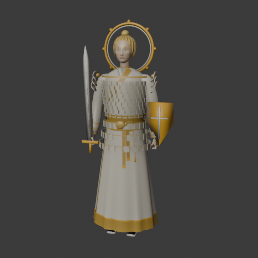
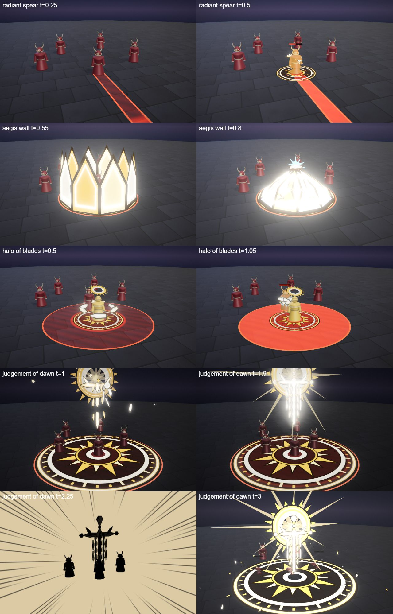
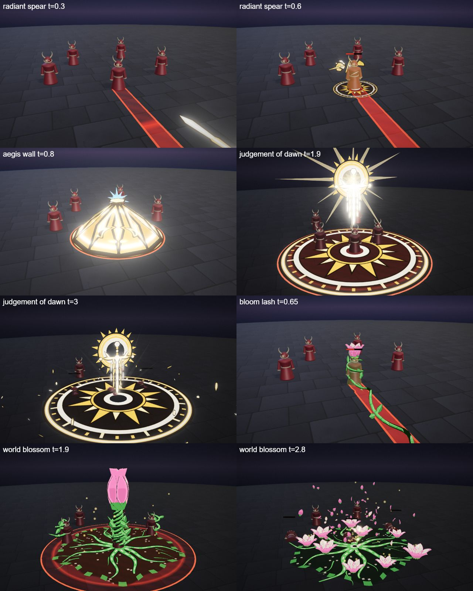

# Auriel, the Dawn Paladin

The dawn hero kit: Auriel's four spells (Q, W, E and the R ultimate), the shared parts file, the palette row and the rigged hero model. A young paladin in white and gold plate with a halo ring; she protects and smites.

## Role

Support, 600 HP, ranged. Signature: *Aegis*. Nearly every spell shields her, and the stun dome and the orbiting blades punish whoever stays close. She wins a 1v1 by trading behind a rolling shield and stunning at the right moment. Her weakness is low burst damage.

## At a glance

| | |
|---|---|
| Hero | Auriel, the Dawn Paladin |
| Spell category | `hero: dawn` |
| Parts file | [`src/effects/parts/dawn.ts`](../../../src/effects/parts/dawn.ts) |
| Kit data | [`src/kits/dawn.ts`](../../../src/kits/dawn.ts) |
| Kit sheet | [`kit-dawn.md`](../../../pipeline/designs/kit-dawn.md) (read [kit-common.md](../../../pipeline/designs/kit-common.md) first) |
| Model | [`public/models/heroes/dawn.glb`](../../../public/models/heroes/dawn.glb) |

## Palette

The art bible row "Dawn" ([ART_BIBLE.md](../../ART_BIBLE.md) section 2, energy value ladders). Every effect of the kit picks from this row.

| Core | Hot | Body | Accent | Dark | Foil |
|---|---|---|---|---|---|
| `#fffdf2` | `#ffe7a0` | `#f2b83c` | `#7fd8ff` | `#3a2408` | ivory `#efe6d2` |

Core is only the tiny core lines; body is the gold of the panels; accent (sky blue) only 2-3 frames at hits; dark is the amber-brown rim and shadows; the ivory foil is the panel faces and the halo's inner band.

## Signature shape and material rules

Hard-light geometry. Light is solid: flat gold panels with crisp edges (hexagons, kite shields, long blade shards) that click together into shapes (a shield wall, a halo of blades, a great sword), lit from inside with a white core line and a darker amber rim. Things assemble panel by panel and shatter into panels. Not soft holy glow and not stained glass (the existing sanctum): opaque, geometric, assembled light.

- Panels: unlit flat shapes, ivory/gold face with a thin white core line and a dark amber rim; only the core lines may bloom, never a soft glow sphere.
- Light rays: thin crisp tapered wedges, low opacity, few.

## Spells

All four play under the normal gameplay camera (no cinematic, no letterbox). Q, W and E each have a shape of their own (see the table: dash, skillshot, trap, orbit, summon and so on), not a fixed strike, zone or aura; R is the ultimate (hit at 2.2 s, clean by 4.5 s, one dead beat and impact frames). Range and cooldown come from the kit data (`src/kits/dawn.ts`), hit time and length from the spell files in `src/spells/targeted/`; "hit" is the telegraph impact time and the first damage.

| Key | Label | Targeting | Range | Cooldown | Hit time | Length | What happens |
|---|---|---|---|---|---|---|---|
| Q | [radiant spear](../../../src/spells/targeted/radiantSpear.ts) | ground (BOLT, skillshot line) | 12 | 3 s | fires 0.2 s, then 0.5 s of flight | 1.8 s | A spear of hard-light shards assembles over her shoulder (6 shards clicking into a long blade). At 0.2 s it flies down the aim line (speed 24) and pierces everything it meets. On the first hit the shards burst out of its back in a fan, a sky-blue accent for 2 frames, a small sun-wheel sigil flashes under it, one impact frame. Each hit shields her for 10 for 4 s. The shards fade out panel by panel. Damage 55, knock 3. |
| W | [aegis wall](../../../src/spells/targeted/aegisWall.ts) | ground (TRAP, r 4) | 10 | 7 s | 1.2 s | 2.75 s | A sun-wheel sigil draws on at the point, then a ring of 10 kite-shield panels assembles around the edge and stands upright, open. At 1.2 s the dome slams shut over whoever is still inside (panels click together at the top) with a flash of the core lines, shake and a ground refraction ring: stun 0.8 s. It ticks at 1.7 s, then shatters outward into panels that fade. Damage 45, then a tick of 10 at 1.7 s. |
| E | [halo of blades](../../../src/spells/targeted/haloOfBlades.ts) | self (ORBIT, r 3.6) | 0 (self) | 9 s | blades cut from 0.3 s to 3.3 s | 3.9 s | A halo ring forms over her head and six blade shards assemble and circle her at 2.5 m for 3 s. She stands rooted for the first 2 s. Each blade cuts an enemy it touches (once per 0.7 s per enemy, 3 hits at most); then the blades and halo shatter into panels. She takes a 25 shield for 4 s at the cast. Damage 10 per hit, knock 1. |
| R | [judgement of dawn](../../../src/spells/targeted/judgementOfDawn.ts) | ground (r 6) | 13 | 20 s | 2.2 s | 4.5 s | The ultimate. The world darkens to a pre-dawn blue and a big sun-wheel sigil draws on. Above the point a giant sword (about 7 long, point down) assembles from dozens of gold panels, a halo ring forms behind its hilt, sun rays fan from it and the enemies are held. Its core lines brighten to white, dead beat at 1.85-2.0 s, then it drives straight down into the point: impact frames, a ring of panel shards bursts outward, sky-blue accent, sun rays, refraction ring. The sword stands a moment and shatters into panels. She takes a 50 shield for 5 s at the impact. Damage 100, knock 6. |

Spell sources: [`radiantSpear.ts`](../../../src/spells/targeted/radiantSpear.ts), [`aegisWall.ts`](../../../src/spells/targeted/aegisWall.ts), [`haloOfBlades.ts`](../../../src/spells/targeted/haloOfBlades.ts), [`judgementOfDawn.ts`](../../../src/spells/targeted/judgementOfDawn.ts). Their catalog rows are in the [effect catalog](../effects.md#hero-dawn).

## Parts file

[`src/effects/parts/dawn.ts`](../../../src/effects/parts/dawn.ts) holds everything the four spells share. Spells import it directly (`../../effects/parts/dawn`). Everything is pooled, takes world-space positions and has a `reset()`; the panel faces and gold stay below the bloom threshold; only the thin core lines are bright enough to bloom.

| Export | Role |
|---|---|
| `DAWN`, `DAWN_CSS` | palette constants (`foil` is the ivory) |
| `dawnFacing`, `dawnForward`, `dawnView`, `dawnOrient`, `dawnPanelNormal`, `dawnClamp01`, `dawnEaseOut`, `dawnEaseOutBack` | helpers: the camera-facing normal, the horizontal direction along the aim, the view direction, panel orientation and easing curves |
| `PanelShape` | the panel shapes: `'hex'`, `'shield'`, `'shard'` |
| `LightPanels` | instanced hard-light panels: `assemble(seconds, stagger, scatter, origin)` (fly in and click into place), `fadeOut`, `fling(i, vel, life, spin)`, `shatter(speed, life, center)`, `hide(i)`, `glow`, `opacity` |
| `HaloRing` | a crisp gold ring with an ivory inner band and short ray ticks: `set(center, normal, radius)`, `spin(dt)`, `opacity` |
| `SunRays` | a few thin crisp tapered wedges fanning from a point: `fan(origin, dir, count, length, spread, grow, width)`, `fade(k)`, `face(aim)` |
| `Sigil` | a gold ground circle with a sun-wheel pattern (canvas): `set(center, radius)` |

## Model

[`public/models/heroes/dawn.glb`](../../../public/models/heroes/dawn.glb): a rigged figure on the Dao rig (same bone names as `public/models/figures/hero.glb`, so `src/effects/weapons/hero.ts` can pose it). Built by `build("dawn")` / `export("dawn")` in [`blender/heroes/hero_figures.py`](../../../blender/heroes/hero_figures.py); hero mode shows it with procedural walk, breath and cast poses. It is wired through the `MODELS` map in [`src/heroes.ts`](../../../src/heroes.ts).

- Look: A young paladin in ivory and gold plate over a white tabard, golden hair, a halo of hard-light panels, a hard-light sword and a gold kite shield.
- Props: `panel_halo`, `light_sword`, `kite_shield`.
- HUD portrait (canvas-drawn in the kit data): A sun disc with crisp rays behind her, a halo ring above a helmed paladin in white and gold plate (pauldrons and breastplate, a dark visor slit with a sky-blue glint) and a raised blade at her side.

The wave 2 concept (Fenna, Auriel and Marin; vector source [`wave2_concept.svg`](../../heroes/wave2_concept.svg)):

## Files

| What | Where |
|---|---|
| Kit sheet (design) | [`pipeline/designs/kit-dawn.md`](../../../pipeline/designs/kit-dawn.md) |
| Shared kit rules | [`pipeline/designs/kit-common.md`](../../../pipeline/designs/kit-common.md) |
| Parts | [`src/effects/parts/dawn.ts`](../../../src/effects/parts/dawn.ts) |
| Spells | [`radiantSpear.ts`](../../../src/spells/targeted/radiantSpear.ts), [`aegisWall.ts`](../../../src/spells/targeted/aegisWall.ts), [`haloOfBlades.ts`](../../../src/spells/targeted/haloOfBlades.ts), [`judgementOfDawn.ts`](../../../src/spells/targeted/judgementOfDawn.ts) |
| Kit data | [`src/kits/dawn.ts`](../../../src/kits/dawn.ts) |
| Model | [`public/models/heroes/dawn.glb`](../../../public/models/heroes/dawn.glb) |
| Model script | [`blender/heroes/hero_figures.py`](../../../blender/heroes/hero_figures.py) |

## Review sheets

Contact sheets in `docs/spells/` (frames over time, from `pipeline/tools/contact-sheet.js`).

### Dawn review

### Dawn and grove re-check (round 2)

Shared with [Fenna (grove)](grove.md).

## See also

- [Hero roster and shared structure](README.md)
- [Vesper (blood)](blood.md), [Brannoc (forge)](forge.md), [Isolde (frost)](frost.md), [Lyra (astral)](astral.md), [Vex (alchemy)](alchemy.md), [Kaia (storm)](storm.md), [Sefu (sand)](sand.md), [Nyx (shadow)](shadow.md), [Fenna (grove)](grove.md), [Marin (tide)](tide.md)
- [Effect catalog](../effects.md)
- [Docs home](../../README.md)
- [Art bible](../../ART_BIBLE.md)
- [Kit shared rules](../../../pipeline/designs/kit-common.md)
