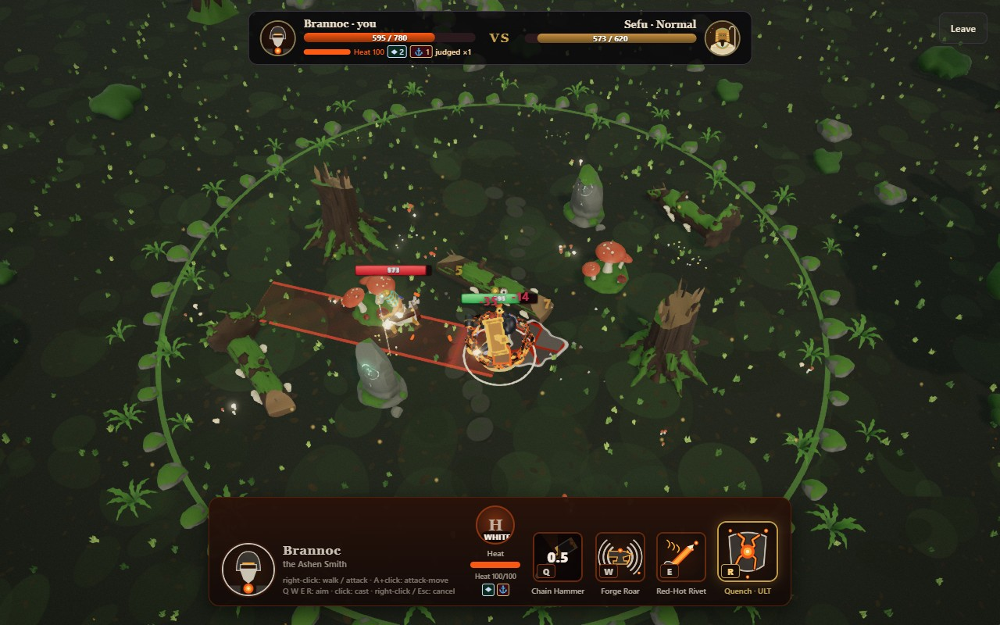
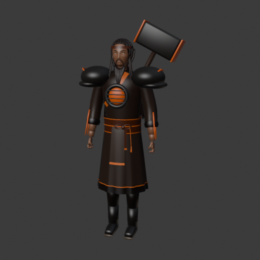
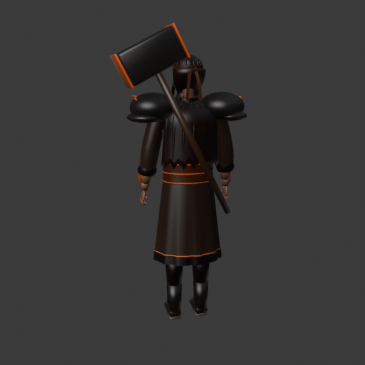

# Brannoc, the Ashen Smith

The forge hero kit: Brannoc's four spells (Q, W, E and the R ultimate), his passive, the shared parts file, the palette row and the rigged hero model. A huge smith in a scorched leather apron with a glowing forge in his chest. Since the rework of 2026-11-12 ([heroes-rework.md](../../../pipeline/designs/heroes-rework.md)) he is played by one rule, **Heat**: his spells have no cooldown, each one heats his hammer, a hot spell hits harder, and at white heat he burns until he Quenches. He is built on the [combat mechanics](../../architecture/mechanics.md): a melee tank with extra HP, a pull, a slow, a knock-up and a stun.

## Role

| | |
|---|---|
| Role | Tank (melee) |
| Signature | Heat |
| HP | 780 |
| Kit shapes | Q HOOK (skillshot line, pull) · W SELF armour + armed slam · E TGT burn · R SELF Quench (spends the Heat) |

He wins a 1v1 by heating up on the way in: the third spell in a row turns the hammer white, and then he is at his strongest and on a clock, because white heat burns him. The Quench ends it with a burst and a stun, and leaves him cold and weak. His weakness is reach and speed: he walks at 3.6 m/s, so a kiter who dodges the hammer (9 m, a straight line) lets him burn for nothing. Measured 2026-11-12 in the fight simulator: 53% and 59% in two runs against the benchmark heroes, both sides ([before](../../balance/rework-brannoc-before.html) 67.5%, [after](../../balance/rework-brannoc-after.html)).

## At a glance

| | |
|---|---|
| Hero | Brannoc, the Ashen Smith |
| Spell category | `hero: forge` |
| Parts file | [`src/effects/parts/forge.ts`](../../../src/effects/parts/forge.ts) |
| Kit data | [`src/kits/forge.ts`](../../../src/kits/forge.ts) |
| Trait (rules) | [`src/traits/forge.ts`](../../../src/traits/forge.ts) |
| Kit sheet | [`kit-forge.md`](../../../pipeline/designs/kit-forge.md) (read [kit-common.md](../../../pipeline/designs/kit-common.md) first) |
| Model | [`public/models/heroes/forge_v2.glb`](../../../public/models/heroes/forge_v2.glb) |

## Palette

The art bible row "Forge" ([ART_BIBLE.md](../../ART_BIBLE.md) section 2, energy value ladders). Every effect of the kit picks from this row and adds black.

| Core | Hot | Body | Accent | Dark | Foil |
|---|---|---|---|---|---|
| `#fff3d0` | `#ffb03a` | `#ff5a12` | `#6fe0ff` | `#120a08` | ash `#cfc6b8` |

Core is tiny; accent (cold quench steam) only 2-3 frames; the ash foil is ash, cooled iron edges and the smoke rim.

## Signature shape and material rules

Molten slag that cools: liquid metal glows white-orange, a black crust grows over it from the edges inward, leaving orange cracks that dim to dull red and go out. Every spell ends with something cooling. Second shape: hard, heavy smith's iron (hammer, anvil, rivets, chain links) with hot edges.

- Molten: an unlit shader with a crust mask (dark crust plates with bright cracks between them); a `cool` parameter 0..1 runs from all glowing to black with dull red cracks.
- Iron: dark `MeshStandard` with a thin hot rim on the forged edges.
- Sparks: short streaks, not dots, and few.

## Passive and twist

| | |
|---|---|
| Passive | **Heat.** No cooldowns. Each spell heats his hammer (Q +40, W +30, E +30, of 100) and is cast at the power of the Heat it found: 55% cold, 115% white-hot, straight in between. Heat cools 10 a second once he has cast nothing for 2.5 s. |
| Twist | **White heat** (the bar full): it does not cool, it stays until he Quenches. He burns 14 HP each second and every Q, W, E costs him 35 HP in place of Heat; slows, roots and knock-ups do nothing to him and his basic attacks deal +15. The burn cannot take his last HP. |
| Resource or meter | **Heat**, 0 to 100, an orange bar under his HP on both screens and in the HUD. The passive slot shows the power of the next spell ("85%") or WHITE. A ring at his feet: dull red from 34 Heat, orange from 67, white at white heat (with a white pip over him). |
| Speed | 3.6 m/s |
| Basic attack | melee, 2.6 m, 18 damage every 1.6 s, wind-up 0.4 s, smash look |
| Other rules | The W slam is a gold pip over him until it is spent. The CPU against him steps back from white heat when within 4 m. The CPU playing him (`aiHold`) leaves a breath between spells so he swings, does not hook an enemy already in reach, roars between two rivets, does not turn the hammer white while the Quench is more than 2 s from ready, pays for white-hot spells only above half HP, rides white heat 3.5 s and then Quenches with the enemy inside 2.5 m (anywhere under 25% HP). |

The 0.5 s "cooldown" of Q, W and E in the kit data is the gap the game server asks between two casts of one slot, and the Quench's 11 s is the server's one ultimate in 10 s (`server/hub.mjs`): neither is a design choice.

## Mechanics

Brannoc uses these pieces of [the combat mechanics](../../architecture/mechanics.md):

| Mechanic | Where |
|---|---|
| Melee kit | `melee: true` and `maxHp: 780` in the kit data. The duel AI walks up to melee range |
| Own resource | `resource` Heat; `castMods` adds it and sets the cast's power, `tick` cools it and burns him |
| HP cost | White heat: 14 HP a second and 35 HP a spell, through `payHp` |
| Pull and slow | Q: `pull: 4` toward him, `knock: 0`, slow 1 s. Q is flagged `cc` (the AI casts it first when the enemy is in range) and `aim: 'line'` |
| Stun | The Quench from white heat: 0.75 s (a status in the cast's mods) |
| Knock-up | The W slam: 0.5 s |
| Armour buff | W: +30% armour for 3 s (kit `buff`), no speed |
| Damage over time | E: two burn ticks |
| Immunity | White heat: slows, roots and knock-ups are swallowed in `taken` |
| Hold | Quench holds him still for 0.6 s |
| Skillshot | Q: a projectile at 18 m/s, 9 m, radius 0.45 |
| Summon, dash, heal | none |

## Spells

All four play under the normal gameplay camera. Range comes from the kit data (`src/kits/forge.ts`), hit time and length from the spell files in `src/spells/targeted/`; damage is the spell file's default times the Heat's power (55% to 115%). "Hit" is the telegraph impact time and the first damage.

| Key | Label | Targeting | Range | Cost | Hit time | Length | What happens |
|---|---|---|---|---|---|---|---|
| Q | [chain hammer](../../../src/spells/targeted/chainHammer.ts) | line skillshot (ground aim) | 9 | +40 Heat | released at 0.3 s, reaches 6 m at 0.63 s | 1.7 s | He whirls the hammer on its chain (0.3 s wind-up), then throws it down the aim. The first enemy it touches takes 22 cold to 46 white-hot (40 at full power), is dragged 4 m toward him and is slowed 1 s; the chain stays taut 0.45 s, then whips back. A miss reels in. |
| W | [forge roar](../../../src/spells/targeted/forgeRoar.ts) | self | 0 (self) | +30 Heat | none (no damage) | 3.6 s | Heat rolls off him in a ring (2.4 m) and a loop of chain turns round his waist for 3 s of +30% armour. His next basic attack in those 3 s is a slam: +30 damage and a 0.5 s knock-up. The hammer glows on his shoulder until the slam is spent. |
| E | [red-hot rivet](../../../src/spells/targeted/redHotRivet.ts) | enemy (needs sight) | 6 | +30 Heat | 0.55 s | 3.2 s | He pulls a white-hot rivet from his chest, flicks it, and it punches into the enemy: 25, then two burn ticks of 6 (at 1.55 s and 2.55 s), all times the Heat's power: 20 in all cold, 43 white-hot. |
| R | [molten core](../../../src/spells/targeted/moltenCore.ts) (named Quench in the game) | self | 6 (the ring is 3 m) | all his Heat; once in 11 s | ring 0.6 s | 2.4 s | He plants himself and a 3 m ring shows for 0.6 s, then it bursts for 30 plus 0.5 per point of Heat (80 at white heat) and throws them back. From white heat it also stuns 0.75 s. The hammer is cold again: it is the only way out of white heat. The spell file's 6 s stance (the old Molten Core) is no longer played by the game; the VFX tool still shows it. |

At white heat a Q, W or E adds no Heat and costs 35 HP.

Spell sources: [`chainHammer.ts`](../../../src/spells/targeted/chainHammer.ts), [`forgeRoar.ts`](../../../src/spells/targeted/forgeRoar.ts), [`redHotRivet.ts`](../../../src/spells/targeted/redHotRivet.ts), [`moltenCore.ts`](../../../src/spells/targeted/moltenCore.ts). Their catalog rows are in the [effect catalog](../effects.md#hero-forge).

## Parts file

[`src/effects/parts/forge.ts`](../../../src/effects/parts/forge.ts) holds everything the kit's spells share. Spells import it directly (`../../effects/parts/forge`).

| Export | Role |
|---|---|
| `FORGE`, `FORGE_CSS` | palette constants |
| `SlagPool` | molten ground decal with a lumpy edge: `spread`, `cool` (crust grows inward), `fade`; web mode is the crack web of the ultimate |
| `SlagBlobs` | thrown molten blobs that land as small cooling splats (cap ~10) |
| `SlagStreams` | molten streams drawn along a function, molten at the leading end |
| `Sparks` | instanced short streak sparks with gravity, life ~0.4 s |
| `ForgeIron` | builders for the heavy objects: `hammer`, `anvil`, `rivet`, `chainLink` (dark iron, hot rim line) |
| `IronChunks` | broken iron that bursts out, rests, cools to black and sinks |
| `ChainRing` | a ring of molten chain links laid out each frame |
| `QuenchSteam` | a few pale toon steam puffs in the ash foil colour |
| `AshFlakes` | falling dull-grey ash |
| `HotStreak` | a short fat comet trail, core-white at the head to orange at the tail |
| `ForgeSigil` | ash-grey anvil sigil with orange runes, drawn on by a sweep |
| `PulseRing` | an expanding ground ring of heat |
| `ChainLine` | a straight run of heavy chain links from `a` to `b` (instanced, the same link as `ChainRing`); `set(a, b, heat, thickness)` every frame, `hide()` |
| `SlagCone` | pooled ground fans of slag, one per basic-attack swing of Molten Core: `fire(center, yaw, radius, life)`, `update(dt)` |

## Model

[`public/models/heroes/forge_v2.glb`](../../../public/models/heroes/forge_v2.glb): a rigged figure on the Dao rig (same bone names as `public/models/figures/hero.glb`, so `src/effects/weapons/hero.ts` can pose it). Built in [`blender/heroes/moba_figures.py`](../../../blender/heroes/moba_figures.py) (the current style, the `_v2` models). Hero mode shows it with procedural walk, breath and cast poses. It is wired through the `MODELS` map in [`src/heroes.ts`](../../../src/heroes.ts) (name `Brannoc`), and its hit size is in `HERO_BODIES` in the same file (radius 0.58 m, height 2.35 m).
- HUD portrait (canvas-drawn in the kit data): A broad iron helm, an ash beard, and the forge glowing in his chest.

  

## Files

| What | Where |
|---|---|
| Kit sheet (design) | [`pipeline/designs/kit-forge.md`](../../../pipeline/designs/kit-forge.md) |
| Shared kit rules | [`pipeline/designs/kit-common.md`](../../../pipeline/designs/kit-common.md) |
| Parts | [`src/effects/parts/forge.ts`](../../../src/effects/parts/forge.ts) |
| Spells | [`chainHammer.ts`](../../../src/spells/targeted/chainHammer.ts), [`forgeRoar.ts`](../../../src/spells/targeted/forgeRoar.ts), [`redHotRivet.ts`](../../../src/spells/targeted/redHotRivet.ts), [`moltenCore.ts`](../../../src/spells/targeted/moltenCore.ts) |
| Kit data | [`src/kits/forge.ts`](../../../src/kits/forge.ts) |
| Trait (passive, twist, rules) | [`src/traits/forge.ts`](../../../src/traits/forge.ts) |
| Model | [`public/models/heroes/forge_v2.glb`](../../../public/models/heroes/forge_v2.glb) |
| Model script | [`blender/heroes/moba_figures.py`](../../../blender/heroes/moba_figures.py) |

## See also

- [Hero roster and shared structure](README.md)
- [Combat mechanics](../../architecture/mechanics.md)
- [Vesper (blood)](blood.md), [Isolde (frost)](frost.md), [Lyra (astral)](astral.md), [Vitriol (alchemy)](alchemy.md)
- [Effect catalog](../effects.md)
- [Docs home](../../README.md)
- [Art bible](../../ART_BIBLE.md)
- [Kit shared rules](../../../pipeline/designs/kit-common.md)
