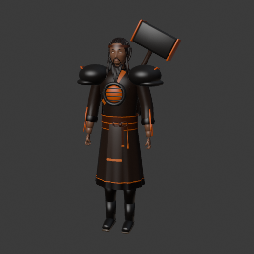
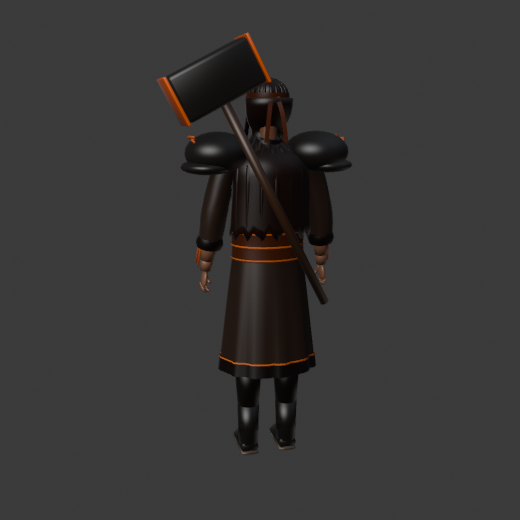
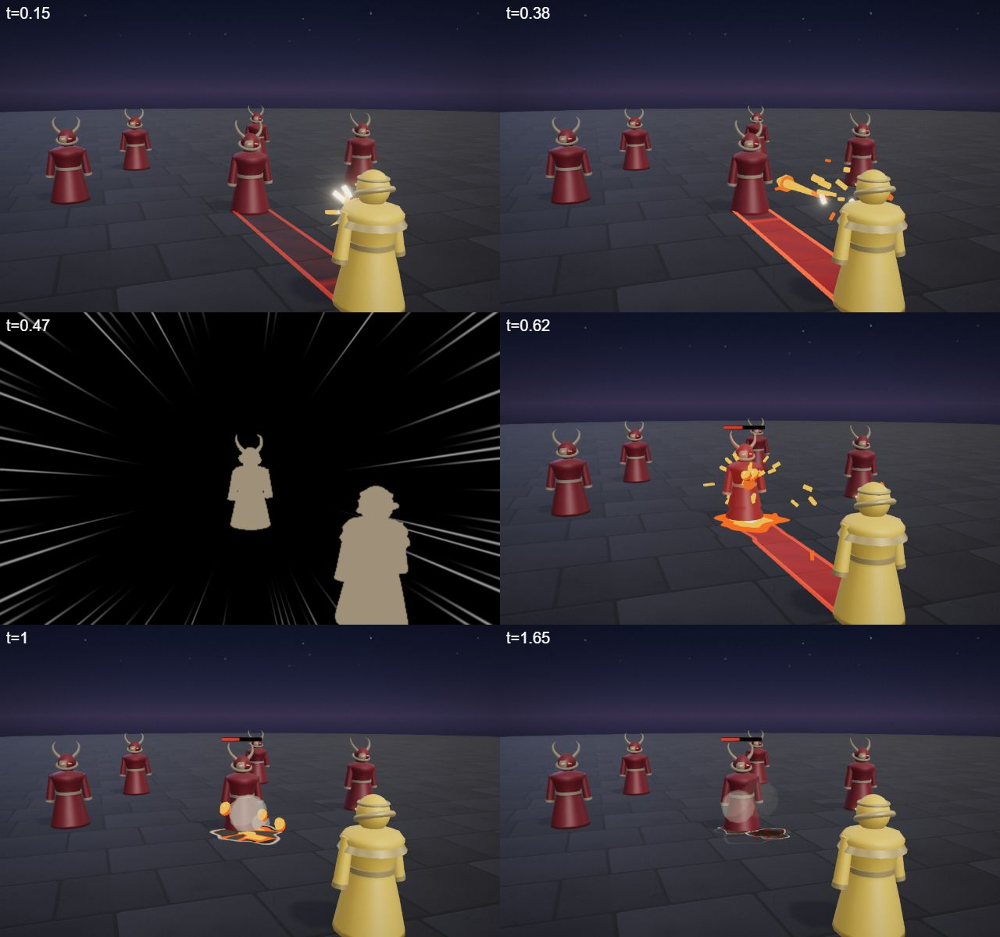
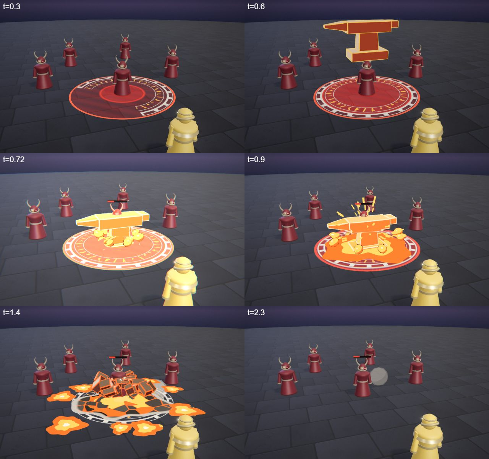
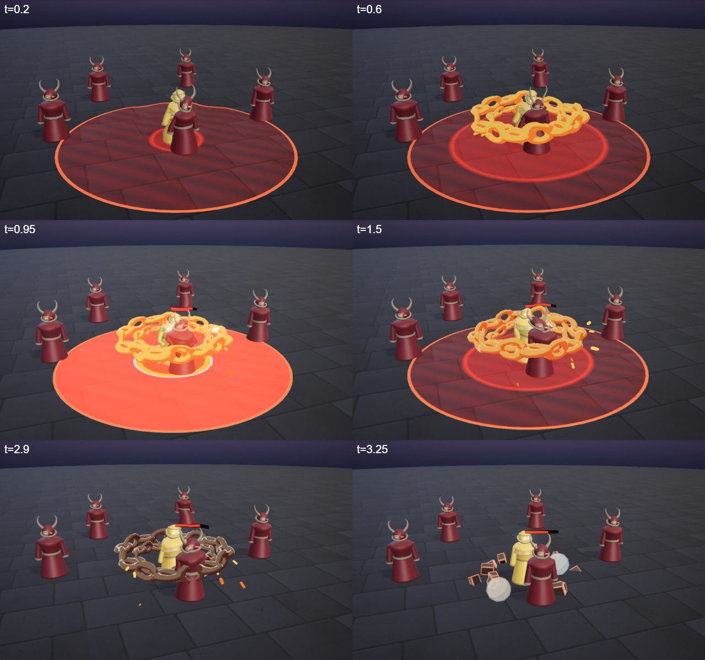
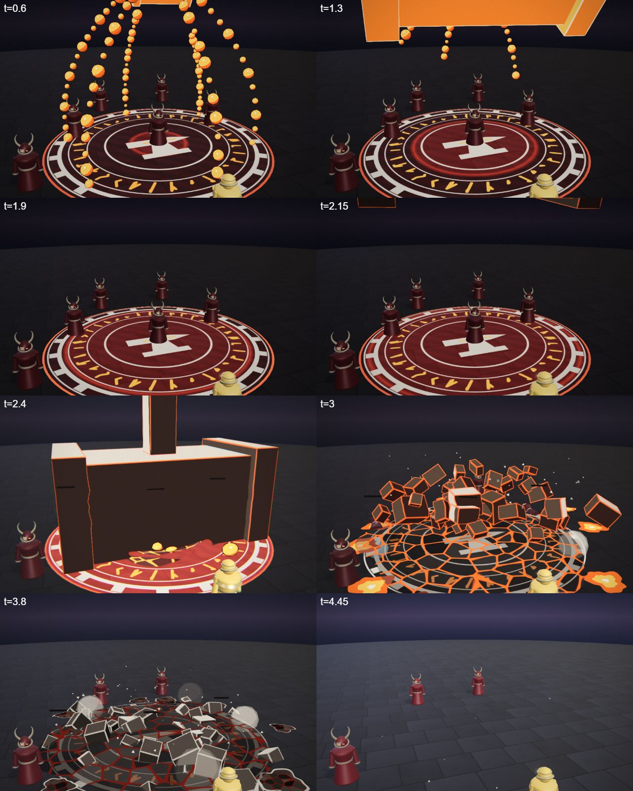
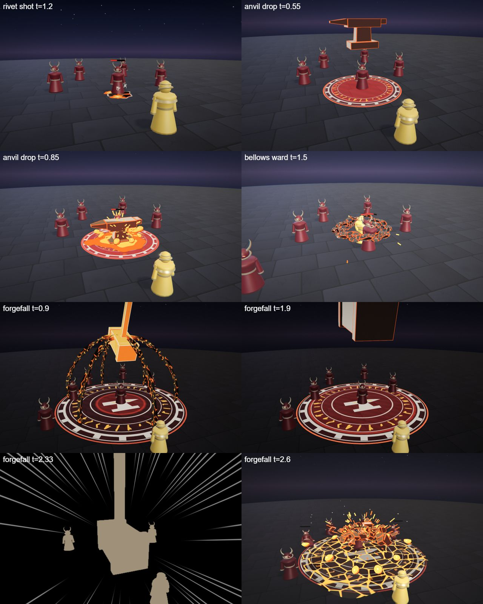
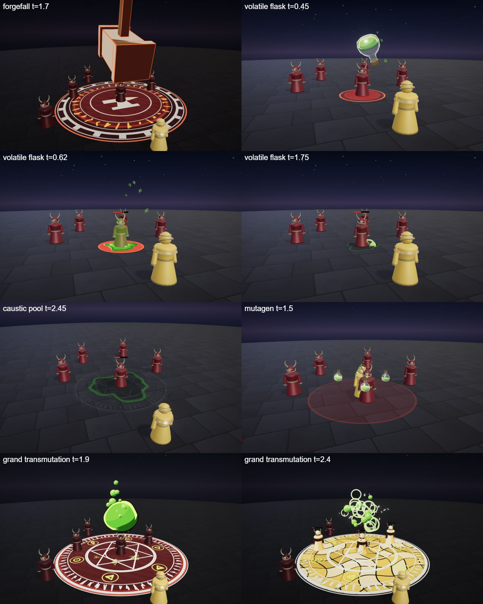

# Brannoc, the Ashen Smith

The forge hero kit: Brannoc's four spells (Q, W, E and the R ultimate), the shared parts file, the palette row and the rigged hero model. A dwarf-sized giant of a blacksmith with a forge in his chest; heavy, slow, every hit lands like a hammer.

## At a glance

| | |
|---|---|
| Hero | Brannoc, the Ashen Smith |
| Spell category | `hero: forge` |
| Parts file | [`src/effects/parts/forge.ts`](../../../src/effects/parts/forge.ts) |
| Kit data | [`src/kits/forge.ts`](../../../src/kits/forge.ts) |
| Kit sheet | [`kit-forge.md`](../../../pipeline/designs/kit-forge.md) (read [kit-common.md](../../../pipeline/designs/kit-common.md) first) |
| Model | [`public/models/heroes/forge.glb`](../../../public/models/heroes/forge.glb) |

## Palette

The art bible row "Forge" ([ART_BIBLE.md](../../ART_BIBLE.md) section 2, energy value ladders). Every effect of the kit picks from this row and adds black.

| Core | Hot | Body | Accent | Dark | Foil |
|---|---|---|---|---|---|
| `#fff3d0` | `#ffb03a` | `#ff5a12` | `#6fe0ff` | `#120a08` | ash `#cfc6b8` |

Core is tiny; accent (cold quench steam) only 2-3 frames; the ash foil is ash, cooled iron edges and the smoke rim.

## Signature shape and material rules

Molten slag that cools: liquid metal glows white-orange, a black crust grows over it from the edges inward, leaving orange cracks that dim to dull red and go out. Every spell ends with something cooling. Second shape: hard, heavy smith's iron (hammer, anvil, rivets, chain links) with hot edges.

- Molten: an unlit shader with a crust mask (dark crust plates with bright cracks between them); a `cool` parameter 0..1 runs from all glowing to black with dull red cracks.
- Iron: dark `MeshStandard` with a thin hot rim on the forged edges.
- Sparks: short streaks, not dots, and few.

## Spells

All four play under the normal gameplay camera (no cinematic, no letterbox). Q, W and E are normal MOBA abilities (hit 0.4-0.8 s after the cast, clean by about 2 s; an E aura may run about 3 s); R is the ultimate (hit around 2.0-2.5 s, clean by 4.5 s, one dead beat and one short impact frame). Range and cooldown come from the kit data (`src/kits/forge.ts`), hit time and length from the spell files in `src/spells/targeted/`; "hit" is the telegraph impact time and the first damage.

| Key | Label | Targeting | Range | Cooldown | Hit time | Length | What happens |
|---|---|---|---|---|---|---|---|
| Q | [rivet shot](../../../src/spells/targeted/rivetShot.ts) | enemy | 10 | 3 s | 0.45 s | 1.7 s | He pulls a white-hot rivet from his chest forge, flicks it and it punches through one enemy in sparks and slag. The slag cools to black. Damage 50. |
| W | [anvil drop](../../../src/spells/targeted/anvilDrop.ts) | ground (r 3.5) | 10 | 7 s | 0.7 s | 2.3 s | A ring of molten runes marks the ground, then a huge anvil falls on it and splashes slag; it crumbles into iron chunks and the crater cools. Damage 55. |
| E | [bellows ward](../../../src/spells/targeted/bellowsWard.ts) | self (r 5) | 0 (self) | 9 s | 0.9 s and 1.9 s (two pulses) | 3.3 s | Two loops of molten chain whirl around him and burst outward in heat twice, then cool and fall with a clank. Loopable. Damage 15 per pulse. |
| R | [forgefall](../../../src/spells/targeted/forgefall.ts) | ground (r 7) | 13 | 20 s | 2.3 s | 4.5 s | The ultimate. An anvil sigil draws on, slag streams pour up into the sky and pool into a colossal hammer that cools black while it rises; dead beat at 1.8-1.95 s, then it swings down: impact frame, spark fountain, molten crack web. Damage 122. |

Spell sources: [`rivetShot.ts`](../../../src/spells/targeted/rivetShot.ts), [`anvilDrop.ts`](../../../src/spells/targeted/anvilDrop.ts), [`bellowsWard.ts`](../../../src/spells/targeted/bellowsWard.ts), [`forgefall.ts`](../../../src/spells/targeted/forgefall.ts). Their catalog rows are in the [effect catalog](../effects.md#hero-forge).

## Parts file

[`src/effects/parts/forge.ts`](../../../src/effects/parts/forge.ts) holds everything the four spells share. Spells import it directly (`../../effects/parts/forge`).

| Export | Role |
|---|---|
| `FORGE`, `FORGE_CSS` | palette constants |
| `SlagPool` | molten ground decal with a lumpy edge: `spread`, `cool` (crust grows inward), `fade`; web mode is the crack web of the ultimate |
| `SlagBlobs` | thrown molten blobs that land as small cooling splats (cap ~10) |
| `SlagStreams` | molten streams drawn along a function, molten at the leading end |
| `Sparks` | instanced short streak sparks with gravity, life ~0.4 s |
| `ForgeIron` | builders for the heavy objects: `hammer`, `anvil`, `rivet`, `chainLink` (dark iron, hot rim line) |
| `IronChunks` | broken iron that bursts out, rests, cools to black and sinks |
| `ChainRing` | a ring of molten chain links laid out each frame |
| `QuenchSteam` | a few pale toon steam puffs in the ash foil colour |
| `AshFlakes` | falling dull-grey ash |
| `HotStreak` | a short fat comet trail, core-white at the head to orange at the tail |
| `ForgeSigil` | ash-grey anvil sigil with orange runes, drawn on by a sweep |
| `PulseRing` | an expanding ground ring of heat |

## Model

[`public/models/heroes/forge.glb`](../../../public/models/heroes/forge.glb): a rigged figure on the Dao rig (same bone names as `public/models/figures/hero.glb`, so `src/effects/weapons/hero.ts` can pose it). Built by `build("forge")` / `export("forge")` in [`blender/heroes/hero_figures.py`](../../../blender/heroes/hero_figures.py); hero mode shows it with procedural walk, breath and cast poses. It is wired through the `MODELS` map in [`src/heroes.ts`](../../../src/heroes.ts).

- Look: Broad, a rolled-sleeve work robe under iron lamellar, a leather apron, wrapped legs, a long beard; a glowing forge in his chest and a great hammer on his back.
- Props: `chest_forge`, `slag_pauldrons`, `molten_veins`, `back_hammer`.
- HUD portrait (canvas-drawn in the kit data): A broad iron helm, an ash beard, and the forge glowing in his chest.

 

## Files

| What | Where |
|---|---|
| Kit sheet (design) | [`pipeline/designs/kit-forge.md`](../../../pipeline/designs/kit-forge.md) |
| Shared kit rules | [`pipeline/designs/kit-common.md`](../../../pipeline/designs/kit-common.md) |
| Parts | [`src/effects/parts/forge.ts`](../../../src/effects/parts/forge.ts) |
| Spells | [`rivetShot.ts`](../../../src/spells/targeted/rivetShot.ts), [`anvilDrop.ts`](../../../src/spells/targeted/anvilDrop.ts), [`bellowsWard.ts`](../../../src/spells/targeted/bellowsWard.ts), [`forgefall.ts`](../../../src/spells/targeted/forgefall.ts) |
| Kit data | [`src/kits/forge.ts`](../../../src/kits/forge.ts) |
| Model | [`public/models/heroes/forge.glb`](../../../public/models/heroes/forge.glb) |
| Model script | [`blender/heroes/hero_figures.py`](../../../blender/heroes/hero_figures.py) |

## Review sheets

Contact sheets in `docs/spells/` (frames over time, from `pipeline/tools/contact-sheet.js`).

### Rivet Shot

### Anvil Drop

### Bellows Ward

### Forgefall

### Forge re-check (round 2)

### Final check (forgefall and the alchemy kit)

## See also

- [Hero roster and shared structure](README.md)
- [Vesper (blood)](blood.md), [Isolde (frost)](frost.md), [Lyra (astral)](astral.md), [Vex (alchemy)](alchemy.md)
- [Effect catalog](../effects.md)
- [Docs home](../../README.md)
- [Art bible](../../ART_BIBLE.md)
- [Kit shared rules](../../../pipeline/designs/kit-common.md)
