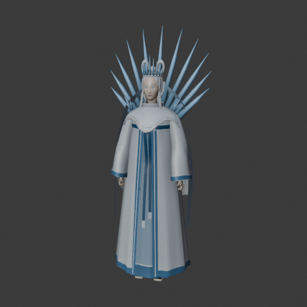
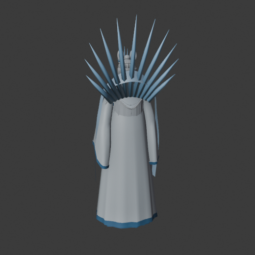
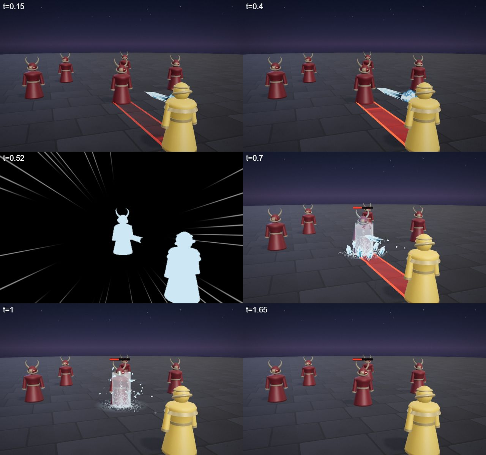
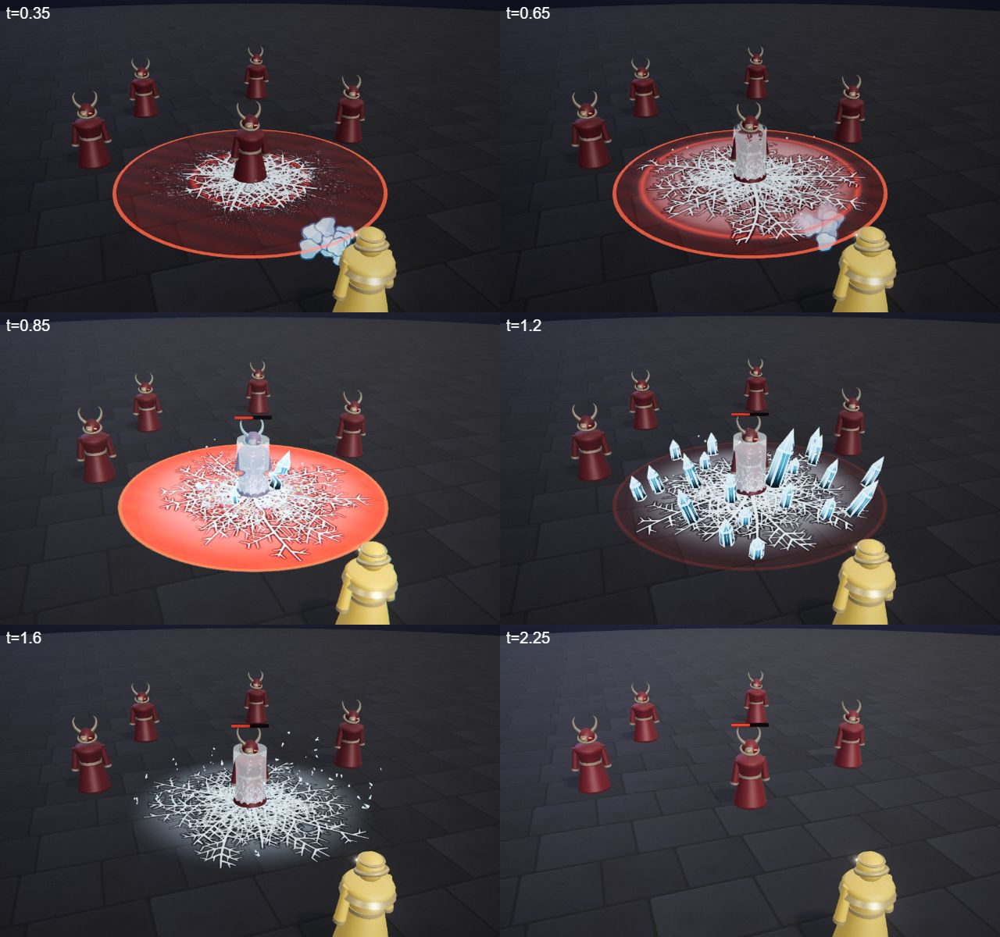
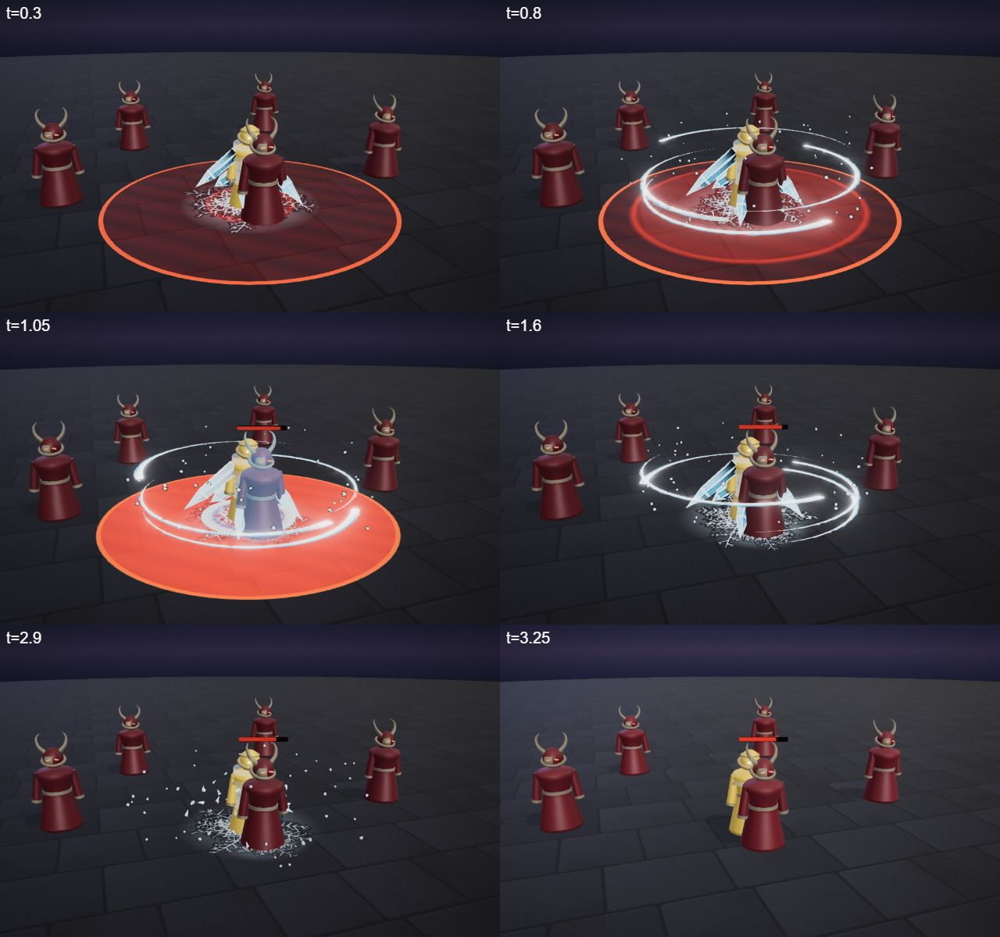
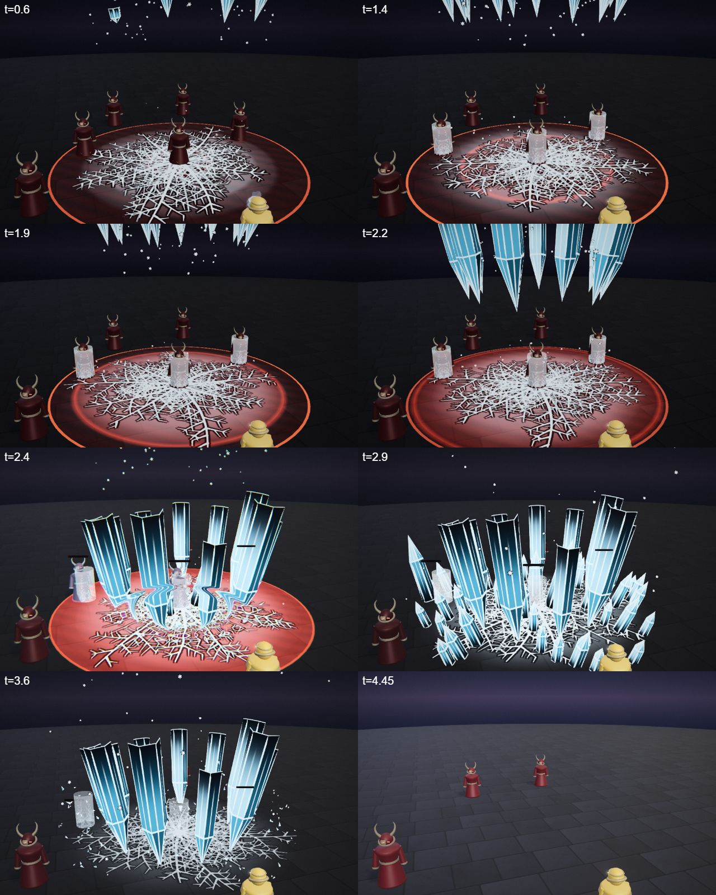
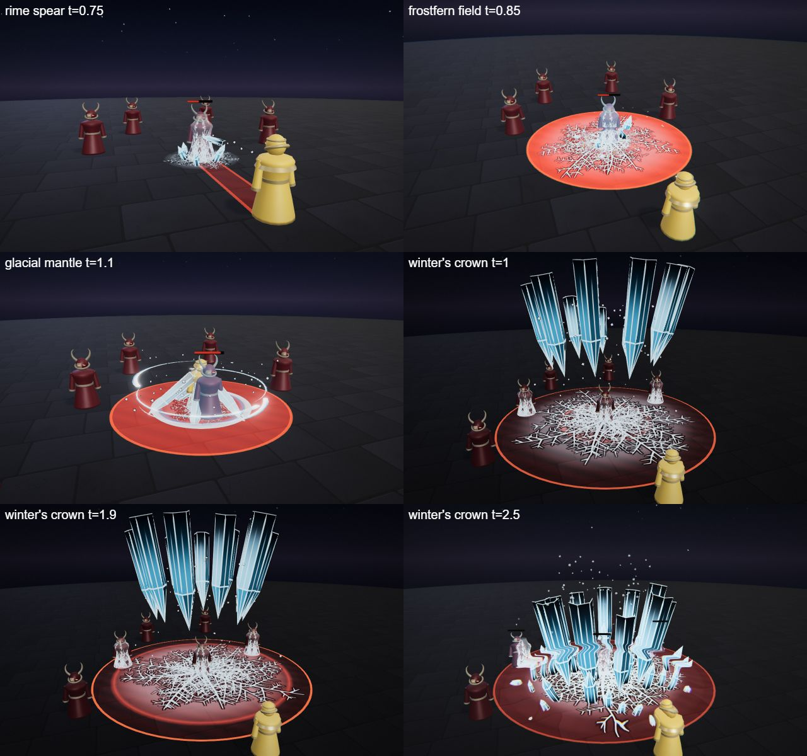

# Isolde, the Winter Warden

The frost hero kit: Isolde's four spells (Q, W, E and the R ultimate), the shared parts file, the palette row and the rigged hero model. A calm warden in a long coat whose breath freezes the air; control and slow, then a crushing ultimate.

## At a glance

| | |
|---|---|
| Hero | Isolde, the Winter Warden |
| Spell category | `hero: frost` |
| Parts file | [`src/effects/parts/frost.ts`](../../../src/effects/parts/frost.ts) |
| Kit data | [`src/kits/frost.ts`](../../../src/kits/frost.ts) |
| Kit sheet | [`kit-frost.md`](../../../pipeline/designs/kit-frost.md) (read [kit-common.md](../../../pipeline/designs/kit-common.md) first) |
| Model | [`public/models/heroes/frost.glb`](../../../public/models/heroes/frost.glb) |

## Palette

The art bible row "Frost" ([ART_BIBLE.md](../../ART_BIBLE.md) section 2, energy value ladders). Every effect of the kit picks from this row and adds black.

| Core | Hot | Body | Accent | Dark | Foil |
|---|---|---|---|---|---|
| `#f6fcff` | `#c9efff` | `#4fb4e8` | `#ff9ec4` | `#081626` | rime `#e8f4fa` |

Core is tiny; accent is a warm pink glint, 2-3 frames at hits; the ferns themselves are the foil and stay below the bloom threshold (they are frost, not light).

## Signature shape and material rules

Frost ferns: rime creeps across the floor (and up the enemies) as feathery, branching fern patterns that grow from a point outward, white-blue on dark stone, then shatter into angular ice shards. Second shape: clear blue ice crystals with hard facets and a pale inner core line. Not lily petals, not hexagon plates.

- Ice crystals: flat facets, blue body darkening to the dark colour at the base, a thin pale core line along the long axis, a pinpoint glint only at the hit.
- Ferns: a canvas-drawn branching texture revealed by a growth mask from the seed point outward (a distance field), never a uniform fade.
- Snow: small soft flakes, few, normal-blended pale with a dark rim so they read on the floor.

## Spells

All four play under the normal gameplay camera (no cinematic, no letterbox). Q, W and E are normal MOBA abilities (hit 0.4-0.8 s after the cast, clean by about 2 s; an E aura may run about 3 s); R is the ultimate (hit around 2.0-2.5 s, clean by 4.5 s, one dead beat and one short impact frame). Range and cooldown come from the kit data (`src/kits/frost.ts`), hit time and length from the spell files in `src/spells/targeted/`; "hit" is the telegraph impact time and the first damage.

| Key | Label | Targeting | Range | Cooldown | Hit time | Length | What happens |
|---|---|---|---|---|---|---|---|
| Q | [rime spear](../../../src/spells/targeted/rimeSpear.ts) | enemy | 11 | 3 s | 0.5 s | 1.7 s | She breathes an ice javelin into her hand and throws it; it pierces the enemy and frost ferns climb the target. Spear and crystals shatter at 0.8 s. Damage 53. |
| W | [frostfern field](../../../src/spells/targeted/frostfernField.ts) | ground (r 4.5) | 10 | 7 s | 0.8 s | 2.3 s | Frost ferns race across the floor, hold everyone in them, then crack into a field of 22 crystals and shatter at 1.5 s. Damage 58. |
| E | [glacial mantle](../../../src/spells/targeted/glacialMantle.ts) | self (r 4) | 0 (self) | 10 s | 1.0 s and 2.0 s (two pulses) | 3.3 s | Ice armour plates grow from her shoulders and hips and a blizzard band circles her; two rime pulses freeze enemies that come close, then the mantle shatters at 2.8 s. Damage 12 per pulse. |
| R | [winter's crown](../../../src/spells/targeted/wintersCrown.ts) | ground (r 7) | 13 | 20 s | 2.3 s | 4.5 s | The ultimate. Ferns spread over the whole zone as the warning, a colossal inverted crown of ice crystals forms in the sky, dead beat at 1.85-2.0 s, then it drives down into a forest of crystals (impact frame, pink glint). Damage 130. |

Spell sources: [`rimeSpear.ts`](../../../src/spells/targeted/rimeSpear.ts), [`frostfernField.ts`](../../../src/spells/targeted/frostfernField.ts), [`glacialMantle.ts`](../../../src/spells/targeted/glacialMantle.ts), [`wintersCrown.ts`](../../../src/spells/targeted/wintersCrown.ts). Their catalog rows are in the [effect catalog](../effects.md#hero-frost).

## Parts file

[`src/effects/parts/frost.ts`](../../../src/effects/parts/frost.ts) holds everything the four spells share. Spells import it directly (`../../effects/parts/frost`).

| Export | Role |
|---|---|
| `FROST`, `FROST_CSS` | palette constants |
| `IceShards` | small angular shards with gravity and spin, short life |
| `IceCrystals` | instanced faceted crystals: `spike`, `cluster`, `shatter` into shards |
| `FrostFerns` | ground decal of branching rime: `grow`, `shatter`, `fade` |
| `RimeSleeves` | rime climbing up enemy bodies from the feet |
| `RimeRing` | a rime ring racing across the floor |
| `IceStreak` | a pale tapered streak, the thrown javelin's wake |
| `Snow` | a small pool of drifting flakes: `swirl`, `scatter`, `stop`, `frozen` for a dead beat |
| `FrostBreath` | a pale cone of toon mist puffs along a direction |

## Model

[`public/models/heroes/frost.glb`](../../../public/models/heroes/frost.glb): a rigged figure on the Dao rig (same bone names as `public/models/figures/hero.glb`, so `src/effects/weapons/hero.ts` can pose it). Built by `build("frost")` / `export("frost")` in [`blender/heroes/hero_figures.py`](../../../blender/heroes/hero_figures.py); hero mode shows it with procedural walk, breath and cast poses. It is wired through the `MODELS` map in [`src/heroes.ts`](../../../src/heroes.ts).

- Look: The frost mistress's pale layered silks and cloud collar, silver hair.
- Props: `ice_crown` (a fan of ice spikes behind the head), `ice_mantle`.
- HUD portrait (canvas-drawn in the kit data): A frost fern fan behind, a tall crystal, and a hooded face with one pink glint.

 

## Files

| What | Where |
|---|---|
| Kit sheet (design) | [`pipeline/designs/kit-frost.md`](../../../pipeline/designs/kit-frost.md) |
| Shared kit rules | [`pipeline/designs/kit-common.md`](../../../pipeline/designs/kit-common.md) |
| Parts | [`src/effects/parts/frost.ts`](../../../src/effects/parts/frost.ts) |
| Spells | [`rimeSpear.ts`](../../../src/spells/targeted/rimeSpear.ts), [`frostfernField.ts`](../../../src/spells/targeted/frostfernField.ts), [`glacialMantle.ts`](../../../src/spells/targeted/glacialMantle.ts), [`wintersCrown.ts`](../../../src/spells/targeted/wintersCrown.ts) |
| Kit data | [`src/kits/frost.ts`](../../../src/kits/frost.ts) |
| Model | [`public/models/heroes/frost.glb`](../../../public/models/heroes/frost.glb) |
| Model script | [`blender/heroes/hero_figures.py`](../../../blender/heroes/hero_figures.py) |

## Review sheets

Contact sheets in `docs/spells/` (frames over time, from `pipeline/tools/contact-sheet.js`).

### Rime Spear

### Frostfern Field

### Glacial Mantle

### Winter's Crown

### Frost re-check (round 2)

## See also

- [Hero roster and shared structure](README.md)
- [Vesper (blood)](blood.md), [Brannoc (forge)](forge.md), [Lyra (astral)](astral.md), [Vex (alchemy)](alchemy.md)
- [Effect catalog](../effects.md)
- [Docs home](../../README.md)
- [Art bible](../../ART_BIBLE.md)
- [Kit shared rules](../../../pipeline/designs/kit-common.md)
