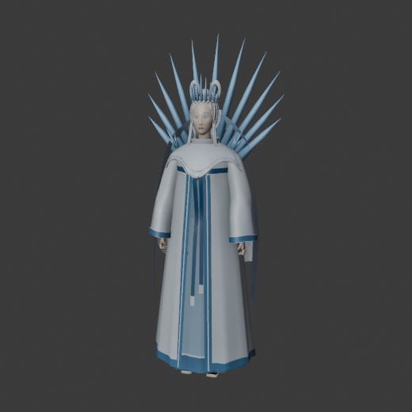
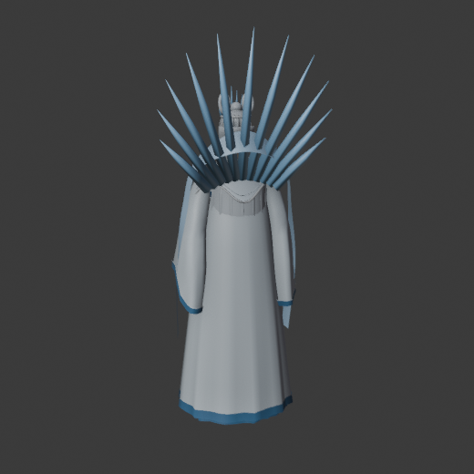

# Isolde, the Winter Warden

The frost hero kit (v5): Isolde's four spells (Q, W, E and the R ultimate), her passive, the shared parts file, the palette row and the rigged hero model. A hooded winter warden in white-blue robes with a fan of frost ferns behind her. Her hits stack Chill on the enemy; Chill slows, five Chill freezes, and her ultimate spends the Chill for damage. She is a ranged controller with a basic attack of 8 m.

## Role

| | |
|---|---|
| Role | Controller (ranged) |
| Signature | Deep Winter |
| HP | 570 |
| Kit shapes | Q LINE piercing skillshot + Shatter recast · W TGT bite · E SELF armour · R TGT strike that spends Chill |

She wins by stacking Chill with her basic attacks and Q and W, freezing the enemy at 5 Chill, and closing with Winter's Shatter. Her weakness is her low HP (570) and the sight she needs for W and R.

## At a glance

| | |
|---|---|
| Hero | Isolde, the Winter Warden |
| Spell category | `hero: frost` |
| Parts file | [`src/effects/parts/frost.ts`](../../../src/effects/parts/frost.ts) |
| Kit data | [`src/kits/frost.ts`](../../../src/kits/frost.ts) |
| Trait (rules) | [`src/traits/frost.ts`](../../../src/traits/frost.ts) |
| Kit sheet | [`kit-frost.md`](../../../pipeline/designs/kit-frost.md) (read [kit-common.md](../../../pipeline/designs/kit-common.md) first) |
| Model | [`public/models/heroes/frost_v2.glb`](../../../public/models/heroes/frost_v2.glb) |

## Palette

The art bible row "Frost" ([ART_BIBLE.md](../../ART_BIBLE.md) section 2, energy value ladders). Every effect of the kit picks from this row and adds black.

| Core | Hot | Body | Accent | Dark | Foil |
|---|---|---|---|---|---|
| `#f6fcff` | `#c9efff` | `#4fb4e8` | `#ff9ec4` | `#081626` | rime `#e8f4fa` |

Core is tiny; accent is a warm pink glint, 2-3 frames at hits; the ferns themselves are the foil and stay below the bloom threshold (they are frost, not light).

## Signature shape and material rules

Frost ferns: rime creeps across the floor (and up the enemies) as feathery, branching fern patterns that grow from a point outward, white-blue on dark stone, then shatter into angular ice shards. Second shape: clear blue ice crystals with hard facets and a pale inner core line. Not lily petals, not hexagon plates.

- Ice crystals: flat facets, blue body darkening to the dark colour at the base, a thin pale core line along the long axis, a pinpoint glint only at the hit.
- Ferns: a canvas-drawn branching texture revealed by a growth mask from the seed point outward (a distance field), never a uniform fade.
- Snow: small soft flakes, few, normal-blended pale with a dark rim so they read on the floor.

## Passive and twist

| | |
|---|---|
| Passive | Deep Winter: her hits put Chill on the enemy (5 at most, each batch lasts 4 s, shown as snowflake pips). A hit that leaves 3 or more Chill also slows them 2 s, if the hit has no status of its own. |
| Twist | Chill: basic attacks add 1 Chill, Icicle 2, its Shatter 1, Hoarfrost 2. With 5 Chill on the enemy before a hit that is not R, that hit freezes them: +30% damage, stun 0.9 s, the Chill clears and none is added until the freeze ends. R spends the Chill instead: +30 damage per stack on its base 50, and the Chill clears (so a frozen enemy takes only 50). |
| Resource or meter | none (Chill is stacks on the enemy; the passive slot shows `n/5`) |
| Speed | 3.9 m/s |
| Basic attack | ranged, 8 m, 12 damage every 1.4 s, wind-up 0.32 s, bolt speed 20, icicle look |
| Other rules | Rime Armour: for 3 s every basic attack that hits her gives the attacker 2 Chill. The Shatter recast of Q opens 1.6 s after the cast and stays open to 2.8 s. The standing icicle is a ground mark (a pale 2 m ring). The CPU shatters the icicle only when the enemy stands inside its ring. |

## Mechanics

Isolde uses these pieces of [the combat mechanics](../../architecture/mechanics.md):

| Mechanic | Where |
|---|---|
| Stacks on the enemy | Chill, from the trait's `dealt` (online it runs on the victim's screen) |
| Slow and stun | The trait adds a 2 s slow from 3 Chill and a 0.9 s stun at the freeze |
| Skillshot | Q: a piercing projectile at 22 m/s, 11 m, radius 0.35 (`aim: 'line'`) |
| Recast | Q: Shatter (`recast`, arm 1.6 s, window 2.8 s, replay on) |
| Ground mark | The standing icicle (`marks`, `markLook`) |
| Armour buff | E: +40% armour for 3 s (kit `buff`) |
| Sight | W and R need sight at the cast; R fizzles if sight is lost at 0.8 s |
| Melee, summon, dash, pull | none |

## Spells

All four play under the normal gameplay camera. Range and cooldown come from the kit data (`src/kits/frost.ts`), hit time and length from the spell files in `src/spells/targeted/`; the numbers are the spell files' defaults and the trait's constants.

| Key | Label | Targeting | Range | Cooldown | Hit time | Length | What happens |
|---|---|---|---|---|---|---|---|
| Q | [icicle](../../../src/spells/targeted/icicle.ts) | line skillshot (ground aim), recast | 11 | 4 s | released at 0.3 s, reaches 6 m at 0.57 s | 1.5 s (the Shatter 1.0 s) | She breathes a long icicle and throws it down the aim; it pierces everything it touches for 42 and 2 Chill. It sticks in the floor where it ends (or where cover stops it) for 2 s with a 2 m ring. Recast (opens 1.6 s after the cast, open to 2.8 s): the icicle cracks and 0.15 s later bursts for 26 and 1 Chill to everyone within 2 m. If it has melted, the recast only puffs snow. |
| W | [hoarfrost](../../../src/spells/targeted/hoarfrost.ts) | enemy (needs sight) | 8 | 9 s | 0.45 s | 1.4 s | A cone of mist and a pale streak run to the enemy, a ring on their feet is the warning, then the frost bites: 36 damage and 2 Chill, judged on the live position. No check after the cast. |
| E | [rime armour](../../../src/spells/targeted/rimeArmour.ts) | self | 0 (self) | 12 s | none (no hits) | 3.7 s | Rime climbs her robe, a ring of fern cracks opens under her and six crystals turn round her shoulders for 3 s. +40% armour, and every basic attack that hits her gives the attacker 2 Chill. The shell fades and the crystals shatter outward. |
| R | [winter's shatter](../../../src/spells/targeted/wintersShatter.ts) | enemy (needs sight) | 9 | 22 s | 0.8 s | 1.7 s (a fizzle 1.2 s) | Ultimate. Her fist of five ice crystals closes while rime climbs the enemy. At 0.8 s the Chill shatters: 50 damage plus 30 per Chill (200 at 5 Chill), and the Chill is spent. If she has lost sight of the enemy it fizzles and no Chill is spent. One impact frame. |

Spell sources: [`icicle.ts`](../../../src/spells/targeted/icicle.ts), [`hoarfrost.ts`](../../../src/spells/targeted/hoarfrost.ts), [`rimeArmour.ts`](../../../src/spells/targeted/rimeArmour.ts), [`wintersShatter.ts`](../../../src/spells/targeted/wintersShatter.ts). Their catalog rows are in the [effect catalog](../effects.md#hero-frost).

## Parts file

[`src/effects/parts/frost.ts`](../../../src/effects/parts/frost.ts) holds everything the kit's spells share. Spells import it directly (`../../effects/parts/frost`).

| Export | Role |
|---|---|
| `FROST`, `FROST_CSS` | palette constants |
| `IceShards` | small angular shards with gravity and spin, short life |
| `IceCrystals` | instanced faceted crystals: `spike`, `cluster`, `shatter` into shards |
| `FrostFerns` | ground decal of branching rime: `grow`, `shatter`, `fade` |
| `RimeSleeves` | rime climbing up enemy bodies from the feet |
| `RimeRing` | a rime ring racing across the floor |
| `IceStreak` | a pale tapered streak, the thrown javelin's wake |
| `Snow` | a small pool of drifting flakes: `swirl`, `scatter`, `stop`, `frozen` for a dead beat |
| `FrostBreath` | a pale cone of toon mist puffs along a direction |
| `icicleStandingLook` | builds the standing icicle and its pale ring, the ground mark Isolde's trait draws (`markLook`) |

## Model

[`public/models/heroes/frost_v2.glb`](../../../public/models/heroes/frost_v2.glb): a rigged figure on the Dao rig (same bone names as `public/models/figures/hero.glb`, so `src/effects/weapons/hero.ts` can pose it). Built in [`blender/heroes/moba_figures.py`](../../../blender/heroes/moba_figures.py) (the current style, the `_v2` models). Hero mode shows it with procedural walk, breath and cast poses. It is wired through the `MODELS` map in [`src/heroes.ts`](../../../src/heroes.ts) (name `Isolde`), and its hit size is in `HERO_BODIES` in the same file (radius 0.4 m, height 2.84 m).
- HUD portrait (canvas-drawn in the kit data): A frost fern fan behind, a tall crystal, and a hooded face with one pink glint.

  

## Files

| What | Where |
|---|---|
| Kit sheet (design) | [`pipeline/designs/kit-frost.md`](../../../pipeline/designs/kit-frost.md) |
| Shared kit rules | [`pipeline/designs/kit-common.md`](../../../pipeline/designs/kit-common.md) |
| Parts | [`src/effects/parts/frost.ts`](../../../src/effects/parts/frost.ts) |
| Spells | [`icicle.ts`](../../../src/spells/targeted/icicle.ts), [`hoarfrost.ts`](../../../src/spells/targeted/hoarfrost.ts), [`rimeArmour.ts`](../../../src/spells/targeted/rimeArmour.ts), [`wintersShatter.ts`](../../../src/spells/targeted/wintersShatter.ts) |
| Kit data | [`src/kits/frost.ts`](../../../src/kits/frost.ts) |
| Trait (passive, twist, rules) | [`src/traits/frost.ts`](../../../src/traits/frost.ts) |
| Model | [`public/models/heroes/frost_v2.glb`](../../../public/models/heroes/frost_v2.glb) |
| Model script | [`blender/heroes/moba_figures.py`](../../../blender/heroes/moba_figures.py) |

## See also

- [Hero roster and shared structure](README.md)
- [Combat mechanics](../../architecture/mechanics.md)
- [Vesper (blood)](blood.md), [Brannoc (forge)](forge.md), [Lyra (astral)](astral.md), [Vitriol (alchemy)](alchemy.md)
- [Effect catalog](../effects.md)
- [Docs home](../../README.md)
- [Art bible](../../ART_BIBLE.md)
- [Kit shared rules](../../../pipeline/designs/kit-common.md)
