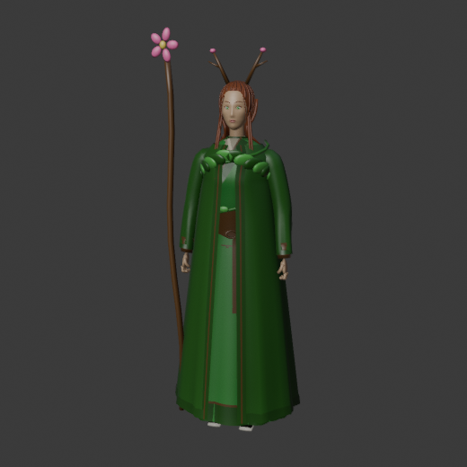

# Fenna, the Grove Warden

The grove hero kit (v5): Fenna's four spells (Q, W, E and the R ultimate), her passive, the shared parts file, the palette row and the rigged hero model. A warden in a cloak of layered leaves with a pale bark collar, antler-like branches round her head and a living staff topped by a bloom. Her spells plant flowers; she heals when she stands near them, and the enemy is slowed by them. She plays at range with a basic attack of 5.5 m.

## Role

| | |
|---|---|
| Role | Support (ranged) |
| Signature | Living Garden |
| HP | 600 |
| Kit shapes | Q LINE skillshot + flower · W TGT root · E DASH + flower · R GROUND tree + Uproot recast |

She wins by standing in her garden: with flowers near her she heals, and the enemy that walks through them is slowed or tramples them. Her weakness is that flowers last only 7 s and an enemy that stands on one for 0.6 s tramples it.

## At a glance

| | |
|---|---|
| Hero | Fenna, the Grove Warden |
| Spell category | `hero: grove` |
| Parts file | [`src/effects/parts/grove.ts`](../../../src/effects/parts/grove.ts) |
| Kit data | [`src/kits/grove.ts`](../../../src/kits/grove.ts) |
| Trait (rules) | [`src/traits/grove.ts`](../../../src/traits/grove.ts) |
| Kit sheet | [`kit-grove.md`](../../../pipeline/designs/kit-grove.md) (read [kit-common.md](../../../pipeline/designs/kit-common.md) first) |
| Model | [`public/models/heroes/grove.glb`](../../../public/models/heroes/grove.glb) |

## Palette

The art bible row "Grove" ([ART_BIBLE.md](../../ART_BIBLE.md) section 2, energy value ladders). Every effect of the kit picks from this row.

| Core | Hot | Body | Accent | Dark | Foil |
|---|---|---|---|---|---|
| `#fffbe0` | `#ffe36a` | `#4caf50` | `#ff7ab8` | `#14260f` | bark cream `#e8dcc0` |

Core is tiny; hot is the pollen gold; body is the leaf green of the vines; accent (petal pink) only 2-3 frames at hits and as the petal rim; dark is the forest floor and the vine undersides; the bark-cream foil is the inner face of the petals, pale bark and the seed rings.

## Signature shape and material rules

The spiral vine that blooms. Thick green vines grow in spirals (a coiling stem with leaf pairs along it) and at the end of every spiral a giant flower bursts open (5-7 broad petals in a cup, a bright pollen core), then sheds petals and pollen. Growth is the motion: things grow out of the ground in seconds. Not thorns (that is the blood kit and the existing thornwood): soft, curling, leafy and flowering.

- Vines: a lit tube (dark green underside, body, a lighter top line) with leaf pairs as flat two-tone cards.
- Petals: flat broad cards, cream inner face and pink rim, opening to at most 40 degrees (a cup, as in the art bible).
- Pollen: a few small soft gold motes, additive at low opacity.

## Passive and twist

| | |
|---|---|
| Passive | Living Garden: Seed Shot and Pollen Glide plant a flower where they land (4 at most, 7 s each). Within 3 m of flowers she heals 3 HP a second per flower (the two best count), 4 HP a second per flower within 6 m of her tree. |
| Twist | The enemy and the flowers. An enemy within 1.5 m of a flower is slowed (0.6 s, renewed every 0.4 s); standing within 1 m for 0.6 s tramples it. Strangle Vine roots 1.4 s instead of 1.0 s when the enemy is within 3 m of a flower. The CPU against her walks to a flower within 3 m to trample it. |
| Resource or meter | Meter FLOWERS, max 4 (the number of flowers standing) |
| Speed | 4.0 m/s |
| Basic attack | ranged, 5.5 m, 10 damage every 0.7 s, wind-up 0.18 s, bolt speed 20, petal look |
| Other rules | World Tree has a recast, Uproot (opens 1.3 s after the cast, open for 9.2 s). The duel AI holds the recast until the enemy is within 3 m of the tree. |

## Mechanics

Fenna uses these pieces of [the combat mechanics](../../architecture/mechanics.md):

| Mechanic | Where |
|---|---|
| Ground marks | Flowers and pollen puffs (`marks`, `markLook`), drawn on both screens |
| Heal | The garden heal in the trait's `tick` |
| Skillshot | Q: a projectile at 20 m/s, radius 0.35, 9 m (`aim: 'line'`) |
| Root | W: 1.0 s (1.4 s near a flower), flagged `cc`. R: the tree roots 1 s when it bursts |
| Dash | E: up to 6 m in 0.3 s (`dash: true`, `escape: true`) |
| Obstacle | R: the tree is a real pillar (radius 1.0) for 8 s; it blocks walking, sight and bolts for both heroes |
| Recast | R: Uproot (`recast`, window 9.2 s, arm 1.3 s) |
| Slow | The flowers' passive slow |
| Melee, summon, shield | none |

## Spells

All four play under the normal gameplay camera. Range and cooldown come from the kit data (`src/kits/grove.ts`), hit time and length from the spell files in `src/spells/targeted/`; the numbers are the spell files' defaults.

| Key | Label | Targeting | Range | Cooldown | Hit time | Length | What happens |
|---|---|---|---|---|---|---|---|
| Q | [seed shot](../../../src/spells/targeted/seedShot.ts) | line skillshot (ground aim) | 9 | 4 s | seed released at 0.25 s, reaches 6 m at 0.55 s | 1.4 s | A seed swells in her hand for 0.25 s, then flies down the aim. The first enemy it touches takes 64. A flower grows where the seed stops: on the enemy, or at the end of its flight or a wall. A sidestep after she raises her hand dodges it. |
| W | [strangle vine](../../../src/spells/targeted/strangleVine.ts) | enemy (needs sight) | 7 | 11 s | 0.5 s | about 2.6 s | Two vines run along the ground to the enemy and a red circle marks them (she is rooted until it lands). At 0.5 s: 40 damage and rooted 1.0 s, or 1.4 s within 3 m of a flower. Six vines spiral up the figure and wither when the root ends. No flower is planted. |
| E | [pollen glide](../../../src/spells/targeted/pollenGlide.ts) | ground (dash) | 6 | 12 s | none (no damage) | 1.3 s | She glides up to 6 m (at least 2 m) toward the aim in 0.3 s on a gust of gold pollen, and a flower grows where she lands. No heal of its own. |
| R | [world tree](../../../src/spells/targeted/worldTree.ts) | ground (r 3) | 9 | 24 s | the tree bursts at 1.2 s; Uproot 0.6 s after its recast | about 10.2 s | Ultimate. A giant flower opens in a 3 m ring (she is rooted for 1.2 s). At 1.2 s a tree 6 m tall bursts up; an enemy inside 3 m is rooted 1 s (no damage). It stands 8 s as a real obstacle and her flowers within 6 m heal 4 HP a second instead of 3. Recast (Uproot, from 1.3 s): a warning ring for 0.6 s, then a 3 m burst of thorns for 60 and a knock of 2. |

Spell sources: [`seedShot.ts`](../../../src/spells/targeted/seedShot.ts), [`strangleVine.ts`](../../../src/spells/targeted/strangleVine.ts), [`pollenGlide.ts`](../../../src/spells/targeted/pollenGlide.ts), [`worldTree.ts`](../../../src/spells/targeted/worldTree.ts). Their catalog rows are in the [effect catalog](../effects.md#hero-grove).

## Parts file

[`src/effects/parts/grove.ts`](../../../src/effects/parts/grove.ts) holds everything the kit's spells share. Spells import it directly (`../../effects/parts/grove`). Everything is pooled, takes world-space positions and has a `reset()`; the petals and the pollen are low-opacity, nothing is bright enough to bloom hard.

| Export | Role |
|---|---|
| `GROVE`, `GROVE_CSS` | palette constants (`bark` is the pale foil) |
| `SpiralVine` | a coiling vine with leaf pairs: `grow(base, dir, length, coils, width, seconds)`, `growAlong(fn, width, seconds, delay)`, `wither(seconds, delay)`, `pointAt(u, out)` |
| `Bloom` | a giant flower: `open(pos, size, seconds)`, `shed(seconds)`, `close(seconds)`, `aim(yaw, lean)`, `hide()` |
| `Petals` | instanced falling and spinning petals: `burst(pos, count, speed)`, `rain(center, radius, count, height, life)`, `stream(from, to, count, seconds)` |
| `Pollen` | soft gold motes: `puff(pos, count)`, `drift(center, radius, count, height, life)` |
| `RootRing` | a ground decal of roots spreading from a point: `spread(center, radius, seconds)`, `fade(seconds, delay)` |
| `GrowOptions` | options type for `SpiralVine.grow` |

## Model

[`public/models/heroes/grove.glb`](../../../public/models/heroes/grove.glb): a rigged figure on the Dao rig (same bone names as `public/models/figures/hero.glb`, so `src/effects/weapons/hero.ts` can pose it). Built by `build("grove")` / `export("grove")` in [`blender/heroes/hero_figures.py`](../../../blender/heroes/hero_figures.py) (the first style). Hero mode shows it with procedural walk, breath and cast poses. It is wired through the `MODELS` map in [`src/heroes.ts`](../../../src/heroes.ts) (name `Fenna`), and its hit size is in `HERO_BODIES` in the same file (radius 0.42 m, height 2.55 m).
- HUD portrait (canvas-drawn in the kit data): A living staff topped by a bloom, a cloak of layered leaves with a pale bark collar, and antler-like branches around her head.

 

## Files

| What | Where |
|---|---|
| Kit sheet (design) | [`pipeline/designs/kit-grove.md`](../../../pipeline/designs/kit-grove.md) |
| Shared kit rules | [`pipeline/designs/kit-common.md`](../../../pipeline/designs/kit-common.md) |
| Parts | [`src/effects/parts/grove.ts`](../../../src/effects/parts/grove.ts) |
| Spells | [`seedShot.ts`](../../../src/spells/targeted/seedShot.ts), [`strangleVine.ts`](../../../src/spells/targeted/strangleVine.ts), [`pollenGlide.ts`](../../../src/spells/targeted/pollenGlide.ts), [`worldTree.ts`](../../../src/spells/targeted/worldTree.ts) |
| Kit data | [`src/kits/grove.ts`](../../../src/kits/grove.ts) |
| Trait (passive, twist, rules) | [`src/traits/grove.ts`](../../../src/traits/grove.ts) |
| Model | [`public/models/heroes/grove.glb`](../../../public/models/heroes/grove.glb) |
| Model script | [`blender/heroes/hero_figures.py`](../../../blender/heroes/hero_figures.py) |

## See also

- [Hero roster and shared structure](README.md)
- [Combat mechanics](../../architecture/mechanics.md)
- [Kaia (storm)](storm.md), [Sefu (sand)](sand.md), [Nyx (shadow)](shadow.md), [Lyra (astral)](astral.md)
- [Effect catalog](../effects.md)
- [Docs home](../../README.md)
- [Art bible](../../ART_BIBLE.md)
- [Kit shared rules](../../../pipeline/designs/kit-common.md)
