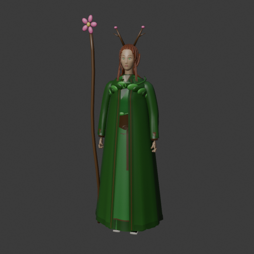
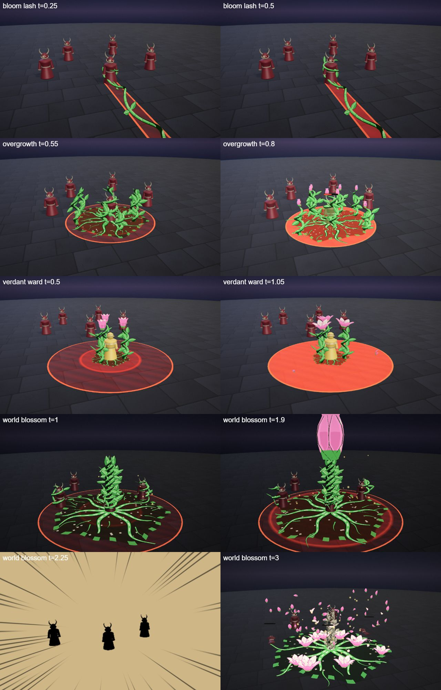

# Fenna, the Grove Warden

The grove hero kit: Fenna's four spells (Q, W, E and the R ultimate), the shared parts file, the palette row and the rigged hero model. A forest warden with antler-like branches in her hair and a living staff; she roots, binds and blooms.

## Role

Support, 600 HP, ranged. Signature: *Regrowth*. She heals through the trade and roots. She wins a 1v1 by attrition: the Q lash heals her 8, the W vines root the enemy and the R heals 45 and roots again, while the turret shoots. Her weakness is low burst damage.

## At a glance

| | |
|---|---|
| Hero | Fenna, the Grove Warden |
| Spell category | `hero: grove` |
| Parts file | [`src/effects/parts/grove.ts`](../../../src/effects/parts/grove.ts) |
| Kit data | [`src/kits/grove.ts`](../../../src/kits/grove.ts) |
| Kit sheet | [`kit-grove.md`](../../../pipeline/designs/kit-grove.md) (read [kit-common.md](../../../pipeline/designs/kit-common.md) first) |
| Model | [`public/models/heroes/grove.glb`](../../../public/models/heroes/grove.glb) |

## Palette

The art bible row "Grove" ([ART_BIBLE.md](../../ART_BIBLE.md) section 2, energy value ladders). Every effect of the kit picks from this row.

| Core | Hot | Body | Accent | Dark | Foil |
|---|---|---|---|---|---|
| `#fffbe0` | `#ffe36a` | `#4caf50` | `#ff7ab8` | `#14260f` | bark cream `#e8dcc0` |

Core is tiny; hot is the pollen gold; body is the leaf green of the vines; accent (petal pink) only 2-3 frames at hits and as the petal rim; dark is the forest floor and the vine undersides; the bark-cream foil is the inner face of the petals, pale bark and the seed rings.

## Signature shape and material rules

The spiral vine that blooms. Thick green vines grow in spirals (a coiling stem with leaf pairs along it) and at the end of every spiral a giant flower bursts open (5-7 broad petals in a cup, a bright pollen core), then sheds petals and pollen. Growth is the motion: things grow out of the ground in seconds. Not thorns (that is the blood kit and the existing thornwood): soft, curling, leafy and flowering.

- Vines: a lit tube (dark green underside, body, a lighter top line) with leaf pairs as flat two-tone cards.
- Petals: flat broad cards, cream inner face and pink rim, opening to at most 40 degrees (a cup, as in the art bible).
- Pollen: a few small soft gold motes, additive at low opacity.

## Spells

All four play under the normal gameplay camera (no cinematic, no letterbox). Q, W and E each have a shape of their own (see the table: dash, skillshot, trap, orbit, summon and so on), not a fixed strike, zone or aura; R is the ultimate (hit at 2.2 s, clean by 4.5 s, one dead beat and impact frames). Range and cooldown come from the kit data (`src/kits/grove.ts`), hit time and length from the spell files in `src/spells/targeted/`; "hit" is the telegraph impact time and the first damage.

| Key | Label | Targeting | Range | Cooldown | Hit time | Length | What happens |
|---|---|---|---|---|---|---|---|
| Q | [bloom lash](../../../src/spells/targeted/bloomLash.ts) | enemy | 10 | 3 s | 0.5 s | 1.6 s | She sweeps the staff and a vine bursts from the ground at her feet. At the hit it spirals across the ground to the enemy and up around it (2 coils) and a flower bursts open on top: pink accent for 2 frames, a petal burst, a small ground refraction ring. Then the flower sheds and the vine withers and sinks. Damage 50, knock 3; the lash heals her for 8. |
| W | [overgrowth](../../../src/spells/targeted/overgrowth.ts) | enemy (zone r 2 round it) | 9 | 7 s | 0.75 s | 2.3 s | Vines grow up round the chosen enemy. Roots spread from where it stands, then 6-8 spiral vines grow up out of them, coil around it and hold it. At the hit every vine bursts into a flower at once (a ring of blooms) with a pollen puff, shake and a ground refraction ring; anyone still inside is rooted for 1.2 s. The flowers shed, the vines wither and the roots fade. Damage 45, then a tick of 10 at 1.3 s. |
| E | [verdant ward](../../../src/spells/targeted/verdantWard.ts) | ground (TURRET, r 1.5) | 9 | 12 s | 0.5 s (the vine stands) | 1.6 s (plays on while the turret lives) | Three vines rise at the aimed spot and spiral upward, a flower opens on each. At 0.5 s they stand as one flowering vine (green stalk, pink blossom) summoned as a turret: 80 HP for 6 s, it fires petals at whatever comes within 8 for 12 every 1.4 s. The vine withers when the time or its HP runs out. |
| R | [world blossom](../../../src/spells/targeted/worldBlossom.ts) | self (SELF-R, r 5) | 0 (self) | 20 s | 2.2 s | 4.5 s | The ultimate. The world darkens to a green dusk and roots spread round her. A trunk of braided spiral vines grows and a giant bud opens into a big flower while vines hold the enemies; the flower then closes its petals over her like a fist, dead beat at 1.85-2.0 s, and the petals slam down. Impact frames, a ring of smaller flowers bursts open across the radius, petals and pollen explode outward, pink accent, refraction ring. She heals 45 and every enemy within 5 m is rooted for 1.0 s. Then petals rain down, the vines wither and the roots fade. Damage 95. |

Spell sources: [`bloomLash.ts`](../../../src/spells/targeted/bloomLash.ts), [`overgrowth.ts`](../../../src/spells/targeted/overgrowth.ts), [`verdantWard.ts`](../../../src/spells/targeted/verdantWard.ts), [`worldBlossom.ts`](../../../src/spells/targeted/worldBlossom.ts). Their catalog rows are in the [effect catalog](../effects.md#hero-grove).

## Parts file

[`src/effects/parts/grove.ts`](../../../src/effects/parts/grove.ts) holds everything the four spells share. Spells import it directly (`../../effects/parts/grove`). Everything is pooled, takes world-space positions and has a `reset()`; the petals and the pollen are low-opacity, nothing is bright enough to bloom hard.

| Export | Role |
|---|---|
| `GROVE`, `GROVE_CSS` | palette constants (`bark` is the pale foil) |
| `SpiralVine` | a coiling vine with leaf pairs: `grow(base, dir, length, coils, width, seconds)`, `growAlong(fn, width, seconds, delay)`, `wither(seconds, delay)`, `pointAt(u, out)` |
| `Bloom` | a giant flower: `open(pos, size, seconds)`, `shed(seconds)`, `close(seconds)`, `aim(yaw, lean)`, `hide()` |
| `Petals` | instanced falling and spinning petals: `burst(pos, count, speed)`, `rain(center, radius, count, height, life)`, `stream(from, to, count, seconds)` |
| `Pollen` | soft gold motes: `puff(pos, count)`, `drift(center, radius, count, height, life)` |
| `RootRing` | a ground decal of roots spreading from a point: `spread(center, radius, seconds)`, `fade(seconds, delay)` |
| `GrowOptions` | options type for `SpiralVine.grow` |

## Model

[`public/models/heroes/grove.glb`](../../../public/models/heroes/grove.glb): a rigged figure on the Dao rig (same bone names as `public/models/figures/hero.glb`, so `src/effects/weapons/hero.ts` can pose it). Built by `build("grove")` / `export("grove")` in [`blender/heroes/hero_figures.py`](../../../blender/heroes/hero_figures.py); hero mode shows it with procedural walk, breath and cast poses. It is wired through the `MODELS` map in [`src/heroes.ts`](../../../src/heroes.ts).

- Look: A slim woman in a leaf-green robe over bark cream, auburn hair with small branch antlers and blossoms, a leaf mantle, a vine spiralling up her body and a living staff that blooms at the top.
- Props: `branch_antlers`, `leaf_mantle`, `body_vine`, `bloom_staff`.
- HUD portrait (canvas-drawn in the kit data): A living staff topped by a bloom behind her, a cloak of layered leaves with a pale bark collar, antler-like branches with leaves and blossoms around her head, and drifting pollen.

The wave 2 concept (Fenna, Auriel and Marin; vector source [`wave2_concept.svg`](../../heroes/wave2_concept.svg)):

## Files

| What | Where |
|---|---|
| Kit sheet (design) | [`pipeline/designs/kit-grove.md`](../../../pipeline/designs/kit-grove.md) |
| Shared kit rules | [`pipeline/designs/kit-common.md`](../../../pipeline/designs/kit-common.md) |
| Parts | [`src/effects/parts/grove.ts`](../../../src/effects/parts/grove.ts) |
| Spells | [`bloomLash.ts`](../../../src/spells/targeted/bloomLash.ts), [`overgrowth.ts`](../../../src/spells/targeted/overgrowth.ts), [`verdantWard.ts`](../../../src/spells/targeted/verdantWard.ts), [`worldBlossom.ts`](../../../src/spells/targeted/worldBlossom.ts) |
| Kit data | [`src/kits/grove.ts`](../../../src/kits/grove.ts) |
| Model | [`public/models/heroes/grove.glb`](../../../public/models/heroes/grove.glb) |
| Model script | [`blender/heroes/hero_figures.py`](../../../blender/heroes/hero_figures.py) |

## Review sheets

Contact sheets in `docs/spells/` (frames over time, from `pipeline/tools/contact-sheet.js`).

### Grove review

### Dawn and grove re-check (round 2)

Shared with [Auriel (dawn)](dawn.md).

## See also

- [Hero roster and shared structure](README.md)
- [Vesper (blood)](blood.md), [Brannoc (forge)](forge.md), [Isolde (frost)](frost.md), [Lyra (astral)](astral.md), [Vex (alchemy)](alchemy.md), [Kaia (storm)](storm.md), [Sefu (sand)](sand.md), [Nyx (shadow)](shadow.md), [Auriel (dawn)](dawn.md), [Marin (tide)](tide.md)
- [Effect catalog](../effects.md)
- [Docs home](../../README.md)
- [Art bible](../../ART_BIBLE.md)
- [Kit shared rules](../../../pipeline/designs/kit-common.md)
