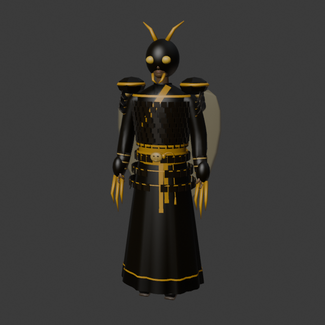
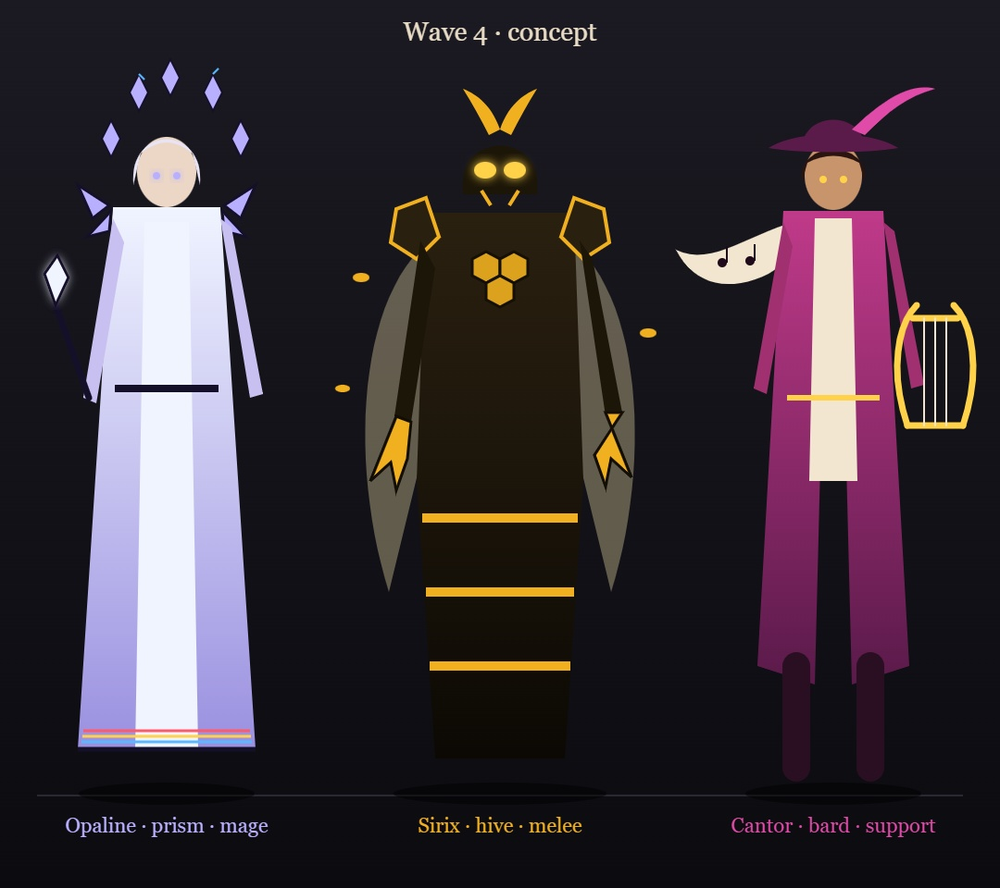
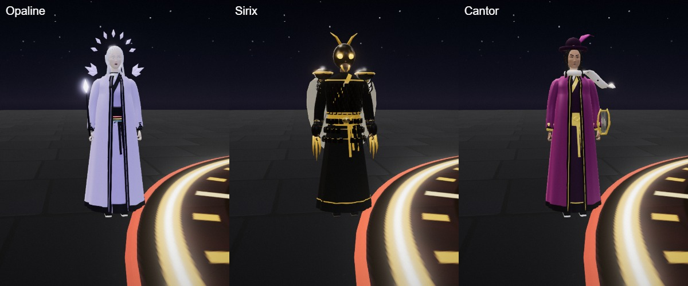
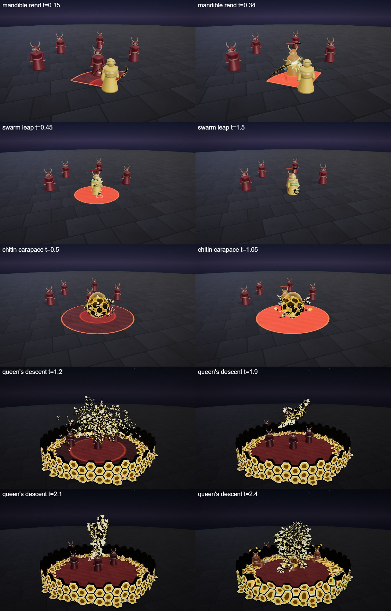
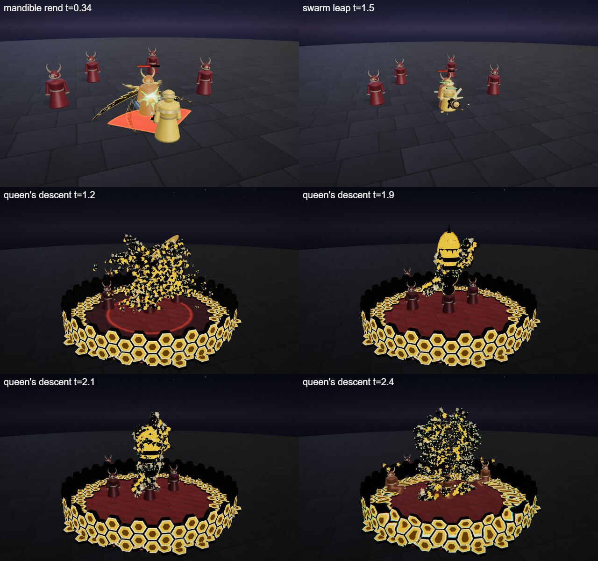

# Sirix, the Swarm Warden

The hive hero kit: Sirix's four spells (Q, W, E and the R ultimate), the shared parts file, the palette row and the rigged hero model. A broad brawler in black chitin plate with amber stripes, a crested insect helm and serrated claw gauntlets, who fights in the middle of a swarm of wasps. He is built on the [combat mechanics](../../architecture/mechanics.md): a melee kit with extra HP, a slow, a leap that summons two wasp soldiers, a pure shield and a slowing ultimate that drops three more wasps.

## Role

| | |
|---|---|
| Role | Juggernaut (melee, summons) |
| Signature | The swarm |
| HP | 720 |
| Kit shapes | Q CONE slow · W DASH + wasps · E BUFF shield · R SUMMON queen ultimate |

He wins a 1v1 by closing in with the leap, then fighting beside his wasps while the shield soaks the trade; the ultimate slows the enemy and adds three more wasps. His weakness is reach: a kiter outruns him, and his wasps die to area damage.

## At a glance

| | |
|---|---|
| Hero | Sirix, the Swarm Warden |
| Spell category | `hero: hive` |
| Parts file | [`src/effects/parts/hive.ts`](../../../src/effects/parts/hive.ts) |
| Kit data | [`src/kits/hive.ts`](../../../src/kits/hive.ts) |
| Kit sheet | [`kit-hive.md`](../../../pipeline/designs/kit-hive.md) (read [kit-common.md](../../../pipeline/designs/kit-common.md) first) |
| Model | [`public/models/heroes/hive.glb`](../../../public/models/heroes/hive.glb) |

## Palette

The art bible row "Hive" ([ART_BIBLE.md](../../ART_BIBLE.md) section 2, energy value ladders). Every effect of the kit picks from this row.

| Core | Hot | Body | Accent | Dark | Foil |
|---|---|---|---|---|---|
| `#fffbe0` | `#ffe08a` | `#f0b020` | `#7aff5a` | `#120e06` | wax `#f6e6b0` |

Core is only tiny highlights; hot is the lit edge of a cell and the glow at the tip of a claw; body is the amber of the wasps, the honey and the rim of every chitin plate; accent (acid green) is only the eyes, the flash of a claw hit and the star of the ultimate; dark is the black chitin and the gaps between cells; the wax foil is the pale honeycomb and the wings.

## Signature shape and material rules

The hexagon and the swarm. Wax-amber hexagonal cells with dark gaps, black chitin plates with an amber rim, dozens to hundreds of tiny dark wasps with striped amber abdomens and a flicker of wings, and sticky amber honey splashes. Every spell is a hive: a double claw swipe, a cloud of wasps streaming behind a leap, a shell of plates, a tower of cells with a giant queen wasp made of the swarm. Not the bone kit's ivory (Mortis) and not the dawn kit's flat gold panels (Auriel): the cells are wax and grow in one by one, and the swarm is many small moving bodies, not confetti.

- Cells: flat unlit hexagons that pop in with a small overshoot and crumble in a random order.
- Wasps: instanced, each with a flicker of wings; drawn bigger than life (0.4 m and up) so they read at gameplay distance.
- Claws: flat sickles, near-black with a serrated outer edge, an amber rim and a hot tip.
- Honey: a few amber blobs that fall and land as flat puddles.

## Mechanics

Sirix uses these pieces of [the combat mechanics](../../architecture/mechanics.md):

| Mechanic | Where |
|---|---|
| Melee kit | `melee: true` and `maxHp: 720` in the kit data (the default is 600; the extra HP pays for having to close in). The duel AI walks up to about 2 m, never backs off and keeps chasing. The Q range is only 3 |
| Slow | Q slows every enemy it hits for 1.0 s and R for 1.5 s (walking speed x 0.6, cap 2.5 s) |
| Dash, summon | W has `dash: true` and `summon: true`: he leaps to the aimed spot with `ctx.moveCaster(point, 0.25)`, re-checks the enemies at the spot he really reaches, and calls `ctx.summon` for two wasp soldiers (`kind: 'melee'`, 40 HP, 6 s, 6 damage per 1 s) |
| Shield | E gives `ctx.shieldSelf(60, 3)`, a pure 60 point shield for 3 s. It has no hit and no telegraph; the swarm flare is for show |
| Summon (ultimate) | R has no `cc` any more. At the hit it calls `ctx.summon` for three wasp soldiers (`kind: 'melee'`, 40 HP, 6 s, 6 damage per 1 s) at the centre. With the leap's two that is at most five of the cap of six |
| Unit look | the wasp soldiers use `waspLook` (see [Parts file](#parts-file)) |
| Skillshot, heal | none |

The numbers follow the "Mechanics budget" of [kit-common.md](../../../pipeline/designs/kit-common.md): melee 720 HP, Q about 45 with a 2.5 s cooldown, the summon W at 40 damage with the wasps making up the rest.

## Spells

All four play under the normal gameplay camera (no cinematic, no letterbox). The four spells have different shapes: Q is a melee cone (hit at 0.3 s, clean by 1.2 s), W a dash that lands a burst and two wasps (hit at 0.4 s, clean by 1.6 s), E a pure shield with no hit (3.2 s), R a slow ultimate that drops three wasps (hit at 2.2 s, clean by 4.5 s, one dead beat). Range and cooldown come from the kit data (`src/kits/hive.ts`), hit time and length from the spell files in `src/spells/targeted/`; "hit" is the telegraph impact time and the first damage.

| Key | Label | Targeting | Range | Cooldown | Hit time | Length | What happens |
|---|---|---|---|---|---|---|---|
| Q | [mandible rend](../../../src/spells/targeted/mandibleRend.ts) | enemy CONE (a 100 degree cone, radius 3.2) | 3 | 2.5 s | 0.3 s | 1.2 s | The claws spread and a few wasps buzz off them. At the hit two crossing serrated claw arcs sweep the cone in front of him with honey splashes and a green flash; everyone still inside the cone is hit and slowed. Damage 45, knock 2, slow 1.0 s. |
| W | [swarm leap](../../../src/spells/targeted/swarmLeap.ts) | ground DASH (r 2.5) | 8 | 9 s | 0.4 s | 1.6 s (the wasps live on as units) | The swarm lifts off his back in a cloud. At 0.1 s he leaps to the point in 0.25 s with the swarm streaming behind him as a ribbon. At 0.4 s a honeycomb bursts under him at the spot he really reaches, with honey splashes, and everyone within 2.5 is hit; two wasp soldiers peel off the swarm and fight for 6 s. The honeycomb crumbles and the swarm thins out. Damage 40, knock 3. |
| E | [chitin carapace](../../../src/spells/targeted/chitinCarapace.ts) | self BUFF (r 4) | 0 (self) | 9 s | none (no hit; the swarm flare is at 1.0 s and 2.0 s) | 3.2 s | Black chitin plates with an amber rim snap together round him in a shell (radius 1.2) while the swarm circles it, and he takes a 60 point shield for 3 s. At 1.0 s and 2.0 s the swarm bursts outward as a flare, for show only: no damage, no slow. From 2.6 s the plates fall and the swarm settles. Shield 60, no damage. |
| R | [queen's descent](../../../src/spells/targeted/queensDescent.ts) | ground SUMMON (r 7) | 13 | 20 s | 2.2 s | 4.5 s | The ultimate. The world darkens to amber-black and honeycomb cells grow over the zone edge, then rise into a ring wall about 2 high. Hundreds of wasps stream in from the rim and form the silhouette of a giant queen wasp (about 8 wide, 6 long, hovering 4 to 7 high, top under 8.5) while the enemies are pulled in. At 1.6 s she folds her wings and points down; dead beat 1.85-2.0 s; at 2.0 s the swarm-queen dives into the centre. At 2.2 s the swarm bursts outward in a ring with honey splashes, a green star and the hit, and three wasp soldiers drop where she lands and fight for 6 s. The wasps scatter, the wall crumbles, the darkness lifts. Damage 85, knock 3, slow 1.5 s, 3 wasps. |

Spell sources: [`mandibleRend.ts`](../../../src/spells/targeted/mandibleRend.ts), [`swarmLeap.ts`](../../../src/spells/targeted/swarmLeap.ts), [`chitinCarapace.ts`](../../../src/spells/targeted/chitinCarapace.ts), [`queensDescent.ts`](../../../src/spells/targeted/queensDescent.ts). Their catalog rows are in the [effect catalog](../effects.md#hero-hive).

## Parts file

[`src/effects/parts/hive.ts`](../../../src/effects/parts/hive.ts) holds everything the four spells share. Spells import it directly (`../../effects/parts/hive`). Everything is pooled, takes world-space positions and has a `reset()`; the materials are unlit flat colours kept below the bloom threshold.

| Export | Role |
|---|---|
| `HIVE`, `HIVE_CSS` | palette constants (`wax` is the pale foil) |
| `Swarm` | an instanced cloud of wasps: `set(center, radius, count, spawner?)` a loose cloud, `stream(from, to, seconds, trail)` a ribbon that settles into a cloud, `dive(point, seconds)` contracts and flies to a point, `scatter(seconds, flat, speed)` flies outward and shrinks away, `form(fn, count, stiffness)` flies each wasp to a fixed silhouette; `size` is the wasp length; `frozen` holds time for a dead beat |
| `Honeycomb` | hexagonal cells that grow in and crumble (`HoneyStyle` `'wax'` or `'chitin'`): `grow(center, radius, seconds, inner, cell)` a patch or band on the floor, `wall(center, radius, height, seconds, cell, thick)` a ring wall that rises, `dome(center, radius, height, seconds, count, cell)` loose plates in a shell, `setCenter`, `crumble(seconds)` |
| `HoneySplash` | amber blobs thrown out that land as flat puddles: `burst(pos, count, speed, size, up)` (at most 28 at once) |
| `ClawSlash` | pooled serrated claw crescents (`ClawOptions`): `slash(center, dir, radius, arcDeg, tilt, seconds, opts)` sweeps one on along its arc, lets it hang and fades it |
| `waspLook` | a `MinionLook` for `SummonOptions.look`, see below |
| `QueenBody` | the solid core of the swarm-queen of the ultimate, see below |

### waspLook

`waspLook` is the unit look for the summoned wasp soldiers ([`MinionLook`](../../architecture/mechanics.md#the-look-pluggable-partsminionts) in `parts/minion.ts`): a giant hovering wasp about 0.9 m long with an amber abdomen (the figure's body colour, which flashes when hit) with dark stripes and a stinger, a dark thorax and head with big acid-green eyes, mandibles, antennae, dangling legs and two pairs of flickering pale wings. It hovers (the feet height is the hover height, about 0.55), leans forward when it walks and lunges stinger-first on a swing. Every other unit kind gets the same wasp.

### QueenBody

`QueenBody` is the solid core of the swarm-queen that the ultimate shapes out of hundreds of wasps: a striped amber abdomen, a dark chitin thorax and head with green eyes, antennae and a stinger (about 5.5 long in all) and four big translucent amber wings (fore span 4 each side, hind span 2.8), every body part with an amber rim hull. `set(center, axis, wing, normal, fold, flap, k)` poses it (`axis` points tail to head, `wing` is the wing axis, `normal` is `axis x wing`, `fold` runs 0 open to 1 folded back, `flap` is a time for the small wing tremble, `k` is the 0..1 size pop); `hide()` and `reset()` hide it. Add its `mesh` to the effect group.

## Model

[`public/models/heroes/hive.glb`](../../../public/models/heroes/hive.glb): a rigged figure on the Dao rig (same bone names as `public/models/figures/hero.glb`, so `src/effects/weapons/hero.ts` can pose it). Built by `build("hive")` / `export("hive")` in [`blender/heroes/hero_figures.py`](../../../blender/heroes/hero_figures.py); hero mode shows it with procedural walk, breath and cast poses. It is wired through the `MODELS` map in [`src/heroes.ts`](../../../src/heroes.ts) (name `Sirix`).

- Look: A broad, shaven fighter in black chitin plate with amber stripes over a dark under-layer, a crested insect helm with amber eye lenses, hexagonal pauldrons, bracers and serrated claw gauntlets, and a translucent wax-coloured wing cloak.
- Props: `insect_helm`, `hex_pauldrons`, `claw_gauntlets`, `wing_cloak`.
- HUD portrait (canvas-drawn in the kit data): Honeycomb cells behind, pale translucent wings spread behind the shoulders, black chitin shoulders with hexagonal pauldrons and an insect head with green eyes.

The wave 4 concept (Opaline, Sirix and Cantor; vector source [`wave4_concept.svg`](../../heroes/wave4_concept.svg)):

The wave 4 models in hero mode (Opaline, Sirix and Cantor):

## Files

| What | Where |
|---|---|
| Kit sheet (design) | [`pipeline/designs/kit-hive.md`](../../../pipeline/designs/kit-hive.md) |
| Shared kit rules | [`pipeline/designs/kit-common.md`](../../../pipeline/designs/kit-common.md) |
| Parts | [`src/effects/parts/hive.ts`](../../../src/effects/parts/hive.ts) |
| Spells | [`mandibleRend.ts`](../../../src/spells/targeted/mandibleRend.ts), [`swarmLeap.ts`](../../../src/spells/targeted/swarmLeap.ts), [`chitinCarapace.ts`](../../../src/spells/targeted/chitinCarapace.ts), [`queensDescent.ts`](../../../src/spells/targeted/queensDescent.ts) |
| Kit data | [`src/kits/hive.ts`](../../../src/kits/hive.ts) |
| Model | [`public/models/heroes/hive.glb`](../../../public/models/heroes/hive.glb) |
| Model script | [`blender/heroes/hero_figures.py`](../../../blender/heroes/hero_figures.py) |

## Review sheets

Contact sheets in `docs/spells/` (frames over time, from `pipeline/tools/contact-sheet.js`).

### Hive review

### Hive re-check (round 2)

## See also

- [Hero roster and shared structure](README.md)
- [Combat mechanics](../../architecture/mechanics.md)
- [Opaline (prism)](prism.md), [Cantor (bard)](bard.md), [Zephyr (sky)](sky.md), [Mortis (bone)](bone.md)
- [Effect catalog](../effects.md)
- [Docs home](../../README.md)
- [Art bible](../../ART_BIBLE.md)
- [Kit shared rules](../../../pipeline/designs/kit-common.md)
