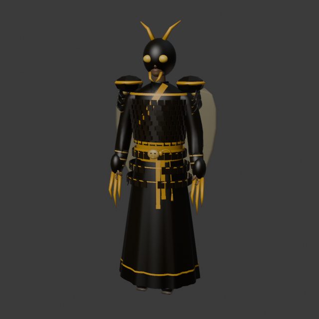

# Sirix, the Swarm Warden

The hive hero kit (kits v5): Sirix's four spells (Q, W, E and the R ultimate), his passive and twist, the shared parts file, the palette row and the rigged hero model. A broad fighter in black chitin plate with a crested insect helm and a wasp swarm that circles him. He is built on the [combat mechanics](../../architecture/mechanics.md): a melee bruiser whose spells spend wasps.

## Role

| | |
|---|---|
| Role | Bruiser (melee) |
| Signature | The Swarm |
| HP | 720 |
| Kit shapes | Q BOLT barb + recast leap, poison for 2 wasps · W BUFF armour, wasps sting attackers · E ZONE cloud of all wasps, blind · R LINE column of all wasps, shove, blind |

He wins a 1v1 by deciding when to spend the swarm: poison on the leap, a cloud to hold ground, or all six wasps in one column. His weakness is that after he spends the swarm he is a plain fighter for seconds. The wasp count shows over him, so that is the moment to hit him. Walk speed 4.0 m/s.

## At a glance

| | |
|---|---|
| Hero | Sirix, the Swarm Warden |
| Spell category | `hero: hive` |
| Parts file | [`src/effects/parts/hive.ts`](../../../src/effects/parts/hive.ts) |
| Kit data | [`src/kits/hive.ts`](../../../src/kits/hive.ts) |
| Trait data | [`src/traits/hive.ts`](../../../src/traits/hive.ts) |
| Kit sheet | [`kit-hive.md`](../../../pipeline/designs/kit-hive.md) (read [kit-common.md](../../../pipeline/designs/kit-common.md) first) |
| Model | [`public/models/heroes/hive.glb`](../../../public/models/heroes/hive.glb) |

## Palette

The art bible row "Hive" ([ART_BIBLE.md](../../ART_BIBLE.md) section 2, energy value ladders). Every effect of the kit picks from this row.

| Core | Hot | Body | Accent | Dark | Foil |
|---|---|---|---|---|---|
| `#fffbe0` | `#ffe08a` | `#f0b020` | `#7aff5a` | `#120e06` | wax `#f6e6b0` |

Core is only tiny highlights; hot is the lit edge of a cell and the glow at the tip of a claw; body is the amber of the wasps, the honey and the rim of every chitin plate; accent (acid green) is only the eyes, the flash of a claw hit and the star of the ultimate; dark is the black chitin and the gaps between cells; the wax foil is the pale honeycomb and the wings.

## Signature shape and material rules

The hexagon and the swarm. Wax-amber hexagonal cells with dark gaps, black chitin plates with an amber rim, dozens to hundreds of tiny dark wasps with striped amber abdomens and a flicker of wings, and sticky amber honey splashes. Every spell is a hive: a double claw swipe, a cloud of wasps streaming behind a leap, a shell of plates, a tower of cells with a giant queen wasp made of the swarm. Not the bone kit's ivory (Mortis) and not the dawn kit's flat gold panels (Auriel): the cells are wax and grow in one by one, and the swarm is many small moving bodies, not confetti.

- Cells: flat unlit hexagons that pop in with a small overshoot and crumble in a random order.
- Wasps: instanced, each with a flicker of wings; drawn bigger than life (0.4 m and up) so they read at gameplay distance.
- Claws: flat sickles, near-black with a serrated outer edge, an amber rim and a hot tip.
- Honey: a few amber blobs that fall and land as flat puddles.

## Passive and twist

| | |
|---|---|
| Passive | **The Swarm**: up to 6 wasps circle him (one more every 2 s and one per basic attack that lands). His spells spend them. He starts a round with none. |
| Twist | **Spend or hold**: spend 2 wasps on the leap's poison, burn them in the cloud, or hold six for the surge. After the surge he is a plain fighter. |
| Resource or meter | meter `WASPS` (max 6). The wasps are drawn as a real swarm on both screens (one wasp mark per count) |
| Walk speed | 4.0 m/s |
| Basic attack | melee, 2.4 m, 13 per 1.2 s, wind-up 0.3 s, claw look |

Other trait rules (`src/traits/hive.ts`):

- Barbed Stinger barbs the enemy for 3 s. The recast, "Leap" (arms after 0.2 s, window 3 s, free), leaps him onto the barbed enemy within 8 m. With 2 wasps he spends them and the leap also poisons.
- Hive Shell: while it runs, each hit he takes (not a passive's) spends a wasp, if he has one, and stings the attacker for 15.
- Swarm Cloud sends every wasp to the cloud at the cast and stops the 2 s clock while it stands. When it ends (3 s) they come back, up to 6.
- Swarm Surge spends every wasp at the cast and nothing refills them.
- The duel AI holds R under 4 wasps, E under 3 wasps, and the recast until the enemy is barbed and within 8 m.

## Mechanics

Sirix uses these pieces of [the combat mechanics](../../architecture/mechanics.md):

| Mechanic | Where |
|---|---|
| Melee kit | `melee: true` and `maxHp: 720` in the kit data. The duel AI walks up to about 2 m and keeps chasing |
| Resource | wasps: the passive, spent by Q (2), W (one per hit taken), E (all), R (all) |
| Recast | Q, "Leap" |
| Armour buff | W: `buff` armour 0.4 for 3 s (40% less damage) |
| Poison | the leap's poison, 30 over 3 s (3 ticks) |
| Blind | E and R, 1 s |
| Shove | R, 4 m |
| Skillshot | Barbed Stinger (radius 0.4, speed 20), Swarm Surge (a 4 m wide column) |
| Dash | the Q leap (to the barbed enemy) |
| Pull, summon, shield | none |

## Spells

All four play under the normal gameplay camera. Range and cooldown come from the kit data (`src/kits/hive.ts`), hit time and length from the spell files in `src/spells/targeted/`; "hit" is the telegraph impact time and the first damage.

| Key | Label | Targeting | Range | Cooldown | Hit time | Length | What happens |
|---|---|---|---|---|---|---|---|
| Q | [barbed stinger](../../../src/spells/targeted/barbedStinger.ts) | ground (BOLT skillshot, line, radius 0.4), recast Leap | 8 | 6 s | 0.25 s (leap 0.3 s) | 1.4 s (leap 1.0 s, with poison 3.7 s) | A stinger flies 8 m at 20 m/s: 42, and the barb stays on the enemy for 3 s. Cast again within 3 s to leap onto the barbed enemy (landing circle 2.4 m, he stops 1.3 m short): 25, and with 2 wasps spent it poisons them for 30 over 3 s. |
| W | [hive shell](../../../src/spells/targeted/hiveShell.ts) | self (radius 1.5) | 0 (self) | 10 s | grown at 0.35 s | 3.5 s | Chitin plates close round him (2.4 m tall): 40% less damage for 3 s. Each hit he takes spends a wasp, which flies out and stings the attacker for 15. No damage of its own. |
| E | [swarm cloud](../../../src/spells/targeted/swarmCloud.ts) | ground (r 2.5) | 9 | 9 s | first tick at 1.0 s | 3.65 s | All his wasps fly to the spot (0.7 s) and hang there for 3 s as a cloud. From 1 s, 7 damage per wasp each second to everyone inside, and they are blinded 1 s. The wasps come back when it ends. |
| R | [swarm surge](../../../src/spells/targeted/swarmSurge.ts) | ground (LINE, column 10 m long, 4 m wide) | 10 | 22 s | 0.5 s (released), then flight at 12 m/s | 2.0 s | Ultimate. He looses every wasp down the column: 18 per wasp, a 4 m shove and 1 s blind. The swarm does not come back: he is a plain fighter afterwards. |

Spell sources: [`barbedStinger.ts`](../../../src/spells/targeted/barbedStinger.ts), [`hiveShell.ts`](../../../src/spells/targeted/hiveShell.ts), [`swarmCloud.ts`](../../../src/spells/targeted/swarmCloud.ts), [`swarmSurge.ts`](../../../src/spells/targeted/swarmSurge.ts). Their catalog rows are in the [effect catalog](../effects.md#hero-hive).

## Parts file

[`src/effects/parts/hive.ts`](../../../src/effects/parts/hive.ts) holds everything the four spells share. Spells import it directly (`../../effects/parts/hive`). Everything is pooled, takes world-space positions and has a `reset()`; the materials are unlit flat colours kept below the bloom threshold.

| Export | Role |
|---|---|
| `HIVE`, `HIVE_CSS` | palette constants (`wax` is the pale foil) |
| `Swarm` | an instanced cloud of wasps: `set(center, radius, count, spawner?)` a loose cloud, `stream(from, to, seconds, trail)` a ribbon that settles into a cloud, `dive(point, seconds)` contracts and flies to a point, `scatter(seconds, flat, speed)` flies outward and shrinks away, `form(fn, count, stiffness)` flies each wasp to a fixed silhouette; `size` is the wasp length; `frozen` holds time for a dead beat |
| `Honeycomb` | hexagonal cells that grow in and crumble (`HoneyStyle` `'wax'` or `'chitin'`): `grow(center, radius, seconds, inner, cell)` a patch or band on the floor, `wall(center, radius, height, seconds, cell, thick)` a ring wall that rises, `dome(center, radius, height, seconds, count, cell)` loose plates in a shell, `setCenter`, `crumble(seconds)` |
| `HoneySplash` | amber blobs thrown out that land as flat puddles: `burst(pos, count, speed, size, up)` (at most 28 at once) |
| `ClawSlash` | pooled serrated claw crescents (`ClawOptions`): `slash(center, dir, radius, arcDeg, tilt, seconds, opts)` sweeps one on along its arc, lets it hang and fades it |
| `waspLook` | a `MinionLook` for `SummonOptions.look`, see below |
| `QueenBody` | the solid core of the swarm-queen of the ultimate, see below |
| `waspMark` | one wasp of Sirix's orbiting swarm (`Trait.markLook`, one per wasp he holds): striped amber abdomen, dark thorax, green eyes, pale wings, about 0.8 m long |

### waspLook

`waspLook` is the unit look for the summoned wasp soldiers ([`MinionLook`](../../architecture/mechanics.md#the-look-pluggable-partsminionts) in `parts/minion.ts`): a giant hovering wasp about 0.9 m long with an amber abdomen (the figure's body colour, which flashes when hit) with dark stripes and a stinger, a dark thorax and head with big acid-green eyes, mandibles, antennae, dangling legs and two pairs of flickering pale wings. It hovers (the feet height is the hover height, about 0.55), leans forward when it walks and lunges stinger-first on a swing. Every other unit kind gets the same wasp.

### QueenBody

`QueenBody` is the solid core of the swarm-queen that the ultimate shapes out of hundreds of wasps: a striped amber abdomen, a dark chitin thorax and head with green eyes, antennae and a stinger (about 5.5 long in all) and four big translucent amber wings (fore span 4 each side, hind span 2.8), every body part with an amber rim hull. `set(center, axis, wing, normal, fold, flap, k)` poses it (`axis` points tail to head, `wing` is the wing axis, `normal` is `axis x wing`, `fold` runs 0 open to 1 folded back, `flap` is a time for the small wing tremble, `k` is the 0..1 size pop); `hide()` and `reset()` hide it. Add its `mesh` to the effect group.

## Model

[`public/models/heroes/hive.glb`](../../../public/models/heroes/hive.glb): a rigged figure on the Dao rig (same bone names as `public/models/figures/hero.glb`, so `src/effects/weapons/hero.ts` can pose it). Built by `build("hive")` / `export("hive")` in [`blender/heroes/hero_figures.py`](../../../blender/heroes/hero_figures.py). Hero mode shows it with procedural walk, breath and cast poses. It is wired through the `MODELS` map in [`src/heroes.ts`](../../../src/heroes.ts). Hit size (`HERO_BODIES`): radius 0.44 m, height 2.31 m.

- Look: a broad, shaven fighter in black chitin plate with amber stripes over a dark under-layer, a crested insect helm with amber eye lenses, hexagonal pauldrons, bracers and serrated claw gauntlets, and two pairs of pale translucent wings rising up and out behind his shoulders, with amber leading edges and dark veins (since 2026-11-10, after his portrait; `blender/heroes/sirix_wings.py`, put into the exported model by `patch_sirix_wings.py`). The game keeps a model's own see-through parts (the wings, Marin's water sash): before that day it drew them solid.
- Props: `insect_helm`, `hex_pauldrons`, `claw_gauntlets`, `wing_cloak`.
- HUD portrait (canvas-drawn in the kit data): honeycomb cells behind, pale translucent wings spread behind the shoulders, black chitin shoulders with hexagonal pauldrons and a crested insect helm with amber eye lenses.

## Files

| What | Where |
|---|---|
| Kit sheet (design) | [`pipeline/designs/kit-hive.md`](../../../pipeline/designs/kit-hive.md) |
| Shared kit rules | [`pipeline/designs/kit-common.md`](../../../pipeline/designs/kit-common.md) |
| Kits v5 design | [`pipeline/designs/kits-v5.md`](../../../pipeline/designs/kits-v5.md) |
| Parts | [`src/effects/parts/hive.ts`](../../../src/effects/parts/hive.ts) |
| Spells | [`barbedStinger.ts`](../../../src/spells/targeted/barbedStinger.ts), [`hiveShell.ts`](../../../src/spells/targeted/hiveShell.ts), [`swarmCloud.ts`](../../../src/spells/targeted/swarmCloud.ts), [`swarmSurge.ts`](../../../src/spells/targeted/swarmSurge.ts) |
| Kit data | [`src/kits/hive.ts`](../../../src/kits/hive.ts) |
| Trait | [`src/traits/hive.ts`](../../../src/traits/hive.ts) |
| Model | [`public/models/heroes/hive.glb`](../../../public/models/heroes/hive.glb) |
| Model script | [`blender/heroes/hero_figures.py`](../../../blender/heroes/hero_figures.py) |

## See also

- [Hero roster and shared structure](README.md)
- [Combat mechanics](../../architecture/mechanics.md)
- [Oblivion (void)](void.md), [Zephyr (sky)](sky.md)
- [Effect catalog](../effects.md)
- [Docs home](../../README.md)
- [Art bible](../../ART_BIBLE.md)
- [Kit shared rules](../../../pipeline/designs/kit-common.md)
