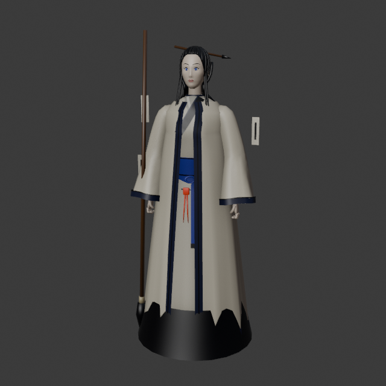
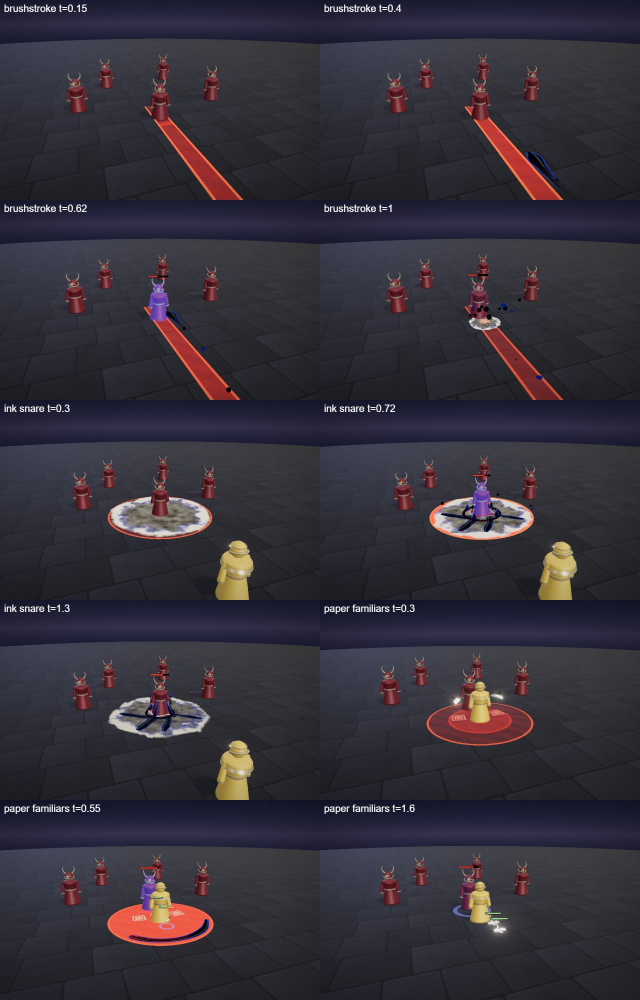
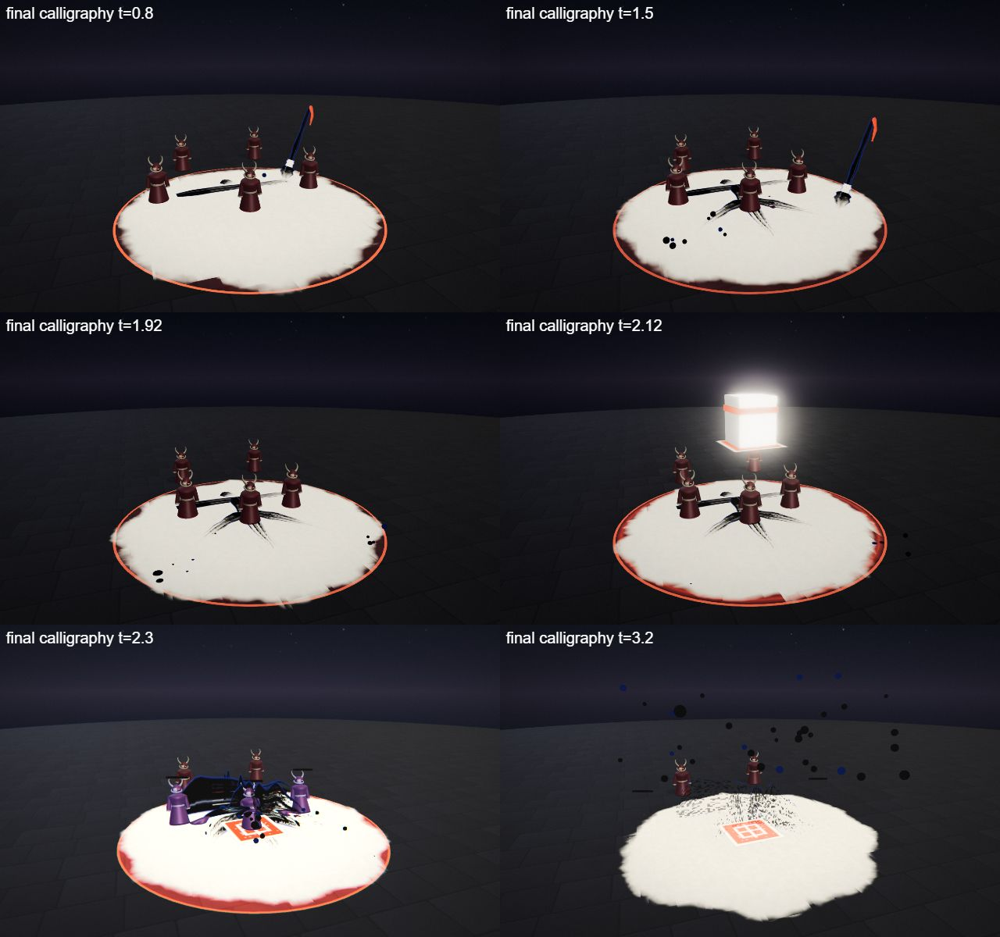
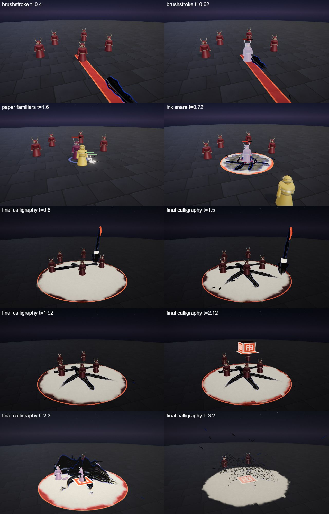

# Shiori, the Last Brush

The ink hero kit: Shiori's four spells (Q, W, E and the R ultimate), the shared parts file, the palette row and the rigged hero model. A calligrapher-mage in a rice-paper white robe whose hem is washed in ink, with an indigo sash, long black hair held by a brush-shaped hairpin, a huge calligraphy brush as tall as she is and paper talismans floating round her. She is built on the [combat mechanics](../../architecture/mechanics.md): a splitting skillshot, a root, two paper-crane summons and a blinding ultimate.

Tournament (19 opponents, 3 fights per ordered pairing, both sides): 72% at first, 58% after Brushstroke 55 → 48 (split 15 → 12) and Final Calligraphy 105 → 95 with blind 2.0 → 1.5 s.

## At a glance

| | |
|---|---|
| Hero | Shiori, the Last Brush |
| Spell category | `hero: ink` |
| Parts file | [`src/effects/parts/ink.ts`](../../../src/effects/parts/ink.ts) |
| Kit data | [`src/kits/ink.ts`](../../../src/kits/ink.ts) |
| Kit sheet | [`kit-ink.md`](../../../pipeline/designs/kit-ink.md) (read [kit-common.md](../../../pipeline/designs/kit-common.md) first) |
| Model | [`public/models/heroes/ink.glb`](../../../public/models/heroes/ink.glb) |

## Palette

The art bible row "Ink" ([ART_BIBLE.md](../../ART_BIBLE.md) section 2, energy value ladders). Every effect of the kit picks from this row.

| Core | Hot | Body | Accent | Dark | Foil |
|---|---|---|---|---|---|
| `#ffffff` | `#c8d4ff` | `#3a5ae8` | `#ff4a2a` | `#0b0a0e` | rice paper `#efe6d2` |

Core is only tiny highlights; hot is the wet highlight on a stroke; body (indigo) is the thin rim glow on the edge of every stroke, which keeps black ink readable on a darkened floor; accent (vermilion) is the seals and the star at an impact; dark is sumi ink, the strokes themselves; the rice-paper foil is the pale torn decal under any ink that lands, and the paper cranes.

## Signature shape and material rules

The wet brushstroke. Everything is calligraphy painted in the air and on the ground: tapered strokes that start fat and end in a dry-brush tail (the bristle gaps show as streaks), splatter drops flung off the stroke ends, ink that bleeds into pale rice-paper decals, and a square vermilion seal stamped where a spell lands. Strokes are black with a thin indigo glow on their edges. Not the shadow kit (flat, hard-edged cut-paper silhouettes) and not the `ink moon severance` recipe (one giant crescent slash): ink is brush texture, wet edges, paper and seals.

- Strokes: ribbons with a canvas texture of bristle streaks and a dry, broken tail; never a uniform width.
- Paper: matte pale decals with a soft torn edge that grow first, with a dark pool bleeding into them.
- Seals: a square vermilion stamp, flat on the ground, one per spell at most (two under the cranes of E).
- Splatter: few small drops on ballistic arcs that land as a flat splat and vanish.

## Mechanics

Shiori uses these pieces of [the combat mechanics](../../architecture/mechanics.md):

| Mechanic | Where |
|---|---|
| Skillshot, split | Q is `aim: 'line'`: `ctx.projectile` fires a stroke (speed 20, range 12, radius 0.45) with `split: { count: 3, spreadDeg: 40, at: 'end', range: 4 }`. It stops at the first enemy it hits; a stroke that flies its full range splits at the end into three child bolts that fan out over 40 degrees, fly 4 m and hit for 12. Hero mode draws a strip toward the cursor; the AI's bolt dodge can sidestep it |
| Root | W roots every enemy it hits for 1.0 s (`status: { kind: 'root', seconds: 1.0 }`, cap 1.5 s): they cannot walk but can cast |
| Summon, unit look | E has `summon: true` and calls `ctx.summon` for two cranes (`kind: 'ranged'`, 35 HP, 6 s, 8 damage every 1.5 s) with `look: inkCraneLook` (see [Parts file](#parts-file)) |
| Blind | R blinds every enemy it hits for 1.5 s (`status: { kind: 'blind', seconds: 1.5 }`, cap 2 s): their casts land at a random spot within 2.5 m of the aim point. It does not move self spells |
| Crowd control flag | W and R have `cc: true`, so the duel AI casts them first when the enemy is in range |
| Melee, dash, shield, heal, pull | none. `maxHp` is not set, so the default 600 HP applies |

The numbers follow the "Mechanics budget" of [kit-common.md](../../../pipeline/designs/kit-common.md).

## Spells

All four play under the normal gameplay camera (no cinematic, no letterbox). Q, W and E are normal MOBA abilities (the first damage about 0.5-0.7 s after the cast, for Q when the stroke arrives; clean by about 2 s); R is the ultimate (hit at 2.2 s, clean by 4.5 s, one dead beat). Range and cooldown come from the kit data (`src/kits/ink.ts`), hit time and length from the spell files in `src/spells/targeted/`; "hit" is the telegraph impact time and the first damage.

| Key | Label | Targeting | Range | Cooldown | Hit time | Length | What happens |
|---|---|---|---|---|---|---|---|
| Q | [brushstroke](../../../src/spells/targeted/brushstroke.ts) | skillshot line (width 0.9) | 12 | 3 s | flies from 0.2 s, about 0.6 s of flight | 1.6 s | She sweeps the big brush: a fat wet arc paints in at her side over the first 0.2 s, then the stroke is fired along the aim line as a flying stroke head (fat, sumi black, indigo rim) trailing a ribbon that dries out behind it and flings a drop now and then. On a hit it bursts in splatter on a small paper bleed with a tiny seal. A stroke that flies its full range flicks into three splatter drops and the three children fly on as short strokes. Damage 48, knock 2; children 12, knock 1. |
| W | [ink snare](../../../src/spells/targeted/inkSnare.ts) | ground (r 3.5) | 10 | 8 s | 0.7 s | 2.2 s | Ink bleeds across the zone, rice paper first and then a dark pool soaking into it (0 to 0.35 s), and four quick strokes scribble themselves across the pool (0.35 to 0.65 s). At 0.7 s the ink rises in short grasping strokes round each foot, a seal stamps the centre with a vermilion star and everyone still inside is hit and rooted. From 1.0 s the strokes dry and flake and the pool fades. Damage 35, root 1.0 s. |
| E | [paper familiars](../../../src/spells/targeted/paperFamiliars.ts) | self (r 3) | 0 (self) | 14 s | 0.5 s | 1.4 s (the cranes live on as units) | Two sheets of rice paper unfold beside her and fold themselves into cranes, a vermilion seal stamping under each (0 to 0.4 s). At 0.5 s the sheets give way to two real ink cranes that fight for 6 s, and a ring of ink splashes out to radius 3: every enemy still inside is hit and shoved. The telegraph circle ends at 0.5 s. Damage 10, knock 1; cranes 35 HP, 8 damage every 1.5 s. |
| R | [final calligraphy](../../../src/spells/targeted/finalCalligraphy.ts) | ground (r 7) | 13 | 20 s | 2.2 s | 4.5 s | The ultimate. The world darkens to sumi black and a vast sheet of rice paper (radius 7, torn edge) unrolls over the zone. A giant brush (about 5 tall, built from strokes) comes down over the point and paints one huge character across the paper in five strokes, a splatter flying off each stroke end, while the enemies drift toward the centre a little. At 1.6 s the brush lifts away; dead beat 1.85-2.0 s; a giant vermilion seal (3 wide) drops from above onto the middle of the character. At 2.2 s: two impact frames, the ink erupts upward as a wall of splatter and flakes, a vermilion star, a ground refraction ring, shake, the hit and a blind. The flakes drift down, the paper fades and the dark lifts. Damage 95, knock 3, blind 1.5 s. |

Spell sources: [`brushstroke.ts`](../../../src/spells/targeted/brushstroke.ts), [`inkSnare.ts`](../../../src/spells/targeted/inkSnare.ts), [`paperFamiliars.ts`](../../../src/spells/targeted/paperFamiliars.ts), [`finalCalligraphy.ts`](../../../src/spells/targeted/finalCalligraphy.ts). Their catalog rows are in the [effect catalog](../effects.md#hero-ink).

## Parts file

[`src/effects/parts/ink.ts`](../../../src/effects/parts/ink.ts) holds everything the four spells share. Spells import it directly (`../../effects/parts/ink`). Everything is pooled, takes world-space positions and has a `reset()`; paper and seals are flat matte colour, nothing is additive and all materials stay below the bloom threshold.

| Export | Role |
|---|---|
| `INK`, `INK_CSS` | palette constants (`foil` is the rice paper) |
| `Stroke` | a brushstroke ribbon along a path (`StrokeOptions`: `flat`, `samples`, `body`, `rim`, `bristle`, `taper`, `order`): fat where the brush came down and tapering to a dry-brush tail, sumi black with bristle streaks, a wet highlight and a thin indigo rim glow. `paint(points, width, seconds)` draws it in over time, `set(points, width, head)` places it directly (path order: fat end first), `dissolve(seconds)` breaks it into flakes that fade, `setStand(k, rise)` lifts a flat ribbon into a wall, `at(u, out)` and `tip(out)` read a point on it; `alpha` |
| `Splatter` | pooled ink drops on ballistic arcs that land as a flat splat: `fling(pos, dir, count, speed, opts)` (`FlingOptions`: `size`, `spread`, `up`, `shard`, `gravity`, `life`); a full pool skips the rest |
| `InkBleed` | a ground decal where ink spreads into rice paper (`SpreadOptions`: `ink`, `unroll`, `yaw`, `y`): `spread(center, radius, seconds, opts)` grows a pale torn disc and then bleeds a dark pool into it, `unroll` rolls the sheet out like a scroll, `fade(seconds)` |
| `Seal` | a vermilion seal flat on the ground, `cap` seals at once: `stamp(center, size)` presses it in, `fall(center, size, fromY, seconds)` drops a big one with its stone handle and presses it on landing, `fade(seconds)` |
| `PaperFold` | sheets of rice paper that unfold in the air and fold themselves into cranes: `show(i, pos, size, yaw)`, `set(i, k)` with k 0..1, `hide(i)` when the real units take over |
| `inkCraneLook` | a `MinionLook` for `SummonOptions.look`, see below |

### inkCraneLook

`inkCraneLook` is the unit look for the summoned cranes ([`MinionLook`](../../architecture/mechanics.md#the-look-pluggable-partsminionts) in `parts/minion.ts`): a folded paper crane about 0.8 m across with a rice-paper body (the figure's body material, which flashes when hit), ink-brushed wing tips, a dark beak and a vermilion dot on the crown. It hovers and bobs, flaps its wings, leans forward when it walks and dips its head when it shoots, and a short ink flick leaves the beak. Every other unit kind gets the same crane.

## Model

[`public/models/heroes/ink.glb`](../../../public/models/heroes/ink.glb): a rigged figure on the Dao rig (same bone names as `public/models/figures/hero.glb`, so `src/effects/weapons/hero.ts` can pose it). Built by `build("ink")` / `export("ink")` in [`blender/heroes/hero_figures.py`](../../../blender/heroes/hero_figures.py); hero mode shows it with procedural walk, breath and cast poses. It is wired through the `MODELS` map in [`src/heroes.ts`](../../../src/heroes.ts) (name `Shiori`).

- Look: A slim woman in a rice-paper white robe with bell sleeves, the hem washed in black ink, an indigo sash with a vermilion seal tassel, long black hair with a brush-shaped hairpin, a huge calligraphy brush with a wooden shaft and a wet black tip, and a few paper talismans floating beside her.
- Props: `ink_hem`, `brush_hairpin`, `seal_tassel`, `giant_brush`, `talismans`.
- HUD portrait (canvas-drawn in the kit data): Paper talisman strips floating round her with a vermilion mark on each, the huge brush on the right, shoulders in a rice-paper white robe with the hem washed in ink and an indigo sash, and a calm face with long black hair and a brush-shaped hairpin.

The wave 5 concept (Oblivion, Shiori and Tempo; vector source [`wave5_concept.svg`](../../heroes/wave5_concept.svg)):

The wave 5 models in hero mode (Oblivion, Shiori and Tempo):

## Files

| What | Where |
|---|---|
| Kit sheet (design) | [`pipeline/designs/kit-ink.md`](../../../pipeline/designs/kit-ink.md) |
| Shared kit rules | [`pipeline/designs/kit-common.md`](../../../pipeline/designs/kit-common.md) |
| Parts | [`src/effects/parts/ink.ts`](../../../src/effects/parts/ink.ts) |
| Spells | [`brushstroke.ts`](../../../src/spells/targeted/brushstroke.ts), [`inkSnare.ts`](../../../src/spells/targeted/inkSnare.ts), [`paperFamiliars.ts`](../../../src/spells/targeted/paperFamiliars.ts), [`finalCalligraphy.ts`](../../../src/spells/targeted/finalCalligraphy.ts) |
| Kit data | [`src/kits/ink.ts`](../../../src/kits/ink.ts) |
| Model | [`public/models/heroes/ink.glb`](../../../public/models/heroes/ink.glb) |
| Model script | [`blender/heroes/hero_figures.py`](../../../blender/heroes/hero_figures.py) |

## Review sheets

Contact sheets in `docs/spells/` (frames over time, from `pipeline/tools/contact-sheet.js`).

### Ink review (Q, W, E)

### Ink review (R)

### Ink re-check (round 2)

## See also

- [Hero roster and shared structure](README.md)
- [Combat mechanics](../../architecture/mechanics.md)
- [Oblivion (void)](void.md), [Tempo (chrono)](chrono.md), [Opaline (prism)](prism.md), [Mortis (bone)](bone.md)
- [Effect catalog](../effects.md)
- [Docs home](../../README.md)
- [Art bible](../../ART_BIBLE.md)
- [Kit shared rules](../../../pipeline/designs/kit-common.md)
