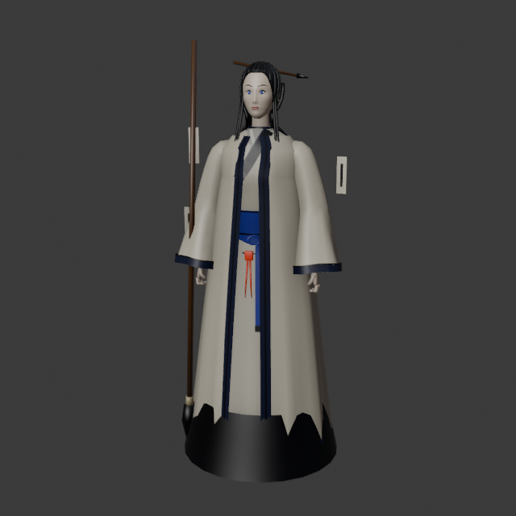

# Shiori, the Last Brush

The ink hero kit (kits v5): Shiori's four spells (Q, W, E and the R ultimate), her passive and twist, the shared parts file, the palette row and the rigged hero model. A slim woman in a rice-paper robe with a huge calligraphy brush. Her spells leave wet ink strokes on the ground, and where two strokes cross, the ink bursts.

## Role

| | |
|---|---|
| Role | Summoner (ranged attack) |
| Signature | Wet Ink |
| HP | 600 |
| Kit shapes | Q BOLT that leaves a stroke along its path · W TRAP seal, roots · E DASH that paints a stroke · R ZONE character, roots, strokes erupt |

She wins a 1v1 by deciding where her strokes cross. Her weakness is that she has little burst until strokes are down, and a hero who keeps to clean ground takes plain damage. Walk speed 4.1 m/s.

## At a glance

| | |
|---|---|
| Hero | Shiori, the Last Brush |
| Spell category | `hero: ink` |
| Parts file | [`src/effects/parts/ink.ts`](../../../src/effects/parts/ink.ts) |
| Kit data | [`src/kits/ink.ts`](../../../src/kits/ink.ts) |
| Trait data | [`src/traits/ink.ts`](../../../src/traits/ink.ts) |
| Kit sheet | [`kit-ink.md`](../../../pipeline/designs/kit-ink.md) (read [kit-common.md](../../../pipeline/designs/kit-common.md) first) |
| Model | [`public/models/heroes/ink.glb`](../../../public/models/heroes/ink.glb) |

## Palette

The art bible row "Ink" ([ART_BIBLE.md](../../ART_BIBLE.md) section 2, energy value ladders). Every effect of the kit picks from this row.

| Core | Hot | Body | Accent | Dark | Foil |
|---|---|---|---|---|---|
| `#ffffff` | `#c8d4ff` | `#3a5ae8` | `#ff4a2a` | `#0b0a0e` | rice paper `#efe6d2` |

Core is only tiny highlights; hot is the wet highlight on a stroke; body (indigo) is the thin rim glow on the edge of every stroke, which keeps black ink readable on a darkened floor; accent (vermilion) is the seals and the star at an impact; dark is sumi ink, the strokes themselves; the rice-paper foil is the pale torn decal under any ink that lands, and the paper cranes.

## Signature shape and material rules

The wet brushstroke. Everything is calligraphy painted in the air and on the ground: tapered strokes that start fat and end in a dry-brush tail (the bristle gaps show as streaks), splatter drops flung off the stroke ends, ink that bleeds into pale rice-paper decals, and a square vermilion seal stamped where a spell lands. Strokes are black with a thin indigo glow on their edges. Not the shadow kit (flat, hard-edged cut-paper silhouettes) and not the `ink moon severance` recipe (one giant crescent slash): ink is brush texture, wet edges, paper and seals.

- Strokes: ribbons with a canvas texture of bristle streaks and a dry, broken tail; never a uniform width.
- Paper: matte pale decals with a soft torn edge that grow first, with a dark pool bleeding into them.
- Seals: a square vermilion stamp, flat on the ground, one per spell at most (two under the cranes of E).
- Splatter: few small drops on ballistic arcs that land as a flat splat and vanish.

## Passive and twist

| | |
|---|---|
| Passive | **Wet Ink**: her strokes stay on the ground for 5 s. An enemy on wet ink is slowed and Stained (+20% damage from her). Where two strokes cross, a point glows and 0.65 s later bursts for 40 within 1.5 m, and takes 1 s off Ink Lash. |
| Twist | **Where do they cross?**: paint now for the damage, or paint to set up a crossing: a new stroke over an old one, or over an armed seal. |
| Resource or meter | meter `INK` (max 4): the strokes she has on the ground now |
| Walk speed | 4.1 m/s |
| Basic attack | ranged, 6 m, 10 per 1.0 s, wind-up 0.25 s, bolt speed 18, ink look |

Other trait rules (`src/traits/ink.ts`):

- Strokes and seals are ground marks drawn on both screens (`marks`): a stroke, a wet seal, an armed seal, a crossing point (it turns hot before it bursts) and the burst itself.
- Standing within 0.8 m of a stroke counts as standing on it. The slow is 0.6 s, refreshed while the enemy stays on the ink. The slow and the Stained mark run on the victim's screen (`victimTick`).
- A seal arms 0.5 s after it lands, lasts 6 s, and once armed it counts as a stroke for crossings.
- Her hits on a Stained enemy deal +20% (not a passive's zero-damage hits).

## Mechanics

Shiori uses these pieces of [the combat mechanics](../../architecture/mechanics.md):

| Mechanic | Where |
|---|---|
| Ground marks | strokes (5 s) from Q, E and R's eruptions; seals (6 s) from W |
| Slow and Stain | the passive: slow 0.6 s refreshed on ink, Stained +20% damage from her |
| Crossing burst | the passive: 40 in 1.5 m after a 0.65 s fuse, 1 s off Ink Lash |
| Root | W (1 s) and R (1 s) |
| Skillshot | Ink Lash (radius 0.35, speed 22) |
| Dash | Flowing Script, 6 m. Kit flags: E `dash` `escape` |
| Crowd control flag | R has `cc: true` |
| Summon, shield, pull | none |

## Spells

All four play under the normal gameplay camera. Range and cooldown come from the kit data (`src/kits/ink.ts`), hit time and length from the spell files in `src/spells/targeted/`; "hit" is the telegraph impact time and the first damage. The lengths are the live ones; in the VFX tool the spell effects stay longer so the strokes can be seen (Q 5.6 s, W 6.6 s, E 5.4 s).

| Key | Label | Targeting | Range | Cooldown | Hit time | Length | What happens |
|---|---|---|---|---|---|---|---|
| Q | [ink lash](../../../src/spells/targeted/inkLash.ts) | ground (BOLT skillshot, line, radius 0.35) | 9 | 4 s | released at 0.3 s, flight at 22 m/s | 1.5 s | A lash of ink flies 9 m: 66, and a stroke 0.7 m wide stays along its path for 5 s. Standing on ink slows and Stains. Where strokes cross, a point bursts for 40. |
| W | [seal of binding](../../../src/spells/targeted/sealOfBinding.ts) | ground (r 1 seal, 2 m across) | 8 | 10 s | lands 0.4 s, armed after 0.5 s | 1.4 s | A paper seal stamps down on the spot and arms 0.5 s later, for 6 s. An enemy who steps in is rooted 1 s and Stained. Once armed it counts as a stroke for crossings. No damage. |
| E | [flowing script](../../../src/spells/targeted/flowingScript.ts) | ground (dash) | 6 | 11 s | the glide takes 0.25 s | 1.0 s | She glides 6 m and paints a stroke along her path. No damage. Do not follow her down the line. |
| R | [the last character](../../../src/spells/targeted/theLastCharacter.ts) | ground (r 2, 4 m across) | 9 | 22 s | 1.0 s (the character is written) | 2.4 s | She writes one great character (4 m wide) at the spot in 1.0 s: 40 and rooted 1 s inside it. Every stroke of hers within 0.8 m of the enemy erupts for 50 (three at most) and vanishes. |

Spell sources: [`inkLash.ts`](../../../src/spells/targeted/inkLash.ts), [`sealOfBinding.ts`](../../../src/spells/targeted/sealOfBinding.ts), [`flowingScript.ts`](../../../src/spells/targeted/flowingScript.ts), [`theLastCharacter.ts`](../../../src/spells/targeted/theLastCharacter.ts). Their catalog rows are in the [effect catalog](../effects.md#hero-ink).

## Parts file

[`src/effects/parts/ink.ts`](../../../src/effects/parts/ink.ts) holds everything the four spells share. Spells import it directly (`../../effects/parts/ink`). Everything is pooled, takes world-space positions and has a `reset()`; paper and seals are flat matte colour, nothing is additive and all materials stay below the bloom threshold.

| Export | Role |
|---|---|
| `INK`, `INK_CSS` | palette constants (`foil` is the rice paper) |
| `Stroke` | a brushstroke ribbon along a path (`StrokeOptions`: `flat`, `samples`, `body`, `rim`, `bristle`, `taper`, `order`): fat where the brush came down and tapering to a dry-brush tail, sumi black with bristle streaks, a wet highlight and a thin indigo rim glow. `paint(points, width, seconds)` draws it in over time, `set(points, width, head)` places it directly (path order: fat end first), `dissolve(seconds)` breaks it into flakes that fade, `setStand(k, rise)` lifts a flat ribbon into a wall, `at(u, out)` and `tip(out)` read a point on it; `alpha` |
| `Splatter` | pooled ink drops on ballistic arcs that land as a flat splat: `fling(pos, dir, count, speed, opts)` (`FlingOptions`: `size`, `spread`, `up`, `shard`, `gravity`, `life`); a full pool skips the rest |
| `InkBleed` | a ground decal where ink spreads into rice paper (`SpreadOptions`: `ink`, `unroll`, `yaw`, `y`): `spread(center, radius, seconds, opts)` grows a pale torn disc and then bleeds a dark pool into it, `unroll` rolls the sheet out like a scroll, `fade(seconds)` |
| `Seal` | a vermilion seal flat on the ground, `cap` seals at once: `stamp(center, size)` presses it in, `fall(center, size, fromY, seconds)` drops a big one with its stone handle and presses it on landing, `fade(seconds)` |
| `PaperFold` | sheets of rice paper that unfold in the air and fold themselves into cranes: `show(i, pos, size, yaw)`, `set(i, k)` with k 0..1, `hide(i)` when the real units take over |
| `inkCraneLook` | a `MinionLook` for `SummonOptions.look`, see below |

### inkCraneLook

`inkCraneLook` is the unit look for the summoned cranes ([`MinionLook`](../../architecture/mechanics.md#the-look-pluggable-partsminionts) in `parts/minion.ts`): a folded paper crane about 0.8 m across with a rice-paper body (the figure's body material, which flashes when hit), ink-brushed wing tips, a dark beak and a vermilion dot on the crown. It hovers and bobs, flaps its wings, leans forward when it walks and dips its head when it shoots, and a short ink flick leaves the beak. Every other unit kind gets the same crane.

## Model

[`public/models/heroes/ink.glb`](../../../public/models/heroes/ink.glb): a rigged figure on the Dao rig (same bone names as `public/models/figures/hero.glb`, so `src/effects/weapons/hero.ts` can pose it). Built by `build("ink")` / `export("ink")` in [`blender/heroes/hero_figures.py`](../../../blender/heroes/hero_figures.py). Hero mode shows it with procedural walk, breath and cast poses. It is wired through the `MODELS` map in [`src/heroes.ts`](../../../src/heroes.ts). Hit size (`HERO_BODIES`): radius 0.43 m, height 2.30 m.

- Look: a slim woman in a rice-paper white robe with bell sleeves, the hem washed in black ink, an indigo sash with a vermilion seal tassel, long black hair with a brush-shaped hairpin, a huge calligraphy brush with a wooden shaft and a wet black tip, and a few paper talismans floating beside her.
- Props: `ink_hem`, `brush_hairpin`, `seal_tassel`, `giant_brush`, `talismans`.
- HUD portrait (canvas-drawn in the kit data): paper talisman strips floating round her with a vermilion mark on each, the huge brush on the right, and shoulders in a rice-paper white robe with the hem washed in ink and an indigo sash.

## Files

| What | Where |
|---|---|
| Kit sheet (design) | [`pipeline/designs/kit-ink.md`](../../../pipeline/designs/kit-ink.md) |
| Shared kit rules | [`pipeline/designs/kit-common.md`](../../../pipeline/designs/kit-common.md) |
| Kits v5 design | [`pipeline/designs/kits-v5.md`](../../../pipeline/designs/kits-v5.md) |
| Parts | [`src/effects/parts/ink.ts`](../../../src/effects/parts/ink.ts) |
| Spells | [`inkLash.ts`](../../../src/spells/targeted/inkLash.ts), [`sealOfBinding.ts`](../../../src/spells/targeted/sealOfBinding.ts), [`flowingScript.ts`](../../../src/spells/targeted/flowingScript.ts), [`theLastCharacter.ts`](../../../src/spells/targeted/theLastCharacter.ts) |
| Kit data | [`src/kits/ink.ts`](../../../src/kits/ink.ts) |
| Trait | [`src/traits/ink.ts`](../../../src/traits/ink.ts) |
| Model | [`public/models/heroes/ink.glb`](../../../public/models/heroes/ink.glb) |
| Model script | [`blender/heroes/hero_figures.py`](../../../blender/heroes/hero_figures.py) |

## See also

- [Hero roster and shared structure](README.md)
- [Combat mechanics](../../architecture/mechanics.md)
- [Oblivion (void)](void.md), [Tempo (chrono)](chrono.md), [Mortis (bone)](bone.md)
- [Effect catalog](../effects.md)
- [Docs home](../../README.md)
- [Art bible](../../ART_BIBLE.md)
- [Kit shared rules](../../../pipeline/designs/kit-common.md)
