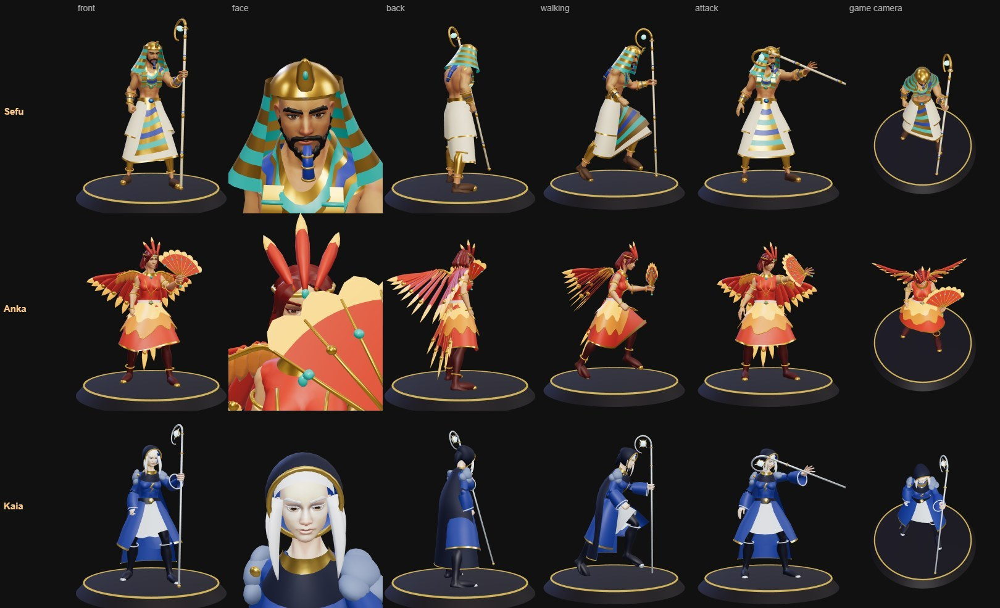

# Anka, the Firebird

Hero 40, and the first made by [the rules for creating a hero](../../pipeline/new-hero.md): her four spells (Q, W, E and the R ultimate), the passive second life, the shared parts file, the palette row and the model. A fire dancer in an ember-red bodice and a feathered skirt, with wings of flame feathers swept back like a cloak and an open feather fan in her left hand. She is the first true fire hero, and the first hero with a second life: one the enemy can take away.

## Role

| | |
|---|---|
| Role | Mage (ranged), fragile |
| Signature | Ashborn |
| HP | 460 (the lowest of the mages; only Mortis, a summoner behind his skeletons, has less: 450) |
| Kit shapes | Q LINE bolt that leaves an ember · W SELF, every ember flares · E DASH to an ember · R LINE dash across the arena, leaves an ember |

Everything she does lays embers on the floor or spends them. An ember is three things at once: a blast (W), a place to fly to (E) and her second life (the passive). She has three at most, and the enemy can stamp them out by standing on them. The question she asks is "do you chase her, or stamp her embers first?". Her weakness: without an ember she is the most fragile mage in the game, and right after Fan the Flames she has nothing.

## At a glance

| | |
|---|---|
| Hero | Anka, the Firebird |
| Spell category | `hero: phoenix` |
| Parts file | [`src/effects/parts/phoenix.ts`](../../../src/effects/parts/phoenix.ts) |
| Kit data | [`src/kits/phoenix.ts`](../../../src/kits/phoenix.ts) |
| Trait | [`src/traits/phoenix.ts`](../../../src/traits/phoenix.ts) |
| Kit sheet | [`kit-phoenix.md`](../../../pipeline/designs/kit-phoenix.md) |
| Model | [`public/models/heroes/phoenix_v4.glb`](../../../public/models/heroes/phoenix_v4.glb) |
| Pictures | [her page](../../heroes/anka.html), [`docs/spells/anka/`](../../spells/anka/), the gate 5 pictures `docs/heroes/anka-gate5-*.jpg` |

## Palette

Ember red and gold with flame, pale ash as the foil, and one small accent: the teal eye of the feather. No black and no metal but gold (Brannoc has the molten orange under a black crust). Constants `PHOENIX` and `PHOENIX_CSS` in the parts file; the kit accent is `#ff7b3a`, the foil `#eadcc4`.

| Core | Hot | Body (accent) | Red | Red light | Deep | Gold | Teal (the eye) | Ash (foil) | Ash shade | Dark |
|---|---|---|---|---|---|---|---|---|---|---|
| `#fff6d8` | `#ffc24a` | `#ff7b3a` | `#c23a22` | `#de5634` | `#4c1410` | `#e0a935` | `#2fb8a8` | `#eadcc4` | `#b8a78c` | `#1a0806` |

## Signature shape and material rules

The long feather with an eye near its tip: a gold shaft, an ember-red vane, a small teal eye. Every spell is made of them.

- An ember is a feather standing in the floor in a small ring; the nest (the ember of her latest cast) wears a crown of flame. Both players see both.
- While she is ash, an egg glows at the nest inside the ring of the flare to come (2.2 m), and a small heap of ash lies where she fell.
- Embers, the nest, the egg and the puffs of a stamped or burnt ember are drawn by the trait's `marks`, not by the spells.
- The firebird of her ultimate is a real bird of feathers that crosses the lane; its hit follows its beak as it is drawn.

## Passive and twist

| | |
|---|---|
| Passive | Ashborn. Her feathers stay on the floor as embers: 3 at most, 12 s each. The newest is her nest. Once a round, a hit that would fell her while a nest burns turns her to ash instead: for 1.2 s she is not drawn, cannot act and nothing reaches her, and she slides unseen to the nest; then she rises there with 25% HP (115) in a flare of 2.2 m (40 and a push), and every ember goes out. |
| Stamping | An enemy who stands within 1 m of an ember for 1 s in all stamps it out. A new ember is too hot to stamp in its first second. The egg cannot be stamped. |
| Twist | Three things at once. An ember is a blast, a place to fly to and her life: spend it on one and the other two are gone. A quill that hits leaves her nest at the enemy's feet. |
| Meter | EMBERS, max 3 (a number on her badge too). |
| Speed | 4.2 m/s. |
| Basic attack | Ranged, range 6.5, damage 12, every 1.0 s, wind-up 0.25 s, speed 20, look `dart`. |
| Hooks | `marks` and `markLook` (embers, nest, egg, ashes, puffs), `taken` (the second life), `tick` (her HP climbs as ash, the rise), `victimTick` (stamping, the flare's hit), `ownChanged` and `peerNote` (the other screen), `figureHidden`, `canCast`, `aiHold`, `enemyGoal`, `badge`. |

What does not start her second life, because it passes no trait:

- The arena's own damage: its event, the closing floor, Last stand. It kills her for good, in the egg too.
- In the Raid, a blow that nothing holds (Ash's Charge). A boss's ordinary hit does start it.

## Where each rule runs (two screens)

- The embers are a list kept by the trait for her figure, on both screens. The spells add to it and spend from it at the moment they land (`layEmber`, `spendEmber`, `burnOut`).
- **Which ember is which.** A quill lands at a different moment on the two screens (on hers it flies along the aim, on the enemy's it is a real bolt). So every cast of hers takes a number (`castNo`: an effect's `cast` runs once a cast on each screen, in the same order), an ember carries the number of the cast that laid it, and the embers are kept in that order. The nest is the ember of her **latest cast**, whichever landed first. Fan the Flames burns the embers of every earlier cast, also one that lands after the flare, and leaves those of later casts; her rising takes the embers of every cast before it in the same way. Before this (found at gate 5) a quill thrown during Firebird's wind-up or just after the fan left the two screens disagreeing on the nest for up to 12 s.
- Stamping is the enemy's move, so it is decided on the enemy's screen (`victimTick`) and told to her client by the ember's id.
- The second life is decided on her own client, in `taken`: the hit is swallowed whole and she pays down to 1 HP herself. She is kept safe as ash by `taken` swallowing every later hit, not by the `sealed` status (the engine refuses it in the half second after a stun, when most kills happen). The other screen learns it with `show('ash', ...)` and shows the egg.
- A hit's damage is taken rounded (55.6 costs 56), so the second life starts when either the plain or the rounded number would fell her.
- **Where a quill's ember lies.** In a network duel a bolt flies on both screens, each against the enemy where that screen draws it, and only the enemy's own screen decides the hit: a quill that hits on one screen flies on to its full reach on the other. So the screen that decides tells her client how far along its aim the quill really got (`noteOwner('lay', ...)` from `victimTick`, in quarter metres), and her client moves that ember there (`peerNote`). Before this (found at gate 5 with an enemy who sidesteps) a dodged quill left her nest 2 to 7 m apart on the two screens, and the egg of her rising was shown where she did not rise. On one screen (a CPU duel, the Raid) the message changes nothing: no ember moved in 16 duels and 8 raid fights.

## Spells

All four play under the normal gameplay camera. Range and cooldown come from the kit data (`src/kits/phoenix.ts`), the numbers from `src/traits/phoenix.ts`, hit time and length from the spell files.

| Key | Label | Targeting | Range | Cooldown | Hit time | Length | What happens |
|---|---|---|---|---|---|---|---|
| Q | [ember quill](../../../src/spells/targeted/emberQuill.ts) | ground LINE (bolt, radius 0.3) | 10 | 3.5 s | 0.3 s (launch), 22 m/s | 1.3 s | She flicks the fan and a feather flies: 54. Where it ends, in the enemy or in the floor, it stays as an ember and becomes her nest. Answer: sidestep (it reaches 6 m at 0.57 s), or stamp the nest it left at your feet. |
| W | [fan the flames](../../../src/spells/targeted/fanTheFlames.ts) | self (a ring of 2.2 m at every ember) | 0 (self) | 9 s | 0.8 s | 1.6 s | One sweep of the fan: every ember she has at the cast flares after 0.8 s: 54, once, however many rings you stand in. The embers burn out. Answer: step out (0.8 s from the very middle). After it she has no ember and no second life. |
| E | [ember flight](../../../src/spells/targeted/emberFlight.ts) | ground (her ember nearest the aim, burst r 1.8) | 12 | 10 s | 0.7 s (0.25 s to go, 0.45 s in the air) | 1.4 s | She turns to feathers and flies to an ember, landing in a burst: 40. The ember is spent. With no ember it cannot be cast. Answer: you could see the ember before; stamp the one near you and she cannot come. |
| R | [firebird](../../../src/spells/targeted/firebird.ts) | ground LINE (a lane 12 m long, 3 m wide) | 12 | 24 s | 1.0 s wind-up, then 0.5 s across | 2.4 s | She spreads wings of fire while the lane shows, then crosses it as a great firebird: 120 to everyone in the lane. She lands at the far end; an ember is left where she took off. Answer: leave the lane (0.63 s), then hit her or stamp the ember she left before she flies back. |

Spell sources: [`emberQuill.ts`](../../../src/spells/targeted/emberQuill.ts), [`fanTheFlames.ts`](../../../src/spells/targeted/fanTheFlames.ts), [`emberFlight.ts`](../../../src/spells/targeted/emberFlight.ts), [`firebird.ts`](../../../src/spells/targeted/firebird.ts). Their catalog rows are in the [effect catalog](../effects.md#hero-phoenix).

The kit sheet's first table still has the numbers before balance (480 HP, 58, 60, a rise at 30%, stamping in 0.6 s). The numbers above are the game's.

## What the computer does

- **As Anka:** quills whenever in reach. Fan the Flames only with the enemy inside a ring, and not with her last ember while she is under 40% HP and still has her second life. Ember Flight to get away (the enemy within 3.5 m, an ember more than 6 m from it) or to strike (an ember within the burst's reach of the enemy, and she above half HP). Firebird within 10 m.
- **Against Anka:** it walks to the nearest ember within 3 m and stamps it; when she is under 35% HP and still has her second life, it goes for the nest within 6 m.

## Measured (gate 5, 2026-11-11)

| Check | Result |
|---|---|
| Fight simulator, six benchmark foes, 192 fights | **52%** (plus or minus 7): Isolde 19 of 32, Sirix 19, Cantor 19, Brannoc 17, Oblivion 15, Kaia 11. [The page](../../balance/anka-gate5-2026-11-11.html). Five runs that day: 56, 52, 56, 54, 52. Before the balance pass of the same day she was 48 (Sirix 6 of 32) |
| The same with the arenas' events and closing stages, 96 fights | 55% (plus or minus 10; three runs that day: 46, 48, 55). [The page](../../balance/anka-gate5-events-2026-11-11.html) |
| Where her damage comes from (a second) | Q 10.3, attack 6.5, R 4.2, W 3.8, E 1.3, the flare 0.4: every spell in use |
| Errors, fights without a winner | none |
| Raid, the Sun Warden, 90 fights at the balance level (three runs of 30, the last on the finished code) | 72 clears (Vitriol 78, Kaia 76); the last run 25 (28, 25); 140 s a fight (125, 129); 27 damage a second (31, 29) |
| Raid, Ash and Ember, 90 fights | 33 clears (Vitriol 54, Kaia 48); the last run 10 (13, 20). 29 of her 57 falls are Ash's Charge, which no second life holds (Vitriol 22 of 36, Kaia 6 of 42): probably her flights take her out from behind the pillars when the computer plays her; not looked into |
| Her second life against a boss | An ordinary hit: she rises at the nest with 115 HP. A Charge: she falls for good, nest or no nest, and in the egg. She has an ember about 70% of a fight; the boss stamps about one ember in twelve (123 of 1,509 in 48 fights). With Stubborn or Phoenix Heart her own life goes first and the upgrade is kept for the next blow. With Blood Pact (nothing heals) she rises with 1 HP |
| The game page, 1280x800 and a phone (390x844, touch) | Picked in the grid, fought, rematch, as the CPU's hero: no errors. She rose with 115 HP on both sizes |
| Online, two screens (bots, six matches on the finished code, four of them with a Kaia who keeps her distance and steps from side to side) | No errors. The same embers on both screens in 99% of 2,500 moments; the nest more than a metre apart in 7 of 1,750 moments (the tenth of a second before the true end arrives); 11 rises, each seen on both screens at the same spot. Before the fixes: the same embers only 45% of the time in the first match, and with a sidestepping Kaia the nest more than a metre apart a tenth of the time, by up to 7 m |

## Parts file

[`src/effects/parts/phoenix.ts`](../../../src/effects/parts/phoenix.ts) holds everything the spells and the trait share.

| Export | Role |
|---|---|
| `PHOENIX`, `PHOENIX_CSS` | palette constants |
| `disc`, `ring`, `softDisc` | floor shapes |
| `featherGeometry`, `FeatherKind`, `FeatherFlock` | the feather (eye, flame or ash) and a pooled flock of them |
| `FireBird`, `FireBirdPose`, `BIRD_HEAD` | the great bird of the ultimate |
| `quill` | one standing feather |
| `emberLook`, `nestLook`, `eggLook`, `ashesLook`, `emberPuffLook` | what the trait's `marks` draw: an ember, the nest with its crown, the egg, her ashes, the puff of a stamped or burnt ember |

## Model

[`public/models/heroes/phoenix_v4.glb`](../../../public/models/heroes/phoenix_v4.glb) (600 KB): built in the fourth style by `build()` in [`blender/heroes/real/phoenix.py`](../../../blender/heroes/real/phoenix.py) through [`real_build.py`](../../../blender/heroes/real_build.py). It is wired through the `MODELS` map in [`src/heroes.ts`](../../../src/heroes.ts); her hit size in `HERO_BODIES` is radius 0.4, height 2.4. She was born in this style: there is no older model, so `?figs=old` shows her as she is (looked at: a duel there runs without errors).

- Look: a slender dancer in an ember-red bodice and a feathered skirt in two scalloped layers, bare arms with gold bands, long dark-red hair under a gold circlet with a three-feather crest, two wings of flame feathers swept down and back from the shoulder blades, a train of five tail feathers with eyes.
- Her fan is in the LEFT hand, held upright by the pack's torch arm (`REAL_STYLE` Anka: `hold: 'torch'` in [`src/motion/real.ts`](../../../src/motion/real.ts)), so her attack flicks it.
- HUD portrait and icons (canvas-drawn in the kit data, from the agreed model): [the kit art](../../heroes/anka_kit_art.jpg).

## Known and open

- When she turns to ash her HP climbs in small steps, so a row of small green "+2" numbers runs from where she fell to the nest.
- Her rising flare has no burst of its own (the egg's ring and the burn puff only).
- The Raid for two was not played with her.
- On the Play screen at laptop height (1280x800) the card has room for about six lines of a passive's text: hers runs past its box, and so does Vitriol's. A matter of the card, not of her.

## Files

| What | Where |
|---|---|
| Kit sheet (design, all six gates) | [`pipeline/designs/kit-phoenix.md`](../../../pipeline/designs/kit-phoenix.md) |
| Parts | [`src/effects/parts/phoenix.ts`](../../../src/effects/parts/phoenix.ts) |
| Spells | [`emberQuill.ts`](../../../src/spells/targeted/emberQuill.ts), [`fanTheFlames.ts`](../../../src/spells/targeted/fanTheFlames.ts), [`emberFlight.ts`](../../../src/spells/targeted/emberFlight.ts), [`firebird.ts`](../../../src/spells/targeted/firebird.ts) |
| Kit data | [`src/kits/phoenix.ts`](../../../src/kits/phoenix.ts) |
| Trait | [`src/traits/phoenix.ts`](../../../src/traits/phoenix.ts) |
| Model | [`public/models/heroes/phoenix_v4.glb`](../../../public/models/heroes/phoenix_v4.glb) |
| Model script | [`blender/heroes/real/phoenix.py`](../../../blender/heroes/real/phoenix.py) |
| Review pictures | [`pipeline/tools/anka-shots.js`](../../../pipeline/tools/anka-shots.js) with `pipeline/tools/page-shots.py` |
| Gate 5 checks | [`pipeline/tools/hero-gate5/`](../../../pipeline/tools/hero-gate5/README.md): the game-page duel, two screens online, the raid cases |

## See also

- [Hero roster and shared structure](README.md)
- [Rules for creating a hero](../../pipeline/new-hero.md)
- [Fenna (grove)](grove.md) and [Kaia (storm)](storm.md): things on the floor that can be trampled or touched; [Sir Whiskers (cat)](cat.md): lives
- [Effect catalog](../effects.md)
- [Docs home](../../README.md)
- [Art bible](../../ART_BIBLE.md)
