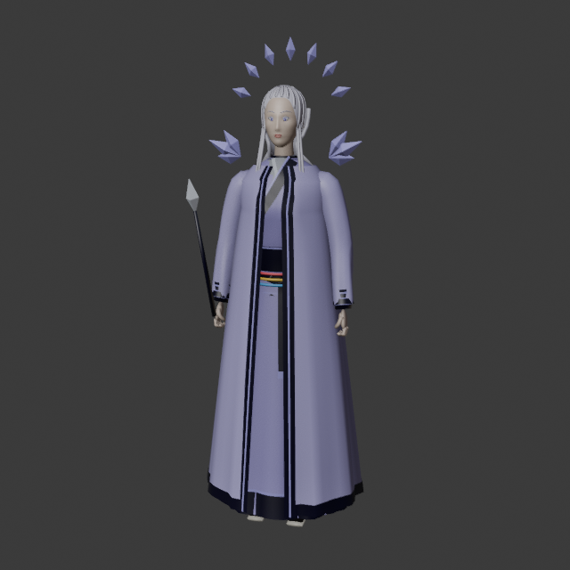

# Opaline, the Lightbreaker

The prism hero kit (kits v5): Opaline's four spells (Q, W, E and the R ultimate), her passive, the shared parts file, the palette row and the rigged hero model. A slim woman in a pale lavender robe with a ring of floating prisms behind her head. Her bolts bounce off walls, pillars and her own crystals.

## Role

| | |
|---|---|
| Role | Marksman (ranged attack) |
| Signature | Prismatic |
| HP | 600 |
| Kit shapes | Q BOLT that banks off up to two surfaces · W ZONE crystal wall (bolts bounce off it) · E NOVA blind + push · R TGT ring of six shards fired inward |

She wins a 1v1 by banking bolts off cover and her own crystal. Her weakness is that open ground gives her nothing to bounce from, and she has no dash. Any hero can draw her into the open or rush her after Flare is spent. Walk speed 4.2 m/s.

## At a glance

| | |
|---|---|
| Hero | Opaline, the Lightbreaker |
| Spell category | `hero: prism` |
| Parts file | [`src/effects/parts/prism.ts`](../../../src/effects/parts/prism.ts) |
| Kit data | [`src/kits/prism.ts`](../../../src/kits/prism.ts) |
| Trait data | [`src/traits/prism.ts`](../../../src/traits/prism.ts) |
| Kit sheet | [`kit-prism.md`](../../../pipeline/designs/kit-prism.md) (read [kit-common.md](../../../pipeline/designs/kit-common.md) first) |
| Model | [`public/models/heroes/prism.glb`](../../../public/models/heroes/prism.glb) |

## Palette

The art bible row "Prism" ([ART_BIBLE.md](../../ART_BIBLE.md) section 2, energy value ladders). Every effect of the kit picks from this row.

| Core | Hot | Body | Accent | Dark | Foil |
|---|---|---|---|---|---|
| `#ffffff` | `#f2eeff` | `#b8b0ff` | spectrum: red `#ff5a6a`, gold `#ffd24a`, green `#5aff9a`, blue `#5ab8ff` | `#14102a` | clear glass `#f0f4ff` |

Core is the white heart of every beam; hot is the lit top face of a crystal; body is the lavender glass; the accent is the four spectrum bands (`SPECTRUM`, always in the order red, gold, green, blue, as thin parallel bands either side of a white core, never a fat rainbow); dark is the outline of every crystal and the violet-black sky of the ultimate; the glass foil is the pale facets and glitter. The kit icons also use a darker lavender `#7f74d6` for the shaded facets.

## Signature shape and material rules

The refracting crystal. Light enters a faceted clear crystal white and leaves as thin, parallel bands of red, gold, green and blue. Every spell is light caught and split: a bolt that shatters into three beams, a ring of crystals feeding one prism, mirrors that throw beams outward, a giant prism that splits a beam into seven lances. Not the astral kit's constellations (Lyra) and not the dawn kit's gold panels (Auriel): cold clear glass with a dark edge line, and spectrum only as thin bands.

- Crystals: double-terminated hexagonal shards, flat-shaded in bands with a lighter top face and a dark outline hull; never smooth.
- Beams: a white core with thin spectrum bands either side (use a width of 0.4 or more so the bands read); a single tint gives one coloured band each side.
- Glitter: a few small flat diamond facets that flash once and fall, each with a dark edge so it reads on a bright floor.

## Passive and twist

| | |
|---|---|
| Passive | **Prismatic**: her bolts bounce off walls, pillars and crystals. Each bounce adds 25% damage and 2 m of range, and a hit after bouncing takes 1 s per bounce off Ricochet Light. Her aim line shows the first bounce. |
| Twist | none (the trait has no `twist` entry) |
| Resource or meter | none |
| Walk speed | 4.2 m/s |
| Basic attack | ranged, 8.5 m, 15 per 1.4 s, wind-up 0.32 s, bolt speed 22, prism look |

Other trait rules (`src/traits/prism.ts`):

- The bolt reflects through `ProjectileOptions.reflect`, set by her spells. The aim line (`bank: true` on Q in the kit data) draws the first bounce; the telegraph draws every leg.
- The cooldown refund is decided where the hit is decided, which online is the victim's screen. The trait reads the number of bounces from the bank bonus in the hit's damage (64, 80 or 96) and tells her own client (`noteOwner`), which takes that many seconds off Q.

## Mechanics

Opaline uses these pieces of [the combat mechanics](../../architecture/mechanics.md):

| Mechanic | Where |
|---|---|
| Reflection (bank) | Q (up to 2 bounces) and R's shards (one bounce each): +25% damage and +2 m range per bounce |
| Cooldown refund | Q: 1 s per bounce after a hit |
| Obstacle | Crystal Pillar: radius 0.7, 80 HP, 6 s; blocks walking, sight and bolts for both heroes |
| Blind | Blinding Flare, 1.5 s. Kit flag: E `cc` |
| Push | Blinding Flare, 2 m |
| Skillshot | Ricochet Light (radius 0.3, speed 24), Shatterlight shards (radius 0.3, speed 14) |
| Dash, summon, shield, heal | none |

## Spells

All four play under the normal gameplay camera. Range and cooldown come from the kit data (`src/kits/prism.ts`), hit time and length from the spell files in `src/spells/targeted/`; "hit" is the telegraph impact time and the first damage.

| Key | Label | Targeting | Range | Cooldown | Hit time | Length | What happens |
|---|---|---|---|---|---|---|---|
| Q | [ricochet light](../../../src/spells/targeted/ricochetLight.ts) | ground (BOLT skillshot, line, radius 0.3), banks | 12 | 3 s | released at 0.3 s, flight at 24 m/s | up to 3.5 s | A bolt of light that bounces off up to two walls, pillars or crystals: 64 damage, +25% for each bounce, knock 1.5. A hit after bouncing takes 1 s per bounce off this spell. |
| W | [crystal pillar](../../../src/spells/targeted/crystalPillar.ts) | ground (r 0.95 foot) | 8 (at least 1.5 from her) | 12 s | rises at 0.5 s | 7.5 s | A crystal (2.9 m tall) rises at the spot and stands 6 s, or until 80 damage breaks it. It blocks walking, sight and bolts for both heroes (radius 0.7), and her bolts bounce off it. It cracks at 5.6 s and shatters at 6.5 s. |
| E | [blinding flare](../../../src/spells/targeted/blindingFlare.ts) | self (r 3) | 0 (self) | 10 s | 0.25 s | 1.5 s | Six panes of light ring her and flash. Enemies within 3 m are blinded for 1.5 s and pushed 2 m away. No damage. |
| R | [shatterlight](../../../src/spells/targeted/shatterlight.ts) | enemy (click, in sight) | 10 | 22 s | 1.2 s (the shards fire) | up to 3.2 s | Six shards rise in a ring (radius 2.5 m) round the spot the enemy stands on. After 1.2 s each fires inward through the centre at 14 m/s: 36 damage each, and each bounces once off a wall. Step out of the ring to dodge. |

Spell sources: [`ricochetLight.ts`](../../../src/spells/targeted/ricochetLight.ts), [`crystalPillar.ts`](../../../src/spells/targeted/crystalPillar.ts), [`blindingFlare.ts`](../../../src/spells/targeted/blindingFlare.ts), [`shatterlight.ts`](../../../src/spells/targeted/shatterlight.ts). Their catalog rows are in the [effect catalog](../effects.md#hero-prism).

## Parts file

[`src/effects/parts/prism.ts`](../../../src/effects/parts/prism.ts) holds everything the four spells share. Spells import it directly (`../../effects/parts/prism`). Everything is pooled, takes world-space positions and has a `reset()`; the materials are toon shaders kept below the bloom threshold.

| Export | Role |
|---|---|
| `PRISM`, `PRISM_CSS`, `SPECTRUM` | palette constants (`foil` is the clear glass) and the four spectrum colours in beam order |
| `Crystal` | pooled hexagonal crystal shards (`CrystalOptions`): `place(pos, dir, length, width, opts)` returns an index; `move`, `setSize`, `setScale`, `setRoll`, `setSpin`, `hide(i)`; `shatter(speed, life, origin)` turns every live crystal into loose tumbling shards; `frozen` holds time for a dead beat |
| `SpectrumBeam` | camera-facing beams with a white core and thin spectrum bands: `set(a, b, width, opacity, tint?, tailTaper?, slot?)`, `split(fanDeg, count, length?, width?, opacity?, tints?)` fans slots 1..count out of the end of slot 0, `fan(origin, dir, axis, ...)` is the general form, `hide(slot)` |
| `Glitter` | small flat diamond facets that flash once and fall: `burst(pos, count, speed, size)` |
| `PrismRing` | a ring of small floating prisms: `set(center, radius, count, spin, size)` each frame, `scale(k)`, `shatter(speed, life)`, `hide()` |

## Model

[`public/models/heroes/prism.glb`](../../../public/models/heroes/prism.glb): a rigged figure on the Dao rig (same bone names as `public/models/figures/hero.glb`, so `src/effects/weapons/hero.ts` can pose it). Built by `build("prism")` / `export("prism")` in [`blender/heroes/hero_figures.py`](../../../blender/heroes/hero_figures.py). Hero mode shows it with procedural walk, breath and cast poses. It is wired through the `MODELS` map in [`src/heroes.ts`](../../../src/heroes.ts). Hit size (`HERO_BODIES`): radius 0.40 m, height 2.46 m.

- Look: a slim woman in a long pale lavender robe over white, with narrow sleeves, loose platinum hair, crystal epaulettes, a ring of small floating prisms behind her head, a crystal-tipped wand in her right hand and thin spectral bands on a dark sash.
- Props: `prism_ring`, `crystal_epaulettes`, `crystal_wand`, `spectral_sash`.
- HUD portrait (canvas-drawn in the kit data): a floating ring of small prisms behind her head with light bending through one of them, shoulders in a pale lavender robe with white trim and crystal epaulettes, and a crystal brooch at the throat.

## Files

| What | Where |
|---|---|
| Kit sheet (design) | [`pipeline/designs/kit-prism.md`](../../../pipeline/designs/kit-prism.md) |
| Shared kit rules | [`pipeline/designs/kit-common.md`](../../../pipeline/designs/kit-common.md) |
| Kits v5 design | [`pipeline/designs/kits-v5.md`](../../../pipeline/designs/kits-v5.md) |
| Parts | [`src/effects/parts/prism.ts`](../../../src/effects/parts/prism.ts) |
| Spells | [`ricochetLight.ts`](../../../src/spells/targeted/ricochetLight.ts), [`crystalPillar.ts`](../../../src/spells/targeted/crystalPillar.ts), [`blindingFlare.ts`](../../../src/spells/targeted/blindingFlare.ts), [`shatterlight.ts`](../../../src/spells/targeted/shatterlight.ts) |
| Kit data | [`src/kits/prism.ts`](../../../src/kits/prism.ts) |
| Trait | [`src/traits/prism.ts`](../../../src/traits/prism.ts) |
| Model | [`public/models/heroes/prism.glb`](../../../public/models/heroes/prism.glb) |
| Model script | [`blender/heroes/hero_figures.py`](../../../blender/heroes/hero_figures.py) |

## See also

- [Hero roster and shared structure](README.md)
- [Combat mechanics](../../architecture/mechanics.md)
- [Auriel (dawn)](dawn.md), [Tempo (chrono)](chrono.md)
- [Effect catalog](../effects.md)
- [Docs home](../../README.md)
- [Art bible](../../ART_BIBLE.md)
- [Kit shared rules](../../../pipeline/designs/kit-common.md)
