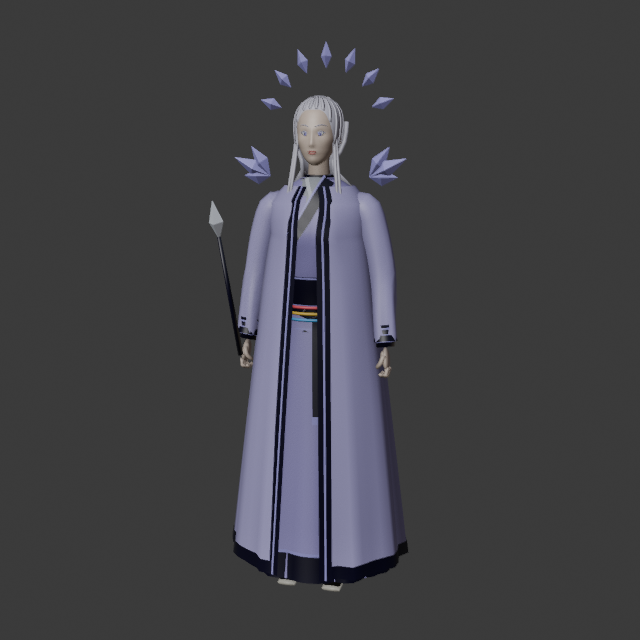
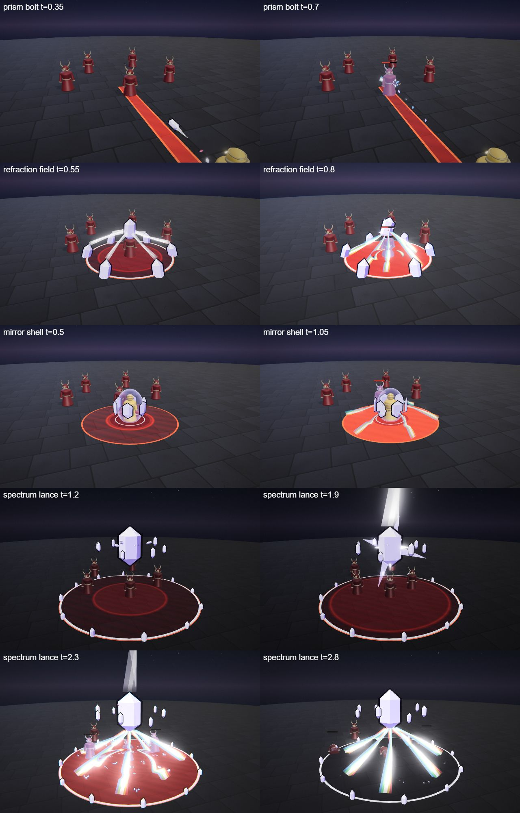
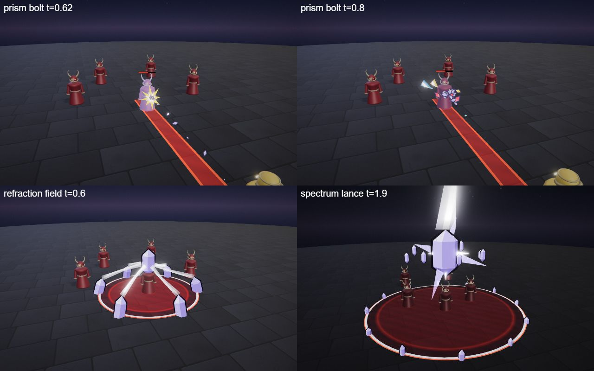

# Opaline, the Lightbreaker

The prism hero kit: Opaline's four spells (Q, W, E and the R ultimate), the shared parts file, the palette row and the rigged hero model. A mage in a long pale lavender robe with a ring of small prisms floating behind her head and a crystal-tipped wand; she catches light in clear crystal and splits it into a spectrum. She is built on the [combat mechanics](../../architecture/mechanics.md): a splitting skillshot, a blind, a shield and a mirror aura.

## At a glance

| | |
|---|---|
| Hero | Opaline, the Lightbreaker |
| Spell category | `hero: prism` |
| Parts file | [`src/effects/parts/prism.ts`](../../../src/effects/parts/prism.ts) |
| Kit data | [`src/kits/prism.ts`](../../../src/kits/prism.ts) |
| Kit sheet | [`kit-prism.md`](../../../pipeline/designs/kit-prism.md) (read [kit-common.md](../../../pipeline/designs/kit-common.md) first) |
| Model | [`public/models/heroes/prism.glb`](../../../public/models/heroes/prism.glb) |

## Palette

The art bible row "Prism" ([ART_BIBLE.md](../../ART_BIBLE.md) section 2, energy value ladders). Every effect of the kit picks from this row.

| Core | Hot | Body | Accent | Dark | Foil |
|---|---|---|---|---|---|
| `#ffffff` | `#f2eeff` | `#b8b0ff` | spectrum: red `#ff5a6a`, gold `#ffd24a`, green `#5aff9a`, blue `#5ab8ff` | `#14102a` | clear glass `#f0f4ff` |

Core is the white heart of every beam; hot is the lit top face of a crystal; body is the lavender glass; the accent is the four spectrum bands (`SPECTRUM`, always in the order red, gold, green, blue, as thin parallel bands either side of a white core, never a fat rainbow); dark is the outline of every crystal and the violet-black sky of the ultimate; the glass foil is the pale facets and glitter. The kit icons also use a darker lavender `#7f74d6` for the shaded facets.

## Signature shape and material rules

The refracting crystal. Light enters a faceted clear crystal white and leaves as thin, parallel bands of red, gold, green and blue. Every spell is light caught and split: a bolt that shatters into three beams, a ring of crystals feeding one prism, mirrors that throw beams outward, a giant prism that splits a beam into seven lances. Not the astral kit's constellations (Lyra) and not the dawn kit's gold panels (Auriel): cold clear glass with a dark edge line, and spectrum only as thin bands.

- Crystals: double-terminated hexagonal shards, flat-shaded in bands with a lighter top face and a dark outline hull; never smooth.
- Beams: a white core with thin spectrum bands either side (use a width of 0.4 or more so the bands read); a single tint gives one coloured band each side.
- Glitter: a few small flat diamond facets that flash once and fall, each with a dark edge so it reads on a bright floor.

## Mechanics

Opaline uses these pieces of [the combat mechanics](../../architecture/mechanics.md):

| Mechanic | Where |
|---|---|
| Skillshot, split | Q is `aim: 'line'`: `ctx.projectile` fires a crystal (speed 22, range 12, radius 0.45) with `split: { count: 3, spreadDeg: 25, at: 'hit', range: 6 }`. At the first hit the parent ends and three child bolts fan out over 25 degrees; each child hits for 15 and never hits an enemy its parent hit. Hero mode draws a strip toward the cursor; the AI's bolt dodge can sidestep it |
| Blind | W blinds every enemy it hits for 1.5 s (`status: { kind: 'blind', seconds: 1.5 }`, cap 2 s): their casts land at a random spot within 2.5 m of the aim point. It does not move self spells |
| Shield | E gives `ctx.shieldSelf(40, 3)`, a 40 point shield for 3 s |
| Aura | E pulses twice and hits every enemy inside radius 4 for 12 with knock 1 |
| Knock | R hits with knock 4 and pulls the enemies in a little while the prism builds (`ctx.displace`) |
| Melee, dash, heal, summons | none. `maxHp` is not set, so the default 600 HP applies |

The numbers follow the "Mechanics budget" of [kit-common.md](../../../pipeline/designs/kit-common.md). In the wave 4 duel tournament her first run gave 63%; Refraction Field was rebalanced from 45 to 40 damage and she then won 53%.

## Spells

All four play under the normal gameplay camera (no cinematic, no letterbox). Q, W and E are normal MOBA abilities (the first damage 0.2-1.0 s after the cast, clean by about 2 s; the E aura runs about 3 s); R is the ultimate (hit at 2.2 s, clean by 4.5 s, one dead beat). Range and cooldown come from the kit data (`src/kits/prism.ts`), hit time and length from the spell files in `src/spells/targeted/`; "hit" is the telegraph impact time and the first damage.

| Key | Label | Targeting | Range | Cooldown | Hit time | Length | What happens |
|---|---|---|---|---|---|---|---|
| Q | [prism bolt](../../../src/spells/targeted/prismBolt.ts) | skillshot line (width 0.9) | 12 | 3 s | flies from 0.2 s, about 0.55 s of flight | 1.5 s | A faceted crystal (0.8 long) forms at her wand tip over 0.2 s, then is fired along the aim line, spinning, with a short white trail. On the first enemy it bursts: glitter, a small spectrum star for two frames, and three thin tinted beams (red, gold, blue) fan out over 25 degrees, one riding each child bolt. The children hit again and spark a little. A bolt that ends without a hit pops into glitter where it was. Damage 45, knock 2; children 15, knock 1. |
| W | [refraction field](../../../src/spells/targeted/refractionField.ts) | ground (r 4) | 10 | 7 s | 0.75 s | 2.2 s | A ring of six tilted crystals rises at the zone edge, facing inward. Each fires a white beam to a prism forming over the centre (about 2.5 high), which spins faster and brightens. At 0.75 s the prism bursts: spectral beams flash down across the zone with glitter, a little shake and a ground refraction ring, and every enemy inside is hit and blinded. From 1.0 s the crystals shatter into glitter. Damage 40, blind 1.5 s. |
| E | [mirror shell](../../../src/spells/targeted/mirrorShell.ts) | self (r 4) | 0 (self) | 9 s | 1.0 s and 2.0 s (two pulses) | 3.2 s | Six flat crystal mirrors assemble round her (radius 1.3, waist to head), turning slowly, and she takes a 40 point shield for 3 s. At 1.0 s and 2.0 s the mirrors flash and throw spectral beams outward to radius 4: every enemy inside takes a small hit. At 2.6 s the mirrors shatter into glitter. The telegraph ends at the first pulse. Damage 12 per pulse, knock 1, shield 40. |
| R | [spectrum lance](../../../src/spells/targeted/spectrumLance.ts) | ground (r 7) | 13 | 20 s | 2.2 s | 4.5 s | The ultimate. The world darkens to a deep violet-black and a ring of small crystals marks the zone. A huge faceted prism (about 4 tall, top under y 8.5) assembles from shards over the point while eight smaller prisms orbit it and the enemies are pulled in a little. A white beam strikes it from the sky and it glows from inside; everything hangs for a dead beat (1.85-2.0 s). Then it splits the beam into seven spectral lances that slam into the ground in a ring (2.0-2.2 s) and sweep once round the zone. At 2.2 s: two impact frames, glitter along the lances, a spectrum accent, a ground refraction ring, shake and the hit. Damage 125, knock 4. |

Spell sources: [`prismBolt.ts`](../../../src/spells/targeted/prismBolt.ts), [`refractionField.ts`](../../../src/spells/targeted/refractionField.ts), [`mirrorShell.ts`](../../../src/spells/targeted/mirrorShell.ts), [`spectrumLance.ts`](../../../src/spells/targeted/spectrumLance.ts). Their catalog rows are in the [effect catalog](../effects.md#hero-prism).

## Parts file

[`src/effects/parts/prism.ts`](../../../src/effects/parts/prism.ts) holds everything the four spells share. Spells import it directly (`../../effects/parts/prism`). Everything is pooled, takes world-space positions and has a `reset()`; the materials are toon shaders kept below the bloom threshold.

| Export | Role |
|---|---|
| `PRISM`, `PRISM_CSS`, `SPECTRUM` | palette constants (`foil` is the clear glass) and the four spectrum colours in beam order |
| `Crystal` | pooled hexagonal crystal shards (`CrystalOptions`): `place(pos, dir, length, width, opts)` returns an index; `move`, `setSize`, `setScale`, `setRoll`, `setSpin`, `hide(i)`; `shatter(speed, life, origin)` turns every live crystal into loose tumbling shards; `frozen` holds time for a dead beat |
| `SpectrumBeam` | camera-facing beams with a white core and thin spectrum bands: `set(a, b, width, opacity, tint?, tailTaper?, slot?)`, `split(fanDeg, count, length?, width?, opacity?, tints?)` fans slots 1..count out of the end of slot 0, `fan(origin, dir, axis, ...)` is the general form, `hide(slot)` |
| `Glitter` | small flat diamond facets that flash once and fall: `burst(pos, count, speed, size)` |
| `PrismRing` | a ring of small floating prisms: `set(center, radius, count, spin, size)` each frame, `scale(k)`, `shatter(speed, life)`, `hide()` |

## Model

[`public/models/heroes/prism.glb`](../../../public/models/heroes/prism.glb): a rigged figure on the Dao rig (same bone names as `public/models/figures/hero.glb`, so `src/effects/weapons/hero.ts` can pose it). Built by `build("prism")` / `export("prism")` in [`blender/heroes/hero_figures.py`](../../../blender/heroes/hero_figures.py); hero mode shows it with procedural walk, breath and cast poses. It is wired through the `MODELS` map in [`src/heroes.ts`](../../../src/heroes.ts) (name `Opaline`).

- Look: A slim woman in a long pale lavender robe over white, with narrow sleeves, loose platinum hair, crystal epaulettes, a ring of small floating prisms behind her head, a crystal-tipped wand in her right hand and thin spectral bands on a dark sash.
- Props: `prism_ring`, `crystal_epaulettes`, `crystal_wand`, `spectral_sash`.
- HUD portrait (canvas-drawn in the kit data): A floating ring of small prisms behind her head with light bending through one of them, shoulders in a pale lavender robe with white trim, crystal epaulettes and a crystal brooch at the throat, and a cool, calm face under long pale hair parted in the middle.

The wave 4 concept (Opaline, Sirix and Cantor; vector source [`wave4_concept.svg`](../../heroes/wave4_concept.svg)):

The wave 4 models in hero mode (Opaline, Sirix and Cantor):

## Files

| What | Where |
|---|---|
| Kit sheet (design) | [`pipeline/designs/kit-prism.md`](../../../pipeline/designs/kit-prism.md) |
| Shared kit rules | [`pipeline/designs/kit-common.md`](../../../pipeline/designs/kit-common.md) |
| Parts | [`src/effects/parts/prism.ts`](../../../src/effects/parts/prism.ts) |
| Spells | [`prismBolt.ts`](../../../src/spells/targeted/prismBolt.ts), [`refractionField.ts`](../../../src/spells/targeted/refractionField.ts), [`mirrorShell.ts`](../../../src/spells/targeted/mirrorShell.ts), [`spectrumLance.ts`](../../../src/spells/targeted/spectrumLance.ts) |
| Kit data | [`src/kits/prism.ts`](../../../src/kits/prism.ts) |
| Model | [`public/models/heroes/prism.glb`](../../../public/models/heroes/prism.glb) |
| Model script | [`blender/heroes/hero_figures.py`](../../../blender/heroes/hero_figures.py) |

## Review sheets

Contact sheets in `docs/spells/` (frames over time, from `pipeline/tools/contact-sheet.js`).

### Prism review

### Prism re-check (round 2)

## See also

- [Hero roster and shared structure](README.md)
- [Combat mechanics](../../architecture/mechanics.md)
- [Sirix (hive)](hive.md), [Cantor (bard)](bard.md), [Lyra (astral)](astral.md), [Auriel (dawn)](dawn.md)
- [Effect catalog](../effects.md)
- [Docs home](../../README.md)
- [Art bible](../../ART_BIBLE.md)
- [Kit shared rules](../../../pipeline/designs/kit-common.md)
