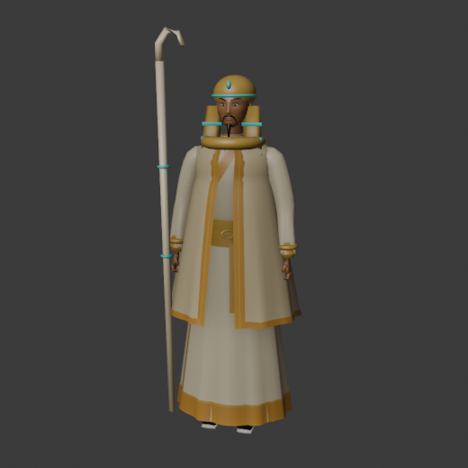
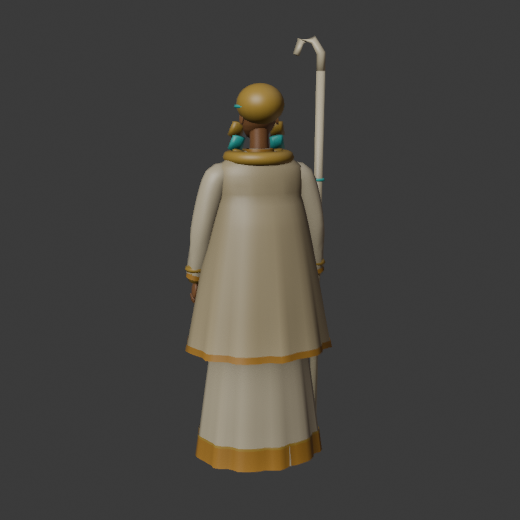
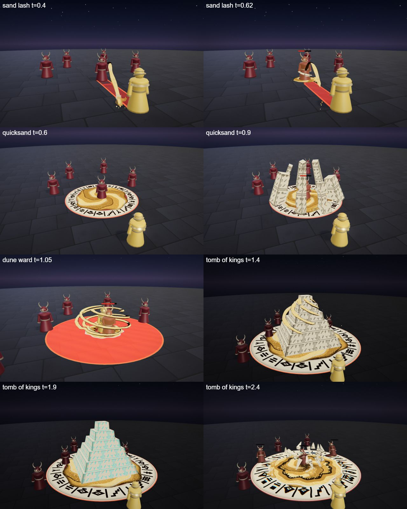

# Sefu, the Dune Sovereign

The sand hero kit: Sefu's four spells (Q, W, E and the R ultimate), the shared parts file, the palette row and the rigged hero model. A desert king in layered linen and a gold headdress with a crook of sandstone; he controls ground and space.

## At a glance

| | |
|---|---|
| Hero | Sefu, the Dune Sovereign |
| Spell category | `hero: sand` |
| Parts file | [`src/effects/parts/sand.ts`](../../../src/effects/parts/sand.ts) |
| Kit data | [`src/kits/sand.ts`](../../../src/kits/sand.ts) |
| Kit sheet | [`kit-sand.md`](../../../pipeline/designs/kit-sand.md) (read [kit-common.md](../../../pipeline/designs/kit-common.md) first) |
| Model | [`public/models/heroes/sand.glb`](../../../public/models/heroes/sand.glb) |

## Palette

The art bible row "Sand" ([ART_BIBLE.md](../../ART_BIBLE.md) section 2, energy value ladders). Every effect of the kit picks from this row and adds black.

| Core | Hot | Body | Accent | Dark | Foil |
|---|---|---|---|---|---|
| `#fff6dc` | `#ffd27a` | `#c8913f` | `#3fd4c8` | `#2a1a0c` | sandstone `#e8d8b4` |

Core is tiny; hot is sunlit sand, body the ochre; accent (a turquoise inlay glint) only 2-3 frames at hits; the sandstone foil is the carved stone and the glyph tablets.

## Signature shape and material rules

Sand that flows like a ribbon and sets like stone: sand pours in thick grainy ribbons, and wherever it stops it hardens into carved sandstone with glyphs cut into it. Every spell moves sand, then sets it, then crumbles it back to dust. Not a sandstorm cloud (that is the existing djinn spell).

- Sand ribbon: a lit band (hot on top, body in the middle, dark edge underneath) with a grain texture scrolling along it and a few grains shedding from the trailing edge.
- Sandstone: flat-shaded pale stone with dark incised glyph lines (a canvas texture), never glowing.
- Dust: small toon puffs in the body colour.

## Spells

All four play under the normal gameplay camera (no cinematic, no letterbox). Q, W and E are normal MOBA abilities (hit 0.5-1.0 s after the cast, clean by about 2.3 s; an E aura may run about 3 s); R is the ultimate (hit at 2.2 s, clean by 4.5 s, one dead beat and impact frames). Range and cooldown come from the kit data (`src/kits/sand.ts`), hit time and length from the spell files in `src/spells/targeted/`; "hit" is the telegraph impact time and the first damage.

| Key | Label | Targeting | Range | Cooldown | Hit time | Length | What happens |
|---|---|---|---|---|---|---|---|
| Q | [sand lash](../../../src/spells/targeted/sandLash.ts) | enemy | 10 | 3 s | 0.5 s | 1.6 s | He sweeps the crook and a thick ribbon of sand pours from the floor, arcs over and cracks across to one enemy like a whip. The tip wraps the legs and sets into a shackle of four carved sandstone shards that crumbles to dust. Damage 53. |
| W | [quicksand](../../../src/spells/targeted/quicksand.ts) | ground (r 4) | 10 | 7 s | 0.75 s | 2.3 s | A ring of carved glyphs cuts into the floor, sand floods inside and swirls inward, sinking and pulling the enemies. The swirl snaps tight and sandstone pillars punch up around the edge, leaning inward like closing teeth; they crumble and the sand settles. Damage 48, then a tick of 10 at 1.3 s. |
| E | [dune ward](../../../src/spells/targeted/duneWard.ts) | self (r 5) | 0 (self) | 9 s | 1.0 s and 2.0 s (two pulses) | 3.2 s | Three sand ribbons rise and wind around him in a slow spiral above a small glyph ring. Twice the ribbons flare and a flat ring of flung sand sweeps out to radius 5, then the ribbons set into stone and crumble. Damage 13 per pulse. |
| R | [tomb of kings](../../../src/spells/targeted/tombOfKings.ts) | ground (r 7) | 13 | 20 s | 2.2 s | 4.5 s | The ultimate. The world darkens warm, a big glyph ring carves into the floor and sand ribbons stack a stepped sandstone pyramid over the zone; a glyph on its face lights turquoise, dead beat at 1.85-2.0 s, then the pyramid implodes into the vortex: impact frames, a ring of carved shards bursts across the zone, a sand shockwave sweeps out. Damage 130. |

Spell sources: [`sandLash.ts`](../../../src/spells/targeted/sandLash.ts), [`quicksand.ts`](../../../src/spells/targeted/quicksand.ts), [`duneWard.ts`](../../../src/spells/targeted/duneWard.ts), [`tombOfKings.ts`](../../../src/spells/targeted/tombOfKings.ts). Their catalog rows are in the [effect catalog](../effects.md#hero-sand).

## Parts file

[`src/effects/parts/sand.ts`](../../../src/effects/parts/sand.ts) holds everything the four spells share. Spells import it directly (`../../effects/parts/sand`). Everything is pooled, takes world-space positions and has a `reset()`.

| Export | Role |
|---|---|
| `SAND`, `SAND_CSS` | palette constants |
| `SandRibbon` | a thick flowing band along a curve, with reveal at the head and tail and grains shedding off the trailing edge |
| `SandstoneBlocks` | instanced carved stone blocks, pillars and shards with glyphs: `raise`, then `crumble` into dust |
| `GlyphRing` | a sandstone ground ring with a row of carved glyphs, revealed over time, optional sun disc |
| `Dust` | small toon dust puffs and falling grains (cap about 10 puffs) |
| `SandPool` | a ground decal of loose sand that swirls inward (the quicksand vortex): `swirl` 0..1, `settle` |
| `SandWave` | a flat sand shockwave ring that sweeps out along the floor |

## Model

[`public/models/heroes/sand.glb`](../../../public/models/heroes/sand.glb): a rigged figure on the Dao rig (same bone names as `public/models/figures/hero.glb`, so `src/effects/weapons/hero.ts` can pose it). Built by `build("sand")` / `export("sand")` in [`blender/heroes/hero_figures.py`](../../../blender/heroes/hero_figures.py); hero mode shows it with procedural walk, breath and cast poses. It is wired through the `MODELS` map in [`src/heroes.ts`](../../../src/heroes.ts).

- Look: A shaved-headed king with a goatee in layered linen, a gold and turquoise striped headcloth, a broad collar, gold cuffs and a sandstone crook.
- Props: `nemes`, `broad_collar`, `sand_crook`, `gold_cuffs`.
- HUD portrait (canvas-drawn in the kit data): Layered linen shoulders, a gold collar, a bearded face under a striped gold headdress, and the sandstone crook behind.

 

## Files

| What | Where |
|---|---|
| Kit sheet (design) | [`pipeline/designs/kit-sand.md`](../../../pipeline/designs/kit-sand.md) |
| Shared kit rules | [`pipeline/designs/kit-common.md`](../../../pipeline/designs/kit-common.md) |
| Parts | [`src/effects/parts/sand.ts`](../../../src/effects/parts/sand.ts) |
| Spells | [`sandLash.ts`](../../../src/spells/targeted/sandLash.ts), [`quicksand.ts`](../../../src/spells/targeted/quicksand.ts), [`duneWard.ts`](../../../src/spells/targeted/duneWard.ts), [`tombOfKings.ts`](../../../src/spells/targeted/tombOfKings.ts) |
| Kit data | [`src/kits/sand.ts`](../../../src/kits/sand.ts) |
| Model | [`public/models/heroes/sand.glb`](../../../public/models/heroes/sand.glb) |
| Model script | [`blender/heroes/hero_figures.py`](../../../blender/heroes/hero_figures.py) |

## Review sheets

Contact sheets in `docs/spells/` (frames over time, from `pipeline/tools/contact-sheet.js`).

### Sand review

## See also

- [Hero roster and shared structure](README.md)
- [Kaia (storm)](storm.md), [Nyx (shadow)](shadow.md), [Vesper (blood)](blood.md), [Brannoc (forge)](forge.md), [Isolde (frost)](frost.md), [Lyra (astral)](astral.md), [Vex (alchemy)](alchemy.md)
- [Effect catalog](../effects.md)
- [Docs home](../../README.md)
- [Art bible](../../ART_BIBLE.md)
- [Kit shared rules](../../../pipeline/designs/kit-common.md)
