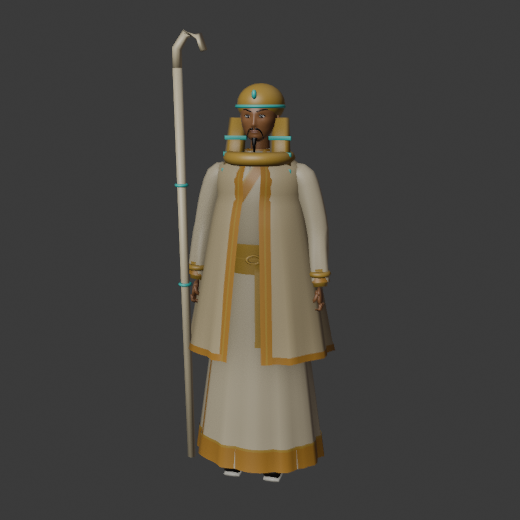
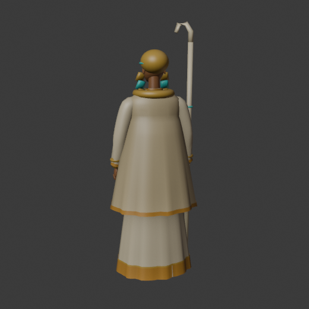

# Sefu, the Dune Sovereign

The sand hero kit (v5): Sefu's four spells (Q, W, E and the R ultimate), his passive, the shared parts file, the palette row and the rigged hero model. A pharaoh in layered linen, a gold collar and a striped gold headdress, with a sandstone crook. His crook and his sarcophagus Judge the enemy, and a Judged enemy takes more from him and cannot dash far. He plays at range with a basic attack of 5.5 m.

## Role

| | |
|---|---|
| Role | Controller (ranged) |
| Signature | Pharaoh's Decree |
| HP | 620 |
| Kit shapes | Q LINE skillshot blind · W TGT hook and pull · E DASH bite + poison · R TGT seal, then burst |

He wins by hooking the enemy with the crook (Judged), spitting at them for a cheap re-cast of the cobra, and sealing them in the sarcophagus. His weakness is the line: the cobra and the dash can be sidestepped, and the sarcophagus shuts on nothing if the enemy steps out of its 1.6 m circle.

## At a glance

| | |
|---|---|
| Hero | Sefu, the Dune Sovereign |
| Spell category | `hero: sand` |
| Parts file | [`src/effects/parts/sand.ts`](../../../src/effects/parts/sand.ts) |
| Kit data | [`src/kits/sand.ts`](../../../src/kits/sand.ts) |
| Trait (rules) | [`src/traits/sand.ts`](../../../src/traits/sand.ts) |
| Kit sheet | [`kit-sand.md`](../../../pipeline/designs/kit-sand.md) (read [kit-common.md](../../../pipeline/designs/kit-common.md) first) |
| Model | [`public/models/heroes/sand_v2.glb`](../../../public/models/heroes/sand_v2.glb) |

## Palette

The art bible row "Sand" ([ART_BIBLE.md](../../ART_BIBLE.md) section 2, energy value ladders). Every effect of the kit picks from this row and adds black.

| Core | Hot | Body | Accent | Dark | Foil |
|---|---|---|---|---|---|
| `#fff6dc` | `#ffd27a` | `#c8913f` | `#3fd4c8` | `#2a1a0c` | sandstone `#e8d8b4` |

Core is tiny; hot is sunlit sand, body the ochre; accent (a turquoise inlay glint) only 2-3 frames at hits; the sandstone foil is the carved stone and the glyph tablets.

## Signature shape and material rules

Sand that flows like a ribbon and sets like stone: sand pours in thick grainy ribbons, and wherever it stops it hardens into carved sandstone with glyphs cut into it. Every spell moves sand, then sets it, then crumbles it back to dust. Not a sandstorm cloud (that is the existing djinn spell).

- Sand ribbon: a lit band (hot on top, body in the middle, dark edge underneath) with a grain texture scrolling along it and a few grains shedding from the trailing edge.
- Sandstone: flat-shaded pale stone with dark incised glyph lines (a canvas texture), never glowing.
- Dust: small toon puffs in the body colour.

## Passive and twist

| | |
|---|---|
| Passive | Pharaoh's Decree: an enemy his crook pulls or his sarcophagus opens on is Judged for 3 s. His hits deal 20% more to a Judged enemy, and their dashes, blinks and leaps go half as far (a `grounded` debuff of 0.5). |
| Twist | A Cobra Spit that hits a Judged enemy halves what is left of its cooldown. The sarcophagus Judges only when it opens (the seal itself does not). The passive slot shows `J` while the enemy is Judged. |
| Resource or meter | none (Judged is a stack on the enemy) |
| Speed | 4 m/s |
| Basic attack | ranged, 5.5 m, 9 damage every 0.7 s, wind-up 0.18 s, bolt speed 20, sand look |
| Other rules | Judged applies to every hit he deals, including basic attacks, once the stack is on. |

## Mechanics

Sefu uses these pieces of [the combat mechanics](../../architecture/mechanics.md):

| Mechanic | Where |
|---|---|
| Skillshot | Q: a projectile at 20 m/s, radius 0.35, 9 m (`aim: 'line'`) |
| Blind | Q: 1.2 s |
| Pull and slow | W: pull 3 m toward him (stopping 1 m short), slow 0.5 s. W is flagged `cc` |
| Dash | E: 6 m in 0.5 s (`dash: true`, kit range 11 is the AI's reach). He can still be hit |
| Damage over time | E's poison: 30 as two ticks of 15, 1 s and 2 s after the bite |
| Sealed | R: `sealed` 1.2 s, the enemy cannot act and cannot be hit. R is flagged `cc` |
| Debuff | Judged: `grounded` 0.5 for 3 s, and +20% damage taken from him |
| Cooldown cut | Judged Cobra Spit hit: half the cooldown back (`noteOwner`, `peerNote`) |
| Melee, summon, shield, heal | none |

## Spells

All four play under the normal gameplay camera. Range and cooldown come from the kit data (`src/kits/sand.ts`), hit time and length from the spell files in `src/spells/targeted/`; the numbers are the spell files' defaults. The Judged bonus (+20%) comes on top.

| Key | Label | Targeting | Range | Cooldown | Hit time | Length | What happens |
|---|---|---|---|---|---|---|---|
| Q | [cobra spit](../../../src/spells/targeted/cobraSpit.ts) | line skillshot (ground aim) | 9 | 5 s | strike at 0.25 s, reaches 6 m at 0.55 s | 1.4 s | A gold and turquoise cobra of sand rears up in 0.2 s and spits venom down the aim. The first enemy it touches takes 62 and is blinded 1.2 s. A hit on a Judged enemy halves the rest of this spell's cooldown. A sidestep after the hood rises dodges it. |
| W | [shepherd's crook](../../../src/spells/targeted/shepherdsCrook.ts) | enemy (needs sight) | 6 | 10 s | 0.5 s | 1.4 s | A ribbon of sand leaves his hand, sets into a sandstone crook and hooks round the enemy's neck. A gold mark shows who is hooked. At 0.5 s: 35 damage, pulled 3 m toward him (stopping 1 m short) and slowed 0.5 s. Judged for 3 s. |
| E | [scarab stride](../../../src/spells/targeted/scarabStride.ts) | ground (dash line) | 11 (the AI's reach; the dash is 6 m) | 12 s | the bite when he passes through the enemy | 3.0 s | He skitters 6 m down the aim in 0.5 s as a stream of scarabs; the line (1.4 m wide) is shown as he starts. Running through the enemy bites once: 30 now and 30 poison as two ticks over 2 s. A pass that misses hits no one. He is not untouchable. |
| R | [sarcophagus](../../../src/spells/targeted/sarcophagus.ts) | enemy (needs sight) | 9 | 24 s | shuts at 0.7 s | about 3.1 s | Ultimate. A gold sarcophagus rises at the spot the enemy stood at (a 1.6 m circle is the telegraph). At 0.7 s it shuts: if the enemy is still inside, they are sealed 1.2 s, unable to act and unable to be hit. It then opens in scarabs for 110 damage, and they are Judged. If they stepped out it shuts on nothing and sinks. The burst comes about 2.0 s after the cast; he is free to act from 0.7 s. |

Spell sources: [`cobraSpit.ts`](../../../src/spells/targeted/cobraSpit.ts), [`shepherdsCrook.ts`](../../../src/spells/targeted/shepherdsCrook.ts), [`scarabStride.ts`](../../../src/spells/targeted/scarabStride.ts), [`sarcophagus.ts`](../../../src/spells/targeted/sarcophagus.ts). Their catalog rows are in the [effect catalog](../effects.md#hero-sand).

## Parts file

[`src/effects/parts/sand.ts`](../../../src/effects/parts/sand.ts) holds everything the kit's spells share. Spells import it directly (`../../effects/parts/sand`). Everything is pooled, takes world-space positions and has a `reset()`.

| Export | Role |
|---|---|
| `SAND`, `SAND_CSS` | palette constants |
| `SandRibbon` | a thick flowing band along a curve, with reveal at the head and tail and grains shedding off the trailing edge |
| `SandstoneBlocks` | instanced carved stone blocks, pillars and shards with glyphs: `raise`, then `crumble` into dust |
| `GlyphRing` | a sandstone ground ring with a row of carved glyphs, revealed over time, optional sun disc |
| `Dust` | small toon dust puffs and falling grains (cap about 10 puffs) |
| `SandPool` | a ground decal of loose sand that swirls inward (the quicksand vortex): `swirl` 0..1, `settle` |
| `SandWave` | a flat sand shockwave ring that sweeps out along the floor |
| `GEM_COLORS`, `GemGlints` | tiny twinkling jewel diamonds (gold, turquoise, lapis, carnelian): `scatter(center, radius, count, life)`, `trickle(dt, center, radius, perSecond)` |
| `SandHood` | a rearing cobra made of sand with a striped gold and turquoise hood: `place(base, yaw)`, `set(rear, strike, opacity, erode, time)` |
| `ScarabSwarm` | pooled scarab beetles: `emit`, `burst(center, count, speed, life)`, `scuttle(pos, dir, count, life)` |
| `Sarcophagus`, `SARCOPHAGUS_HEIGHT` | a gold mummiform sarcophagus in two halves round a spot (2.9 m tall, opaque): `place(center, yaw)`, `set(open, rise)` |

## Model

[`public/models/heroes/sand_v2.glb`](../../../public/models/heroes/sand_v2.glb): a rigged figure on the Dao rig (same bone names as `public/models/figures/hero.glb`, so `src/effects/weapons/hero.ts` can pose it). Built in [`blender/heroes/moba_figures.py`](../../../blender/heroes/moba_figures.py) (the current style, the `_v2` models). Hero mode shows it with procedural walk, breath and cast poses. It is wired through the `MODELS` map in [`src/heroes.ts`](../../../src/heroes.ts) (name `Sefu`), and its hit size is in `HERO_BODIES` in the same file (radius 0.4 m, height 2.86 m).
- HUD portrait (canvas-drawn in the kit data): Layered linen shoulders, a gold collar, a bearded face under a striped gold headdress, and the sandstone crook behind.

  

## Files

| What | Where |
|---|---|
| Kit sheet (design) | [`pipeline/designs/kit-sand.md`](../../../pipeline/designs/kit-sand.md) |
| Shared kit rules | [`pipeline/designs/kit-common.md`](../../../pipeline/designs/kit-common.md) |
| Parts | [`src/effects/parts/sand.ts`](../../../src/effects/parts/sand.ts) |
| Spells | [`cobraSpit.ts`](../../../src/spells/targeted/cobraSpit.ts), [`shepherdsCrook.ts`](../../../src/spells/targeted/shepherdsCrook.ts), [`scarabStride.ts`](../../../src/spells/targeted/scarabStride.ts), [`sarcophagus.ts`](../../../src/spells/targeted/sarcophagus.ts) |
| Kit data | [`src/kits/sand.ts`](../../../src/kits/sand.ts) |
| Trait (passive, twist, rules) | [`src/traits/sand.ts`](../../../src/traits/sand.ts) |
| Model | [`public/models/heroes/sand_v2.glb`](../../../public/models/heroes/sand_v2.glb) |
| Model script | [`blender/heroes/moba_figures.py`](../../../blender/heroes/moba_figures.py) |

## See also

- [Hero roster and shared structure](README.md)
- [Combat mechanics](../../architecture/mechanics.md)
- [Kaia (storm)](storm.md), [Nyx (shadow)](shadow.md), [Fenna (grove)](grove.md), [Lyra (astral)](astral.md)
- [Effect catalog](../effects.md)
- [Docs home](../../README.md)
- [Art bible](../../ART_BIBLE.md)
- [Kit shared rules](../../../pipeline/designs/kit-common.md)
