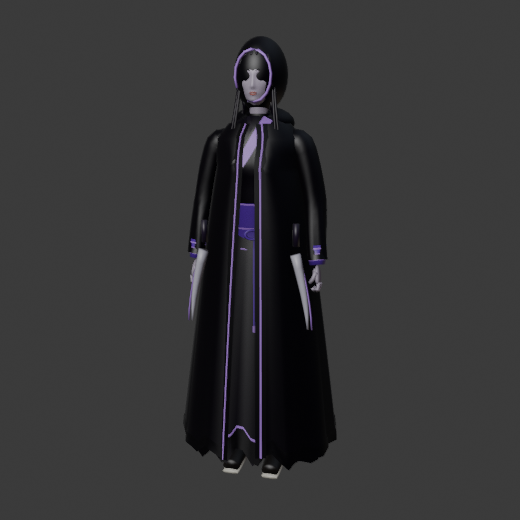
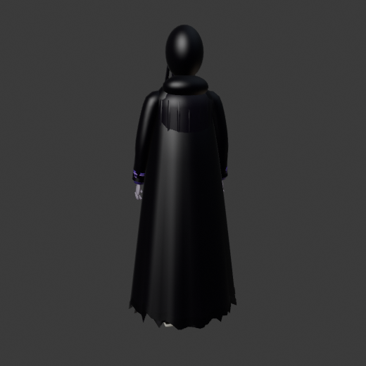
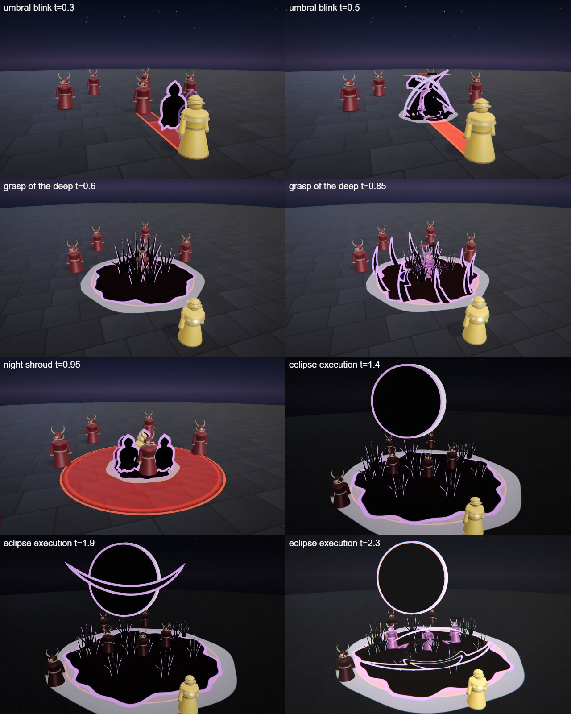
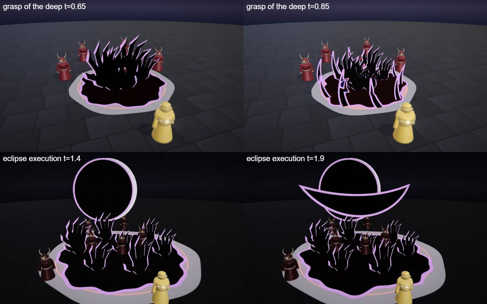

# Nyx, the Umbral Stalker

The shadow hero kit: Nyx's four spells (Q, W, E and the R ultimate), the shared parts file, the palette row and the rigged hero model. A hooded assassin with twin curved daggers; she blinks, clones and executes.

## At a glance

| | |
|---|---|
| Hero | Nyx, the Umbral Stalker |
| Spell category | `hero: shadow` |
| Parts file | [`src/effects/parts/shadow.ts`](../../../src/effects/parts/shadow.ts) |
| Kit data | [`src/kits/shadow.ts`](../../../src/kits/shadow.ts) |
| Kit sheet | [`kit-shadow.md`](../../../pipeline/designs/kit-shadow.md) (read [kit-common.md](../../../pipeline/designs/kit-common.md) first) |
| Model | [`public/models/heroes/shadow.glb`](../../../public/models/heroes/shadow.glb) |

## Palette

The art bible row "Shadow" ([ART_BIBLE.md](../../ART_BIBLE.md) section 2, energy value ladders). Every effect of the kit picks from this row and adds black.

| Core | Hot | Body | Accent | Dark | Foil |
|---|---|---|---|---|---|
| `#f4e8ff` | `#c88cff` | `#6a2ec0` | `#5affd2` | `#050308` | moon `#cfcad8` |

Core is tiny; hot is the violet edge line; accent (a cold mint cut) only 2-3 frames at hits; dark is the shapes themselves; the moon-grey foil is the pale floor disc under shadow pools and the eclipse moon.

## Signature shape and material rules

Flat cut-paper shadow: flat, matte-black shapes (blades, hands, a crescent, a hooded figure, the hero's own silhouette as a clone) with a thin hard violet edge line. They lie flat on the floor or stand upright as cut-outs and move in sharp, stepped motions. Not smoke and not glowing void (that is the existing void and crow sets).

- Shadow shapes: normal-blended matte black with a hot edge line, never additive.
- Pools: the floor under a shadow shape gets a pale foil disc so the black reads on the dark floor.
- Cuts: thin hot crescents with a mint core for 2 frames at the hit.

## Spells

All four play under the normal gameplay camera (no cinematic, no letterbox). Q, W and E are normal MOBA abilities (hit 0.45-1.0 s after the cast, clean by about 2.3 s; an E aura may run about 3 s); R is the ultimate (hit at 2.2 s, clean by 4.5 s, one dead beat and impact frames). Range and cooldown come from the kit data (`src/kits/shadow.ts`), hit time and length from the spell files in `src/spells/targeted/`; "hit" is the telegraph impact time and the first damage.

| Key | Label | Targeting | Range | Cooldown | Hit time | Length | What happens |
|---|---|---|---|---|---|---|---|
| Q | [umbral blink](../../../src/spells/targeted/umbralBlink.ts) | enemy | 10 | 3 s | 0.45 s | 1.5 s | A black figure cut-out peels off Nyx, blinks to one enemy in four stepped jumps (a trail of fading figures) and two crossed blade cut-outs slash through it: mint cut, a small shadow pool, one impact frame. The cut-outs shatter into flat black shards. Damage 50. |
| W | [grasp of the deep](../../../src/spells/targeted/graspOfTheDeep.ts) | ground (r 4) | 10 | 7 s | 0.75 s | 2.3 s | A shadow pool with a pale foil disc spreads at the point and flat black hands rise out of it around the enemies. They close and pull the enemies down a little, a ring of upright blade cut-outs snaps up at the edge; then the hands sink and the pool shrinks. Damage 45, then a tick of 10 at 1.3 s. |
| E | [night shroud](../../../src/spells/targeted/nightShroud.ts) | self (r 5) | 0 (self) | 9 s | 1.0 s and 2.0 s (two pulses) | 3.2 s | A shadow pool spreads under her and three figure cut-outs (clones) rise and circle her. At 1.0 s and 2.0 s every clone lunges at the nearest enemy in a stepped dash, slashes and snaps back; then the clones fold flat into the pool. Damage 13 per pulse. |
| R | [eclipse execution](../../../src/spells/targeted/eclipseExecution.ts) | ground (r 7) | 13 | 20 s | 2.2 s | 4.5 s | The ultimate. The world goes dark, a shadow pool covers the zone and hands hold the enemies while a pale moon rises and a black disc slides across it into an eclipse. A giant black crescent blade forms and tilts back, dead beat at 1.85-2.0 s, then it sweeps down through the zone in one stroke: impact frames, a long mint cut, refraction ring, then it shatters into black shards. Damage 125. |

Spell sources: [`umbralBlink.ts`](../../../src/spells/targeted/umbralBlink.ts), [`graspOfTheDeep.ts`](../../../src/spells/targeted/graspOfTheDeep.ts), [`nightShroud.ts`](../../../src/spells/targeted/nightShroud.ts), [`eclipseExecution.ts`](../../../src/spells/targeted/eclipseExecution.ts). Their catalog rows are in the [effect catalog](../effects.md#hero-shadow).

## Parts file

[`src/effects/parts/shadow.ts`](../../../src/effects/parts/shadow.ts) holds everything the four spells share. Spells import it directly (`../../effects/parts/shadow`). Everything is pooled, takes world-space positions and has a `reset()`; all materials are normal-blended.

| Export | Role |
|---|---|
| `SHADOW`, `SHADOW_CSS` | palette constants |
| `facing`, `forward`, `shadowEaseOut`, `shadowEaseOutBack` | helpers: the normal of an upright cut-out that faces the gameplay camera, the horizontal direction along the aim, and two easing curves |
| `CutShape` | a flat black cut-out with a violet edge line from a drawn outline; presets blade, hand, crescent and hooded figure |
| `ShadowPool` | a black ground pool with a hard violet rim and a pale foil disc under it: `spread`, `shrink` |
| `ShadowHands` | instanced flat hands that rise out of a pool, grab and sink |
| `Afterimage` | a stepped trail of fading black figure cut-outs between two points |
| `CutFlash` | the hit cut: a thin hot crescent with a mint core |
| `CutShards` | flat black shards that fall and fade when a cut-out shatters |

## Model

[`public/models/heroes/shadow.glb`](../../../public/models/heroes/shadow.glb): a rigged figure on the Dao rig (same bone names as `public/models/figures/hero.glb`, so `src/effects/weapons/hero.ts` can pose it). Built by `build("shadow")` / `export("shadow")` in [`blender/heroes/hero_figures.py`](../../../blender/heroes/hero_figures.py); hero mode shows it with procedural walk, breath and cast poses. It is wired through the `MODELS` map in [`src/heroes.ts`](../../../src/heroes.ts).

- Look: A slim woman in a tattered black cloak with a violet edge, a deep hood, pale skin and violet glowing eyes; twin curved daggers at the hips.
- Props: `deep_hood`, `twin_daggers`.
- HUD portrait (canvas-drawn in the kit data): A pale moon behind her, two crossed daggers and the hooded black figure with a mint slit for the eyes.

 

## Files

| What | Where |
|---|---|
| Kit sheet (design) | [`pipeline/designs/kit-shadow.md`](../../../pipeline/designs/kit-shadow.md) |
| Shared kit rules | [`pipeline/designs/kit-common.md`](../../../pipeline/designs/kit-common.md) |
| Parts | [`src/effects/parts/shadow.ts`](../../../src/effects/parts/shadow.ts) |
| Spells | [`umbralBlink.ts`](../../../src/spells/targeted/umbralBlink.ts), [`graspOfTheDeep.ts`](../../../src/spells/targeted/graspOfTheDeep.ts), [`nightShroud.ts`](../../../src/spells/targeted/nightShroud.ts), [`eclipseExecution.ts`](../../../src/spells/targeted/eclipseExecution.ts) |
| Kit data | [`src/kits/shadow.ts`](../../../src/kits/shadow.ts) |
| Model | [`public/models/heroes/shadow.glb`](../../../public/models/heroes/shadow.glb) |
| Model script | [`blender/heroes/hero_figures.py`](../../../blender/heroes/hero_figures.py) |

## Review sheets

Contact sheets in `docs/spells/` (frames over time, from `pipeline/tools/contact-sheet.js`).

### Shadow review (round 1)

### Shadow re-check (round 2)

## See also

- [Hero roster and shared structure](README.md)
- [Kaia (storm)](storm.md), [Sefu (sand)](sand.md), [Vesper (blood)](blood.md), [Brannoc (forge)](forge.md), [Isolde (frost)](frost.md), [Lyra (astral)](astral.md), [Vex (alchemy)](alchemy.md)
- [Effect catalog](../effects.md)
- [Docs home](../../README.md)
- [Art bible](../../ART_BIBLE.md)
- [Kit shared rules](../../../pipeline/designs/kit-common.md)
