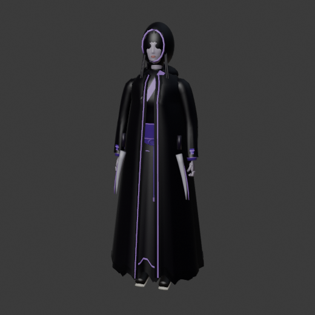
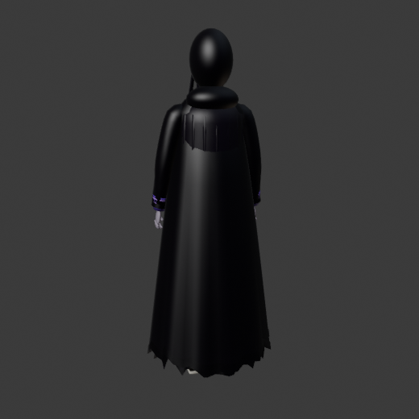

# Nyx, the Umbral Stalker

The shadow hero kit (v5): Nyx's four spells (Q, W, E and the R ultimate), her passive, the shared parts file, the palette row and the rigged hero model. A hooded figure in matte black with a thin violet edge and a mint slit for the eyes. She fades when she is left alone, and her first strike out of the fade hits harder. She is a melee assassin and she walks fast (4.6 m/s).

## Role

| | |
|---|---|
| Role | Assassin (melee) |
| Signature | Umbral Veil |
| HP | 640 |
| Kit shapes | Q TGT dagger strike (backstab) · W SELF smoke cloud · E DASH + SUMMON shadow double · R SELF night |

She wins by fading, walking up behind the enemy and landing Q from the veil: 50% more damage, 1.6 times from behind, and a silence. Her weakness is reach: Q reaches only 2.5 m and her basic attack 1.9 m, so she has to close in and be seen doing it.

## At a glance

| | |
|---|---|
| Hero | Nyx, the Umbral Stalker |
| Spell category | `hero: shadow` |
| Parts file | [`src/effects/parts/shadow.ts`](../../../src/effects/parts/shadow.ts) |
| Kit data | [`src/kits/shadow.ts`](../../../src/kits/shadow.ts) |
| Trait (rules) | [`src/traits/shadow.ts`](../../../src/traits/shadow.ts) |
| Kit sheet | [`kit-shadow.md`](../../../pipeline/designs/kit-shadow.md) (read [kit-common.md](../../../pipeline/designs/kit-common.md) first) |
| Model | [`public/models/heroes/shadow.glb`](../../../public/models/heroes/shadow.glb) |

## Palette

The art bible row "Shadow" ([ART_BIBLE.md](../../ART_BIBLE.md) section 2, energy value ladders). Every effect of the kit picks from this row and adds black.

| Core | Hot | Body | Accent | Dark | Foil |
|---|---|---|---|---|---|
| `#f4e8ff` | `#c88cff` | `#6a2ec0` | `#5affd2` | `#050308` | moon `#cfcad8` |

Core is tiny; hot is the violet edge line; accent (a cold mint cut) only 2-3 frames at hits; dark is the shapes themselves; the moon-grey foil is the pale floor disc under shadow pools and the eclipse moon.

## Signature shape and material rules

Flat cut-paper shadow: flat, matte-black shapes (blades, hands, a crescent, a hooded figure, the hero's own silhouette as a clone) with a thin hard violet edge line. They lie flat on the floor or stand upright as cut-outs and move in sharp, stepped motions. Not smoke and not glowing void (that is the existing void and crow sets).

- Shadow shapes: normal-blended matte black with a hot edge line, never additive.
- Pools: the floor under a shadow shape gets a pale foil disc so the black reads on the dark floor.
- Cuts: thin hot crescents with a mint core for 2 frames at the hit.

## Passive and twist

| | |
|---|---|
| Passive | Umbral Veil: after 2.5 s without dealing or taking damage (1.2 s within 2 m of cover) she fades: her figure is dark and see-through (still plainly visible and targetable), and she is 10% faster. A violet ring at her feet shows the veil. |
| Twist | Her next Q or basic attack out of the veil deals 50% more, silences the enemy 0.6 s (once per 5 s) and takes 3 s off Shadow Double's cooldown, and the veil ends. Inside her own smoke cloud she fades after 1.5 s without a fight. During Nightfall she fades 0.8 s after each hit she lands. The passive slot shows VEIL or NIGHT. |
| Resource or meter | none |
| Speed | 4.6 m/s |
| Basic attack | melee, 1.9 m, 11 damage every 0.7 s, wind-up 0.18 s, twin look |
| Other rules | The duel AI playing her walks to a spot 1.3 m behind the enemy when within 6 m, and holds R until the enemy is within 8 m. |

## Mechanics

Nyx uses these pieces of [the combat mechanics](../../architecture/mechanics.md):

| Mechanic | Where |
|---|---|
| Melee kit | `melee: true`, `maxHp: 640`; Q range 2.5 |
| Backstab | Q: x1.6 damage when she is in the back 120 degrees of the enemy's facing (decided at the hit) |
| Veil | The trait's `figureVeil`, `ring`, haste buff and `leaveVeil` mods |
| Blind | W: 0.5 s every 0.4 s to enemies inside the cloud |
| Dash | E: 4 m in 0.18 s, through cover (`dash: true`) |
| Summon | E: one melee shadow copy (40 HP, 2.5 s, 15 per 0.9 s); one spell kills it |
| Buffs | R: haste +25% and might +20% for 5 s, then a 1 s self slow |
| Silence | Q or basic attack out of the veil, 0.6 s |
| Pull, shield, heal | none |

## Spells

All four play under the normal gameplay camera. Range and cooldown come from the kit data (`src/kits/shadow.ts`), hit time and length from the spell files in `src/spells/targeted/`; the numbers are the spell files' defaults and the trait's constants.

| Key | Label | Targeting | Range | Cooldown | Hit time | Length | What happens |
|---|---|---|---|---|---|---|---|
| Q | [umbral cut](../../../src/spells/targeted/umbralCut.ts) | enemy (needs sight) | 2.5 | 4 s | 0.35 s | 1.0 s | A black pool with a violet rim marks the enemy and a dagger cut-out lies from her to it; she stands still for the 0.35 s wind-up. The strike lands on the enemy's live position if it is within 3.2 m of her: 54, or 86 from behind. Out of reach: a puff and no hit. A hit shows a violet crescent with a mint core (two crossed ones from behind). |
| W | [smoke veil](../../../src/spells/targeted/smokeVeil.ts) | self (cloud r 3) | 0 (self) | 12 s | first tick at 0.3 s, then every 0.4 s | 3.5 s | A 3 m cloud of dark purple smoke rises at her feet and stays where she cast it for 3 s. Every 0.4 s each enemy inside is blinded 0.5 s (no damage). While she stands inside she fades after 1.5 s without a fight. |
| E | [shadow double](../../../src/spells/targeted/shadowDouble.ts) | ground (dash 4 m) | 4 | 10 s | none (the copy's blows) | 1.0 s | She darts 4 m in 0.18 s, through cover if it is in the way. A shadow copy (40 HP, lives 2.5 s, 15 per 0.9 s) stays where she stood and walks at the enemy. Three black cut-outs trail along the dart. |
| R | [nightfall](../../../src/spells/targeted/nightfall.ts) | self | 0 (self) | 24 s | none (no hits) | 5.5 s | The arena darkens for 5 s (to 0.55 with a violet tint) and a pale moon crescent hangs over it. She moves 25% faster and deals 20% more, and fades again 0.8 s after each hit she lands. When it ends she is slowed 1 s. |

Spell sources: [`umbralCut.ts`](../../../src/spells/targeted/umbralCut.ts), [`smokeVeil.ts`](../../../src/spells/targeted/smokeVeil.ts), [`shadowDouble.ts`](../../../src/spells/targeted/shadowDouble.ts), [`nightfall.ts`](../../../src/spells/targeted/nightfall.ts). Their catalog rows are in the [effect catalog](../effects.md#hero-shadow).

## Parts file

[`src/effects/parts/shadow.ts`](../../../src/effects/parts/shadow.ts) holds everything the kit's spells share. Spells import it directly (`../../effects/parts/shadow`). Everything is pooled, takes world-space positions and has a `reset()`; all materials are normal-blended.

| Export | Role |
|---|---|
| `SHADOW`, `SHADOW_CSS` | palette constants |
| `facing`, `forward`, `shadowEaseOut`, `shadowEaseOutBack` | helpers: the normal of an upright cut-out that faces the gameplay camera, the horizontal direction along the aim, and two easing curves |
| `CutShape` | a flat black cut-out with a violet edge line from a drawn outline; presets blade, hand, crescent and hooded figure |
| `ShadowPool` | a black ground pool with a hard violet rim and a pale foil disc under it: `spread`, `shrink` |
| `ShadowHands` | instanced flat hands that rise out of a pool, grab and sink |
| `Afterimage` | a stepped trail of fading black figure cut-outs between two points |
| `CutFlash` | the hit cut: a thin hot crescent with a mint core |
| `CutShards` | flat black shards that fall and fade when a cut-out shatters |
| `ShadowWisps` | small dark-purple smoke wisps (Smoke Veil): toon billboards with a lumpy outline that erodes as they age; `emit(pos, vel, size, life)`, `update(dt)` |
| `shadowCloneLook` | the `MinionLook` of the Shadow Double: a thin hooded figure about 1.3 m tall in a ragged black cloak with a violet outline and two mint eyes, a dagger in its right hand |

## Model

[`public/models/heroes/shadow.glb`](../../../public/models/heroes/shadow.glb): a rigged figure on the Dao rig (same bone names as `public/models/figures/hero.glb`, so `src/effects/weapons/hero.ts` can pose it). Built by `build("shadow")` / `export("shadow")` in [`blender/heroes/hero_figures.py`](../../../blender/heroes/hero_figures.py) (the first style). Hero mode shows it with procedural walk, breath and cast poses. It is wired through the `MODELS` map in [`src/heroes.ts`](../../../src/heroes.ts) (name `Nyx`), and its hit size is in `HERO_BODIES` in the same file (radius 0.4 m, height 2.32 m).
- HUD portrait (canvas-drawn in the kit data): A pale moon behind her, two crossed daggers and the hooded black figure with a mint slit for the eyes.

  

## Files

| What | Where |
|---|---|
| Kit sheet (design) | [`pipeline/designs/kit-shadow.md`](../../../pipeline/designs/kit-shadow.md) |
| Shared kit rules | [`pipeline/designs/kit-common.md`](../../../pipeline/designs/kit-common.md) |
| Parts | [`src/effects/parts/shadow.ts`](../../../src/effects/parts/shadow.ts) |
| Spells | [`umbralCut.ts`](../../../src/spells/targeted/umbralCut.ts), [`smokeVeil.ts`](../../../src/spells/targeted/smokeVeil.ts), [`shadowDouble.ts`](../../../src/spells/targeted/shadowDouble.ts), [`nightfall.ts`](../../../src/spells/targeted/nightfall.ts) |
| Kit data | [`src/kits/shadow.ts`](../../../src/kits/shadow.ts) |
| Trait (passive, twist, rules) | [`src/traits/shadow.ts`](../../../src/traits/shadow.ts) |
| Model | [`public/models/heroes/shadow.glb`](../../../public/models/heroes/shadow.glb) |
| Model script | [`blender/heroes/hero_figures.py`](../../../blender/heroes/hero_figures.py) |

## See also

- [Hero roster and shared structure](README.md)
- [Combat mechanics](../../architecture/mechanics.md)
- [Kaia (storm)](storm.md), [Sefu (sand)](sand.md), [Fenna (grove)](grove.md), [Lyra (astral)](astral.md)
- [Effect catalog](../effects.md)
- [Docs home](../../README.md)
- [Art bible](../../ART_BIBLE.md)
- [Kit shared rules](../../../pipeline/designs/kit-common.md)
