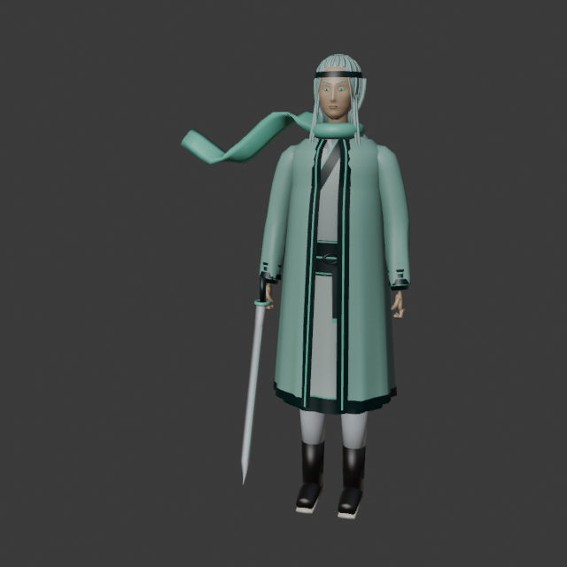
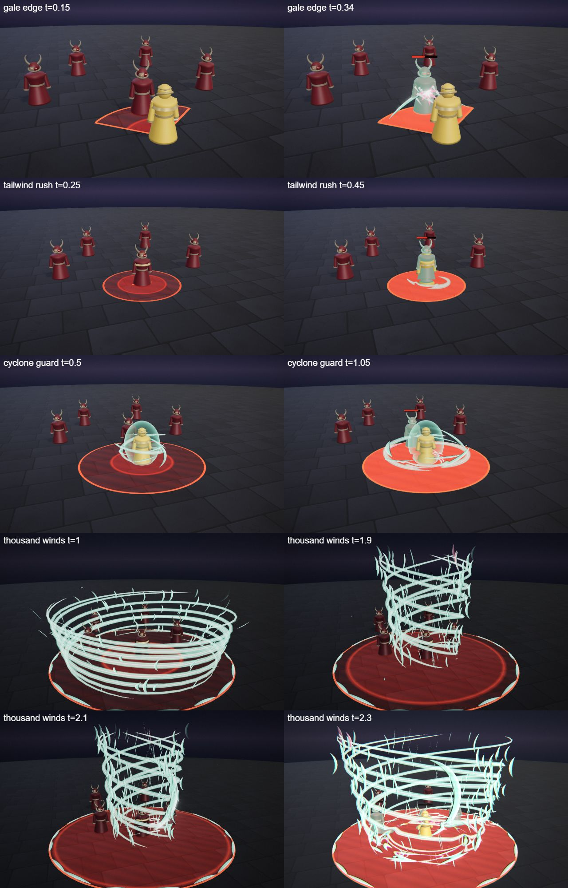
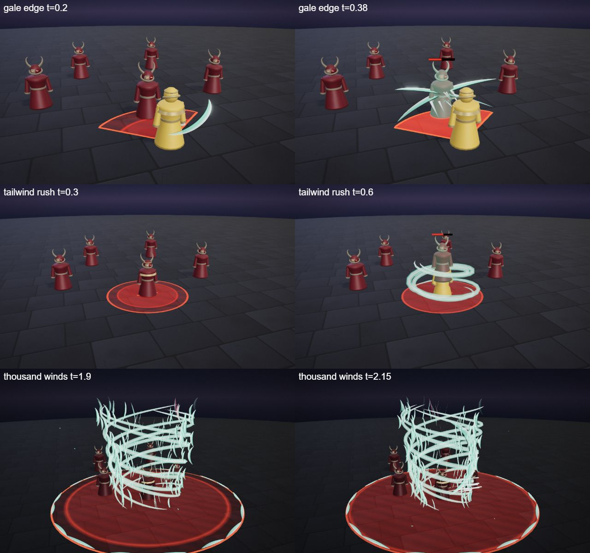
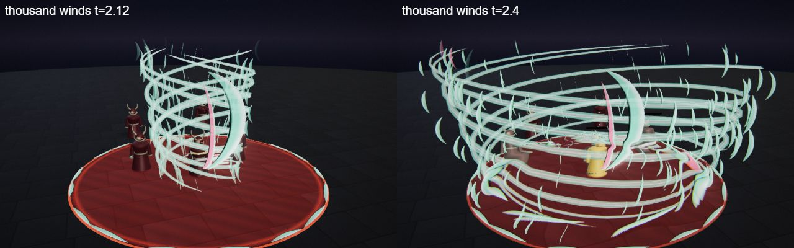

# Zephyr, the Wind Blade

The sky hero kit: Zephyr's four spells (Q, W, E and the R ultimate), the shared parts file, the palette row and the rigged hero model. A melee fighter in a white and mint wrap coat with a slim curved sword and a long scarf that always streams in the wind. He is the first hero built on the [combat mechanics](../../architecture/mechanics.md): a melee kit with extra HP, a dash, a knock-up and a shield.

## At a glance

| | |
|---|---|
| Hero | Zephyr, the Wind Blade |
| Spell category | `hero: sky` |
| Parts file | [`src/effects/parts/sky.ts`](../../../src/effects/parts/sky.ts) |
| Kit data | [`src/kits/sky.ts`](../../../src/kits/sky.ts) |
| Kit sheet | [`kit-sky.md`](../../../pipeline/designs/kit-sky.md) (read [kit-common.md](../../../pipeline/designs/kit-common.md) first) |
| Model | [`public/models/heroes/sky.glb`](../../../public/models/heroes/sky.glb) |

## Palette

The art bible row "Sky" ([ART_BIBLE.md](../../ART_BIBLE.md) section 2, energy value ladders). Every effect of the kit picks from this row.

| Core | Hot | Body | Accent | Dark | Foil |
|---|---|---|---|---|---|
| `#ffffff` | `#e6fff6` | `#7fe6c8` | `#ff8fb0` | `#0d2a2a` | cloud `#eef3f6` |

Core is only tiny highlights; hot is the leading edge of a crescent; body is the mint wind; accent (blossom pink) only 2-3 frames at hits and on a few leaves; dark is the inner edge of a crescent and the storm-teal sky; the cloud foil is the speed lines and the pale side of the leaves.

## Signature shape and material rules

The wind crescent. Wind is drawn as sharp, pale sickle crescents with a hot leading edge and a thin dark inner edge, joined by thin spiral gust ribbons and a few blown leaves. Every spell is a blade of wind: a swing, a rush, a whirl, a cyclone of blades. Not smoke, not cloud puffs and not the storm kit's lightning (Kaia): flat, hard-edged cut-outs and fine lines.

- Crescents: flat, unlit, needle tips; the sweep-on shows the hot edge first.
- Gust ribbons: thin translucent bands with a hot centre line and a faint dark rim.
- Leaves: small two-tone teardrops, a handful per hit, tumbling in the wind.

## Mechanics

Zephyr uses these pieces of [the combat mechanics](../../architecture/mechanics.md):

| Mechanic | Where |
|---|---|
| Melee kit | `melee: true` and `maxHp: 700` in the kit data (the default is 600; the extra HP pays for having to close in). The duel AI walks up to about 2 m, never backs off and keeps chasing. The Q range is only 3 |
| Dash | W has `dash: true` and `cc: true`: he slides to the aimed spot with `ctx.moveCaster(point, 0.25)` and re-checks the enemies at the spot he really reaches. The AI casts it only to close a gap |
| Knock-up | W lifts every enemy within 2.5 for 0.4 s (`status: { kind: 'knockup' }`, cap 0.8 s); R lifts for 0.5 s. A knock-up is a stun, so it is followed by 0.5 s of stun immunity |
| Shield | E gives `ctx.shieldSelf(50, 3)`, a 50 point shield for 3 s |
| Skillshot, summons | none |

The numbers follow the "Mechanics budget" of [kit-common.md](../../../pipeline/designs/kit-common.md): melee 700 HP, Q about 40 with a 2.5 s cooldown, knock-ups at most 0.4 s on the W and 0.5 s on the R. In the wave 3 duel tournament he won 60%.

## Spells

All four play under the normal gameplay camera (no cinematic, no letterbox). Q, W and E are normal MOBA abilities (hit 0.3-1.0 s after the cast, clean by about 1.6 s; the E aura runs about 3 s); R is the ultimate (hit at 2.2 s, clean by 4.5 s, one dead beat). Range and cooldown come from the kit data (`src/kits/sky.ts`), hit time and length from the spell files in `src/spells/targeted/`; "hit" is the telegraph impact time and the first damage.

| Key | Label | Targeting | Range | Cooldown | Hit time | Length | What happens |
|---|---|---|---|---|---|---|---|
| Q | [gale edge](../../../src/spells/targeted/galeEdge.ts) | enemy (a 100 degree cone, radius 3.2) | 3 | 2.5 s | 0.3 s | 1.2 s | A short spiral of wind gathers round his sword arm. At the hit two crossing pale crescents sweep the cone in front of him with speed lines, a blossom-pink flash and a few leaves blown forward; everyone still inside the cone is hit. Damage 45, knock 2. |
| W | [tailwind rush](../../../src/spells/targeted/tailwindRush.ts) | ground (r 2.5) | 8 | 7 s | 0.4 s | 1.6 s | A gust ribbon trails from his feet to the point. At 0.1 s he rides it there in 0.25 s behind a streak of speed lines and one long crescent, landing in a burst of leaves. At the hit a spiral gust at the real landing spot lifts everyone within 2.5 off their feet. Damage 45, knock-up 0.4 s. |
| E | [cyclone guard](../../../src/spells/targeted/cycloneGuard.ts) | self (r 4) | 0 (self) | 9 s | 1.0 s and 2.0 s (two pulses) | 3.2 s | A whirl of seven crescents and two gust ribbons wraps him (radius 1.2 to 1.8) and he takes a 50 point shield for 3 s. At 1.0 s and 2.0 s the whirl flares out to radius 4 as a ring of crescents that cuts and shoves every enemy inside; from 2.6 s it unwinds into leaves. Damage 13 per pulse, knock 2, shield 50. |
| R | [thousand winds](../../../src/spells/targeted/thousandWinds.ts) | ground (r 7) | 13 | 20 s | 2.2 s | 4.5 s | The ultimate. The world darkens to a pale storm teal and a ring of crescents marks the zone. A tall spiral of gust ribbons and about 150 small crescents rises round the zone edge to about 7 high, spinning faster while the enemies are pulled in. The cyclone tightens to radius 3 and the blades freeze edge-on pointing at the centre (dead beat 1.85-2.0 s). He dashes into the eye (`moveCaster`, 0.2 s) and a giant vertical crescent splits the centre: the cyclone bursts outward as a ring of crescents, a pink star, the hit. Damage 132, knock-up 0.5 s. |

Spell sources: [`galeEdge.ts`](../../../src/spells/targeted/galeEdge.ts), [`tailwindRush.ts`](../../../src/spells/targeted/tailwindRush.ts), [`cycloneGuard.ts`](../../../src/spells/targeted/cycloneGuard.ts), [`thousandWinds.ts`](../../../src/spells/targeted/thousandWinds.ts). Their catalog rows are in the [effect catalog](../effects.md#hero-sky).

## Parts file

[`src/effects/parts/sky.ts`](../../../src/effects/parts/sky.ts) holds everything the four spells share. Spells import it directly (`../../effects/parts/sky`). Everything is pooled, takes world-space positions and has a `reset()`; the materials are unlit toon shaders kept below the bloom threshold.

| Export | Role |
|---|---|
| `SKY`, `SKY_CSS` | palette constants (`cloud` is the pale foil) |
| `WindCrescent` | pooled flat sickles: `slash(center, dir, radius, arcDeg, tilt, seconds, opts)` sweeps one on and fades it (`SlashOptions`: `width`, `reverse`, `tone`, `spin`, `rise`, `sweep`); `put(pos, yaw, tilt, radius, arcDeg, ...)` is immediate mode for swarms (call every frame after `update`); `frozen` holds time for a dead beat |
| `GustRibbon` | thin spiral gust band: `spiral(center, radius, height, turns, seconds, width)`, `along(points, width, seconds)`, `setFunction(fn, width, head, tail, time, opacity)`, `hide()` |
| `SpeedLines` | streaks: `burst(pos, dir, count, length)`, `sweep(a, b, count, length, minLife)` |
| `Leaves` | tumbling leaves: `spawn(pos, vel, life, size)`, `blow(pos, dir, count, speed)` |

## Model

[`public/models/heroes/sky.glb`](../../../public/models/heroes/sky.glb): a rigged figure on the Dao rig (same bone names as `public/models/figures/hero.glb`, so `src/effects/weapons/hero.ts` can pose it). Built by `build("sky")` / `export("sky")` in [`blender/heroes/hero_figures.py`](../../../blender/heroes/hero_figures.py); hero mode shows it with procedural walk, breath and cast poses. It is wired through the `MODELS` map in [`src/heroes.ts`](../../../src/heroes.ts) (name `Zephyr`).

- Look: A slim fighter in a white and mint wrap coat with a split skirt, wrapped legs, windswept pale-teal hair under a mint headband, a long mint scarf streaming in the wind and a slim curved sword in his right hand.
- Props: `wind_scarf`, `curved_sword`.
- HUD portrait (canvas-drawn in the kit data): A big pale crescent behind him, two gust ribbons streaming off to the side, mint and white shoulders with a scarf, and a head with swept white hair and a pink blossom.

The wave 3 concept (Zephyr, Mortis and Ada; vector source [`wave3_concept.svg`](../../heroes/wave3_concept.svg)):

## Files

| What | Where |
|---|---|
| Kit sheet (design) | [`pipeline/designs/kit-sky.md`](../../../pipeline/designs/kit-sky.md) |
| Shared kit rules | [`pipeline/designs/kit-common.md`](../../../pipeline/designs/kit-common.md) |
| Parts | [`src/effects/parts/sky.ts`](../../../src/effects/parts/sky.ts) |
| Spells | [`galeEdge.ts`](../../../src/spells/targeted/galeEdge.ts), [`tailwindRush.ts`](../../../src/spells/targeted/tailwindRush.ts), [`cycloneGuard.ts`](../../../src/spells/targeted/cycloneGuard.ts), [`thousandWinds.ts`](../../../src/spells/targeted/thousandWinds.ts) |
| Kit data | [`src/kits/sky.ts`](../../../src/kits/sky.ts) |
| Model | [`public/models/heroes/sky.glb`](../../../public/models/heroes/sky.glb) |
| Model script | [`blender/heroes/hero_figures.py`](../../../blender/heroes/hero_figures.py) |

## Review sheets

Contact sheets in `docs/spells/` (frames over time, from `pipeline/tools/contact-sheet.js`).

### Sky review

### Sky re-check (round 2)

### Sky re-check (round 3)

## See also

- [Hero roster and shared structure](README.md)
- [Combat mechanics](../../architecture/mechanics.md)
- [Mortis (bone)](bone.md), [Ada (clockwork)](clockwork.md), [Marin (tide)](tide.md), [Kaia (storm)](storm.md)
- [Effect catalog](../effects.md)
- [Docs home](../../README.md)
- [Art bible](../../ART_BIBLE.md)
- [Kit shared rules](../../../pipeline/designs/kit-common.md)
