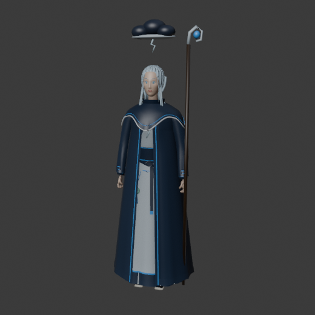
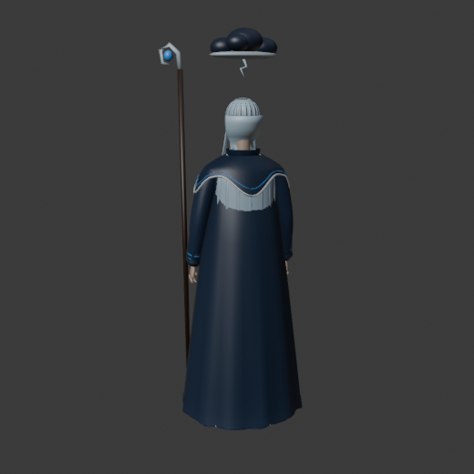

# Kaia, the Tempest Caller

The storm hero kit (v5): Kaia's four spells (Q, W, E and the R ultimate), her passive, the shared parts file, the palette row and the rigged hero model. A hooded storm caller in a rain cloak with a hooked staff. Her spells plant lightning rods on the ground; when one of her spells hurts the enemy, every rod near them arcs for extra damage. She plays at range with a basic attack of 6 m.

## Role

| | |
|---|---|
| Role | Mage (burst), ranged |
| Signature | Lightning Rods |
| HP | 580 |
| Kit shapes | Q TGT strike + rod · W GROUND great rod + recast discharge · E TGT magnet pull to a rod · R SELF storm over her |

She wins by planting rods in front of the enemy and then hitting them with another spell, so that the rods arc. Her weakness is that the enemy that stands within 1 m of a rod grounds it, and her rods last only 6 s.

## At a glance

| | |
|---|---|
| Hero | Kaia, the Tempest Caller |
| Spell category | `hero: storm` |
| Parts file | [`src/effects/parts/storm.ts`](../../../src/effects/parts/storm.ts) |
| Kit data | [`src/kits/storm.ts`](../../../src/kits/storm.ts) |
| Trait (rules) | [`src/traits/storm.ts`](../../../src/traits/storm.ts) |
| Kit sheet | [`kit-storm.md`](../../../pipeline/designs/kit-storm.md) (read [kit-common.md](../../../pipeline/designs/kit-common.md) first) |
| Model | [`public/models/heroes/storm_v2.glb`](../../../public/models/heroes/storm_v2.glb) |

## Palette

The art bible row "Storm" ([ART_BIBLE.md](../../ART_BIBLE.md) section 2, energy value ladders). Every effect of the kit picks from this row and adds black.

| Core | Hot | Body | Accent | Dark | Foil |
|---|---|---|---|---|---|
| `#ffffff` | `#d6f2ff` | `#4aa8ff` | `#ffe36a` | `#0a1220` | rain `#c8d4de` |

Core is tiny (the white line inside the lightning); accent is a yellow spark, 2-3 frames at hits; the rain foil is the rain streaks, the ripples and the lit underside of the clouds.

## Signature shape and material rules

The lightning tree: thick, hard-edged lightning that branches like a tree (a trunk that forks two or three times, getting thinner, with a dark outline), plus slanting rain sheets at one shared angle, grounded by dark flat-bottomed cloud above and puddle ripples below. Blue-white lightning in rain, not violet thunder sigils.

- Lightning: an unlit ribbon with a white core line, a blue body and a dark outline under it; it flickers on and off in 2-3 frame steps, never a smooth fade.
- Cloud: dark toon puffs with a pale lit underside, flat-bottomed.
- Rain: thin normal-blended streaks at one angle, short and sparse.

## Passive and twist

| | |
|---|---|
| Passive | Lightning Rods: her spells plant rods where they land (3 at most, each stands 6 s; a great rod stands 3 s). When a spell of hers deals damage to the enemy, every rod within 5 m of them arcs for 18 and is used up. An enemy within 1 m of a rod grounds it (it fizzles). |
| Twist | Rods are the point of her kit: Q plants one 1.5 m in front of the enemy, W plants a great rod (it counts as one of the three), E pulls the enemy toward her nearest rod, R's bolts also fall near rods. The great rod does not arc on W's own hits. |
| Resource or meter | Meter RODS, max 3 (the number of rods standing) |
| Speed | 4 m/s (the default) |
| Basic attack | ranged, 6 m, 10 damage every 1.0 s, wind-up 0.25 s, bolt speed 18, spark look |
| Other rules | The CPU against her walks to a rod within 3 m of it to ground it. The CPU playing her holds R until the enemy is within 6.8 m of her or 2.8 m of a rod. While the storm is up the passive shows a `storm` pip. |

## Mechanics

Kaia uses these pieces of [the combat mechanics](../../architecture/mechanics.md):

| Mechanic | Where |
|---|---|
| Ground marks | Rods, rings and arcs are drawn by the trait's `marks` and `markLook` on both screens |
| Recast | W: Discharge (`recast`, window 3 s, arm 1.2 s, replay on) |
| Slow | W's pulses slow 1 s |
| Pull and stun | E: pull 3 m toward her nearest rod (or her), stunned 0.6 s if it ends within 1 m of the rod. E is flagged `cc` |
| Live-position hits | The bolts are `projectile: true` (judged on live positions); the rings and circles are the warning |
| Self-cast storm | R follows her for 6 s |
| Melee, summon, dash, shield, heal | none |

## Spells

All four play under the normal gameplay camera. Range and cooldown come from the kit data (`src/kits/storm.ts`), hit time and length from the spell files in `src/spells/targeted/`; the numbers are the spell files' defaults. Rod arcs (18 each) come on top.

| Key | Label | Targeting | Range | Cooldown | Hit time | Length | What happens |
|---|---|---|---|---|---|---|---|
| Q | [sky strike](../../../src/spells/targeted/skyStrike.ts) | enemy (needs sight) | 7 | 4 s | 0.35 s | 1.4 s | A blue ring closes round the enemy and a small cloud gathers over them. At 0.35 s a lightning tree falls on their live position: 60 damage. A rod is planted 1.5 m in front of them, toward her. Rods already within 5 m of them arc for 18. |
| W | [thunder rod](../../../src/spells/targeted/thunderRod.ts) | ground (zone r 3.5) | 9 | 9 s | rod planted at 0.25 s; pulses at 1.2 s and 2.2 s | 3.4 s | A bolt plants a great rod (4.4 m tall, stands 3 s) at the spot and a 3.5 m ring fills on the ground. From 1.2 s, once a second, everyone in the ring takes 24 and is slowed 1 s. Cast again from 1.2 s to 3 s (Discharge): a huge bolt falls on the rod 0.25 s later for 50 to everyone in the ring, and the rod is spent. If the rod is gone, it only fizzles. |
| E | [polarity](../../../src/spells/targeted/polarity.ts) | enemy (needs sight) | 8 | 11 s | bolt 0.25 s; pull 1.0 s | 1.8 s | A bolt jumps to the enemy: 20 damage, and a blue horseshoe magnet spins over their head. At 1.0 s they are yanked 3 m toward her nearest rod (toward her, if she has none). If that brings them within 1 m of the rod: stunned 0.6 s. |
| R | [supercell storm](../../../src/spells/targeted/supercellStorm.ts) | self (list radius 14) | 0 (self) | 24 s | a check every 0.8 s, bolts 0.6 s later | 6.6 s | A dark flat-bottomed cloud gathers over her in 0.5 s and follows her for 6 s. Every 0.8 s, if the enemy is within 7 m of her or 3 m of one of her rods, a bolt marks their spot (a 1.2 m circle) and falls 0.6 s later: 32 if they are still inside. Rods arc as normal. |

Spell sources: [`skyStrike.ts`](../../../src/spells/targeted/skyStrike.ts), [`thunderRod.ts`](../../../src/spells/targeted/thunderRod.ts), [`polarity.ts`](../../../src/spells/targeted/polarity.ts), [`supercellStorm.ts`](../../../src/spells/targeted/supercellStorm.ts). Their catalog rows are in the [effect catalog](../effects.md#hero-storm).

## Parts file

[`src/effects/parts/storm.ts`](../../../src/effects/parts/storm.ts) holds everything the kit's spells share. Spells import it directly (`../../effects/parts/storm`). Everything is pooled, takes world-space positions and has a `reset()`.

| Export | Role |
|---|---|
| `STORM`, `STORM_CSS` | palette constants |
| `LightningTree` | a branching bolt from a start to an end point (`strike`): forks two to three levels, re-randomised every few frames while it lives, optional ground forks |
| `StormCloud` | a dark flat-bottomed cloud patch (or a turning ring with an eye): `gather`, `disperse`, and a `flash` value that lights its underside |
| `RainSheet` | slanting rain in a column or disc, one shared angle |
| `Puddles` | ground ripple rings and wet decals (cap about 10) |
| `Sparks` | short yellow-white crackle streaks |

## Model

[`public/models/heroes/storm_v2.glb`](../../../public/models/heroes/storm_v2.glb): a rigged figure on the Dao rig (same bone names as `public/models/figures/hero.glb`, so `src/effects/weapons/hero.ts` can pose it). Built in [`blender/heroes/moba_figures.py`](../../../blender/heroes/moba_figures.py) (the current style, the `_v2` models). Hero mode shows it with procedural walk, breath and cast poses. It is wired through the `MODELS` map in [`src/heroes.ts`](../../../src/heroes.ts) (name `Kaia`), and its hit size is in `HERO_BODIES` in the same file (radius 0.47 m, height 3.24 m).
- HUD portrait (canvas-drawn in the kit data): A dark cloud over slanting rain and a branching bolt, a hooded face in a rain cloak, and the hooked staff with a spark in its hook.

  

## Files

| What | Where |
|---|---|
| Kit sheet (design) | [`pipeline/designs/kit-storm.md`](../../../pipeline/designs/kit-storm.md) |
| Shared kit rules | [`pipeline/designs/kit-common.md`](../../../pipeline/designs/kit-common.md) |
| Parts | [`src/effects/parts/storm.ts`](../../../src/effects/parts/storm.ts) |
| Spells | [`skyStrike.ts`](../../../src/spells/targeted/skyStrike.ts), [`thunderRod.ts`](../../../src/spells/targeted/thunderRod.ts), [`polarity.ts`](../../../src/spells/targeted/polarity.ts), [`supercellStorm.ts`](../../../src/spells/targeted/supercellStorm.ts) |
| Kit data | [`src/kits/storm.ts`](../../../src/kits/storm.ts) |
| Trait (passive, twist, rules) | [`src/traits/storm.ts`](../../../src/traits/storm.ts) |
| Model | [`public/models/heroes/storm_v2.glb`](../../../public/models/heroes/storm_v2.glb) |
| Model script | [`blender/heroes/moba_figures.py`](../../../blender/heroes/moba_figures.py) |

## See also

- [Hero roster and shared structure](README.md)
- [Combat mechanics](../../architecture/mechanics.md)
- [Sefu (sand)](sand.md), [Nyx (shadow)](shadow.md), [Fenna (grove)](grove.md), [Lyra (astral)](astral.md)
- [Effect catalog](../effects.md)
- [Docs home](../../README.md)
- [Art bible](../../ART_BIBLE.md)
- [Kit shared rules](../../../pipeline/designs/kit-common.md)
