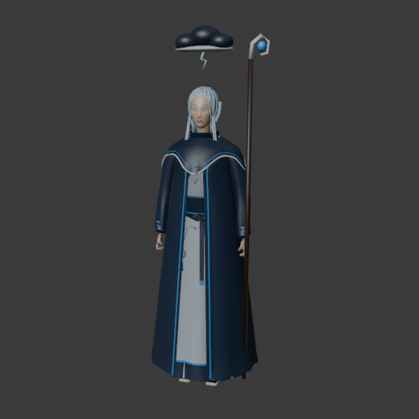
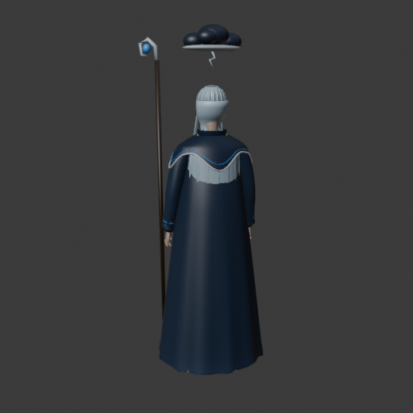
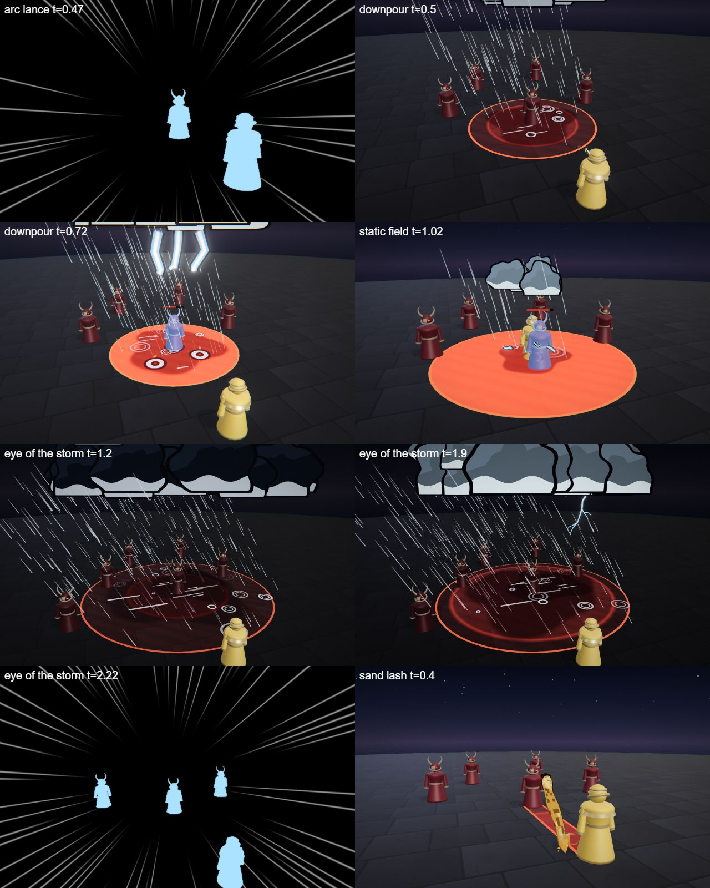
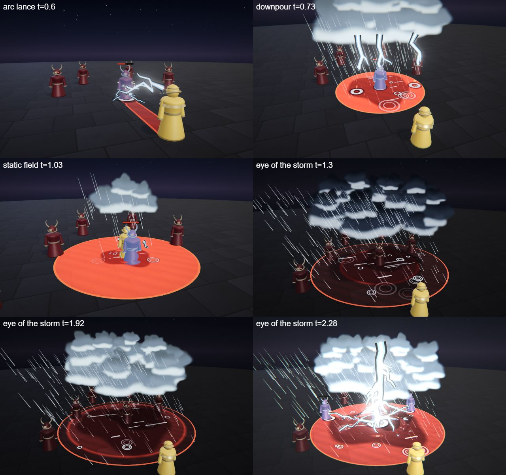

# Kaia, the Tempest Caller

The storm hero kit: Kaia's four spells (Q, W, E and the R ultimate), the shared parts file, the palette row and the rigged hero model. A young storm caller with a hooked staff and a rain cloak; fast, harassing, lightning from above.

## Role

| | |
|---|---|
| Role | Mage (burst) |
| Signature | Unavoidable lightning: the only instant hits |
| HP | 560 |
| Reach | Ranged |

She bursts: her lightning cannot be dodged once it is cast, and the ring and the zones stun and slow. She has little HP and the nova can be out-walked.

## At a glance

| | |
|---|---|
| Hero | Kaia, the Tempest Caller |
| Spell category | `hero: storm` |
| Parts file | [`src/effects/parts/storm.ts`](../../../src/effects/parts/storm.ts) |
| Kit data | [`src/kits/storm.ts`](../../../src/kits/storm.ts) |
| Kit sheet | [`kit-storm.md`](../../../pipeline/designs/kit-storm.md) (read [kit-common.md](../../../pipeline/designs/kit-common.md) first) |
| Model | [`public/models/heroes/storm.glb`](../../../public/models/heroes/storm.glb) |

## Palette

The art bible row "Storm" ([ART_BIBLE.md](../../ART_BIBLE.md) section 2, energy value ladders). Every effect of the kit picks from this row and adds black.

| Core | Hot | Body | Accent | Dark | Foil |
|---|---|---|---|---|---|
| `#ffffff` | `#d6f2ff` | `#4aa8ff` | `#ffe36a` | `#0a1220` | rain `#c8d4de` |

Core is tiny (the white line inside the lightning); accent is a yellow spark, 2-3 frames at hits; the rain foil is the rain streaks, the ripples and the lit underside of the clouds.

## Signature shape and material rules

The lightning tree: thick, hard-edged lightning that branches like a tree (a trunk that forks two or three times, getting thinner, with a dark outline), plus slanting rain sheets at one shared angle, grounded by dark flat-bottomed cloud above and puddle ripples below. Blue-white lightning in rain, not violet thunder sigils.

- Lightning: an unlit ribbon with a white core line, a blue body and a dark outline under it; it flickers on and off in 2-3 frame steps, never a smooth fade.
- Cloud: dark toon puffs with a pale lit underside, flat-bottomed.
- Rain: thin normal-blended streaks at one angle, short and sparse.

## Spells

All four play under the normal gameplay camera (no cinematic, no letterbox). The four slots are four different spell types (see the Targeting column). Q is an instant chain, W a rain zone, E a ring that grows from her and R a ground ultimate. Q, W and E hit 0.45-1.4 s after the cast and are clean by about 2.6 s; R is the ultimate (hit at 2.2 s, clean by 4.5 s, one dead beat and impact frames). Range and cooldown come from the kit data (`src/kits/storm.ts`), hit time and length from the spell files in `src/spells/targeted/`; "hit" is the telegraph impact time and the first damage.

| Key | Label | Targeting | Range | Cooldown | Hit time | Length | What happens |
|---|---|---|---|---|---|---|---|
| Q | [arc lance](../../../src/spells/targeted/arcLance.ts) | enemy (TGT, chains to a 2nd) | 11 | 3 s | 0.45 s | 1.5 s | She points the hooked staff and a horizontal lightning tree jumps from the tip to one enemy and splits into the ground at its feet. A yellow star pops, three small ground forks spread, the bolt flickers out in steps. Damage 50. The bolt then chains to a second enemy within 6 m for half damage (25). |
| W | [downpour](../../../src/spells/targeted/downpour.ts) | ground (r 4, ZONE) | 10 | 7 s | 0.7 s (centre bolt 1.3 s) | 2.3 s | A storm cloud gathers high over the point and rain falls inside the circle. Three lightning trees strike down out of it at once, then one more hits the centre. The rain thins and the floor dries. Damage 40 and slow 1.0 s, then 15. Hits check where the enemy stands now. |
| E | [static field](../../../src/spells/targeted/staticField.ts) | self (r 5, NOVA) | 0 (self) | 9 s | 1.4 s (the ring leaves at 0.9 s) | 2.6 s | A small cloud forms over her head and a ring of short arcs circles her at radius 1.5 in light rain. At 0.9 s a ring of lightning expands from her to 5 m in 0.5 s. It hits once, on the frame its front passes an enemy: damage 20 and stun 0.5 s. Stand far away, or inside before it starts. |
| R | [eye of the storm](../../../src/spells/targeted/eyeOfTheStorm.ts) | ground (r 5, ZONE) | 13 | 20 s | 2.2 s | 4.5 s | The ultimate. The world darkens and a vast ring of storm cloud with a clear eye turns over the zone; the eye narrows, dead beat at 1.85-2.0 s, then one colossal lightning tree slams down through the eye and forks across the floor to every enemy. Impact frames, refraction ring, then the cloud breaks up. Damage 140. |

Spell sources: [`arcLance.ts`](../../../src/spells/targeted/arcLance.ts), [`downpour.ts`](../../../src/spells/targeted/downpour.ts), [`staticField.ts`](../../../src/spells/targeted/staticField.ts), [`eyeOfTheStorm.ts`](../../../src/spells/targeted/eyeOfTheStorm.ts). Their catalog rows are in the [effect catalog](../effects.md#hero-storm).

## Parts file

[`src/effects/parts/storm.ts`](../../../src/effects/parts/storm.ts) holds everything the four spells share. Spells import it directly (`../../effects/parts/storm`). Everything is pooled, takes world-space positions and has a `reset()`.

| Export | Role |
|---|---|
| `STORM`, `STORM_CSS` | palette constants |
| `LightningTree` | a branching bolt from a start to an end point (`strike`): forks two to three levels, re-randomised every few frames while it lives, optional ground forks |
| `StormCloud` | a dark flat-bottomed cloud patch (or a turning ring with an eye): `gather`, `disperse`, and a `flash` value that lights its underside |
| `RainSheet` | slanting rain in a column or disc, one shared angle |
| `Puddles` | ground ripple rings and wet decals (cap about 10) |
| `Sparks` | short yellow-white crackle streaks |

## Model

[`public/models/heroes/storm.glb`](../../../public/models/heroes/storm.glb): a rigged figure on the Dao rig (same bone names as `public/models/figures/hero.glb`, so `src/effects/weapons/hero.ts` can pose it). Built by `build("storm")` / `export("storm")` in [`blender/heroes/hero_figures.py`](../../../blender/heroes/hero_figures.py); hero mode shows it with procedural walk, breath and cast poses. It is wired through the `MODELS` map in [`src/heroes.ts`](../../../src/heroes.ts).

- Look: A slim young woman in a storm-blue rain cloak over a pale tunic, wind-swept silver-blue hair and glowing storm-blue eyes; a small storm cloud floats over her head and she carries a hooked staff.
- Props: `cloud_crown`, `hooked_staff`, `bolt_emblem`.
- HUD portrait (canvas-drawn in the kit data): A dark cloud over slanting rain and a branching bolt, a hooded face in a rain cloak, and the hooked staff with a spark in its hook.

 

## Files

| What | Where |
|---|---|
| Kit sheet (design) | [`pipeline/designs/kit-storm.md`](../../../pipeline/designs/kit-storm.md) |
| Shared kit rules | [`pipeline/designs/kit-common.md`](../../../pipeline/designs/kit-common.md) |
| Parts | [`src/effects/parts/storm.ts`](../../../src/effects/parts/storm.ts) |
| Spells | [`arcLance.ts`](../../../src/spells/targeted/arcLance.ts), [`downpour.ts`](../../../src/spells/targeted/downpour.ts), [`staticField.ts`](../../../src/spells/targeted/staticField.ts), [`eyeOfTheStorm.ts`](../../../src/spells/targeted/eyeOfTheStorm.ts) |
| Kit data | [`src/kits/storm.ts`](../../../src/kits/storm.ts) |
| Model | [`public/models/heroes/storm.glb`](../../../public/models/heroes/storm.glb) |
| Model script | [`blender/heroes/hero_figures.py`](../../../blender/heroes/hero_figures.py) |

## Review sheets

Contact sheets in `docs/spells/` (frames over time, from `pipeline/tools/contact-sheet.js`).

### Storm review (round 1)

### Storm re-check (round 2)

## See also

- [Hero roster and shared structure](README.md)
- [Sefu (sand)](sand.md), [Nyx (shadow)](shadow.md), [Vesper (blood)](blood.md), [Brannoc (forge)](forge.md), [Isolde (frost)](frost.md), [Lyra (astral)](astral.md), [Vex (alchemy)](alchemy.md)
- [Effect catalog](../effects.md)
- [Docs home](../../README.md)
- [Art bible](../../ART_BIBLE.md)
- [Kit shared rules](../../../pipeline/designs/kit-common.md)
