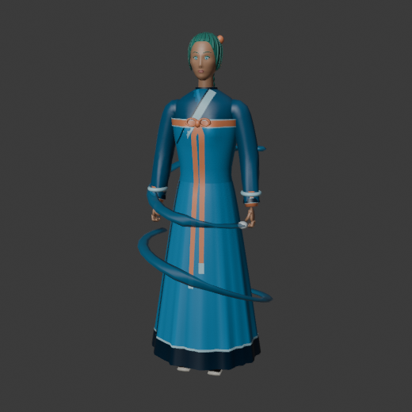

# Marin, the Tide Dancer

The tide hero kit (kits v5): Marin's four spells (Q, W, E and the R ultimate), her passive, the shared parts file, the palette row and the rigged hero model. A slim barefoot dancer in a sea-glass dress who swirls ribbons of water. The tide turns every 8 s, and her spells push the enemy away at High tide and pull it to her at Low tide.

## Role

| | |
|---|---|
| Role | Controller (ranged attack) |
| Signature | Turning Tide |
| HP | 610 |
| Kit shapes | Q BOLT skillshot, push or pull · W ZONE coral pillar (a real obstacle), push or pull · E DASH, untouchable, splash, flips the tide · R SELF channel, drag + crash |

She wins a 1v1 by choosing the tide: she throws at the tide that suits her and flips it with Mist Form. Her weakness is that after Mist Form she has no way out for 10 s, and anyone can read the tide from the ring at her feet. Walking toward her at Low tide leaves her spells nothing to drag. Walk speed 4.1 m/s.

## At a glance

| | |
|---|---|
| Hero | Marin, the Tide Dancer |
| Spell category | `hero: tide` |
| Parts file | [`src/effects/parts/tide.ts`](../../../src/effects/parts/tide.ts) |
| Kit data | [`src/kits/tide.ts`](../../../src/kits/tide.ts) |
| Trait data | [`src/traits/tide.ts`](../../../src/traits/tide.ts) |
| Kit sheet | [`kit-tide.md`](../../../pipeline/designs/kit-tide.md) (read [kit-common.md](../../../pipeline/designs/kit-common.md) first) |
| Model | [`public/models/heroes/tide.glb`](../../../public/models/heroes/tide.glb) |

## Palette

The art bible row "Tide" ([ART_BIBLE.md](../../ART_BIBLE.md) section 2, energy value ladders). Every effect of the kit picks from this row.

| Core | Hot | Body | Accent | Dark | Foil |
|---|---|---|---|---|---|
| `#ffffff` | `#bff2ff` | `#1f9fd6` | `#ff9a6a` | `#05253a` | foam `#eaf8fb` |

Core is only tiny highlights; hot is shallow water and the foam shadow; body is the water; accent (coral) only 2-3 frames at hits; dark is deep water and the ribbon's underside; the foam foil is the foam crests and splash rims.

## Signature shape and material rules

The water ribbon. Water moves as thick, smooth ribbons that she swirls like a dancer's sash: a curling band of clear blue water with a white foam crest on its leading edge, throwing spinning droplets off the curls. Every spell is a dance move: a whip, a spiral, a fountain, a wave. Not a sea wave wall or moonlit tide (the existing great wave and lunar tide): ribbons and foam at human scale, choreographed.

- Ribbons: a smooth band with a deep underside, the body colour, a shallow lighter top and a foam gradient on the leading edge; no gloss highlight, no faceting, translucent at most 0.85.
- Droplets: small teardrops stretched along their velocity, few.
- Splashes: crown-shaped foam rings on the floor.

## Passive and twist

| | |
|---|---|
| Passive | **Turning Tide**: the tide turns every 8 s, and Mist Form turns it when she reforms. At High tide her spells push the enemy away; at Low tide they pull it toward her. A ring at her feet shows the tide and the time left. |
| Twist | none. The tide is the whole rule |
| Resource or meter | meter `TIDE` (max 8): the seconds left until the next turn. A ring at her feet (radius 1.6, on both screens) is pale at High tide and blue at Low tide; its arc is the time left. During Moon's Pull it is blue and shows the moon's time left |
| Walk speed | 4.1 m/s |
| Basic attack | ranged, 6.5 m, 10 per 0.7 s, wind-up 0.18 s, bolt speed 20, wave look |

Other trait rules (`src/traits/tide.ts`):

- The tide is kept in `t.mem` (`epoch`, `base`), the same on both screens. It starts at High. Mist Form's flip is sent as `tideflip` so the other screen flips too.
- The spell effects always hand `dealt` the Low-tide shape (a pull toward the source); the trait flips it into a push at High tide. A push is a pull toward a point behind the victim, so it moves the same metres on a foe and on the player hero.
- Mist Form: for 0.25 s (the dash) every hit on her is swallowed.
- Moon's Pull is a 3 s channel. While it runs the tide is held at Low and her pulls are doubled.

## Mechanics

Marin uses these pieces of [the combat mechanics](../../architecture/mechanics.md):

| Mechanic | Where |
|---|---|
| Push and pull | Q (2.5 m), W (3 m push, 2 m pull), R (drag). Pull works the same on foes and on the player hero; units and network duels follow the mechanics page |
| Obstacle | Coral Spire stands 5 s as a real obstacle (radius 0.8) |
| Dash | Mist Form, up to 6 m in 0.25 s, untouchable meanwhile (kit flags `dash` and `parry`) |
| Channel | Moon's Pull, 3 s; a stun, silence or knock-up ends it |
| Skillshot | Wave Disc (line, radius 0.8, speed 20) |
| Summon, heal, shield | none |

## Spells

All four play under the normal gameplay camera. Range and cooldown come from the kit data (`src/kits/tide.ts`), hit time and length from the spell files in `src/spells/targeted/`; "hit" is the telegraph impact time and the first damage.

| Key | Label | Targeting | Range | Cooldown | Hit time | Length | What happens |
|---|---|---|---|---|---|---|---|
| Q | [wave disc](../../../src/spells/targeted/waveDisc.ts) | ground (BOLT skillshot, line, radius 0.8) | 9 | 4 s | thrown at 0.3 s, then flight at 20 m/s | 2.0 s | A spinning disc of water flies down the aim. Damage 52. High tide: knocks the enemy back 2.5 m. Low tide: pulls it 2.5 m toward her, on a short water tether. |
| W | [coral spire](../../../src/spells/targeted/coralSpire.ts) | ground (r 2.5 hit circle) | 8 (at least 2 from her) | 9 s | 0.9 s | 6.7 s | A coral pillar bursts up at the spot and stands for 5 s as a real obstacle (radius 0.8), then cracks and sinks. As it rises the enemy within 2.5 m takes 44. High tide shoves it 3 m away, Low tide drags it 2 m to the pillar. |
| E | [mist form](../../../src/spells/targeted/mistForm.ts) | ground (dash to the aim, splash r 3) | 6 | 10 s | 0.25 s | 1.15 s | She turns to water and flows up to 6 m to the aim, through the enemy if it is in the way, untouchable for the 0.25 s run. She reforms at the end spot in a splash: 40 within 3 m. The tide flips. |
| R | [moon's pull](../../../src/spells/targeted/moonPull.ts) | self (radius 25) | 12 | 22 s | moon up at 0.3 s; ends at 3.0 s | 3.9 s | A pale moon with orbiting sea-glass beads stands over her head and she roots herself for 3 s. The tide is held at Low and her pulls are doubled. An enemy within 12 m that she can see is dragged toward her at 2.4 m/s (it stops 1.6 m from her) for 8 every 1/3 s, 24 a second, on up to 2 tethers. If it is within 2.5 m when the moon sets by itself, a tide crash hits for 110. |

Spell sources: [`waveDisc.ts`](../../../src/spells/targeted/waveDisc.ts), [`coralSpire.ts`](../../../src/spells/targeted/coralSpire.ts), [`mistForm.ts`](../../../src/spells/targeted/mistForm.ts), [`moonPull.ts`](../../../src/spells/targeted/moonPull.ts). Their catalog rows are in the [effect catalog](../effects.md#hero-tide).

## Parts file

[`src/effects/parts/tide.ts`](../../../src/effects/parts/tide.ts) holds everything the four spells share. Spells import it directly (`../../effects/parts/tide`). Everything is pooled, takes world-space positions and has a `reset()`; the materials are unlit toon shaders kept below the bloom threshold.

| Export | Role |
|---|---|
| `TIDE`, `TIDE_CSS` | palette constants (`foam` is the pale foil) |
| `WaterRibbon` | a thick smooth water band with a foam crest on its head and droplets shed from the curls: `setPath(points, width, head, tail, time)`, `setFunction(fn, width, head, tail, time)`, `hide()` |
| `Droplets` | instanced spinning teardrops with gravity that land in small splash rings: `spray(pos, dir, count, speed)`, `drop(pos, vel, life, size)` |
| `SplashCrown` | a foam crown splash on the floor: `burst(pos, size, life)` |
| `WaterPool` | a shallow ripple pool decal: `spread(center, radius, seconds)`, `ripple(pos)`, `drain(seconds)` |
| `SerpentHead` | the serpent head of the ultimate (foam mane, eye glints): `place(pos, dir, scale, open)`, `hide()` |
| `TideRing` | the tide ring at her feet: a thin rim with eight chevrons that march outward in pale foam at High tide and inward in deep blue at Low tide: `set(pos, high, opacity, time, radius)` |
| `TideCurrent` | flowing streaks on the floor round a centre, foam darts outward (High) or blue darts spiralling inward (Low): `set(center, rMin, rMax, inward, strength, time)` |
| `WaterDisc` | the spinning disc of water (flat lens, foam rim, three foam arms): `set(pos, scale, spin, high)` |
| `CoralSpire` | the coral pillar (a central spike, seven leaning branches, a foam collar): `grow(k)`, `sink(k)`, `opacity` |
| `MoonHalo` | a pale moon disc over her head with orbiting sea-glass beads: `set(pos, size, opacity, time)` |

## Model

[`public/models/heroes/tide.glb`](../../../public/models/heroes/tide.glb): a rigged figure on the Dao rig (same bone names as `public/models/figures/hero.glb`, so `src/effects/weapons/hero.ts` can pose it). Built by `build("tide")` / `export("tide")` in [`blender/heroes/hero_figures.py`](../../../blender/heroes/hero_figures.py). Hero mode shows it with procedural walk, breath and cast poses. It is wired through the `MODELS` map in [`src/heroes.ts`](../../../src/heroes.ts). Hit size (`HERO_BODIES`): radius 0.43 m, height 2.29 m.

- Look: a slim barefoot dancer in a deep teal dress with sea-glass layers and a coral sash, a sea-green braid with a coral clip, water rings on her wrists and two water sashes swirling around her.
- Props: `coral_clip`, `wrist_rings`, `water_sashes`.
- HUD portrait (canvas-drawn in the kit data): sashes of water sweeping round her, a wave-blue wrap on the shoulders and a head with a swept dark hair line and a coral flower.

## Files

| What | Where |
|---|---|
| Kit sheet (design) | [`pipeline/designs/kit-tide.md`](../../../pipeline/designs/kit-tide.md) |
| Shared kit rules | [`pipeline/designs/kit-common.md`](../../../pipeline/designs/kit-common.md) |
| Kits v5 design | [`pipeline/designs/kits-v5.md`](../../../pipeline/designs/kits-v5.md) |
| Parts | [`src/effects/parts/tide.ts`](../../../src/effects/parts/tide.ts) |
| Spells | [`waveDisc.ts`](../../../src/spells/targeted/waveDisc.ts), [`coralSpire.ts`](../../../src/spells/targeted/coralSpire.ts), [`mistForm.ts`](../../../src/spells/targeted/mistForm.ts), [`moonPull.ts`](../../../src/spells/targeted/moonPull.ts) |
| Kit data | [`src/kits/tide.ts`](../../../src/kits/tide.ts) |
| Trait | [`src/traits/tide.ts`](../../../src/traits/tide.ts) |
| Model | [`public/models/heroes/tide.glb`](../../../public/models/heroes/tide.glb) |
| Model script | [`blender/heroes/hero_figures.py`](../../../blender/heroes/hero_figures.py) |

## See also

- [Hero roster and shared structure](README.md)
- [Combat mechanics](../../architecture/mechanics.md)
- [Auriel (dawn)](dawn.md), [Zephyr (sky)](sky.md)
- [Effect catalog](../effects.md)
- [Docs home](../../README.md)
- [Art bible](../../ART_BIBLE.md)
- [Kit shared rules](../../../pipeline/designs/kit-common.md)
