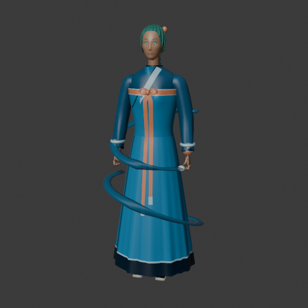
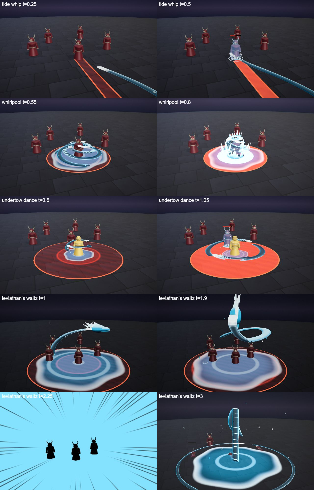
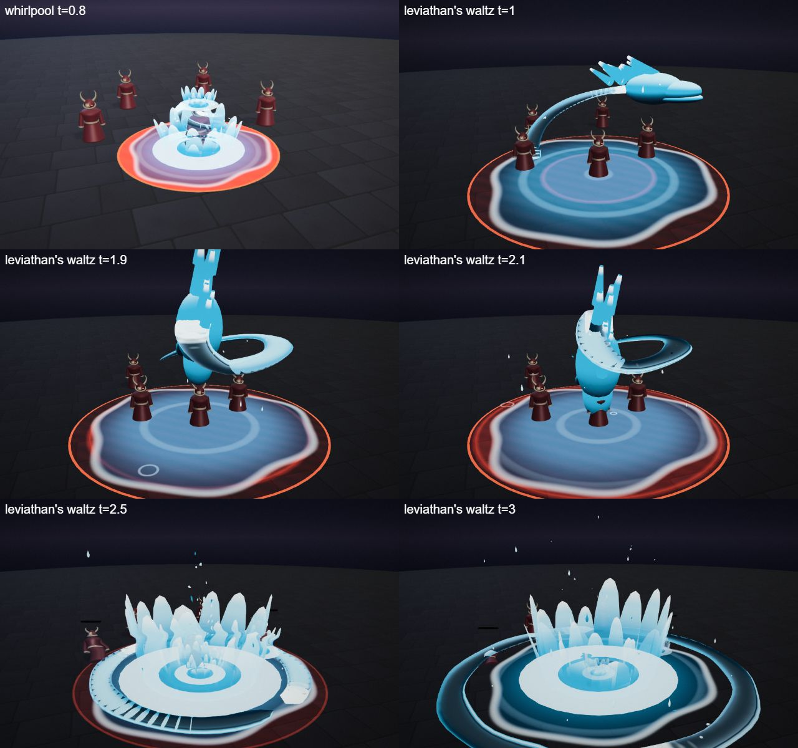

# Marin, the Tide Dancer

The tide hero kit: Marin's four spells (Q, W, E and the R ultimate), the shared parts file, the palette row and the rigged hero model. A barefoot dancer with flowing sashes and water rings on her wrists; agile, she pushes and pulls. Every spell is a dance move.

## At a glance

| | |
|---|---|
| Hero | Marin, the Tide Dancer |
| Spell category | `hero: tide` |
| Parts file | [`src/effects/parts/tide.ts`](../../../src/effects/parts/tide.ts) |
| Kit data | [`src/kits/tide.ts`](../../../src/kits/tide.ts) |
| Kit sheet | [`kit-tide.md`](../../../pipeline/designs/kit-tide.md) (read [kit-common.md](../../../pipeline/designs/kit-common.md) first) |
| Model | [`public/models/heroes/tide.glb`](../../../public/models/heroes/tide.glb) |

## Palette

The art bible row "Tide" ([ART_BIBLE.md](../../ART_BIBLE.md) section 2, energy value ladders). Every effect of the kit picks from this row.

| Core | Hot | Body | Accent | Dark | Foil |
|---|---|---|---|---|---|
| `#ffffff` | `#bff2ff` | `#1f9fd6` | `#ff9a6a` | `#05253a` | foam `#eaf8fb` |

Core is only tiny highlights; hot is shallow water and the foam shadow; body is the water; accent (coral) only 2-3 frames at hits; dark is deep water and the ribbon's underside; the foam foil is the foam crests and splash rims.

## Signature shape and material rules

The water ribbon. Water moves as thick, smooth ribbons that she swirls like a dancer's sash: a curling band of clear blue water with a white foam crest on its leading edge, throwing spinning droplets off the curls. Every spell is a dance move: a whip, a spiral, a fountain, a wave. Not a sea wave wall or moonlit tide (the existing great wave and lunar tide): ribbons and foam at human scale, choreographed.

- Ribbons: a smooth band with a deep underside, the body colour, a shallow lighter top and a foam gradient on the leading edge; no gloss highlight, no faceting, translucent at most 0.85.
- Droplets: small teardrops stretched along their velocity, few.
- Splashes: crown-shaped foam rings on the floor.

## Spells

All four play under the normal gameplay camera (no cinematic, no letterbox). Q, W and E are normal MOBA abilities (hit 0.45-1.0 s after the cast, clean by about 2.3 s; an E aura may run about 3 s); R is the ultimate (hit at 2.2 s, clean by 4.5 s, one dead beat and impact frames). Range and cooldown come from the kit data (`src/kits/tide.ts`), hit time and length from the spell files in `src/spells/targeted/`; "hit" is the telegraph impact time and the first damage.

| Key | Label | Targeting | Range | Cooldown | Hit time | Length | What happens |
|---|---|---|---|---|---|---|---|
| Q | [tide whip](../../../src/spells/targeted/tideWhip.ts) | enemy | 10 | 3 s | 0.45 s | 1.5 s | She spins and a water ribbon unrolls from her wrist in a curl. At the hit the ribbon lashes out to the enemy like a whip, wraps around it once and bursts into a splash crown: coral accent for 2 frames, droplets, a small ground refraction ring, one impact frame. The ribbon falls as droplets and the pool drains. Damage 50, knock 3. |
| W | [whirlpool](../../../src/spells/targeted/whirlpool.ts) | ground (r 4) | 10 | 7 s | 0.75 s | 2.3 s | A water pool spreads at the point and three ribbons rise from it and spiral around the centre faster and faster, pulling the enemies inside toward it. At the hit the spiral snaps upward into a tall water column with a foam crown, splashes outward, shake and a ground refraction ring. The column collapses at 1.3 s and the water falls back. Damage 45, then a tick of 10 at 1.3 s. |
| E | [undertow dance](../../../src/spells/targeted/undertowDance.ts) | self (r 5) | 0 (self) | 9 s | 1.0 s and 2.0 s (two pulses) | 3.2 s | Two water ribbons rise and circle her like sashes while she spins. At 1.0 s and 2.0 s the ribbons flare out to radius 5 in a flat spinning ring of water with foam on its edge and splash every enemy inside; then they fall as droplets. Damage 13 per pulse, knock 2. |
| R | [leviathan's waltz](../../../src/spells/targeted/leviathansWaltz.ts) | ground (r 7) | 13 | 20 s | 2.2 s | 4.5 s | The ultimate. The world darkens to a deep sea blue and a water pool spreads over the zone. A huge water ribbon rises from it and coils into a serpent (a head with a foam mane and two pale eye glints, a long coiling body) circling the zone at 3-6 high while the enemies are pulled toward the centre. It rears up over the point, mouth open, dead beat at 1.85-2.0 s, then dives straight down: impact frames, a huge splash crown, a ring wave of water racing outward, coral accent, refraction ring. The water falls as rain. Damage 125, knock 6. |

Spell sources: [`tideWhip.ts`](../../../src/spells/targeted/tideWhip.ts), [`whirlpool.ts`](../../../src/spells/targeted/whirlpool.ts), [`undertowDance.ts`](../../../src/spells/targeted/undertowDance.ts), [`leviathansWaltz.ts`](../../../src/spells/targeted/leviathansWaltz.ts). Their catalog rows are in the [effect catalog](../effects.md#hero-tide).

## Parts file

[`src/effects/parts/tide.ts`](../../../src/effects/parts/tide.ts) holds everything the four spells share. Spells import it directly (`../../effects/parts/tide`). Everything is pooled, takes world-space positions and has a `reset()`; the materials are unlit toon shaders kept below the bloom threshold.

| Export | Role |
|---|---|
| `TIDE`, `TIDE_CSS` | palette constants (`foam` is the pale foil) |
| `WaterRibbon` | a thick smooth water band with a foam crest on its head and droplets shed from the curls: `setPath(points, width, head, tail, time)`, `setFunction(fn, width, head, tail, time)`, `hide()` |
| `Droplets` | instanced spinning teardrops with gravity that land in small splash rings: `spray(pos, dir, count, speed)`, `drop(pos, vel, life, size)` |
| `SplashCrown` | a foam crown splash on the floor: `burst(pos, size, life)` |
| `WaterPool` | a shallow ripple pool decal: `spread(center, radius, seconds)`, `ripple(pos)`, `drain(seconds)` |
| `SerpentHead` | the serpent head of the ultimate (foam mane, eye glints): `place(pos, dir, scale, open)`, `hide()` |

## Model

[`public/models/heroes/tide.glb`](../../../public/models/heroes/tide.glb): a rigged figure on the Dao rig (same bone names as `public/models/figures/hero.glb`, so `src/effects/weapons/hero.ts` can pose it). Built by `build("tide")` / `export("tide")` in [`blender/heroes/hero_figures.py`](../../../blender/heroes/hero_figures.py); hero mode shows it with procedural walk, breath and cast poses. It is wired through the `MODELS` map in [`src/heroes.ts`](../../../src/heroes.ts).

- Look: A slim barefoot dancer in a deep teal dress with sea-glass layers and a coral sash, a sea-green braid with a coral clip, water rings on her wrists and two water sashes swirling around her.
- Props: `coral_clip`, `wrist_rings`, `water_sashes`.
- HUD portrait (canvas-drawn in the kit data): Sashes of water sweeping round her, behind and in front, a wave-blue wrap on the shoulders and a head with a swept dark hair line and a coral flower.

The wave 2 concept (Fenna, Auriel and Marin; vector source [`wave2_concept.svg`](../../heroes/wave2_concept.svg)):

## Files

| What | Where |
|---|---|
| Kit sheet (design) | [`pipeline/designs/kit-tide.md`](../../../pipeline/designs/kit-tide.md) |
| Shared kit rules | [`pipeline/designs/kit-common.md`](../../../pipeline/designs/kit-common.md) |
| Parts | [`src/effects/parts/tide.ts`](../../../src/effects/parts/tide.ts) |
| Spells | [`tideWhip.ts`](../../../src/spells/targeted/tideWhip.ts), [`whirlpool.ts`](../../../src/spells/targeted/whirlpool.ts), [`undertowDance.ts`](../../../src/spells/targeted/undertowDance.ts), [`leviathansWaltz.ts`](../../../src/spells/targeted/leviathansWaltz.ts) |
| Kit data | [`src/kits/tide.ts`](../../../src/kits/tide.ts) |
| Model | [`public/models/heroes/tide.glb`](../../../public/models/heroes/tide.glb) |
| Model script | [`blender/heroes/hero_figures.py`](../../../blender/heroes/hero_figures.py) |

## Review sheets

Contact sheets in `docs/spells/` (frames over time, from `pipeline/tools/contact-sheet.js`).

### Tide review

### Tide re-check (round 2)

## See also

- [Hero roster and shared structure](README.md)
- [Vesper (blood)](blood.md), [Brannoc (forge)](forge.md), [Isolde (frost)](frost.md), [Lyra (astral)](astral.md), [Vex (alchemy)](alchemy.md), [Kaia (storm)](storm.md), [Sefu (sand)](sand.md), [Nyx (shadow)](shadow.md), [Fenna (grove)](grove.md), [Auriel (dawn)](dawn.md)
- [Effect catalog](../effects.md)
- [Docs home](../../README.md)
- [Art bible](../../ART_BIBLE.md)
- [Kit shared rules](../../../pipeline/designs/kit-common.md)
