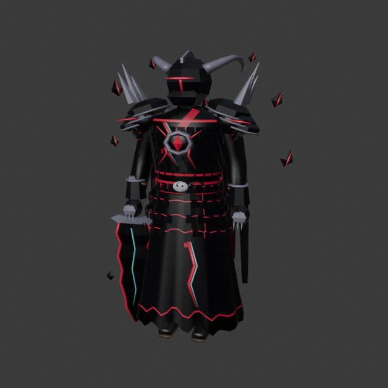
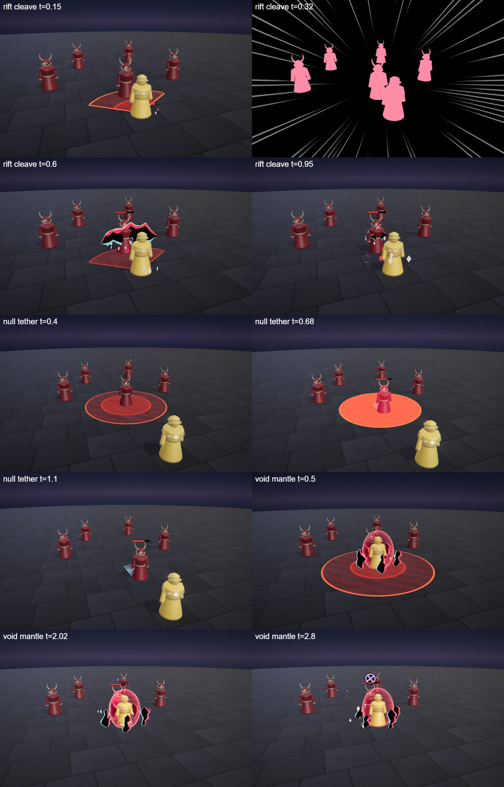
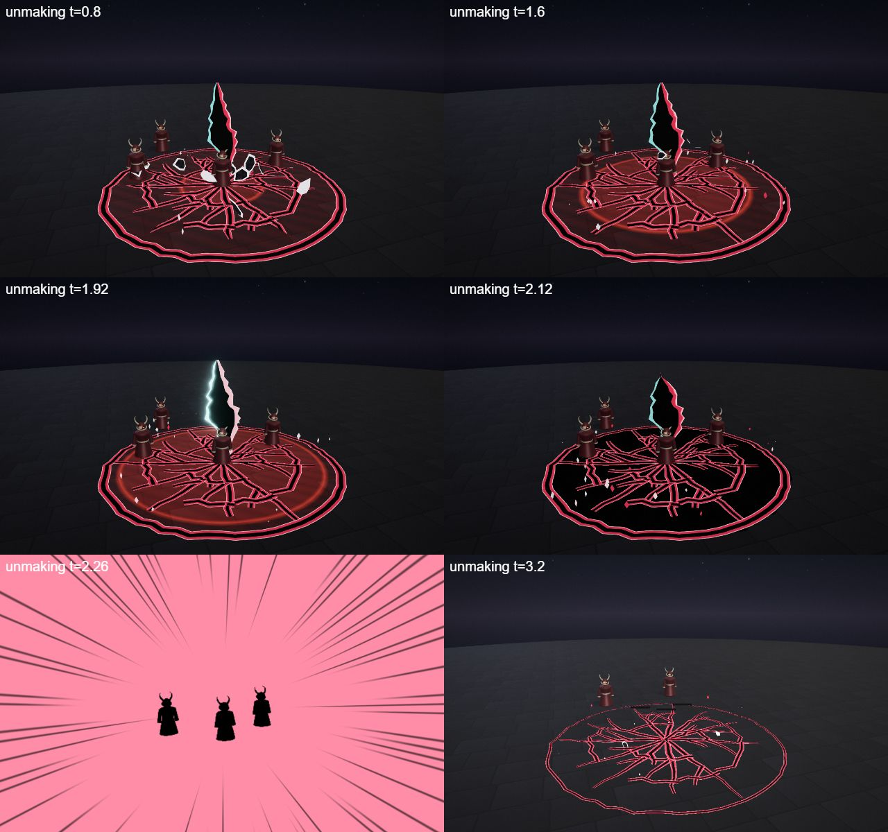
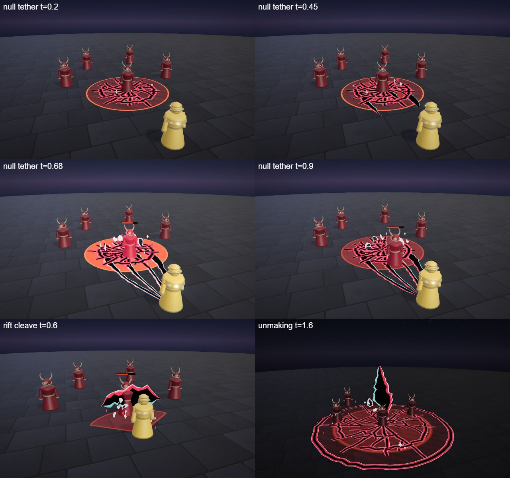

# Oblivion, the Unmaker

The void hero kit: Oblivion's four spells (Q, W, E and the R ultimate), the shared parts file, the palette row and the rigged hero model. A towering knight in black plate cracked with glowing pink rifts, a horned featureless helm with one rift slit for a visor, a ragged hem and a huge greatsword whose blade is a jagged slab of void. He is built on the [combat mechanics](../../architecture/mechanics.md): a melee juggernaut with extra HP, a pull that drags enemies to him, a slow and silences.

Tournament (19 opponents, 3 fights per ordered pairing, both sides): 26% at first, 54% after Rift Cleave 40 → 46, Null Tether 30 → 36 with pull 3 → 4 and Unmaking 100 → 110.

## Role

| | |
|---|---|
| Role | Juggernaut (melee) |
| Signature | Into the rift |
| HP | 780 |
| Kit shapes | Q CONE · W ZONE pull to him · E AURA silence · R ZONE pull + silence |

He wins a 1v1 by dragging the enemy into melee range with the tether and the ultimate, then silencing them so they cannot cast their way out. His weakness is reach: a kiter outside his pulls (W range 8, R range 13) is hard to catch.

## At a glance

| | |
|---|---|
| Hero | Oblivion, the Unmaker |
| Spell category | `hero: void` |
| Parts file | [`src/effects/parts/void.ts`](../../../src/effects/parts/void.ts) |
| Kit data | [`src/kits/void.ts`](../../../src/kits/void.ts) |
| Kit sheet | [`kit-void.md`](../../../pipeline/designs/kit-void.md) (read [kit-common.md](../../../pipeline/designs/kit-common.md) first) |
| Model | [`public/models/heroes/void.glb`](../../../public/models/heroes/void.glb) |

## Palette

The art bible row "Void" ([ART_BIBLE.md](../../ART_BIBLE.md) section 2, energy value ladders). Every effect of the kit picks from this row.

| Core | Hot | Body | Accent | Dark | Foil |
|---|---|---|---|---|---|
| `#ffffff` | `#ffc4d4` | `#ff2a55` | `#7affff` | `#000000` | ash `#d8d4e0` |

Core is only tiny highlights; hot is the bright line along a rift edge; body (rift pink-red) is the glowing edge of every tear and crack; accent (cyan) is the thin fringe on the other side of a tear and the star at an impact; dark is the void itself, pure black; the ash foil is the pale rim of the shards and the motes, which keeps the black readable on a darkened floor.

## Signature shape and material rules

Torn space. The world tears like paper or cracks like glass and the tears show pure black with nothing in them. Every rift is a jagged slit of black with a hot pink edge on one side and a thin cyan fringe on the other, like a lens that came apart. Shards of the world (flat dark flakes with a pale ash rim) drift into the tears and pale ash motes rise. Not the shadow kit (flat violet-black cut-paper silhouettes), not the astral kit (stars on violet night) and not the black-hole effect: there are no spheres, no discs and no swirling, only cuts, slits and shards.

- Rifts: unlit pure black with `depthWrite` on, so they really cut the frame; the outline is jagged and the width varies along the slit.
- Cracks: a decal of glass-like cracks on the ground, black with pink edges.
- Shards: flat flakes, dark grey faces with an ash rim, kept to 12 or fewer per spell and short-lived.
- Motes: small pale flat diamonds that rise slowly.

## Mechanics

Oblivion uses these pieces of [the combat mechanics](../../architecture/mechanics.md):

| Mechanic | Where |
|---|---|
| Melee kit | `melee: true` and `maxHp: 780` in the kit data (the default is 600; the extra HP pays for having to close in). The duel AI walks up to about 2 m, never backs off and keeps chasing. The Q range is only 3 |
| Pull | W and R use `HitOptions.pull` (see ["Pull"](../../architecture/mechanics.md#pull)). W has `pull: 4` and `knock: 0` and no `from`, so every enemy it hits is dragged toward Oblivion and stops 1 m short of him; R has `pull: 4`, `knock: 0` and `from` set to the centre of the zone, so enemies are dragged to the middle. A pull is at most 4 m, and units and network duels ignore it |
| Slow | W slows every enemy it hits for 1.0 s (walking speed x 0.6, cap 2.5 s) |
| Silence | E's one pulse silences for 1.2 s and R silences for 1.5 s (cap 1.5 s): they can move but not cast. E has no shield |
| Crowd control flag | R has `cc: true`, so the duel AI casts it first when the enemy is in range |
| Aura | E pulses once (at 1.0 s) and hits every enemy inside radius 4 for 35 with knock 1 |
| Skillshot, summon, dash, heal | none |

The numbers follow the "Mechanics budget" of [kit-common.md](../../../pipeline/designs/kit-common.md): melee 780 HP and a Q of about 40 (the code has 53). The budget also covers pulls (about 30-35 damage and at most 3 m on a W, about 100 and at most 4 m on an R); the code has W at 48 damage and 4 m and R at 120 damage and 4 m, radius 5.

## Spells

All four play under the normal gameplay camera (no cinematic, no letterbox). The four spells have different shapes: Q is a melee cone (hit at 0.3 s, clean by 1.2 s), W a ground zone that pulls enemies to him (hit at 0.65 s, clean by 1.8 s), E a single silencing burst round him (hit at 1.0 s, clean by 2.6 s), R a pulling, silencing ultimate (hit at 2.2 s, clean by 4.5 s, one dead beat). Range and cooldown come from the kit data (`src/kits/void.ts`), hit time and length from the spell files in `src/spells/targeted/`; "hit" is the telegraph impact time and the first damage.

| Key | Label | Targeting | Range | Cooldown | Hit time | Length | What happens |
|---|---|---|---|---|---|---|---|
| Q | [rift cleave](../../../src/spells/targeted/riftCleave.ts) | enemy CONE (a 110 degree cone, radius 3.2, up to 10 targets) | 3 | 2.5 s | 0.3 s | 1.2 s | The blade draws back with a few ash motes. At the hit one wide crescent sweep leaves a tear standing in the air along the arc (a black slit with a pink edge on top and a cyan fringe below); shards burst and are drawn into it, a cyan star flashes and everyone still inside the cone is hit and knocked back. From 0.5 s the rift zips shut from both ends. Damage 53, knock 2. |
| W | [null tether](../../../src/spells/targeted/nullTether.ts) | ground ZONE (r 3.5) | 8 | 8 s | 0.65 s | 1.8 s | Glass-like cracks spread over the zone (0 to 0.3 s), then four black tendril-rifts race along the ground from the zone to his feet (0.3 to 0.6 s). At 0.65 s the tears snap taut and yank: every enemy still inside the zone is hit, dragged toward him (pull 4 m) and slowed, and shards stream along the tears toward him. From 0.8 s the tears close and the cracks fade. Damage 48, pull 4, slow 1.0 s. |
| E | [void mantle](../../../src/spells/targeted/voidMantle.ts) | self AURA (r 4) | 0 (self) | 10 s | 1.0 s (one pulse) | 2.6 s | A ring of five standing rifts (about 1.4 tall) opens round him at radius 1.4 and turns slowly. At 1.0 s the rifts flare and a crack ring races out to radius 4: every enemy still inside is hit, knocked back and silenced. From 2.0 s the rifts zip shut one by one. No shield. Damage 35, knock 1, silence 1.2 s. |
| R | [unmaking](../../../src/spells/targeted/unmaking.ts) | ground ZONE (r 5) | 13 | 20 s | 2.2 s | 4.5 s | The ultimate. The world darkens to black and a crack line traces the zone edge. The ground inside cracks like glass from the centre out, plates of ground lift and drift inward, and a vast standing rift (about 6 tall) opens over the point and widens while shards and ash stream into it and the enemies are drawn in a little (up to 0.6 m, put back at the hit). At 1.6 s the rift goes still and its edges flicker cyan; dead beat 1.85-2.0 s. At 2.0 s the rift slams shut and from 2.1 s the cracked disc inverts for two frames (the floor plates go black with pink edges). At 2.2 s: two impact frames, the plates shatter outward as shards, a cyan star, a ground refraction ring, shake and the hit, which drags everyone to the middle. The shards fall and fade, the cracks heal and the darkness lifts. Damage 120, pull 4, silence 1.5 s. |

Spell sources: [`riftCleave.ts`](../../../src/spells/targeted/riftCleave.ts), [`nullTether.ts`](../../../src/spells/targeted/nullTether.ts), [`voidMantle.ts`](../../../src/spells/targeted/voidMantle.ts), [`unmaking.ts`](../../../src/spells/targeted/unmaking.ts). Their catalog rows are in the [effect catalog](../effects.md#hero-void).

## Parts file

[`src/effects/parts/void.ts`](../../../src/effects/parts/void.ts) holds everything the four spells share. Spells import it directly (`../../effects/parts/void`). Everything is pooled, takes world-space positions and has a `reset()`; the materials are unlit and kept below the bloom threshold.

| Export | Role |
|---|---|
| `VOID`, `VOID_CSS` | palette constants (`ash` is the pale foil) |
| `Rift` | jagged black tears (`RiftOptions`: `sweep`, `delay`, `wedge`, `seed`). Each slot is a ribbon with a cyan fringe, the black cut and a pink band; `open(center, dir, length, width, seconds, opts)` a slit lying on the ground, `openStanding(base, height, facing, width, seconds, opts)` a vertical slit, `openPath(points, facing, width, seconds, opts)` a slit along any polyline; each returns a slot index. `place(i, pos)`, `setWide(i, k)`, `close(seconds, index, delay)` zips shut from both ends, `flare(amount, seconds, index)` a cyan and hot flash, `snap(index)` straightens the wobble; `frozen` holds time and `flicker` makes the cyan fringe flicker |
| `Shards` | pooled flat flakes of the world: `drift(from, to, count, seconds, spread, size)` streams them into a point where they shrink away, `burst(pos, count, speed, size)` throws them out and they fall and shrink (about 1 s) |
| `Crackle` | a ground decal of glass cracks (black with pink edges): `grow(center, radius, seconds)` runs the cracks out from the centre, `ring(center, radius, seconds)` traces the outline circle, `fade(seconds)` heals them (outer cracks first), `invert(on)` fills the disc black under the cracks; `width` is the crack width at the base |
| `AshMotes` | small pale motes that rise slowly and shrink out in about 2 s: `emit(center, radius, count)` (at most 48 at once) |

The kit has no unit look: Oblivion summons nothing.

## Model

[`public/models/heroes/void.glb`](../../../public/models/heroes/void.glb): a rigged figure on the Dao rig (same bone names as `public/models/figures/hero.glb`, so `src/effects/weapons/hero.ts` can pose it). Built by `build("void")` / `export("void")` in [`blender/heroes/hero_figures.py`](../../../blender/heroes/hero_figures.py); hero mode shows it with procedural walk, breath and cast poses. It is wired through the `MODELS` map in [`src/heroes.ts`](../../../src/heroes.ts) (name `Oblivion`).

- Look: A towering, shaven, coarse-built knight in black plate with pink rift trim and a tattered hem, a horned featureless helm with one glowing rift slit for a visor, broad pauldrons with an ash rim, pink rift cracks (with a cyan fringe) across the chest and the skirt, and a greatsword whose blade is a jagged slab of void with glowing pink edges.
- Props: `void_helm`, `void_pauldrons`, `rift_cracks`, `void_greatsword`.
- HUD portrait (canvas-drawn in the kit data): A charcoal ground with ash cracks, a tall tear behind him with shards in the air, a ragged cloak whose hem breaks up into floating shards, black plate with spiked pauldrons cracked with pink rifts, and a horned helm with one rift slit.

The wave 5 concept (Oblivion, Shiori and Tempo; vector source [`wave5_concept.svg`](../../heroes/wave5_concept.svg)):

The wave 5 models in hero mode (Oblivion, Shiori and Tempo):

## Files

| What | Where |
|---|---|
| Kit sheet (design) | [`pipeline/designs/kit-void.md`](../../../pipeline/designs/kit-void.md) |
| Shared kit rules | [`pipeline/designs/kit-common.md`](../../../pipeline/designs/kit-common.md) |
| Parts | [`src/effects/parts/void.ts`](../../../src/effects/parts/void.ts) |
| Spells | [`riftCleave.ts`](../../../src/spells/targeted/riftCleave.ts), [`nullTether.ts`](../../../src/spells/targeted/nullTether.ts), [`voidMantle.ts`](../../../src/spells/targeted/voidMantle.ts), [`unmaking.ts`](../../../src/spells/targeted/unmaking.ts) |
| Kit data | [`src/kits/void.ts`](../../../src/kits/void.ts) |
| Model | [`public/models/heroes/void.glb`](../../../public/models/heroes/void.glb) |
| Model script | [`blender/heroes/hero_figures.py`](../../../blender/heroes/hero_figures.py) |

## Review sheets

Contact sheets in `docs/spells/` (frames over time, from `pipeline/tools/contact-sheet.js`).

### Void review (Q, W, E)

### Void review (R)

### Void re-check (round 2)

## See also

- [Hero roster and shared structure](README.md)
- [Combat mechanics](../../architecture/mechanics.md)
- [Shiori (ink)](ink.md), [Tempo (chrono)](chrono.md), [Sirix (hive)](hive.md), [Zephyr (sky)](sky.md)
- [Effect catalog](../effects.md)
- [Docs home](../../README.md)
- [Art bible](../../ART_BIBLE.md)
- [Kit shared rules](../../../pipeline/designs/kit-common.md)
