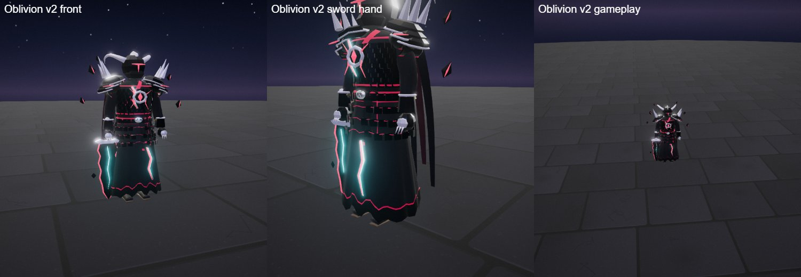

# Oblivion, the Unmaker

The void hero kit (kits v5): Oblivion's four spells (Q, W, E and the R ultimate), his passive, the shared parts file, the palette row and the rigged hero model. A towering knight in black plate cracked with glowing pink rifts, a horned helm with one glowing slit and a greatsword of void. He is built on the [combat mechanics](../../architecture/mechanics.md): a melee juggernaut with extra HP whose gravity pulls in whoever he can see while he stands still.

## Role

| | |
|---|---|
| Role | Juggernaut (melee) |
| Signature | Deep Gravity |
| HP | 780 |
| Kit shapes | Q SELF slam with a short pull · W ZONE null zone, silences inside, stops bolts · E DASH step that arms a rip · R LINE black hole that crawls, pulls and stuns, recast to collapse |

He wins a 1v1 by standing still: a ring grows round him and drags in any enemy he can see. His weakness is that while he walks he has no pull and is slower than almost everyone, so any hero can keep away. Standing still, he cannot reach you unless you are close. Walk speed 3.8 m/s.

## At a glance

| | |
|---|---|
| Hero | Oblivion, the Unmaker |
| Spell category | `hero: void` |
| Parts file | [`src/effects/parts/void.ts`](../../../src/effects/parts/void.ts) |
| Kit data | [`src/kits/void.ts`](../../../src/kits/void.ts) |
| Trait data | [`src/traits/void.ts`](../../../src/traits/void.ts) |
| Kit sheet | [`kit-void.md`](../../../pipeline/designs/kit-void.md) (read [kit-common.md](../../../pipeline/designs/kit-common.md) first) |
| Model | [`public/models/heroes/void_v2.glb`](../../../public/models/heroes/void_v2.glb) |

## Palette

The art bible row "Void" ([ART_BIBLE.md](../../ART_BIBLE.md) section 2, energy value ladders). Every effect of the kit picks from this row.

| Core | Hot | Body | Accent | Dark | Foil |
|---|---|---|---|---|---|
| `#ffffff` | `#ffc4d4` | `#ff2a55` | `#7affff` | `#000000` | ash `#d8d4e0` |

Core is only tiny highlights; hot is the bright line along a rift edge; body (rift pink-red) is the glowing edge of every tear and crack; accent (cyan) is the thin fringe on the other side of a tear and the star at an impact; dark is the void itself, pure black; the ash foil is the pale rim of the shards and the motes, which keeps the black readable on a darkened floor.

## Signature shape and material rules

Torn space. The world tears like paper or cracks like glass and the tears show pure black with nothing in them. Every rift is a jagged slit of black with a hot pink edge on one side and a thin cyan fringe on the other, like a lens that came apart. Shards of the world (flat dark flakes with a pale ash rim) drift into the tears and pale ash motes rise. Not the shadow kit (flat violet-black cut-paper silhouettes), not the astral kit (stars on violet night) and not the black-hole effect: there are no spheres, no discs and no swirling, only cuts, slits and shards.

- Rifts: unlit pure black with `depthWrite` on, so they really cut the frame; the outline is jagged and the width varies along the slit.
- Cracks: a decal of glass-like cracks on the ground, black with pink edges.
- Shards: flat flakes, dark grey faces with an ash rim, kept to 12 or fewer per spell and short-lived.
- Motes: small pale flat diamonds that rise slowly.

## Passive and twist

| | |
|---|---|
| Passive | **Deep Gravity**: while he stands still a ring grows round him: 3 m and 0.4 m/s after 1 s, then +1 m and +0.2 m/s each second up to 6 m and 1.0 m/s (level 4, after 4 s). It drags in any enemy he can see. One step ends it. |
| Twist | none (the trait has no `twist` entry) |
| Resource or meter | none. A ring round him (drawn on both screens) grows smoothly with a pulse at each level and an inner arc counting down to the next one. A pink `rip` mark pip shows while Phase Step's rip is armed |
| Walk speed | 3.8 m/s |
| Basic attack | melee, 2.6 m, 15 per 1.2 s, wind-up 0.3 s, cleave look |

Other trait rules (`src/traits/void.ts`):

- The drag runs on the victim's screen (`victimTick`, `carryEnemy`) and stops 1.5 m short of him. Cover stops it: it needs line of sight, and the cover comes from the obstacles his spells record when they are cast (before his first cast the way counts as clear).
- Phase Step arms a rip for 3 s: his next basic attack deals +40 (power 55/15) and weakens the enemy by 20% for 2 s.
- Black Hole has a recast, "Collapse" (arms after 0.3 s, window 4 s). The duel AI never fires it (`aiWait`).
- A CPU Oblivion walks to melee range, so it only stands still when attacking or casting. The ring rarely passes level 1.

## Mechanics

Oblivion uses these pieces of [the combat mechanics](../../architecture/mechanics.md):

| Mechanic | Where |
|---|---|
| Melee kit | `melee: true` and `maxHp: 780` in the kit data (the default is 600; the extra HP pays for having to close in). The duel AI walks up to about 2 m and keeps chasing. Q's range is only 3 |
| Pull | the passive ring (drags him-ward, up to 1.0 m/s); Q (1.5 m); Black Hole (1.8 m/s within 5 m, on live positions, stopped by cover). See ["Pull"](../../architecture/mechanics.md#pull) |
| Silence | Null Zone: every 0.25 s an enemy inside gets silence 0.3 s |
| Stun | Black Hole core, 1 s, once per enemy |
| Weaken | Phase Step's rip: the enemy deals 20% less for 2 s |
| Dash | Phase Step: a 0.25 s mark, then he steps to the spot (not untouchable). Kit flag: E `dash` |
| Bolt wall | Null Zone: eight wall segments round the circle make bolts that enter it vanish |
| Recast | R, "Collapse" |
| Crowd control flag | W and R have `cc: true`, so the duel AI casts them first when the enemy is in range |
| Skillshot, summon, shield, heal | none |

## Spells

All four play under the normal gameplay camera. Range and cooldown come from the kit data (`src/kits/void.ts`), hit time and length from the spell files in `src/spells/targeted/`; "hit" is the telegraph impact time and the first damage. The R label in the kit data is "void black hole": "black hole" is the older set piece in the VFX tool.

| Key | Label | Targeting | Range | Cooldown | Hit time | Length | What happens |
|---|---|---|---|---|---|---|---|
| Q | [gravity slam](../../../src/spells/targeted/gravitySlam.ts) | self (r 3) | 3 | 4 s | 0.35 s | 1.6 s | He slams the ground. Damage 60 within 3 m, and enemies there are dragged 1.5 m toward him. Knock 0. |
| W | [null zone](../../../src/spells/targeted/nullZone.ts) | self (a sphere r 3 fixed at the cast spot) | 0 (self) | 12 s | opens at 0.2 s, first tick 0.25 s | 3.5 s | A dark, see-through 3 m sphere of void with a bright edge stays where he cast it for 3 s. Every 0.25 s an enemy inside gets silence 0.3 s (no damage), so it cannot cast. Eight wall segments round the circle make bolts that enter it vanish. It closes over 0.35 s. |
| E | [phase step](../../../src/spells/targeted/phaseStep.ts) | ground (dash to the spot) | 4 | 14 s | 0.25 s (the step) | 3.6 s | He marks a spot within 4 m (at least 1 m away), then steps through the void to it 0.25 s later. No damage, not untouchable. His next basic attack within 3 s rips for +40 and weakens the enemy 20% for 2 s; a fist of void shows on his hand while it is armed. |
| R | [void black hole](../../../src/spells/targeted/blackHole.ts) | ground (LINE, aim; pull radius 5) | 8 | 24 s | core active from 0.4 s | 4.7 s | A black hole with a rift crawls 8 m down his aim at 2 m/s for 4 s. It pulls enemies within 5 m at 1.8 m/s (stopped by cover). Touching its core (radius 1 m) deals 105 and stuns 1 s, once per enemy. Recast "Collapse" (from 0.3 s, within 4 s): it stops, a 3 m ring fills for 0.5 s, then 85 within 3 m. |

Spell sources: [`gravitySlam.ts`](../../../src/spells/targeted/gravitySlam.ts), [`nullZone.ts`](../../../src/spells/targeted/nullZone.ts), [`phaseStep.ts`](../../../src/spells/targeted/phaseStep.ts), [`blackHole.ts`](../../../src/spells/targeted/blackHole.ts). Their catalog rows are in the [effect catalog](../effects.md#hero-void).

## Parts file

[`src/effects/parts/void.ts`](../../../src/effects/parts/void.ts) holds everything the four spells share. Spells import it directly (`../../effects/parts/void`). Everything is pooled, takes world-space positions and has a `reset()`; the materials are unlit and kept below the bloom threshold.

| Export | Role |
|---|---|
| `VOID`, `VOID_CSS` | palette constants (`ash` is the pale foil) |
| `Rift` | jagged black tears (`RiftOptions`: `sweep`, `delay`, `wedge`, `seed`). Each slot is a ribbon with a cyan fringe, the black cut and a pink band; `open(center, dir, length, width, seconds, opts)` a slit lying on the ground, `openStanding(base, height, facing, width, seconds, opts)` a vertical slit, `openPath(points, facing, width, seconds, opts)` a slit along any polyline; each returns a slot index. `place(i, pos)`, `setWide(i, k)`, `close(seconds, index, delay)` zips shut from both ends, `flare(amount, seconds, index)` a cyan and hot flash, `snap(index)` straightens the wobble; `frozen` holds time and `flicker` makes the cyan fringe flicker |
| `Shards` | pooled flat flakes of the world: `drift(from, to, count, seconds, spread, size)` streams them into a point where they shrink away, `burst(pos, count, speed, size)` throws them out and they fall and shrink (about 1 s) |
| `Crackle` | a ground decal of glass cracks (black with pink edges): `grow(center, radius, seconds)` runs the cracks out from the centre, `ring(center, radius, seconds)` traces the outline circle, `fade(seconds)` heals them (outer cracks first), `invert(on)` fills the disc black under the cracks; `width` is the crack width at the base |
| `AshMotes` | small pale motes that rise slowly and shrink out in about 2 s: `emit(center, radius, count)` (at most 48 at once) |

The kit has no unit look: Oblivion summons nothing.

## Model

[`public/models/heroes/void_v2.glb`](../../../public/models/heroes/void_v2.glb): a rigged figure on the Dao rig. Built by `build("void")` / `export("void")` in [`blender/heroes/moba_figures.py`](../../../blender/heroes/moba_figures.py). Hero mode shows it with procedural walk, breath and cast poses. It is wired through the `MODELS` map in [`src/heroes.ts`](../../../src/heroes.ts). Hit size (`HERO_BODIES`): radius 0.63 m, height 2.62 m.

- Look: huge and dark; a horned great-helm with a glowing eye slit, layered spiked pauldrons, black plate with a rift core in the chest, a tattered cape in four tails, armoured legs, and a greatsword with a void edge held low in the right hand. A tower, not Brannoc's wedge: a straight-sided plate body with long tassets.
- HUD portrait (canvas-drawn in the kit data): a tall tear behind him with a pink edge and a cyan fringe and shards in the air, a ragged cloak whose hem breaks into floating black shards, and black plate with broad pauldrons cracked with glowing pink rifts.

The model in hero mode:

## Files

| What | Where |
|---|---|
| Kit sheet (design) | [`pipeline/designs/kit-void.md`](../../../pipeline/designs/kit-void.md) |
| Shared kit rules | [`pipeline/designs/kit-common.md`](../../../pipeline/designs/kit-common.md) |
| Kits v5 design | [`pipeline/designs/kits-v5.md`](../../../pipeline/designs/kits-v5.md) |
| Parts | [`src/effects/parts/void.ts`](../../../src/effects/parts/void.ts) |
| Spells | [`gravitySlam.ts`](../../../src/spells/targeted/gravitySlam.ts), [`nullZone.ts`](../../../src/spells/targeted/nullZone.ts), [`phaseStep.ts`](../../../src/spells/targeted/phaseStep.ts), [`blackHole.ts`](../../../src/spells/targeted/blackHole.ts) |
| Kit data | [`src/kits/void.ts`](../../../src/kits/void.ts) |
| Trait | [`src/traits/void.ts`](../../../src/traits/void.ts) |
| Model | [`public/models/heroes/void_v2.glb`](../../../public/models/heroes/void_v2.glb) |
| Model script | [`blender/heroes/moba_figures.py`](../../../blender/heroes/moba_figures.py) |

## See also

- [Hero roster and shared structure](README.md)
- [Combat mechanics](../../architecture/mechanics.md)
- [Shiori (ink)](ink.md), [Tempo (chrono)](chrono.md), [Sirix (hive)](hive.md), [Zephyr (sky)](sky.md)
- [Effect catalog](../effects.md)
- [Docs home](../../README.md)
- [Art bible](../../ART_BIBLE.md)
- [Kit shared rules](../../../pipeline/designs/kit-common.md)
